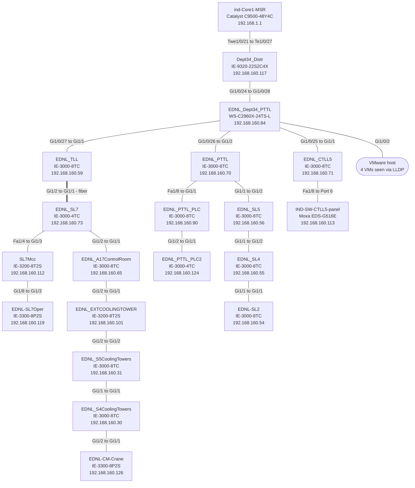
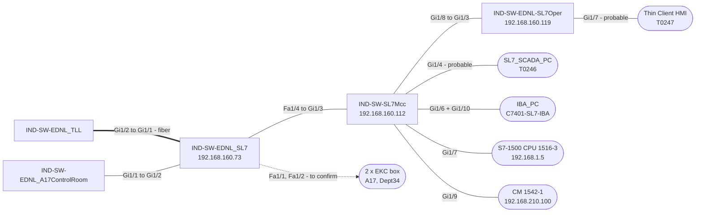

# Topology and Connections

[[00-SL7_Index|Index]] · [[01-Topology_and_Connections|Topology & connections]] · [[09-Open_Issues_and_Questions|Open issues]]

How every device connects to every other device. **Port numbers come from the live CDP/LLDP output**; cable type comes from the colours on `SL7_Network.pdf`. Where the two disagree, the live data is used and the difference is listed in the last column and in [[09-Open_Issues_and_Questions]].

## 1. The shape of the network
- The network is a **tree**. Every switch has exactly one path to the plant core; no loops or second uplinks appear in any CDP/LLDP table.
- The only connection to the core is `IND-SW-Dept34_Distr` `Te1/0/27` ↔ `ind-Core1-MSR` `Twe1/0/21`. **It is not on the diagram.**
- `IND-SW-EDNL_Dept34_PTTL` is the hub: four branches leave it (TLL / SL7, PTTL, CTLL5, VMware host).
- Depth runs from 1 hop (Dept34_Distr) to **9 hops** (CM-Crane).
- 19 links in total: 18 between the captured switches and the core, plus one to the Moxa panel behind CTLL5.

## 2. Backbone diagram
Thick line = fibre (MM). Each label reads *parent port to child port*.

## 3. Link table

| # | From (nearer core) | Port | Cable | Port | To | Verified by | Diagram check |
|---|---|---|---|---|---|---|---|
| 1 | `ind-Core1-MSR` | `Twe1/0/21` | Not on diagram | `Te1/0/27` | `IND-SW-Dept34_Distr` | One end only | Not on diagram |
| 2 | `IND-SW-Dept34_Distr` | `Gi1/0/24` | Unknown | `Gi1/0/28` | `IND-SW-EDNL_Dept34_PTTL` | CDP, both ends | **Differs** (`IND-SW-Dept34_Distr`: diagram Gi1/0/28, live Gi1/0/24) |
| 3 | `IND-SW-EDNL_Dept34_PTTL` | `Gi1/0/27` | UTP | `Gi1/1` | `IND-SW-EDNL_TLL` | CDP, both ends | Matches |
| 4 | `IND-SW-EDNL_TLL` | `Gi1/2` | Fiber (MM) | `Gi1/1` | `IND-SW-EDNL_SL7` | CDP, both ends | Matches |
| 5 | `IND-SW-EDNL_SL7` | `Fa1/4` | UTP | `Gi1/3` | `IND-SW-SL7Mcc` | CDP, both ends | **Differs** (`IND-SW-EDNL_SL7`: diagram Fa1/1, live Fa1/4) |
| 6 | `IND-SW-SL7Mcc` | `Gi1/8` | UTP | `Gi1/3` | `IND-SW-EDNL-SL7Oper` | CDP, both ends | Not on diagram |
| 7 | `IND-SW-EDNL_SL7` | `Gi1/2` | Unknown | `Gi1/1` | `IND-SW-EDNL_A17ControlRoom` | CDP, both ends | Matches |
| 8 | `IND-SW-EDNL_A17ControlRoom` | `Gi1/2` | Unknown | `Gi1/1` | `IND-SW-EDNL_EXTCOOLINGTOWER` | CDP, both ends | Matches |
| 9 | `IND-SW-EDNL_EXTCOOLINGTOWER` | `Gi1/2` | Unknown | `Gi1/2` | `IND-SW-EDNL_S5CoolingTowers` | CDP, both ends | Matches |
| 10 | `IND-SW-EDNL_S5CoolingTowers` | `Gi1/1` | Unknown | `Gi1/1` | `IND-SW-EDNL_S4CoolingTowers` | CDP, both ends | **Differs** (`IND-SW-EDNL_S4CoolingTowers`: diagram Gi1/2, live Gi1/1) |
| 11 | `IND-SW-EDNL_S4CoolingTowers` | `Gi1/2` | Unknown | `Gi1/1` | `IND-SW-EDNL-CM-Crane` | CDP, both ends | **Differs** (`IND-SW-EDNL-CM-Crane`: diagram Gi1/2, live Gi1/1; `IND-SW-EDNL_S4CoolingTowers`: diagram Gi1/1, live Gi1/2) |
| 12 | `IND-SW-EDNL_Dept34_PTTL` | `Gi1/0/26` | Unknown | `Gi1/2` | `IND-SW-EDNL_PTTL` | CDP, both ends | Matches |
| 13 | `IND-SW-EDNL_PTTL` | `Fa1/8` | Unknown | `Gi1/1` | `IND-SW-EDNL_PTTL_PLC` | CDP, both ends | **Differs** (`IND-SW-EDNL_PTTL_PLC`: diagram Gi1/2, live Gi1/1) |
| 14 | `IND-SW-EDNL_PTTL_PLC` | `Gi1/2` | Unknown | `Gi1/1` | `IND-SW-EDNL_PTTL_PLC2` | CDP, both ends | Matches |
| 15 | `IND-SW-EDNL_PTTL` | `Gi1/1` | Unknown | `Gi1/2` | `IND-SW-EDNL_SL5` | CDP, both ends | Matches |
| 16 | `IND-SW-EDNL_SL5` | `Gi1/1` | Unknown | `Gi1/2` | `IND-SW-EDNL_SL4` | CDP, both ends | Matches |
| 17 | `IND-SW-EDNL_SL4` | `Gi1/1` | Unknown | `Gi1/1` | `IND-SW-EDNL-SL2` | CDP, both ends | Matches |
| 18 | `IND-SW-EDNL_Dept34_PTTL` | `Gi1/0/25` | Unknown | `Gi1/1` | `IND-SW-EDNL_CTLL5` | CDP, both ends | **Differs** (`IND-SW-EDNL_CTLL5`: diagram Gi1/2, live Gi1/1) |
| 19 | `IND-SW-EDNL_CTLL5` | `Fa1/8` | Not on diagram | `Port 6` | `IND-SW-CTLL5-panel` | One end only | Not on diagram |

Cable: **UTP** = blue, **Fiber (MM)** = orange dashed, **Unknown** = black on the diagram.

## 4. Walk-through: how each device connects

**Core to Dept34.** `ind-Core1-MSR` (C9500) connects on `Twe1/0/21` to `IND-SW-Dept34_Distr` `Te1/0/27`. From `Gi1/0/24` the Distr switch connects down to `IND-SW-EDNL_Dept34_PTTL` `Gi1/0/28`.

**Dept34_PTTL (the hub).** Its ports go four ways: `Gi1/0/27` → TLL `Gi1/1` (UTP); `Gi1/0/26` → PTTL `Gi1/2`; `Gi1/0/25` → CTLL5 `Gi1/1`; `Gi1/0/2` → a VMware host carrying four VMs.

**TLL to SL7.** TLL `Gi1/2` is a multimode fibre run to SL7 `Gi1/1`. SL7 is the junction of the SL7 area: from it, `Fa1/4` goes to the MCC switch (UTP), and `Gi1/2` goes to the A17 control-room switch.

**SL7 MCC and operating desk.** MCC `Gi1/3` is the uplink to SL7 `Fa1/4`. MCC `Gi1/8` goes to the operating-desk switch `Gi1/3` (UTP). On MCC itself: `Gi1/4` probably the SCADA thin client, `Gi1/6` + `Gi1/10` the IBA PC (two NICs), `Gi1/7` the S7-1500 CPU, `Gi1/9` the CM 1542-1. On the operating-desk switch `Gi1/7` probably the HMI thin client.

**The cooling-tower and crane chain.** A17 `Gi1/1` ← SL7 `Gi1/2`; A17 `Gi1/2` → EXT `Gi1/1`; EXT `Gi1/2` → S5 `Gi1/2`; S5 `Gi1/1` → S4 `Gi1/1`; S4 `Gi1/2` → Crane `Gi1/1`. Crane is the last switch (9 hops).

**PTTL branch.** PTTL `Fa1/8` → PTTL_PLC `Gi1/1`, and PTTL_PLC `Gi1/2` → PTTL_PLC2 `Gi1/1`. PTTL `Gi1/1` → SL5 `Gi1/2`; SL5 `Gi1/1` → SL4 `Gi1/2`; SL4 `Gi1/1` → SL2 `Gi1/1`.

**CTLL5.** CTLL5 `Gi1/1` is the uplink; `Fa1/8` goes to port 6 of the Moxa `IND-SW-CTLL5-panel`.

## 5. End devices

| Device | What it is | IP | Switch | Port | VLAN | Confidence |
|---|---|---|---|---|---|---|
| SL7_SCADA_PC | Thin client T0246 | 192.168.193.112 | `IND-SW-SL7Mcc` | `Gi1/4` | 593 Ignition | Probable |
| IBA_PC | PC C7401-SL7-IBA | 192.168.191.42 | `IND-SW-SL7Mcc` | `Gi1/6` + `Gi1/10` | 591 SL7 / 561 CESMS | Confirmed (LLDP name) |
| Siemens S7-1500 CPU 1516-3 PN/DP | PLC | 192.168.1.5 | `IND-SW-SL7Mcc` | `Gi1/7` | 591 SL7 | Confirmed (LLDP) |
| Siemens CM 1542-1 | PLC comms module | 192.168.210.100 | `IND-SW-SL7Mcc` | `Gi1/9` | 591 SL7 | Confirmed (LLDP) |
| Thin Client HMI (T0247) | Thin client | 192.168.191.146 | `IND-SW-EDNL-SL7Oper` | `Gi1/7` | 593 Ignition | Probable |
| 2 × EKC box (A17, Dept34) | EKC boxes | — | `IND-SW-EDNL_SL7` | `Fa1/1`, `Fa1/2` | 590 / 561 | To confirm |
| VMware host (VMs IND-SL7-ENG-PLC, IND-SL7-ENG-DRI, IND-PTTLACDRV, IND-CTLL5-ENG) | VMware ESXi (per diagram) | see 06 | `IND-SW-EDNL_Dept34_PTTL` | `Gi1/0/2` | trunk | Confirmed (LLDP) |
| IND-SW-CTLL5-panel | Moxa EDS-G516E switch | 192.168.160.113 | `IND-SW-EDNL_CTLL5` | `Fa1/8` | 591 CTLL5_Network | Confirmed (LLDP) |
| 8 PLC-network devices (S7-1200 CPUs, CP 343-1 …) | Siemens PLCs | 10.0.0.x, 192.168.0.x, 192.168.2.x | `IND-SW-EDNL_SL5` | `Fa1/8` | 591 IND_SL5 | Confirmed (LLDP) |
| Unnamed MAC 503e.aa16.6734 | Unknown | — | `IND-SW-EDNL_PTTL_PLC2` | `Fa1/1` | 579 PTTL | Seen, unidentified |
| Unnamed MAC f8ed.fc52.42b1 | Unknown | — | `IND-SW-EDNL_SL4` | `Fa1/8` | 591 | Seen, unidentified |

“Probable” = inferred from the VLAN and from there being no other active port; confirm by comparing MAC addresses.

## 6. SL7 site detail

## 7. Observations

- **Three links are limited to 100 Mb/s** because one end is a FastEthernet port: SL7 `Fa1/4` ↔ MCC `Gi1/3`, PTTL `Fa1/8` ↔ PTTL_PLC `Gi1/1`, and CTLL5 `Fa1/8` ↔ the Moxa panel.
- **Long daisy chains:** A17 → EXT → S5 → S4 → Crane (5 switches) and SL5 → SL4 → SL2 (3 switches). A fault in an upstream switch cuts off everything below it.
- **8 different IOS versions** are in use across the captured switches (and the core). The oldest is PTTL_PLC at 12.2(58)SE2 (built July 2011).
