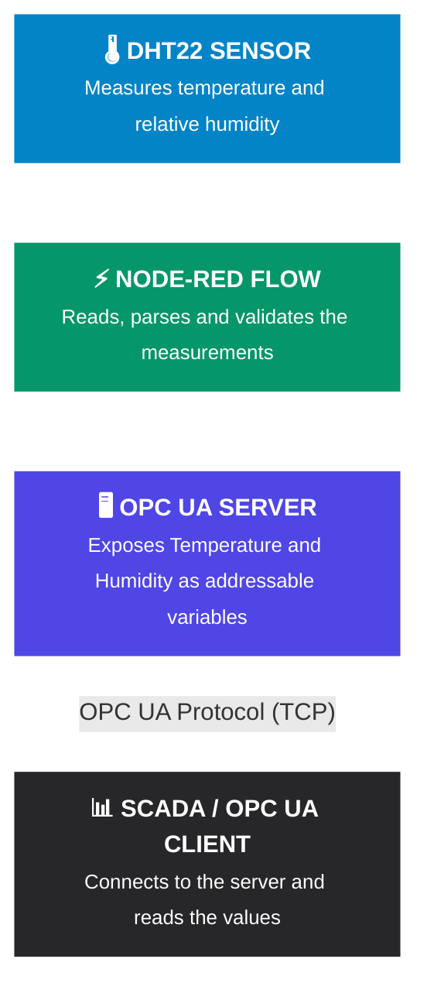
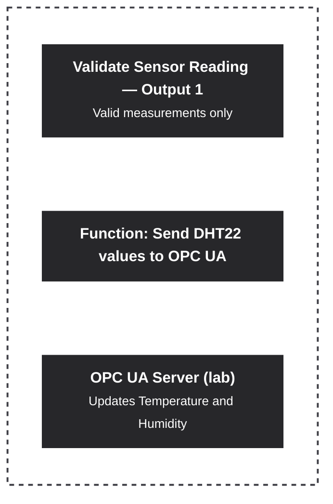
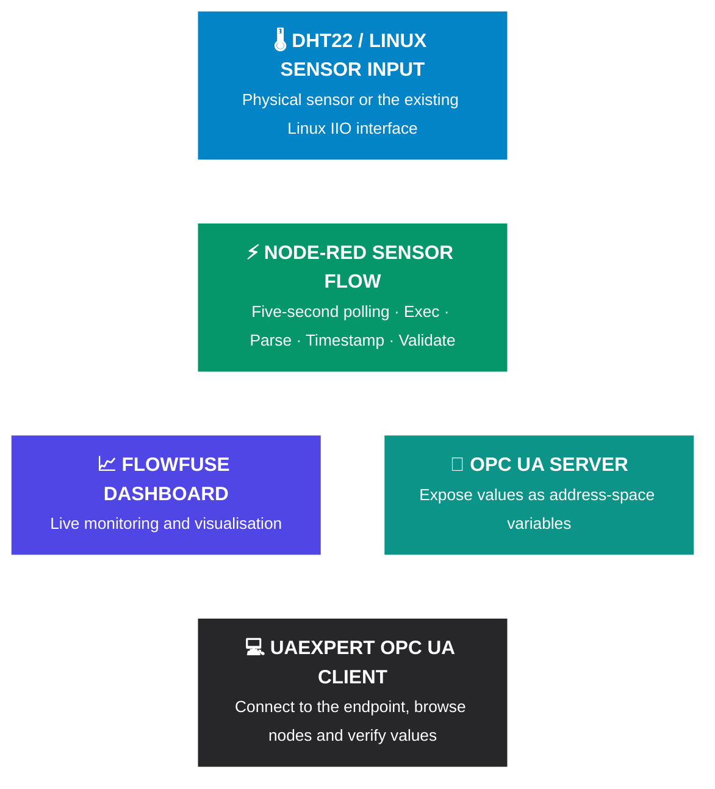
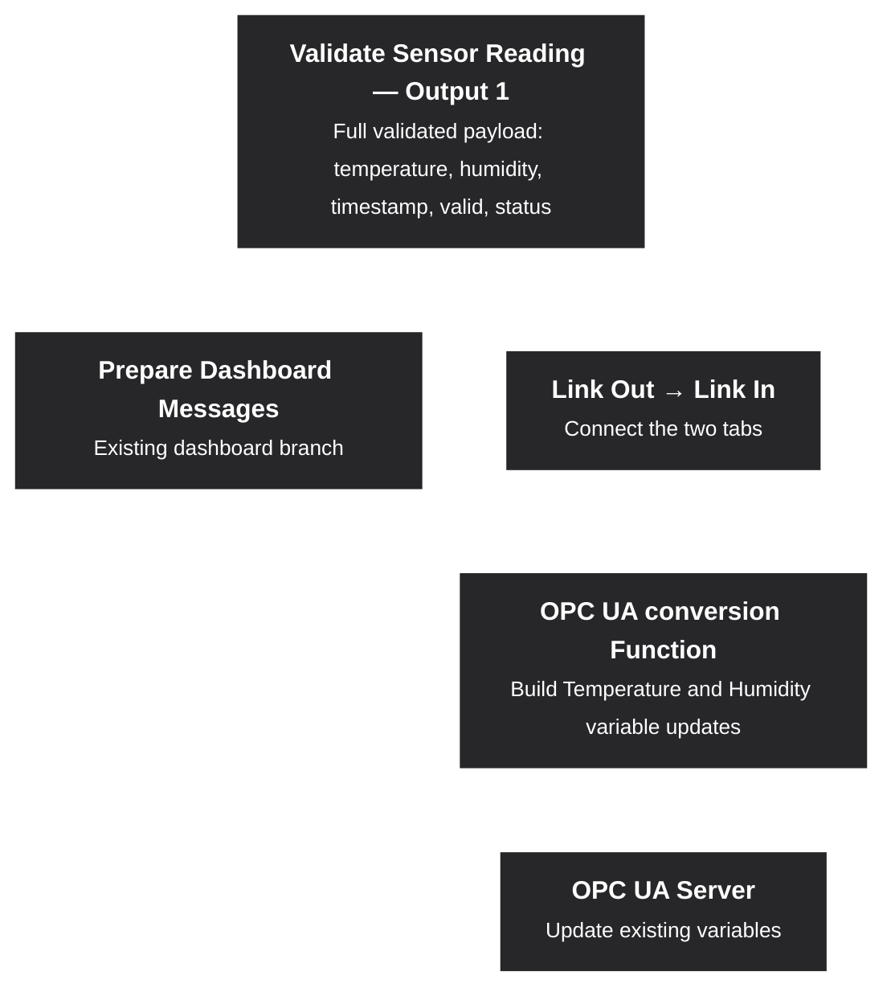
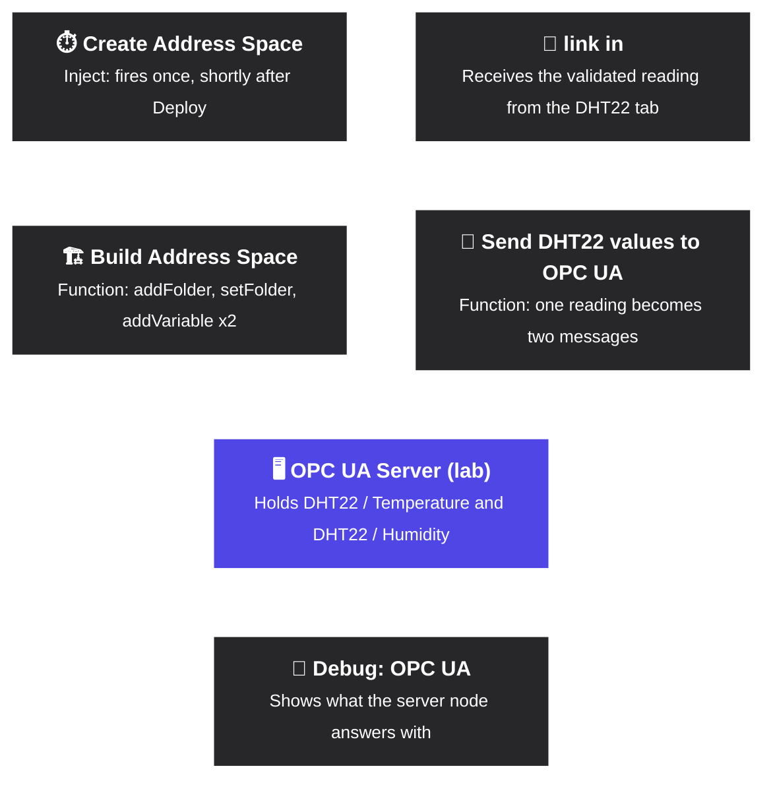
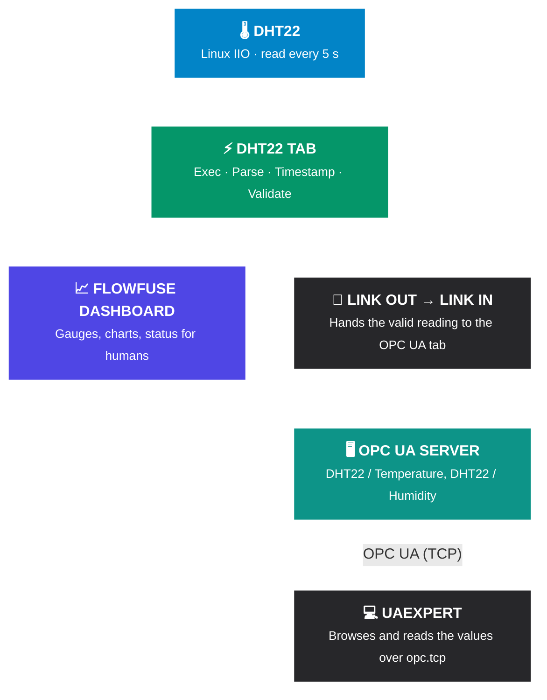

# Get an OPC UA server running

## 9.1 Understand what we're building
OPC UA provides a standard way for industrial systems and software applications to exchange structured data. However, an OPC UA server does more than simply connect a machine to an office computer. It exposes data and other information through a standard interface that an OPC UA client can discover and use. The server might run on a PLC, an industrial gateway, a computer, or—in our case—the Raspberry Pi running Node-RED.

Think of it this way: your dashboard is already displaying the readings to a human. OPC UA will make those readings available to other compatible software.

For example, an office application could request the current temperature without needing to know how your Raspberry Pi reads the sensor.

---
## 9.2 Getting everything Ready
### OPC UA Server 
To install OPC UA on **Node-RED** a node to communicate via OPC UA based on node-opcua library, you can install OPC UA nodes on **Node-RED** using either the built-in visual editor or the command-line interface.

The two most common official packages are `node-red-contrib-opcua` (for Client, Browser, and server options) and `node-red-contrib-opcua-server` (solely for hosting a programmable OPC UA server).

We gonna download it via the Node-RED Palette Manager but you could also use the command line if you're bored (`npm install node-red-contrib-opcua`).

- Open your Node-RED editor in a web browser (usually at `http://localhost:1880` on your server and `http://<YOUR-IP-ADDRESS>:1880`).
- Click the **Menu icon** (three horizontal lines) in the top-right corner.
- Select **Manage palette** from the dropdown menu.
- Click on the **Install** tab.
- In the search box, type `node-red-contrib-opcua`. 
- Find the package in the list and click the **Install** button next to it. 
- A warning window may appear regarding dependencies; click **Install** to confirm.
- Once completed, the new nodes (like `OpcUa-Client`, `OpcUa-Item`, and `OpcUa-Browser`) will appear in your left-hand palette. 

![[Pasted image 20261015155542.png|560]]  ![[Pasted image 20261015151600.png|120]]

### OPC UA Clients
Before we create any flows, we now need a OPC UA Client, here's a list I stole of commercial and open source OPC UA Clients:

| Company            | Client Name          | Platform     | Li.| ECC |  Download link                  | Last version        |
|--------------------|----------------------|--------------|----|---- |---------------------------------|---------------------|
| Unified Automation | UA Expert            | Windows/Linux| 🆓 | ❌ | http://bit.ly/UaExpert          | 2.0.2  (2026-05-19) |
| Prosys             | OPC UA Browser       | All (java)   | 🆓 | ❌ | http://bit.ly/ProsysOpcUaClient | 5.0.0  (2023-11-06) |
| Softing            | OPC UA Demo-Client   | Windows      | 🆓 | ✅ | http://bit.ly/SoftingOpcUa      | 2.50.0 (2025-10-02) |
| Free OPC UA        | OPC UA Client GUI    | All (Python) | 🆓 | ❌ | http://bit.ly/FreeOpcUA         | 0.8.4  (2022-01-31) |
| Kepware            | OPC UA Client Driver | Windows      | 💰 | ❌ | http://bit.ly/KepwareOpcUa      | ???                 |
| Node OPC UA        | OPC UA Commander     | All (JS)     | 🛠️ | ❌ | http://bit.ly/NodeOpcUaClient   | 0.39.0 (2024-08-09) |
| Matrikon           | OPC UA Explorer      | Windows/Linux| 🆓 | ❌ | http://bit.ly/Matrikon          | 2.3.2  (2024-10-07) |

ECC: Elliptic Curve Cryptography (OPC UA - 1.05)
License:
- 🆓: Free
- 💰: Commercial
- 🛠️: Open-source

 We'll be using the [UaExpert](https://www.unified-automation.com/products/development-tools/uaexpert.html) which is a full-featured, platform-independent OPC UA (Open Platform Communications Unified Architecture) reference client developed by Unified Automation. 

Go to the UaExpert website, sign up on the website, login and download the client, install it and choose dark mode and voila:

![[Pasted image 20261015152324.png]]

Donesies! Not really...

---
## 9.3 OPC UA Server Flow Setup
### Old Flow
> 😘**Don't hit me but....** 

I won't lie I absolutely used AI for the OPC UA Server flow initially (fight me), but mainly because there is no information on this particular topic or least not clear enough information, but that's not the point.

> [!note] The only useful useless info I found (I know it's kinda a oxymoron but still...)
> https://www.umh.app/insight/creating-a-node-red-flow-with-simulated-opc-ua-data
> https://flows.nodered.org/collection/gzu0bJiFfpEb
> https://flows.nodered.org/flow/a5bf4adbf30620665710544b357b7934/in/gzu0bJiFfpEb
> https://flowfuse.com/blog/2023/07/how-to-deploy-a-basic-opc-ua-server-in-node-red/
> https://www.industry40.tv/blog-post/how-to-create-an-opc-ua-server-using-node-red-for-industrial-data
> 

The main point I'm trying to convey is while doing this task, I absolutely didn't understand what I was doing and it led to a lot of headaches. The initial flow was initially as shown below, this was made by AI:



### Where the problem started...
![[Pasted image 20261007123351.png]]
As you can see in the above image, this is my **DHT22 Environment Flow (Flow 1)**, and initially, I created a separate flow for the **OPC UA Server (Flow 2)** that reads the temperature and humidity by adding a function and connecting it to the **Validate Sensor Reading**. The above sensor flow already does the hard work of obtaining and validating the readings. We didn't need to rebuild it in **Flow 2**, we just needed to take the output of that and present it to the OPCUA Server, right? Even for me (a total beginner) it made sense but this is where I should clocked the red flags.

The valid output of `Validate Sensor Reading` carries the reading object so we were gonna place a Function node after that valid output to convert the object into the message structure expected by the OPC UA server:



### New Flow
#### Import the Flow
1. Menu (top-right) then **Import**.
2. Choose **select a file to import** and pick `DHT22_Environmental_Monitor_&_OPC_UA_Server_Flow.json` (or paste its contents, it's somewhere in this folder, find it kid).
3. Choose **new flow** and click **Import**.
4. Click **Deploy**.

##### `DHT22_Environmental_Monitor_&_OPC_UA_Server_Flow.json`:
```JSON
[
    {
        "id": "3d2a14e9d3bb6454",
        "type": "tab",
        "label": "DHT22 Environmental Monitor",
        "disabled": false,
        "info": "DHT22 -> Linux IIO -> Exec -> Parse -> Timestamp -> Validate -> FlowFuse Dashboard"
    },
    {
        "id": "a8bdc3b46b6ed8db",
        "type": "inject",
        "z": "3d2a14e9d3bb6454",
        "name": "Get Reading",
        "props": [
            {
                "p": "payload"
            }
        ],
        "repeat": "5",
        "crontab": "",
        "once": true,
        "onceDelay": 0.1,
        "topic": "",
        "payload": "",
        "payloadType": "date",
        "x": 370,
        "y": 180,
        "wires": [
            [
                "ceb7e335d1f2f7c1"
            ]
        ]
    },
    {
        "id": "ceb7e335d1f2f7c1",
        "type": "exec",
        "z": "3d2a14e9d3bb6454",
        "command": "printf 'temperature='; cat /sys/bus/iio/devices/iio:device0/in_temp_input; printf 'humidity='; cat /sys/bus/iio/devices/iio:device0/in_humidityrelative_input",
        "addpay": "",
        "append": "",
        "useSpawn": "false",
        "timer": "",
        "winHide": false,
        "oldrc": false,
        "name": "Read DHT22",
        "x": 560,
        "y": 180,
        "wires": [
            [
                "8d10b8a2eee93a3d"
            ],
            [
                "96392ace05cd8ee8"
            ],
            []
        ]
    },
    {
        "id": "8d10b8a2eee93a3d",
        "type": "function",
        "z": "3d2a14e9d3bb6454",
        "name": "Parse Sensor Data",
        "func": "// Input: msg.payload is the raw text from the Exec node, e.g.\n//   temperature=25400\n//   humidity=48000\n// Output: msg.payload = { temperature: 25.4, humidity: 48 }\n// Property names are LOWERCASE on purpose: JavaScript is case-sensitive,\n// and the validation node reads payload.temperature / payload.humidity.\n\nconst lines = String(msg.payload).trim().split(\"\\n\");\n\nlet temperature;   // stays undefined if the line is missing or malformed\nlet humidity;\n\nfor (const line of lines) {\n    // Only accept exactly \"key=digits\" so half-written lines are ignored\n    const match = line.trim().match(/^(temperature|humidity)=(-?\\d+)$/);\n    if (!match) {\n        continue;\n    }\n    const key = match[1];\n    const scaled = Number(match[2]) / 1000;      // IIO uses a 1000x scale\n    const value = Math.round(scaled * 10) / 10;  // 1 decimal place\n\n    if (key === \"temperature\") {\n        temperature = value;\n    } else {\n        humidity = value;\n    }\n}\n\nmsg.payload = {\n    temperature: temperature,\n    humidity: humidity\n};\n\nreturn msg;\n",
        "outputs": 1,
        "timeout": 0,
        "noerr": 0,
        "initialize": "",
        "finalize": "",
        "libs": [],
        "x": 760,
        "y": 180,
        "wires": [
            [
                "b86179699613945c"
            ]
        ]
    },
    {
        "id": "b86179699613945c",
        "type": "function",
        "z": "3d2a14e9d3bb6454",
        "name": "Add Timestamp",
        "func": "// Stored as ISO 8601 in UTC (the trailing Z). Convert to local time only when displaying.\nmsg.payload.timestamp = new Date().toISOString();\n\nreturn msg;\n",
        "outputs": 1,
        "timeout": 0,
        "noerr": 0,
        "initialize": "",
        "finalize": "",
        "libs": [],
        "x": 960,
        "y": 180,
        "wires": [
            [
                "601c3131c55eca1a"
            ]
        ]
    },
    {
        "id": "601c3131c55eca1a",
        "type": "function",
        "z": "3d2a14e9d3bb6454",
        "name": "Validate Sensor Reading",
        "func": "// TWO OUTPUTS:\n//   Output 1 = VALID   -> dashboard + debug\n//   Output 2 = INVALID -> error status + debug\n// return [msg, null]  sends msg out of output 1 only\n// return [null, msg]  sends msg out of output 2 only\n\nconst temperature = msg.payload.temperature;\nconst humidity = msg.payload.humidity;\n\nconst errors = [];\n\n// Number.isFinite() is false for undefined, null, NaN and Infinity,\n// and typeof check rejects strings and other non-numbers.\nconst tempIsNumber = typeof temperature === \"number\" && Number.isFinite(temperature);\nconst humIsNumber = typeof humidity === \"number\" && Number.isFinite(humidity);\n\nif (!tempIsNumber) {\n    errors.push(\"Invalid temperature\");\n} else if (temperature < -40 || temperature > 80) {\n    errors.push(\"Temperature outside expected range\");\n}\n\nif (!humIsNumber) {\n    errors.push(\"Invalid humidity\");\n} else if (humidity < 0 || humidity > 100) {\n    errors.push(\"Humidity outside expected range\");\n}\n\nif (errors.length > 0) {\n    msg.payload = {\n        valid: false,\n        errors: errors,\n        reading: msg.payload\n    };\n    return [null, msg];\n}\n\nmsg.payload.valid = true;\nmsg.payload.status = \"OK\";\n\nreturn [msg, null];\n",
        "outputs": 2,
        "timeout": 0,
        "noerr": 0,
        "initialize": "",
        "finalize": "",
        "libs": [],
        "x": 1170,
        "y": 180,
        "wires": [
            [
                "611ffb1bcc77624e",
                "4648a122c8abda90",
                "1283aa4fb3204950"
            ],
            [
                "6daa988ee7ac4ce2",
                "6449b280ccc412b7"
            ]
        ]
    },
    {
        "id": "611ffb1bcc77624e",
        "type": "debug",
        "z": "3d2a14e9d3bb6454",
        "name": "Debug: VALID",
        "active": true,
        "tosidebar": true,
        "console": false,
        "tostatus": false,
        "complete": "payload",
        "targetType": "msg",
        "statusVal": "",
        "statusType": "auto",
        "x": 1500,
        "y": 120,
        "wires": []
    },
    {
        "id": "6daa988ee7ac4ce2",
        "type": "debug",
        "z": "3d2a14e9d3bb6454",
        "name": "Debug: INVALID",
        "active": true,
        "tosidebar": true,
        "console": false,
        "tostatus": false,
        "complete": "payload",
        "targetType": "msg",
        "statusVal": "",
        "statusType": "auto",
        "x": 1500,
        "y": 280,
        "wires": []
    },
    {
        "id": "96392ace05cd8ee8",
        "type": "debug",
        "z": "3d2a14e9d3bb6454",
        "name": "Debug: EXEC ERROR",
        "active": true,
        "tosidebar": true,
        "console": false,
        "tostatus": false,
        "complete": "payload",
        "targetType": "msg",
        "statusVal": "",
        "statusType": "auto",
        "x": 600,
        "y": 260,
        "wires": []
    },
    {
        "id": "4648a122c8abda90",
        "type": "function",
        "z": "3d2a14e9d3bb6454",
        "name": "Prepare Dashboard Messages",
        "func": "// Takes ONE valid reading and splits it into four clean messages,\n// one per dashboard widget. Each widget reads msg.payload.\n//   Output 1 -> temperature gauge + chart  (number)\n//   Output 2 -> humidity gauge + chart     (number)\n//   Output 3 -> status text                (string)\n//   Output 4 -> last-updated text          (string)\n// msg.topic is the series name the charts use.\n\nconst reading = msg.payload;\n\nconst updated = new Date(reading.timestamp).toLocaleString(\"en-ZA\", {\n    timeZone: \"Africa/Johannesburg\",\n    hour12: false\n});\n\nreturn [\n    { payload: reading.temperature, topic: \"Temperature\" },\n    { payload: reading.humidity, topic: \"Humidity\" },\n    { payload: reading.status },\n    { payload: updated }\n];\n",
        "outputs": 4,
        "timeout": 0,
        "noerr": 0,
        "initialize": "",
        "finalize": "",
        "libs": [],
        "x": 1530,
        "y": 180,
        "wires": [
            [
                "256b87e9ea2ab753",
                "3db946a3f209ba8f"
            ],
            [
                "a8195dabe1c7df4a",
                "4addb77c813031d3"
            ],
            [
                "30068750ee3ff089"
            ],
            [
                "b47990f87b7e9192"
            ]
        ]
    },
    {
        "id": "6449b280ccc412b7",
        "type": "function",
        "z": "3d2a14e9d3bb6454",
        "name": "Build Error Status",
        "func": "// Turns a rejected reading into a short status line for the dashboard.\n// The gauges keep their last valid value; only the status text changes.\nconst errors = msg.payload.errors || [\"Unknown error\"];\n\nreturn { payload: \"SENSOR ERROR: \" + errors.join(\"; \") };\n",
        "outputs": 1,
        "timeout": 0,
        "noerr": 0,
        "initialize": "",
        "finalize": "",
        "libs": [],
        "x": 1510,
        "y": 360,
        "wires": [
            [
                "30068750ee3ff089"
            ]
        ]
    },
    {
        "id": "256b87e9ea2ab753",
        "type": "ui-gauge",
        "z": "3d2a14e9d3bb6454",
        "name": "Temperature Gauge",
        "group": "4943608bb462ecb9",
        "order": 1,
        "width": 3,
        "height": 3,
        "gtype": "gauge-34",
        "gstyle": "needle",
        "title": "Temperature",
        "units": "°C",
        "icon": "",
        "prefix": "",
        "suffix": "",
        "segments": [
            {
                "from": "-10",
                "color": "#3b82f6"
            },
            {
                "from": "18",
                "color": "#5cd65c"
            },
            {
                "from": "28",
                "color": "#ffc800"
            },
            {
                "from": "35",
                "color": "#ea5353"
            }
        ],
        "min": -10,
        "max": 50,
        "sizeThickness": 16,
        "sizeGap": 4,
        "sizeKeyThickness": 8,
        "styleRounded": true,
        "styleGlow": false,
        "className": "",
        "x": 1820,
        "y": 80,
        "wires": [
            []
        ]
    },
    {
        "id": "a8195dabe1c7df4a",
        "type": "ui-gauge",
        "z": "3d2a14e9d3bb6454",
        "name": "Humidity Gauge",
        "group": "4943608bb462ecb9",
        "order": 2,
        "width": 3,
        "height": 3,
        "gtype": "gauge-34",
        "gstyle": "needle",
        "title": "Humidity",
        "units": "% RH",
        "icon": "",
        "prefix": "",
        "suffix": "",
        "segments": [
            {
                "from": "0",
                "color": "#ffc800"
            },
            {
                "from": "30",
                "color": "#5cd65c"
            },
            {
                "from": "70",
                "color": "#3b82f6"
            }
        ],
        "min": 0,
        "max": 100,
        "sizeThickness": 16,
        "sizeGap": 4,
        "sizeKeyThickness": 8,
        "styleRounded": true,
        "styleGlow": false,
        "className": "",
        "x": 1820,
        "y": 140,
        "wires": [
            []
        ]
    },
    {
        "id": "30068750ee3ff089",
        "type": "ui-text",
        "z": "3d2a14e9d3bb6454",
        "group": "4943608bb462ecb9",
        "order": 3,
        "width": 6,
        "height": 1,
        "name": "System Status",
        "label": "System Status",
        "format": "{{msg.payload}}",
        "layout": "row-spread",
        "style": false,
        "font": "",
        "fontSize": 16,
        "color": "#717171",
        "wrapText": false,
        "className": "",
        "value": "payload",
        "valueType": "msg",
        "x": 1820,
        "y": 200,
        "wires": []
    },
    {
        "id": "b47990f87b7e9192",
        "type": "ui-text",
        "z": "3d2a14e9d3bb6454",
        "group": "4943608bb462ecb9",
        "order": 4,
        "width": 6,
        "height": 1,
        "name": "Last Updated",
        "label": "Last Updated (SAST)",
        "format": "{{msg.payload}}",
        "layout": "row-spread",
        "style": false,
        "font": "",
        "fontSize": 16,
        "color": "#717171",
        "wrapText": false,
        "className": "",
        "value": "payload",
        "valueType": "msg",
        "x": 1820,
        "y": 260,
        "wires": []
    },
    {
        "id": "3db946a3f209ba8f",
        "type": "ui-chart",
        "z": "3d2a14e9d3bb6454",
        "group": "2d88d77ba0df47ac",
        "name": "Temperature Chart",
        "label": "Temperature (°C)",
        "order": 1,
        "chartType": "line",
        "category": "topic",
        "categoryType": "msg",
        "xAxisLabel": "",
        "xAxisProperty": "",
        "xAxisPropertyType": "timestamp",
        "xAxisType": "time",
        "xAxisFormat": "",
        "xAxisFormatType": "auto",
        "xmin": "",
        "xmax": "",
        "yAxisLabel": "",
        "yAxisProperty": "payload",
        "yAxisPropertyType": "msg",
        "ymin": "",
        "ymax": "",
        "bins": "",
        "action": "append",
        "stackSeries": false,
        "pointShape": "line",
        "pointRadius": 4,
        "showLegend": true,
        "removeOlder": "1",
        "removeOlderUnit": "3600",
        "removeOlderPoints": "",
        "colors": [
            "#ea5353",
            "#aec7e8",
            "#ff7f0e",
            "#2ca02c",
            "#98df8a",
            "#d62728",
            "#000000",
            "#000000",
            "#000000"
        ],
        "textColor": [
            "#666666"
        ],
        "textColorDefault": true,
        "gridColor": [
            "#e5e5e5"
        ],
        "gridColorDefault": true,
        "width": 6,
        "height": 4,
        "className": "",
        "interpolation": "linear",
        "x": 1820,
        "y": 320,
        "wires": [
            []
        ]
    },
    {
        "id": "4addb77c813031d3",
        "type": "ui-chart",
        "z": "3d2a14e9d3bb6454",
        "group": "2d88d77ba0df47ac",
        "name": "Humidity Chart",
        "label": "Humidity (% RH)",
        "order": 2,
        "chartType": "line",
        "category": "topic",
        "categoryType": "msg",
        "xAxisLabel": "",
        "xAxisProperty": "",
        "xAxisPropertyType": "timestamp",
        "xAxisType": "time",
        "xAxisFormat": "",
        "xAxisFormatType": "auto",
        "xmin": "",
        "xmax": "",
        "yAxisLabel": "",
        "yAxisProperty": "payload",
        "yAxisPropertyType": "msg",
        "ymin": "0",
        "ymax": "100",
        "bins": "",
        "action": "append",
        "stackSeries": false,
        "pointShape": "line",
        "pointRadius": 4,
        "showLegend": true,
        "removeOlder": "1",
        "removeOlderUnit": "3600",
        "removeOlderPoints": "",
        "colors": [
            "#3b82f6",
            "#aec7e8",
            "#ff7f0e",
            "#2ca02c",
            "#98df8a",
            "#d62728",
            "#000000",
            "#000000",
            "#000000"
        ],
        "textColor": [
            "#666666"
        ],
        "textColorDefault": true,
        "gridColor": [
            "#e5e5e5"
        ],
        "gridColorDefault": true,
        "width": 6,
        "height": 4,
        "className": "",
        "interpolation": "linear",
        "x": 1820,
        "y": 380,
        "wires": [
            []
        ]
    },
    {
        "id": "1283aa4fb3204950",
        "type": "link out",
        "z": "3d2a14e9d3bb6454",
        "name": "link out 1",
        "mode": "link",
        "links": [
            "opcua_live_sensor_linkin"
        ],
        "x": 1295,
        "y": 380,
        "wires": []
    },
    {
        "id": "4943608bb462ecb9",
        "type": "ui-group",
        "name": "Current Conditions",
        "page": "20c88269870b6d9a",
        "width": "6",
        "height": "1",
        "order": 1,
        "showTitle": true,
        "className": "",
        "visible": "true",
        "disabled": "false",
        "groupType": "default"
    },
    {
        "id": "2d88d77ba0df47ac",
        "type": "ui-group",
        "name": "History (last hour)",
        "page": "20c88269870b6d9a",
        "width": "6",
        "height": "1",
        "order": 2,
        "showTitle": true,
        "className": "",
        "visible": "true",
        "disabled": "false",
        "groupType": "default"
    },
    {
        "id": "20c88269870b6d9a",
        "type": "ui-page",
        "name": "Environment",
        "ui": "7a8920030d721e23",
        "path": "/environment",
        "icon": "home",
        "layout": "grid",
        "theme": "d5e1045f475c214c",
        "breakpoints": [
            {
                "name": "Default",
                "px": "0",
                "cols": "3"
            },
            {
                "name": "Tablet",
                "px": "576",
                "cols": "6"
            },
            {
                "name": "Small Desktop",
                "px": "768",
                "cols": "9"
            },
            {
                "name": "Desktop",
                "px": "1024",
                "cols": "12"
            }
        ],
        "tabs": [],
        "order": 1,
        "className": "",
        "visible": "true",
        "disabled": "false"
    },
    {
        "id": "7a8920030d721e23",
        "type": "ui-base",
        "name": "Environment Monitor",
        "path": "/dashboard",
        "includeClientData": true,
        "acceptsClientConfig": [
            "ui-notification",
            "ui-control"
        ],
        "showPathInSidebar": false,
        "headerContent": "page",
        "navigationStyle": "default",
        "titleBarStyle": "default",
        "showReconnectNotification": true,
        "notificationDisplayTime": 1,
        "showDisconnectNotification": true,
        "allowInstall": true
    },
    {
        "id": "d5e1045f475c214c",
        "type": "ui-theme",
        "name": "Dark Theme",
        "colors": {
            "surface": "#18191b",
            "primary": "#0d74ce",
            "bgPage": "#111113",
            "groupBg": "#212225",
            "groupOutline": "#363a3f"
        },
        "sizes": {
            "density": "default",
            "pagePadding": "12px",
            "groupGap": "12px",
            "groupBorderRadius": "4px",
            "widgetGap": "12px"
        }
    },
    {
        "id": "6ba56fd1ab2db7f2",
        "type": "global-config",
        "env": [],
        "modules": {
            "@flowfuse/node-red-dashboard": "1.33.0"
        }
    }
]
```

## 9.4 The NEW Flow, Node by Node: DHT22 Environmental Monitor
### Node-RED vocabulary used here

| Term                 | Meaning                                                                                                   |
| -------------------- | --------------------------------------------------------------------------------------------------------- |
| **Message (`msg`)**  | A JavaScript object that travels from node to node along the wires                                        |
| **`msg.payload`**    | The conventional property that carries the main data. Most nodes read and write this one                  |
| **Wire / output**    | A node can have several outputs. Each is a separate exit. Wires connect an output to the next node's input |

### The nodes
![[Pasted image 20261015144036.png]]

| #   | Node name                      | Type     | What it does                                                                        | Why it exists                                                                           |
| --- | ------------------------------ | -------- | ----------------------------------------------------------------------------------- | --------------------------------------------------------------------------------------- |
| 1   | **Get Reading**                | inject   | Fires every 5 seconds, and once right after Deploy                                  | It is the clock. The sensor does not push data; we ask for it                           |
| 2   | **Read DHT22**                 | exec     | Runs one shell command that prints both values                                      | Asks Linux for the values. No Python, no extra library                                  |
| 3   | **Parse Sensor Data**          | function | Turns text into `{ temperature, humidity }` as numbers, divided by 1000             | Text like `temperature=25400` is not usable by gauges or comparisons                    |
| 4   | **Add Timestamp**              | function | Adds `timestamp` as an ISO 8601 UTC string                                          | Every reading needs to say when it happened, for charts, logs and a future database     |
| 5   | **Validate Sensor Reading**    | function | Checks the numbers. **Two outputs**: 1 = valid, 2 = invalid                         | Stops garbage (like 150% humidity) reaching the dashboard                               |
| 6   | **Debug: VALID**               | debug    | Shows valid messages in the debug sidebar                                           | Lets you see what the dashboard is receiving                                            |
| 7   | **Debug: INVALID**             | debug    | Shows rejected readings with the reasons                                            | Lets you see what was thrown away and why                                               |
| 8   | **Debug: EXEC ERROR**          | debug    | Shows the command's error text (stderr)                                             | Shows kernel read failures like `Input/output error`                                    |
| 9   | **Prepare Dashboard Messages** | function | Splits one valid reading into 4 messages (one per widget)                           | Dashboard widgets read `msg.payload`, so each needs its own message with just its value |
| 10  | **Build Error Status**         | function | Turns a rejection into text such as `SENSOR ERROR: Humidity outside expected range` | The dashboard shows a failure instead of silently freezing                              |
| 11  | **link out 1**                 | link out | Sends a copy of every valid reading to the `link in` node on the OPC UA tab         | Lets the OPC UA tab reuse this sensor pipeline instead of reading the sensor a second time |
| 12  | **Temperature Gauge**          | ui-gauge | Shows the current temperature as a needle gauge (-10 to 50 °C, colour bands)        | At-a-glance reading for a human                                                         |
| 13  | **Humidity Gauge**             | ui-gauge | Shows the current relative humidity as a gauge                                      | At-a-glance reading for a human                                                         |
| 14  | **System Status**              | ui-text  | Shows `OK` or the `SENSOR ERROR: ...` text                                          | Failures are visible instead of the gauges silently freezing                            |
| 15  | **Last Updated**               | ui-text  | Shows the time of the last valid reading in SAST                                    | Tells you whether the data is fresh or stale                                            |
| 16  | **Temperature Chart**          | ui-chart | Line chart of temperature over the last hour                                        | Shows trends, not just the current value                                                |
| 17  | **Humidity Chart**             | ui-chart | Line chart of humidity over the last hour (fixed 0 to 100 scale)                    | Shows trends, not just the current value                                                |

---

After struggling with this entire thing for a while I decided to question what I was actually doing, the new flow takes a different approach. I decided I should combine the two flows at `Validate Sensor Reading`, not make the OPC UA flow independently read the sensor. The new problem was figuring out **how???**

**Flow 1** already does the difficult work: it reads the Linux IIO values, converts them into °C and % RH, timestamps them, and rejects invalid readings. So why not just reuse that pipeline rather than duplicate it: 


After coming to the conclusion that we can just reuse the output from **Flow 1**, it made things easier and all we had to do was link the 2 flows by using the **link in/out** nodes to connect the two tabs.



Once the connection is deployed, the sensor's five-second polling cycle should feed new values into OPC UA whenever valid readings arrive.

## 9.5 The NEW Flow, Node by Node: OPC UA Server - Live DHT22
### Node-RED vocabulary used here

| Term                      | Meaning                                                                                                                  |
| ------------------------- | ------------------------------------------------------------------------------------------------------------------------ |
| **Server**                | The program that holds the data and waits for clients to ask for it. Here: the OPC UA Server node inside Node-RED        |
| **Client**                | The program that connects to the server and reads the data. Here: UaExpert                                               |
| **Endpoint**              | The address a client connects to, e.g. `opc.tcp://<YOUR-IP-ADDRESS>:53880`                                               |
| **Address space**         | The tree of folders and variables the server exposes. A client "browses" it the way you browse folders in File Explorer  |
| **Namespace (`ns`)**      | A numbered group of names so two items with the same name can't clash. We use `ns=1`                                     |
| **NodeId**                | The unique ID of one item, e.g. `ns=1;s=Temperature` (`s` = the ID is a string)                                          |
| **Folder**                | A container in the address space. Ours is called `DHT22`                                                                 |
| **Variable**              | One readable value. Ours: `Temperature` and `Humidity`                                                                   |
| **Datatype**              | What kind of value a variable holds. `Double` = a decimal number such as `25.4`                                          |
| **`opcuaCommand`**        | A special instruction inside `msg.payload` that tells the server node to *build* something (`addFolder`, `addVariable`) instead of storing a value |

### The big picture
Two jobs happen in this flow, and they happen at different times:

1. **Setup (once per Deploy):** build the empty shelves, a `DHT22` folder with a `Temperature` and a `Humidity` variable.
2. **Updates (every 5 seconds):** put the newest valid reading onto those shelves.



### The nodes
![[Pasted image 20261015160629.png]]

| #   | Node name                       | Type         | What it does                                                                                               | Why it exists                                                                                           |
| --- | ------------------------------- | ------------ | ---------------------------------------------------------------------------------------------------------- | ------------------------------------------------------------------------------------------------------- |
| 1   | **link in 1**                   | link in      | Receives the valid reading sent by `link out 1` on the DHT22 tab                                           | This is the bridge between the two tabs. Its ID matches the link out, so the wire is invisible but real |
| 2   | **Send DHT22 values to OPC UA** | function     | Turns one reading into two messages: one for `Temperature`, one for `Humidity`                             | The server wants one message per variable: `msg.topic` = which variable, `msg.payload` = the value      |
| 3   | **Create Address Space**        | inject       | Fires once, a couple of seconds after Deploy                                                               | The server starts empty. Something has to ask it to build the folder and variables                      |
| 4   | **Build Address Space**         | function     | Sends 4 commands in order: `addFolder`, `setFolder`, `addVariable` (Temperature), `addVariable` (Humidity) | Variables must exist before you can write to them                                                       |
| 5   | **OPC UA Server (lab)**         | OpcUa-Server | Runs the actual OPC UA server, builds what it is told to, stores the values, answers clients               | This is the whole point of the task                                                                     |
| 6   | **Debug: OPC UA**               | debug        | Shows the server node's output in the debug sidebar                                                        | Lets you see whether commands and values were accepted                                                  |

> ⚠️ **Check against your screenshot:** node names, count and IDs above are written from how the flow is described in this document. If your Flow 2 has extra or differently named nodes, edit the table to match what's on your canvas.

### Node 2: Send DHT22 values to OPC UA
Input is the valid reading from the DHT22 tab: `{ temperature, humidity, timestamp, valid, status }`.

```javascript
// Takes ONE valid reading and turns it into TWO messages for the OPC UA server.
//   msg.topic   = the NodeId of the variable to update
//   msg.payload = the new value (a plain number)
// Wrapping the two messages in [[ ... ]] sends both out of output 1.

const reading = msg.payload;

return [[
    { topic: "ns=1;s=Temperature", payload: reading.temperature },
    { topic: "ns=1;s=Humidity",    payload: reading.humidity }
]];
```

Only the valid output of `Validate Sensor Reading` reaches this node, so the OPC UA variables never receive garbage. If a reading is rejected, they simply keep their last good value.

### Node 4: Build Address Space
Order matters here: folder first, then tell the server to put the next things *inside* that folder, then the variables.

```javascript
// Runs once after Deploy. Sends four commands to the OPC UA server node.
// opcuaCommand in msg.payload = "build something", not "store a value".
//   addFolder   -> creates the DHT22 folder
//   setFolder   -> makes DHT22 the parent for what comes next
//   addVariable -> creates a variable; datatype=Double means decimal number

return [[
    { topic: "ns=1;s=DHT22",                       payload: { opcuaCommand: "addFolder" } },
    { topic: "ns=1;s=DHT22",                       payload: { opcuaCommand: "setFolder" } },
    { topic: "ns=1;s=Temperature;datatype=Double", payload: { opcuaCommand: "addVariable" } },
    { topic: "ns=1;s=Humidity;datatype=Double",    payload: { opcuaCommand: "addVariable" } }
]];
```

**Why this runs on every Deploy:** each time you click Deploy, Node-RED restarts the OPC UA server and its address space is wiped. The inject node has *Inject once after Deploy* ticked, so the shelves get rebuilt automatically. Without it the server comes back empty and your values have nowhere to go.

### Node 5: OPC UA Server (lab) settings
Open the node and check these. For this lab we keep security off so we can focus on getting data flowing:

| Setting                     | Value                                   | Note                                                              |
| --------------------------- | --------------------------------------- | ----------------------------------------------------------------- |
| **Port**                    | `53880` (default) or your own           | Write it down, you need it for the endpoint URL in UaExpert       |
| **Allow anonymous**         | ✅ ticked                                | Lets UaExpert connect without a username                          |
| **Security: None endpoint** | ✅ ticked                                | Lets UaExpert connect with Security Mode `None`                   |
| **Everything else**         | Default                                 |                                                                   |

> 🔒 **Lab only.** Anonymous access with no encryption is fine on a bench Raspberry Pi. On a real plant network you would use usernames and `SignAndEncrypt`. Never leave a setup like this reachable from an office or production network.

---

## 9.6 Connect UaExpert to your server
### Find the endpoint URL
It is built from three parts:

```
opc.tcp://<YOUR-IP-ADDRESS>:<PORT>
```

Example: `opc.tcp://192.168.1.50:53880`. Use the Raspberry Pi's IP address and the port from the server node. `localhost` only works if UaExpert runs on the Pi itself.

### Connect
1. Open **UaExpert**.
2. Click **Server** in the top menu, then **Add...** (or click the **+** icon in the toolbar).
3. Double-click **<Double click to Add Server...> ** under **Custom Discovery**.
4. Paste your endpoint URL into the **Endpoint Url** box.
5. Open the **Authentication Settings** tab and make sure **Anonymous** is selected.
6. Click **OK**.
7. Under **Project** on the left, right-click the new server and choose **Connect** (or select it and press the plug icon).
8. If a **certificate** window appears, choose **Trust Server Certificate** (or Continue), then **Connect**.

When it works, the server name in the project tree turns solid and the **Address Space** window fills with items.

![[Pasted image 20261016084819.png]]

### Find your values
1. In **Address Space**, expand **Root → Objects**.
2. Open the **DHT22** folder.
3. Drag **Temperature** and **Humidity** into the **Data Access View** in the middle.
4. Watch the **Value** column.

The values should change roughly every 5 seconds, which is the inject interval on the DHT22 tab.

![[Pasted image 20261015161044.png]]
![[Pasted image 20261015161417.png]]

---

## 9.7 Troubleshooting

| Symptom                                           | Likely cause                                                                         | Fix                                                                                                    |
| ------------------------------------------------- | ------------------------------------------------------------------------------------ | ------------------------------------------------------------------------------------------------------ |
| UaExpert can't connect / times out                | Wrong IP or port, flow not deployed, or a firewall in the way                        | Re-check the port in the server node, confirm Deploy, then try `opc.tcp://<IP>:<PORT>` again           |
| Certificate error (`BadCertificateUntrusted`)     | UaExpert or the server doesn't trust the other's certificate yet                     | Choose **Trust Server Certificate** in UaExpert. In the server node, tick *auto accept unknown certificate* if needed |
| Connected, but the `DHT22` folder is missing      | Address space was never built, or Deploy wiped it and the setup inject didn't fire   | Make sure **Create Address Space** has *Inject once after Deploy* ticked, then Deploy again            |
| Variables exist but never change                  | `link out` / `link in` not connected, or no valid readings arriving                  | Check **Debug: VALID** on the DHT22 tab, then check both link nodes target each other                  |
| Variables exist but show `Bad` / empty            | Value sent before the variable existed, or wrong NodeId                              | Make sure NodeIds are identical in both function nodes: `ns=1;s=Temperature` and `ns=1;s=Humidity`    |
| Everything vanished after a Deploy                | Deploy restarts the OPC UA server and clears its address space                       | Reconnect UaExpert. The setup inject rebuilds the folder and variables on its own                      |
| `BadNodeIdUnknown` in UaExpert                    | Namespace or name mismatch                                                           | Compare the NodeId in UaExpert (right-click → Attributes) with the one in your function nodes          |

---

## 9.9 Recap


### Lessons from the headaches
- Only one flow talks to the sensor. The dashboard and the OPC UA server both consume its validated output. Two flows reading the same hardware means two places to break. 
- Because bad readings are rejected before the link out, nothing downstream needs its own checks.
- If you can't say what a node does, stop and find out before wiring on top of it. That's what turned the AI-made flow into a mess.
