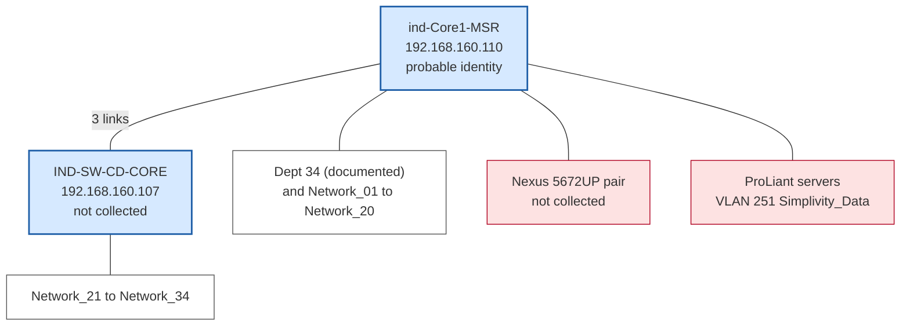

# Network overview

[[00-management_networks_index|Index]] · [[02-network_boundary_method|Method]] · [[03-open_questions_and_verification|Open questions]]

How the 34 provisional networks, Department 34 and the 11 unplaced switches connect to the shared core layer.

## 1. The core layer

- **`ind-Core1-MSR`** (probably the stacked C9500 at 192.168.160.110): 21 networks including Dept 34, plus two Nexus 5672UP switches and several servers.
- **`IND-SW-CD-CORE`** (192.168.160.107, C9500-48Y4C, collection failed): 14 networks.
- The two cores are joined by three links. **No network is attached to both cores.**
- Neither core is part of any network. Every connection to a core is recorded as an upstream boundary.

Per-network detail is in each network folder. The two core-side diagrams with every network on them are in `Core_Infrastructure/01-topology_and_connections.md`.

## 2. Proposed network-boundary and clustering table

Confidence: **15 High**, **17 Medium**, **2 Low** (Dept 34 is documented separately). The criteria are in [[02-network_boundary_method]].

| Network                                                                                                        | Distribution switch                            | Downstream switches                                                                                                                                                                     | Upstream boundary                                                                                             | Confidence        |
| -------------------------------------------------------------------------------------------------------------- | ---------------------------------------------- | --------------------------------------------------------------------------------------------------------------------------------------------------------------------------------------- | ------------------------------------------------------------------------------------------------------------- | ----------------- |
| Dept 34 (documented)                                                                                           | IND-SW-Dept34_Distr                            | 17 more: Dept34_PTTL, TLL, SL7, SL7Mcc, SL7Oper, A17, cooling towers, Crane, PTTL, CTLL5, PLC, PLC2, SL5, SL4, SL2                                                                      | ind-Core1-MSR `Twe1/0/21` to `Te1/0/27` (both ends)                                                           | High (documented) |
| [Network_01_EDNL_S6MCCRoom_Provisional](Network_01_EDNL_S6MCCRoom_Provisional/00-index.md)                     | EDNL_S6MCCRoom                                 | EDNL_AnnealingFurnace, EDNL_CompHouse2&3_2ndSW, EDNL_CompHouse2and3, EDNL_CompHouse4, EDNL_SL6MCCRoom, EDNL_SubStationE, EDNL_SubStationH, EDNL_SubStationK, Unclassified-192.168.160.4 | ind-Core1-MSR `Twe2/0/5` to `Gi1/1`                                                                           | High              |
| [Network_02_CCL2_CompRoom_Provisional](Network_02_CCL2_CompRoom_Provisional/00-index.md)                       | CCL2_CompRoom, CCL2_OS1                        | CCL_CESS, EDNL_CCLCNGGAS, EDNL_CCLServiceTunnel, EDNL_WaterTowerSUB, CCL2Coater_Bottom, CCL2_DC_L                                                                                       | ind-Core1-MSR `Twe2/0/10` to `Gi1/0/49`; ind-Core1-MSR `Twe2/0/12` to `Gi1/0/25`                              | Medium            |
| [Network_03_CCL1DevRoom_Provisional](Network_03_CCL1DevRoom_Provisional/00-index.md)                           | CCL1DevRoom                                    | CCL1PLCC, CCL1_PLC_B, CCL1OS4, CCL1OS5, CCL1OS6, CCL1OS9                                                                                                                                | ind-Core1-MSR `Twe2/0/14` to `Gi1/0/27`                                                                       | Medium            |
| [Network_04_EDNL_ElectrciansWorkShop_Provisional](Network_04_EDNL_ElectrciansWorkShop_Provisional/00-index.md) | EDNL_ElectrciansWorkShop                       | EDNL_SubStationD, EDNL_SubStationG, EDNL_SubStationM, EDNL_SubStationN, Unclassified-192.168.160.116                                                                                    | ind-Core1-MSR `Twe1/0/10` to `Gi1/2`                                                                          | High              |
| [Network_05_EDNL_S4SMCCRoomBottom_Provisional](Network_05_EDNL_S4SMCCRoomBottom_Provisional/00-index.md)       | EDNL_S4SMCCRoomBottom                          | CD_MainServerRoom, EDNL_S4GaugeCab, EDNL_S4PulPit                                                                                                                                       | ind-Core1-MSR `Twe2/0/3` to `Gi1/0/25`                                                                        | Medium            |
| [Network_06_EDNL_FoilColingTowers_Provisional](Network_06_EDNL_FoilColingTowers_Provisional/00-index.md)       | EDNL_FoilColingTowers                          | EDNL_SubStationJ                                                                                                                                                                        | ind-Core1-MSR `Twe1/0/2` to `Gi1/2`                                                                           | High              |
| [Network_07_EDNL_MainServerRoom_Provisional](Network_07_EDNL_MainServerRoom_Provisional/00-index.md)           | EDNL_MainServerRoom, ENDL-INDServerRoom_Bottom | none seen                                                                                                                                                                               | ind-Core1-MSR `Twe1/0/9` to `Gi1/0/28`; ind-Core1-MSR `Twe2/0/8` to `Gi1/0/28`                                | Medium            |
| [Network_08_EDNL_SubStation1_Provisional](Network_08_EDNL_SubStation1_Provisional/00-index.md)                 | EDNL_SubStation1                               | EDNL-Dept34SubStation                                                                                                                                                                   | ind-Core1-MSR `Twe1/0/4` to `Gi1/1`                                                                           | High              |
| [Network_09_EDNL_SubStationA_Provisional](Network_09_EDNL_SubStationA_Provisional/00-index.md)                 | EDNL_SubStationA                               | EDNL_SubStationB                                                                                                                                                                        | ind-Core1-MSR `Twe2/0/1` to `Gi1/1`                                                                           | High              |
| [Network_10_ENDL_SUBNMcc_Provisional](Network_10_ENDL_SUBNMcc_Provisional/00-index.md)                         | ENDL_SUBNMcc                                   | EDNL_FoilAnnealingSubN                                                                                                                                                                  | ind-Core1-MSR `Twe1/0/3` to `Gi1/2`                                                                           | Medium            |
| [Network_11_EDNL_AdminMCC_Provisional](Network_11_EDNL_AdminMCC_Provisional/00-index.md)                       | EDNL_AdminMCC                                  | none seen                                                                                                                                                                               | ind-Core1-MSR `Twe1/0/1` to `Gi1/1`                                                                           | High              |
| [Network_12_EDNL_EffluentPlant_Provisional](Network_12_EDNL_EffluentPlant_Provisional/00-index.md)             | EDNL_EffluentPlant                             | none seen                                                                                                                                                                               | ind-Core1-MSR `Twe1/0/6` to `Gi1/1`                                                                           | High              |
| [Network_13_EDNL_GeneratorSub_Provisional](Network_13_EDNL_GeneratorSub_Provisional/00-index.md)               | EDNL_GeneratorSub                              | none seen                                                                                                                                                                               | ind-Core1-MSR `Twe1/0/5` to `Gi1/2`                                                                           | High              |
| [Network_14_FS14MCC_Provisional](Network_14_FS14MCC_Provisional/00-index.md)                                   | FS14MCC                                        | none seen                                                                                                                                                                               | ind-Core1-MSR `Twe2/0/2` to `Te1/1/1`                                                                         | High              |
| [Network_15_FS15MCC_Provisional](Network_15_FS15MCC_Provisional/00-index.md)                                   | FS15MCC                                        | none seen                                                                                                                                                                               | ind-Core1-MSR `Twe2/0/6` to `Gi1/0/25`                                                                        | High              |
| [Network_16_U160-105_Provisional](Network_16_U160-105_Provisional/00-index.md)                                 | Unclassified-192.168.160.105                   | none seen                                                                                                                                                                               | ind-Core1-MSR `Twe1/0/7` to `Gi0/11`                                                                          | High              |
| [Network_17_U160-115_Provisional](Network_17_U160-115_Provisional/00-index.md)                                 | Unclassified-192.168.160.115                   | none seen                                                                                                                                                                               | ind-Core1-MSR `Twe1/0/8` to `Gi0/2`                                                                           | High              |
| [Network_18_U160-121_Provisional](Network_18_U160-121_Provisional/00-index.md)                                 | Unclassified-192.168.160.121                   | none seen                                                                                                                                                                               | ind-Core1-MSR `Twe1/0/27` to `Gi1/1`                                                                          | High              |
| [Network_19_U160-122_Provisional](Network_19_U160-122_Provisional/00-index.md)                                 | Unclassified-192.168.160.122                   | none seen                                                                                                                                                                               | ind-Core1-MSR `Twe2/0/13` to `Gi1/1/1`                                                                        | High              |
| [Network_20_U160-127_Provisional](Network_20_U160-127_Provisional/00-index.md)                                 | Unclassified-192.168.160.127                   | none seen                                                                                                                                                                               | ind-Core1-MSR `Twe1/0/11` to `Gi1/0/25`                                                                       | High              |
| [Network_21_CD-Effluent_6A_Provisional](Network_21_CD-Effluent_6A_Provisional/00-index.md)                     | CD-Effluent_6A, CD_CoolingTower                | CD-BulkWaterTank, CD-Effluent, CD-Effluent_6A_Control, CD-Sub6A, CD_Sub5MCC, CD_WaterTowerMCC                                                                                           | IND-SW-CD-CORE `Twe2/0/21` to `Gi1/2` (one end only); IND-SW-CD-CORE `Twe2/0/37` to `Gi1/2` (one end only)    | Low               |
| [Network_22_CD-PP_CTLSsub_Provisional](Network_22_CD-PP_CTLSsub_Provisional/00-index.md)                       | CD-PP_CTLSsub                                  | CD-PP_Compressor, CD-PP_FurnaceMCC, CD-PP_HSHTFsub                                                                                                                                      | IND-SW-CD-CORE `Twe2/0/20` to `Gi1/1` (one end only)                                                          | Medium            |
| [Network_23_CD_A19_Provisional](Network_23_CD_A19_Provisional/00-index.md)                                     | CD_A19, CD_SubStation4                         | CDRF_ScalperPiller42, CD_SubStation1                                                                                                                                                    | IND-SW-CD-CORE `Twe2/0/14` to `Gi1/0/27` (one end only); IND-SW-CD-CORE `Twe2/0/31` to `Gi1/1` (one end only) | Low               |
| [Network_24_CD_HFM_Provisional](Network_24_CD_HFM_Provisional/00-index.md)                                     | CD_HFM                                         | CD-Sub3A                                                                                                                                                                                | IND-SW-CD-CORE `Twe2/0/17` to `Gi1/1` (one end only)                                                          | Medium            |
| [Network_25_CD_HRM_Provisional](Network_25_CD_HRM_Provisional/00-index.md)                                     | CD_HRM                                         | Unclassified-192.168.160.114                                                                                                                                                            | IND-SW-CD-CORE `Twe2/0/19` to `Gi1/1` (one end only)                                                          | Medium            |
| [Network_26_U160-123_Provisional](Network_26_U160-123_Provisional/00-index.md)                                 | Unclassified-192.168.160.123                   | CD_TRCMCC                                                                                                                                                                               | IND-SW-CD-CORE `Twe2/0/7` to `Te1/1` (one end only)                                                           | Medium            |
| [Network_27_CD-PP_PF4_Provisional](Network_27_CD-PP_PF4_Provisional/00-index.md)                               | CD-PP_PF4                                      | none seen                                                                                                                                                                               | IND-SW-CD-CORE `Twe2/0/18` to `Gi1/1` (one end only)                                                          | Medium            |
| [Network_28_CDHL_CoolingTowers_Provisional](Network_28_CDHL_CoolingTowers_Provisional/00-index.md)             | CDHL_CoolingTowers                             | none seen                                                                                                                                                                               | IND-SW-CD-CORE `Twe2/0/35` to `Gi1/1` (one end only)                                                          | Medium            |
| [Network_29_CD_CompHouse5_Provisional](Network_29_CD_CompHouse5_Provisional/00-index.md)                       | CD_CompHouse5                                  | none seen                                                                                                                                                                               | IND-SW-CD-CORE `Twe2/0/29` to `Gi1/0/25` (one end only)                                                       | Medium            |
| [Network_30_CD_SubStation2_Provisional](Network_30_CD_SubStation2_Provisional/00-index.md)                     | CD_SubStation2                                 | none seen                                                                                                                                                                               | IND-SW-CD-CORE `Twe2/0/15` to `Gi1/1` (one end only)                                                          | Medium            |
| [Network_31_CD_UBC_Provisional](Network_31_CD_UBC_Provisional/00-index.md)                                     | CD_UBC                                         | none seen                                                                                                                                                                               | IND-SW-CD-CORE `Twe2/0/41` to `Gi1/1` (one end only)                                                          | Medium            |
| [Network_32_U160-106_Provisional](Network_32_U160-106_Provisional/00-index.md)                                 | Unclassified-192.168.160.106                   | none seen                                                                                                                                                                               | IND-SW-CD-CORE `Twe2/0/13` to `Gi1/1` (one end only)                                                          | Medium            |
| [Network_33_U160-120_Provisional](Network_33_U160-120_Provisional/00-index.md)                                 | Unclassified-192.168.160.120                   | none seen                                                                                                                                                                               | IND-SW-CD-CORE `Twe2/0/9` to `Gi1/0/25` (one end only)                                                        | Medium            |
| [Network_34_U160-128_Provisional](Network_34_U160-128_Provisional/00-index.md)                                 | Unclassified-192.168.160.128                   | none seen                                                                                                                                                                               | IND-SW-CD-CORE `Twe2/0/27` to `Gi1/1` (one end only)                                                          | Medium            |
| Unplaced (11)                                                                                                  | -                                              | -                                                                                                                                                                                       | no neighbour data                                                                                             | not applicable    |
| Core: ind-Core1-MSR / IND-SW-CD-CORE                                                                           | -                                              | -                                                                                                                                                                                       | boundary itself: not part of any network                                                                      | -                 |

## 3. Why each group is separate

- Each network is a distribution head (a switch cabled directly to a core) plus everything reachable from it **without passing through the core**.
- A switch is **not** placed in a network just because it is reachable through another switch. Reachability through the core is exactly what the boundary cuts.
- Removing the two cores from the link graph produces these groups and nothing else, and the same rule reproduces Department 34 exactly (18 switches, headed by `IND-SW-Dept34_Distr`).
- Where two heads sit in the same group (Network_02, 07, 21, 23) they are cabled to each other below the core, which is evidence for one network with two uplinks, but it could also be two networks bridged laterally. Those are marked Medium or Low and listed as questions.

## 4. Provisional names

Folder names use the head switch hostname, which is a fact from the data. They do **not** say which department or area the network serves. Rename the folder when that is confirmed.
