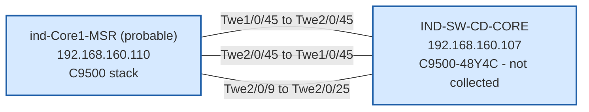
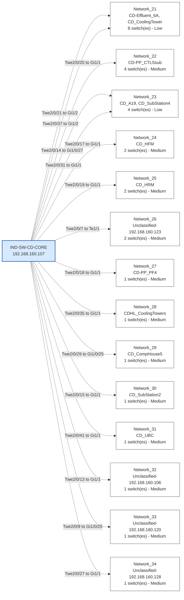

# Core infrastructure: topology

[Core infrastructure](00-index.md) · [[01-network_overview|Network overview]]

The two core devices and the networks that hang off each. Each network is one box; open its folder for the detail. Diagram key: solid line = link reported from **both** ends; dotted arrow = reported from **one** end only. Dashed box = upstream boundary (not part of this network). Label = port on the upper device, then port on the lower device.

## 1. The core pair



## 2. Networks on ind-Core1-MSR

```mermaid
flowchart LR
    N_Unclassified_192_168_160_110["ind-Core1-MSR<br/>IP: 192.168.160.110<br/>Type: Core Switch (IOS-XE 25G)"]:::head
    Network_01["Network_01<br/>EDNL_S6MCCRoom<br/>IP: 192.168.160.61<br/>Type: IE-3000-8TC<br/>10 switch(es) - High"]:::access
    Network_02["Network_02<br/>IND-SW_CCL2_CompRoom (192.168.160.22, WS-C2960X-48TS-L)<br/>IND-SW_CCL2_OS1 (192.168.160.21, WS-C2960X-24TS-L)<br/>8 switch(es) - Medium"]:::access
    Network_03["Network_03<br/>CCL1DevRoom<br/>IP: 192.168.160.12<br/>Type: WS-C2960X-24TS-L<br/>7 switch(es) - Medium"]:::access
    Network_04["Network_04<br/>EDNL_ElectrciansWorkShop<br/>IP: 192.168.160.27<br/>Type: IE-3000-8TC<br/>6 switch(es) - High"]:::access
    Network_05["Network_05<br/>EDNL_S4SMCCRoomBottom<br/>IP: 192.168.160.29<br/>Type: WS-C2960X-24TS-L<br/>4 switch(es) - Medium"]:::access
    Network_06["Network_06<br/>EDNL_FoilColingTowers<br/>IP: 192.168.160.37<br/>Type: IE-3000-8TC<br/>2 switch(es) - High"]:::access
    Network_07["Network_07<br/>EDNL_MainServerRoom (192.168.160.26, WS-C2960X-24TS-L)<br/>ENDL-INDServerRoom_ (192.168.1.61, WS-C2960X-24PS-L)<br/>2 switch(es) - Medium"]:::access
    Network_08["Network_08<br/>EDNL_SubStation1<br/>IP: 192.168.160.35<br/>Type: IE-3000-8TC<br/>2 switch(es) - High"]:::access
    Network_09["Network_09<br/>EDNL_SubStationA<br/>IP: 192.168.160.39<br/>Type: IE-3000-8TC<br/>2 switch(es) - High"]:::access
    Network_10["Network_10<br/>ENDL_SUBNMcc<br/>IP: 192.168.160.102<br/>Type: IE-3000-8TC<br/>2 switch(es) - Medium"]:::access
    Network_11["Network_11<br/>EDNL_AdminMCC<br/>IP: 192.168.160.77<br/>Type: IE-3000-4TC<br/>1 switch(es) - High"]:::access
    Network_12["Network_12<br/>EDNL_EffluentPlant<br/>IP: 192.168.160.91<br/>Type: IE-3000-8TC<br/>1 switch(es) - High"]:::access
    Network_13["Network_13<br/>EDNL_GeneratorSub<br/>IP: 192.168.160.28<br/>Type: IE-3000-8TC<br/>1 switch(es) - High"]:::access
    Network_14["Network_14<br/>IND-SW_FS14MCC<br/>IP: 192.168.160.9<br/>Type: C9200L-24P-4X<br/>1 switch(es) - High"]:::access
    Network_15["Network_15<br/>IND-SW_FS15MCC<br/>IP: 192.168.160.8<br/>Type: WS-C2960X-24TS-L<br/>1 switch(es) - High"]:::access
    Network_16["Network_16<br/>IND-SW-EDNL-FM_CMPM<br/>IP: 192.168.160.105<br/>Type: WS-C2960CX-8PC-L<br/>1 switch(es) - High"]:::access
    Network_17["Network_17<br/>IND-SW-Creche<br/>IP: 192.168.160.115<br/>Type: WS-C2960C-8TC-L<br/>1 switch(es) - High"]:::access
    Network_18["Network_18<br/>IND-SW-EDNL-Lab<br/>IP: 192.168.160.121<br/>Type: IE-3300-8P2S<br/>1 switch(es) - High"]:::access
    Network_19["Network_19<br/>IND-SW-S6 (label: .122)<br/>CDP IP: 192.168.126.12<br/>Type: C9200L-24P-4G<br/>1 switch(es) - High"]:::access
    Network_20["Network_20<br/>IND-SW-EDNL-Lab1<br/>IP: 192.168.160.127<br/>Type: WS-C2960X-24TS-L<br/>1 switch(es) - High"]:::access
    N_Unclassified_192_168_160_110 ---|"Twe2/0/5 to Gi1/1"| Network_01
    N_Unclassified_192_168_160_110 ---|"Twe2/0/10 to Gi1/0/49"| Network_02
    N_Unclassified_192_168_160_110 ---|"Twe2/0/12 to Gi1/0/25"| Network_02
    N_Unclassified_192_168_160_110 ---|"Twe2/0/14 to Gi1/0/27"| Network_03
    N_Unclassified_192_168_160_110 ---|"Twe1/0/10 to Gi1/2"| Network_04
    N_Unclassified_192_168_160_110 ---|"Twe2/0/3 to Gi1/0/25"| Network_05
    N_Unclassified_192_168_160_110 ---|"Twe1/0/2 to Gi1/2"| Network_06
    N_Unclassified_192_168_160_110 ---|"Twe1/0/9 to Gi1/0/28"| Network_07
    N_Unclassified_192_168_160_110 ---|"Twe2/0/8 to Gi1/0/28"| Network_07
    N_Unclassified_192_168_160_110 ---|"Twe1/0/4 to Gi1/1"| Network_08
    N_Unclassified_192_168_160_110 ---|"Twe2/0/1 to Gi1/1"| Network_09
    N_Unclassified_192_168_160_110 ---|"Twe1/0/3 to Gi1/2"| Network_10
    N_Unclassified_192_168_160_110 ---|"Twe1/0/1 to Gi1/1"| Network_11
    N_Unclassified_192_168_160_110 ---|"Twe1/0/6 to Gi1/1"| Network_12
    N_Unclassified_192_168_160_110 ---|"Twe1/0/5 to Gi1/2"| Network_13
    N_Unclassified_192_168_160_110 ---|"Twe2/0/2 to Te1/1/1"| Network_14
    N_Unclassified_192_168_160_110 ---|"Twe2/0/6 to Gi1/0/25"| Network_15
    N_Unclassified_192_168_160_110 ---|"Twe1/0/7 to Gi0/11"| Network_16
    N_Unclassified_192_168_160_110 ---|"Twe1/0/8 to Gi0/2"| Network_17
    N_Unclassified_192_168_160_110 ---|"Twe1/0/27 to Gi1/1"| Network_18
    N_Unclassified_192_168_160_110 ---|"Twe2/0/13 to Gi1/1/1"| Network_19
    N_Unclassified_192_168_160_110 ---|"Twe1/0/11 to Gi1/0/25"| Network_20
    D34["Dept 34 (documented)<br/>IND-SW-Dept34_Distr<br/>IP: 192.168.160.117<br/>Type: IE-9320-22S2C4X<br/>18 switches"]:::access
    N_Unclassified_192_168_160_110 ---|"Twe1/0/21 to Te1/0/27"| D34
    NX1["SW-EDNL-MCompRoomN5K<br/>IP: 10.10.1.2<br/>Type: N5K-C5672UP (Nexus 5672UP)"]:::unknown
    NX2["SW-EDNL-ICompRoomN5K<br/>IP: 10.10.44.3<br/>Type: N5K-C5672UP (Nexus 5672UP)"]:::unknown
    N_Unclassified_192_168_160_110 ---|"Twe1/0/43 CDP / Twe1/0/6 LLDP label: Eth1/45"| NX1
    N_Unclassified_192_168_160_110 ---|"Twe2/0/48 per CDP: Eth1/7"| NX2
    classDef boundary fill:#f3f3f3,stroke:#666,stroke-dasharray:5 5;
    classDef head fill:#d6e9ff,stroke:#1f5fa8,stroke-width:2px;
    classDef access fill:#ffffff,stroke:#555;
    classDef enddev fill:#fff7d6,stroke:#b58900;
    classDef unknown fill:#fde2e2,stroke:#b00020;
```



## 3. Networks on IND-SW-CD-CORE



Nexus connections are shown with the port names the cores reported; the two Nexus 5672UP switches are not in the inventory. The core-side port numbers for CD-CORE come from its neighbours only, because its own collection failed.

### `show cdp neighbors detail`
```Cisco
ind-Core1-MSR#show cdp neighbors detail
-------------------------
Device ID: SW-EDNL-MCompRoomN5K.hulamin.co.za(FOC1850R0ES)
Entry address(es):
  IP address: 10.10.1.2
Platform: N5K-C5672UP,  Capabilities: Router Switch IGMP CVTA phone port
Interface: TwentyFiveGigE1/0/43,  Port ID (outgoing port): Ethernet1/45
Holdtime : 129 sec

Version :
Cisco Nexus Operating System (NX-OS) Software, Version 7.0(6)N1(1)

advertisement version: 2
Peer Source MAC: 8c60.4f58.da54
Native VLAN: 250
Duplex: full

-------------------------
Device ID: IND-SW-EDNL_SubStationA.hulamin.co.za
Entry address(es):
  IP address: 192.168.160.39
Platform: cisco IE-3000-8TC,  Capabilities: Switch IGMP
Interface: TwentyFiveGigE2/0/1,  Port ID (outgoing port): GigabitEthernet1/1
Holdtime : 144 sec

Version :
Cisco IOS Software, IES Software (IES-LANBASEK9-M), Version 15.0(2)EY3, RELEASE SOFTWARE (fc1)
Technical Support: http://www.cisco.com/techsupport
Copyright (c) 1986-2013 by Cisco Systems, Inc.
Compiled Thu 14-Nov-13 13:52 by prod_rel_team

advertisement version: 2
Peer Source MAC: 2c0b.e9ff.c301
Protocol Hello:  OUI=0x00000C, Protocol ID=0x0112; payload len=27, value=00000000FFFFFFFF010221FF0000000000002C0BE9FFC300FF0000
VTP Management Domain: ''
Native VLAN: 1
Duplex: full
Management address(es):
  IP address: 192.168.160.39

-------------------------
Device ID: IND-SW-CCL2_OS1.hulamin.co.za
Entry address(es):
  IP address: 192.168.160.21
Platform: cisco WS-C2960X-24TS-L,  Capabilities: Switch IGMP
Interface: TwentyFiveGigE2/0/12,  Port ID (outgoing port): GigabitEthernet1/0/25
Holdtime : 177 sec

Version :
Cisco IOS Software, C2960X Software (C2960X-UNIVERSALK9-M), Version 15.0(2)EX5, RELEASE SOFTWARE (fc1)
Technical Support: http://www.cisco.com/techsupport
Copyright (c) 1986-2014 by Cisco Systems, Inc.
Compiled Fri 21-Feb-14 05:54 by prod_rel_team

advertisement version: 2
Peer Source MAC: 6cfa.8958.ce19
Protocol Hello:  OUI=0x00000C, Protocol ID=0x0112; payload len=27, value=00000000FFFFFFFF010221FF0000000000006CFA8958CE00FF0000
VTP Management Domain: ''
Native VLAN: 1
Duplex: full
Management address(es):
  IP address: 192.168.160.21

-------------------------
Device ID: IND-SW-S6
Entry address(es):
  IP address: 192.168.126.12
Platform: cisco C9200L-24P-4G,  Capabilities: Switch IGMP
Interface: TwentyFiveGigE2/0/13,  Port ID (outgoing port): GigabitEthernet1/1/1
Holdtime : 151 sec

Version :
Cisco IOS Software [Cupertino], Catalyst L3 Switch Software (CAT9K_LITE_IOSXE), Version 17.9.4a, RELEASE SOFTWARE (fc3)
Technical Support: http://www.cisco.com/techsupport
Copyright (c) 1986-2023 by Cisco Systems, Inc.
Compiled Fri 20-Oct-23 10:33 by mcpre

advertisement version: 2
Peer Source MAC: 9433.d883.1d99
VTP Management Domain: ''
Native VLAN: 1
Duplex: full
Management address(es):
  IP address: 192.168.126.12

-------------------------
Device ID: IND-SW-EDNL_FoilCoolingTowers.hulamin.co
Entry address(es):
  IP address: 192.168.160.37
Platform: cisco IE-3000-8TC,  Capabilities: Switch IGMP
Interface: TwentyFiveGigE1/0/2,  Port ID (outgoing port): GigabitEthernet1/2
Holdtime : 120 sec

Version :
Cisco IOS Software, IES Software (IES-LANBASEK9-M), Version 15.0(2)EY3, RELEASE SOFTWARE (fc1)
Technical Support: http://www.cisco.com/techsupport
Copyright (c) 1986-2013 by Cisco Systems, Inc.
Compiled Thu 14-Nov-13 13:52 by prod_rel_team

advertisement version: 2
Peer Source MAC: 2852.618d.dd02
Protocol Hello:  OUI=0x00000C, Protocol ID=0x0112; payload len=27, value=00000000FFFFFFFF010221FF0000000000002852618DDD00FF0000
VTP Management Domain: ''
Native VLAN: 1
Duplex: full
Management address(es):
  IP address: 192.168.160.37

-------------------------
Device ID: IND-SW-EDNL-Lab
Entry address(es):
  IP address: 192.168.160.121
Platform: cisco IE-3300-8P2S,  Capabilities: Router Switch IGMP
Interface: TwentyFiveGigE1/0/27,  Port ID (outgoing port): GigabitEthernet1/1
Holdtime : 141 sec

Version :
Cisco IOS Software [Cupertino], IE3x00 Switch Software (IE3x00-UNIVERSALK9-M), Version 17.9.5c, RELEASE SOFTWARE (fc1)
Technical Support: http://www.cisco.com/techsupport
Copyright (c) 1986-2024 by Cisco Systems, Inc.
Compiled Fri 12-Jul-24 17:41 by mcpre

advertisement version: 2
Peer Source MAC: 28b5.91d5.4f81
VTP Management Domain: ''
Native VLAN: 1
Duplex: full
Management address(es):
  IP address: 192.168.160.121

-------------------------
Device ID: IND-SW-EDNL_ElectricalWorkShop.hulamin.c
Entry address(es):
  IP address: 192.168.160.27
Platform: cisco IE-3000-8TC,  Capabilities: Switch IGMP
Interface: TwentyFiveGigE1/0/10,  Port ID (outgoing port): GigabitEthernet1/2
Holdtime : 127 sec

Version :
Cisco IOS Software, IES Software (IES-LANBASEK9-M), Version 12.2(58)SE2, RELEASE SOFTWARE (fc1)
Technical Support: http://www.cisco.com/techsupport
Copyright (c) 1986-2011 by Cisco Systems, Inc.
Compiled Thu 21-Jul-11 00:59 by prod_rel_team

advertisement version: 2
Peer Source MAC: 701f.5320.e402
Protocol Hello:  OUI=0x00000C, Protocol ID=0x0112; payload len=27, value=00000000FFFFFFFF010221FF000000000000701F5320E400FF0000
VTP Management Domain: ''
Native VLAN: 1
Duplex: full
Management address(es):
  IP address: 192.168.160.27

-------------------------
Device ID: IND-SW_FS15MCC.hulamin.co.za
Entry address(es):
  IP address: 192.168.160.8
Platform: cisco WS-C2960X-24TS-L,  Capabilities: Switch IGMP
Interface: TwentyFiveGigE2/0/6,  Port ID (outgoing port): GigabitEthernet1/0/25
Holdtime : 179 sec

Version :
Cisco IOS Software, C2960X Software (C2960X-UNIVERSALK9-M), Version 15.2(2)E5, RELEASE SOFTWARE (fc2)
Technical Support: http://www.cisco.com/techsupport
Copyright (c) 1986-2016 by Cisco Systems, Inc.
Compiled Thu 02-Jun-16 01:31 by prod_rel_team

advertisement version: 2
Peer Source MAC: 0087.31dd.2219
Protocol Hello:  OUI=0x00000C, Protocol ID=0x0112; payload len=27, value=00000000FFFFFFFF010221FF000000000000008731DD2200FF0000
VTP Management Domain: ''
Native VLAN: 1
Duplex: full
Management address(es):
  IP address: 192.168.160.8

-------------------------
Device ID: IND-SW-EDNL_S4SMCCRoomBottom.hulamin.co.
Entry address(es):
  IP address: 192.168.160.29
Platform: cisco WS-C2960X-24TS-L,  Capabilities: Switch IGMP
Interface: TwentyFiveGigE2/0/3,  Port ID (outgoing port): GigabitEthernet1/0/25
Holdtime : 143 sec

Version :
Cisco IOS Software, C2960X Software (C2960X-UNIVERSALK9-M), Version 15.2(2)E3, RELEASE SOFTWARE (fc3)
Technical Support: http://www.cisco.com/techsupport
Copyright (c) 1986-2015 by Cisco Systems, Inc.
Compiled Wed 26-Aug-15 07:12 by prod_rel_team

advertisement version: 2
Peer Source MAC: 0056.2b28.6099
Protocol Hello:  OUI=0x00000C, Protocol ID=0x0112; payload len=27, value=00000000FFFFFFFF010221FF00000000000000562B286080FF0000
VTP Management Domain: ''
Native VLAN: 1
Duplex: full
Management address(es):
  IP address: 192.168.160.29

-------------------------
Device ID: IND-SW-CCL2_CompRoom.hulamin.co.za
Entry address(es):
  IP address: 192.168.160.22
Platform: cisco WS-C2960X-48TS-L,  Capabilities: Switch IGMP
Interface: TwentyFiveGigE2/0/10,  Port ID (outgoing port): GigabitEthernet1/0/49
Holdtime : 175 sec

Version :
Cisco IOS Software, C2960X Software (C2960X-UNIVERSALK9-M), Version 15.0(2a)EX5, RELEASE SOFTWARE (fc3)
Technical Support: http://www.cisco.com/techsupport
Copyright (c) 1986-2015 by Cisco Systems, Inc.
Compiled Mon 16-Feb-15 08:16 by prod_rel_team

advertisement version: 2
Peer Source MAC: 188b.45ff.c9b1
Protocol Hello:  OUI=0x00000C, Protocol ID=0x0112; payload len=27, value=00000000FFFFFFFF010221FF000000000000188B45FFC980FF0000
VTP Management Domain: ''
Native VLAN: 1
Duplex: full
Management address(es):
  IP address: 192.168.160.22

-------------------------
Device ID: IND-SW-CD-CORE.hulamin.co.za
Entry address(es):
  IP address: 192.168.160.107
Platform: cisco C9500-48Y4C,  Capabilities: Router Switch IGMP
Interface: TwentyFiveGigE1/0/45,  Port ID (outgoing port): TwentyFiveGigE2/0/45
Holdtime : 151 sec

Version :
Cisco IOS Software [Cupertino], Catalyst L3 Switch Software (CAT9K_IOSXE), Version 17.9.4, RELEASE SOFTWARE (fc5)
Technical Support: http://www.cisco.com/techsupport
Copyright (c) 1986-2023 by Cisco Systems, Inc.
Compiled Wed 26-Jul-23 10:26 by mcpre

advertisement version: 2
Peer Source MAC: e80a.b9fd.ff2d
VTP Management Domain: ''
Native VLAN: 1
Duplex: full
Management address(es):
  IP address: 192.168.160.107

-------------------------
Device ID: IND-SW-CD-CORE.hulamin.co.za
Entry address(es):
  IP address: 192.168.160.107
Platform: cisco C9500-48Y4C,  Capabilities: Router Switch IGMP
Interface: TwentyFiveGigE2/0/9,  Port ID (outgoing port): TwentyFiveGigE2/0/25
Holdtime : 149 sec

Version :
Cisco IOS Software [Cupertino], Catalyst L3 Switch Software (CAT9K_IOSXE), Version 17.9.4, RELEASE SOFTWARE (fc5)
Technical Support: http://www.cisco.com/techsupport
Copyright (c) 1986-2023 by Cisco Systems, Inc.
Compiled Wed 26-Jul-23 10:26 by mcpre

advertisement version: 2
Peer Source MAC: e80a.b9fd.ff19
VTP Management Domain: ''
Native VLAN: 1
Duplex: full
Management address(es):
  IP address: 192.168.160.107

-------------------------
Device ID: IND-SW-CD-CORE.hulamin.co.za
Entry address(es):
  IP address: 192.168.160.107
Platform: cisco C9500-48Y4C,  Capabilities: Router Switch IGMP
Interface: TwentyFiveGigE2/0/45,  Port ID (outgoing port): TwentyFiveGigE1/0/45
Holdtime : 124 sec

Version :
Cisco IOS Software [Cupertino], Catalyst L3 Switch Software (CAT9K_IOSXE), Version 17.9.4, RELEASE SOFTWARE (fc5)
Technical Support: http://www.cisco.com/techsupport
Copyright (c) 1986-2023 by Cisco Systems, Inc.
Compiled Wed 26-Jul-23 10:26 by mcpre

advertisement version: 2
Peer Source MAC: e80a.b9f1.8bad
VTP Management Domain: ''
Native VLAN: 1
Duplex: full
Management address(es):
  IP address: 192.168.160.107

-------------------------
Device ID: IND-SW-EDNL_EffluentPlant.hulamin.co.za
Entry address(es):
  IP address: 192.168.160.91
Platform: cisco IE-3000-8TC,  Capabilities: Switch IGMP
Interface: TwentyFiveGigE1/0/6,  Port ID (outgoing port): GigabitEthernet1/1
Holdtime : 147 sec

Version :
Cisco IOS Software, IES Software (IES-LANBASEK9-M), Version 15.2(7)E2, RELEASE SOFTWARE (fc3)
Technical Support: http://www.cisco.com/techsupport
Copyright (c) 1986-2020 by Cisco Systems, Inc.
Compiled Sun 15-Mar-20 07:11 by prod_rel_team

advertisement version: 2
Peer Source MAC: 682c.7bfc.6e01
VTP Management Domain: ''
Native VLAN: 1
Duplex: full
Management address(es):
  IP address: 192.168.160.91

-------------------------
Device ID: IND-SW-Creche.hulamin.co.za
Entry address(es):
  IP address: 192.168.160.115
Platform: cisco WS-C2960C-8TC-L,  Capabilities: Switch IGMP
Interface: TwentyFiveGigE1/0/8,  Port ID (outgoing port): GigabitEthernet0/2
Holdtime : 163 sec

Version :
Cisco IOS Software, C2960C Software (C2960c405-UNIVERSALK9-M), Version 15.0(2)SE8, RELEASE SOFTWARE (fc1)
Technical Support: http://www.cisco.com/techsupport
Copyright (c) 1986-2015 by Cisco Systems, Inc.
Compiled Thu 14-May-15 03:20 by prod_rel_team

advertisement version: 2
Peer Source MAC: 08cc.a740.e90a
Protocol Hello:  OUI=0x00000C, Protocol ID=0x0112; payload len=27, value=00000000FFFFFFFF010221FF00000000000008CCA740E900FF0000
VTP Management Domain: ''
Native VLAN: 1
Duplex: full
Management address(es):
  IP address: 192.168.160.115

-------------------------
Device ID: IND-SW-EDNL_S6MCCRoom.hulamin.co.za
Entry address(es):
  IP address: 192.168.160.61
Platform: cisco IE-3000-8TC,  Capabilities: Switch IGMP
Interface: TwentyFiveGigE2/0/5,  Port ID (outgoing port): GigabitEthernet1/1
Holdtime : 136 sec

Version :
Cisco IOS Software, IES Software (IES-LANBASEK9-M), Version 15.2(4)EA5, RELEASE SOFTWARE (fc1)
Technical Support: http://www.cisco.com/techsupport
Copyright (c) 1986-2016 by Cisco Systems, Inc.
Compiled Tue 20-Dec-16 14:59 by prod_rel_team

advertisement version: 2
Peer Source MAC: 0027.90cc.fc81
Protocol Hello:  OUI=0x00000C, Protocol ID=0x0112; payload len=27, value=00000000FFFFFFFF010221FF000000000000002790CCFC80FF0000
VTP Management Domain: ''
Native VLAN: 1
Duplex: full
Management address(es):
  IP address: 192.168.160.61

-------------------------
Device ID: IND-SW-EDNL_GenSub.hulamin.co.za
Entry address(es):
  IP address: 192.168.160.28
Platform: cisco IE-3000-8TC,  Capabilities: Switch IGMP
Interface: TwentyFiveGigE1/0/5,  Port ID (outgoing port): GigabitEthernet1/2
Holdtime : 177 sec

Version :
Cisco IOS Software, IES Software (IES-LANBASEK9-M), Version 15.0(2)EY3, RELEASE SOFTWARE (fc1)
Technical Support: http://www.cisco.com/techsupport
Copyright (c) 1986-2013 by Cisco Systems, Inc.
Compiled Thu 14-Nov-13 13:52 by prod_rel_team

advertisement version: 2
Peer Source MAC: 00af.1fd0.a682
Protocol Hello:  OUI=0x00000C, Protocol ID=0x0112; payload len=27, value=00000000FFFFFFFF010221FF00000000000000AF1FD0A680FF0000
VTP Management Domain: ''
Native VLAN: 1
Duplex: full
Management address(es):
  IP address: 192.168.160.28

-------------------------
Device ID: IND-SW-EDNL-Lab1.hulamin.co.za
Entry address(es):
  IP address: 192.168.160.127
Platform: cisco WS-C2960X-24TS-L,  Capabilities: Switch IGMP
Interface: TwentyFiveGigE1/0/11,  Port ID (outgoing port): GigabitEthernet1/0/25
Holdtime : 131 sec

Version :
Cisco IOS Software, C2960X Software (C2960X-UNIVERSALK9-M), Version 15.2(7)E7, RELEASE SOFTWARE (fc10)
Technical Support: http://www.cisco.com/techsupport
Copyright (c) 1986-2022 by Cisco Systems, Inc.
Compiled Thu 22-Sep-22 08:33 by mcpre

advertisement version: 2
Peer Source MAC: 0077.8d71.c119
VTP Management Domain: ''
Native VLAN: 1
Duplex: full
Management address(es):
  IP address: 192.168.160.127

-------------------------
Device ID: IND-SW-EDNL_AdminMCC.hulamin.co.za
Entry address(es):
  IP address: 192.168.160.77
Platform: cisco IE-3000-4TC,  Capabilities: Switch IGMP
Interface: TwentyFiveGigE1/0/1,  Port ID (outgoing port): GigabitEthernet1/1
Holdtime : 156 sec

Version :
Cisco IOS Software, IES Software (IES-LANBASEK9-M), Version 15.2(7)E2, RELEASE SOFTWARE (fc3)
Technical Support: http://www.cisco.com/techsupport
Copyright (c) 1986-2020 by Cisco Systems, Inc.
Compiled Sun 15-Mar-20 07:11 by prod_rel_team

advertisement version: 2
Peer Source MAC: 2c0b.e9fe.ff01
VTP Management Domain: ''
Native VLAN: 1
Duplex: full
Management address(es):
  IP address: 192.168.160.77

-------------------------
Device ID: IND-SW-Dept34_Distr
Entry address(es):
  IP address: 192.168.160.117
  IPv6 address: FE80::B28D:57FF:FE9C:8EC7  (link-local)
Platform: cisco IE-9320-22S2C4X,  Capabilities: Switch IGMP
Interface: TwentyFiveGigE1/0/21,  Port ID (outgoing port): TenGigabitEthernet1/0/27
Holdtime : 140 sec

Version :
Cisco IOS Software [Dublin], Catalyst L3 Switch Software (IE9K_IOSXE), Version 17.12.2, RELEASE SOFTWARE (fc2)
Technical Support: http://www.cisco.com/techsupport
Copyright (c) 1986-2023 by Cisco Systems, Inc.
Compiled Tue 14-Nov-23 06:36 by mcpre

advertisement version: 2
Peer Source MAC: b08d.579c.8e9b
VTP Management Domain: ''
Native VLAN: 1
Duplex: full
Application: VoIP using priority tagged frames
Management address(es):
  IP address: 192.168.160.117

-------------------------
Device ID: SW-EDNL-ICompRoomN5K.hulamin.co.za(FOC1850R0F2)
Entry address(es):
  IP address: 10.10.44.3
Platform: N5K-C5672UP,  Capabilities: Router Switch IGMP CVTA phone port
Interface: TwentyFiveGigE2/0/48,  Port ID (outgoing port): Ethernet1/7
Holdtime : 179 sec

Version :
Cisco Nexus Operating System (NX-OS) Software, Version 7.0(6)N1(1)

advertisement version: 2
Peer Source MAC: 8c60.4f58.dc6e
Native VLAN: 1
Duplex: full

-------------------------
Device ID: IND-SW_CCL1DevRoom.hulamin.co.za
Entry address(es):
  IP address: 192.168.160.12
Platform: cisco WS-C2960X-24TS-L,  Capabilities: Switch IGMP
Interface: TwentyFiveGigE2/0/14,  Port ID (outgoing port): GigabitEthernet1/0/27
Holdtime : 166 sec

Version :
Cisco IOS Software, C2960X Software (C2960X-UNIVERSALK9-M), Version 15.2(2)E3, RELEASE SOFTWARE (fc3)
Technical Support: http://www.cisco.com/techsupport
Copyright (c) 1986-2015 by Cisco Systems, Inc.
Compiled Wed 26-Aug-15 07:12 by prod_rel_team

advertisement version: 2
Peer Source MAC: 009e.1efd.de1b
Protocol Hello:  OUI=0x00000C, Protocol ID=0x0112; payload len=27, value=00000000FFFFFFFF010221FF000000000000009E1EFDDE00FF0000
VTP Management Domain: ''
Native VLAN: 1
Duplex: full
Management address(es):
  IP address: 192.168.160.12

-------------------------
Device ID: IND-SW-EDNL_INDServerRoom_Bottom.hulamin
Entry address(es):
  IP address: 192.168.1.61
Platform: cisco WS-C2960X-24PS-L,  Capabilities: Switch IGMP
Interface: TwentyFiveGigE2/0/8,  Port ID (outgoing port): GigabitEthernet1/0/28
Holdtime : 179 sec

Version :
Cisco IOS Software, C2960X Software (C2960X-UNIVERSALK9-M), Version 15.2(2)E6, RELEASE SOFTWARE (fc1)
Technical Support: http://www.cisco.com/techsupport
Copyright (c) 1986-2016 by Cisco Systems, Inc.
Compiled Fri 16-Dec-16 21:27 by prod_rel_team

advertisement version: 2
Peer Source MAC: cc98.91a8.bd9c
Protocol Hello:  OUI=0x00000C, Protocol ID=0x0112; payload len=27, value=00000000FFFFFFFF010221FF000000000000CC9891A8BD80FF0000
VTP Management Domain: ''
Native VLAN: 1
Duplex: full
Management address(es):
  IP address: 192.168.1.61

-------------------------
Device ID: IND-SW_FS14MCC
Entry address(es):
  IP address: 192.168.160.9
Platform: cisco C9200L-24P-4X,  Capabilities: Switch IGMP
Interface: TwentyFiveGigE2/0/2,  Port ID (outgoing port): TenGigabitEthernet1/1/1
Holdtime : 147 sec

Version :
Cisco IOS Software [Dublin], Catalyst L3 Switch Software (CAT9K_LITE_IOSXE), Version 17.12.3, RELEASE SOFTWARE (fc7)
Technical Support: http://www.cisco.com/techsupport
Copyright (c) 1986-2024 by Cisco Systems, Inc.
Compiled Wed 20-Mar-24 15:43 by mcpre

advertisement version: 2
Peer Source MAC: 9c66.97dc.2f99
VTP Management Domain: ''
Native VLAN: 1
Duplex: full
Management address(es):
  IP address: 192.168.160.9

-------------------------
Device ID: IND-SW-EDNL_MainServerRoom.hulamin.co.za
Entry address(es):
  IP address: 192.168.160.26
Platform: cisco WS-C2960X-24TS-L,  Capabilities: Switch IGMP
Interface: TwentyFiveGigE1/0/9,  Port ID (outgoing port): GigabitEthernet1/0/28
Holdtime : 148 sec

Version :
Cisco IOS Software, C2960X Software (C2960X-UNIVERSALK9-M), Version 15.2(2)E3, RELEASE SOFTWARE (fc3)
Technical Support: http://www.cisco.com/techsupport
Copyright (c) 1986-2015 by Cisco Systems, Inc.
Compiled Wed 26-Aug-15 07:12 by prod_rel_team

advertisement version: 2
Peer Source MAC: 009e.1efc.f99c
Protocol Hello:  OUI=0x00000C, Protocol ID=0x0112; payload len=27, value=00000000FFFFFFFF010221FF000000000000009E1EFCF980FF0000
VTP Management Domain: ''
Native VLAN: 1
Duplex: full
Management address(es):
  IP address: 192.168.160.26

-------------------------
Device ID: IND-SW-EDNL-SubNMCC.hulamin.co.za
Entry address(es):
  IP address: 192.168.160.102
Platform: cisco IE-3000-8TC,  Capabilities: Switch IGMP
Interface: TwentyFiveGigE1/0/3,  Port ID (outgoing port): GigabitEthernet1/2
Holdtime : 177 sec

Version :
Cisco IOS Software, IES Software (IES-LANBASEK9-M), Version 15.2(5)E, RELEASE SOFTWARE (fc1)
Technical Support: http://www.cisco.com/techsupport
Copyright (c) 1986-2016 by Cisco Systems, Inc.
Compiled Tue 19-Jul-16 02:21 by prod_rel_team

advertisement version: 2
Peer Source MAC: 682c.7bfc.6d82
Protocol Hello:  OUI=0x00000C, Protocol ID=0x0112; payload len=27, value=00000000FFFFFFFF010221FF000000000000682C7BFC6D80FF0000
VTP Management Domain: ''
Native VLAN: 1
Duplex: full
Management address(es):
  IP address: 192.168.160.102

-------------------------
Device ID: IND-SW-EDNL-FM_CMPM.hulamin.co.za
Entry address(es):
  IP address: 192.168.160.105
Platform: cisco WS-C2960CX-8PC-L,  Capabilities: Switch IGMP
Interface: TwentyFiveGigE1/0/7,  Port ID (outgoing port): GigabitEthernet0/11
Holdtime : 163 sec

Version :
Cisco IOS Software, C2960CX Software (C2960CX-UNIVERSALK9-M), Version 15.2(7)E7, RELEASE SOFTWARE (fc10)
Technical Support: http://www.cisco.com/techsupport
Copyright (c) 1986-2022 by Cisco Systems, Inc.
Compiled Thu 22-Sep-22 08:53 by mcpre

advertisement version: 2
Peer Source MAC: 00b1.e3e1.7f0b
VTP Management Domain: ''
Native VLAN: 1
Duplex: full
Management address(es):
  IP address: 192.168.160.105

-------------------------
Device ID: IND-SW-EDNL_SubStation1.hulamin.co.za
Entry address(es):
  IP address: 192.168.160.35
Platform: cisco IE-3000-8TC,  Capabilities: Switch IGMP
Interface: TwentyFiveGigE1/0/4,  Port ID (outgoing port): GigabitEthernet1/1
Holdtime : 159 sec

Version :
Cisco IOS Software, IES Software (IES-LANBASEK9-M), Version 12.2(58)SE2, RELEASE SOFTWARE (fc1)
Technical Support: http://www.cisco.com/techsupport
Copyright (c) 1986-2011 by Cisco Systems, Inc.
Compiled Thu 21-Jul-11 00:59 by prod_rel_team

advertisement version: 2
Peer Source MAC: 08cc.a7c0.7a81
Protocol Hello:  OUI=0x00000C, Protocol ID=0x0112; payload len=27, value=00000000FFFFFFFF010221FF00000000000008CCA7C07A80FF0000
VTP Management Domain: ''
Native VLAN: 1
Duplex: full
Management address(es):
  IP address: 192.168.160.35


Total cdp entries displayed : 28
ind-Core1-MSR#
```