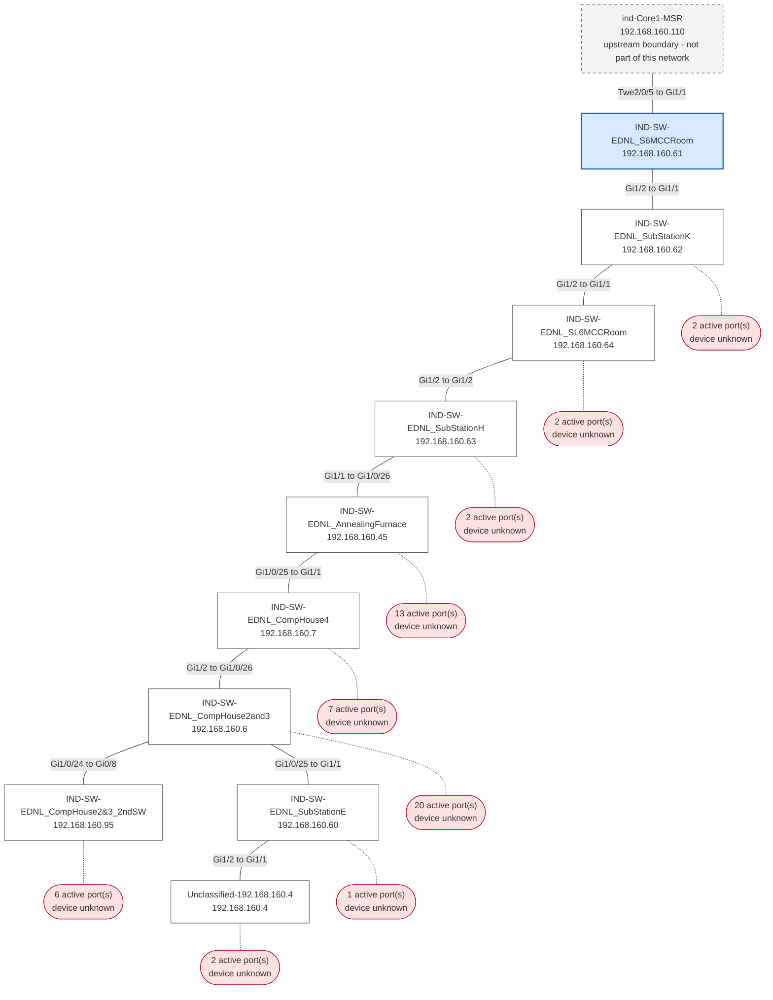

# Topology and connections - Network_01_EDNL_S6MCCRoom_Provisional

[Network index](00-index.md) · [[01-network_overview|Network overview]]

## 1. Upstream boundary

The core layer is the network boundary. The connection to it is recorded as an upstream link; the core and everything beyond it are not part of this network.

| Head switch | Head port | Upstream device | Upstream port | Evidence | Source | Conflicting observations |
|---|---|---|---|---|---|---|
| [[IND-SW-EDNL_S6MCCRoom]] | `Gi1/1` | ind-Core1-MSR (probable identity of 192.168.160.110) | `Twe2/0/5` | seen from both ends | CDP | LLDP-only: Gi1/2 to Twe2/0/5; LLDP-only: Gi1/1 to Twe1/0/1 |

## 2. Topology

Diagram key: solid line = link reported from **both** ends; dotted arrow = reported from **one** end only. Dashed box = upstream boundary (not part of this network). Label = port on the upper device, then port on the lower device.

## 3. Links inside the network

| Upper switch | Port | Port | Lower switch | Media | Evidence | Conflicting observations |
|---|---|---|---|---|---|---|
| [[IND-SW-EDNL_S6MCCRoom]] | `Gi1/2` | `Gi1/1` | [[IND-SW-EDNL_SubStationK]] | 1000baseX(FD) | seen from both ends | — |
| [[IND-SW-EDNL_SL6MCCRoom]] | `Gi1/2` | `Gi1/2` | [[IND-SW-EDNL_SubStationH]] | — | seen from both ends | LLDP-only Gi1/2 to Gi1/1; LLDP-only Fa1/4 to Gi1/2 |
| [[IND-SW-EDNL_SubStationK]] | `Gi1/2` | `Gi1/1` | [[IND-SW-EDNL_SL6MCCRoom]] | — | seen from both ends | LLDP-only Gi1/1 to Gi1/1; LLDP-only Gi1/2 to Gi1/2 |
| [[IND-SW-EDNL_SubStationH]] | `Gi1/1` | `Gi1/0/26` | [[IND-SW-EDNL_AnnealingFurnace]] | 1000baseX(FD) | seen from both ends | — |
| [[IND-SW-EDNL_AnnealingFurnace]] | `Gi1/0/25` | `Gi1/1` | [[IND-SW-EDNL_CompHouse4]] | 1000baseX(FD) | seen from both ends | LLDP-only Trunk to IND-SW-EDNL_Subk to Gi1/2 |
| [[IND-SW-EDNL_CompHouse4]] | `Gi1/2` | `Gi1/0/26` | [[IND-SW-EDNL_CompHouse2and3]] | — | seen from both ends | LLDP-only Gi1/0/25 to Trunk to IND-SW_Core1 |
| [[IND-SW-EDNL_CompHouse2and3]] | `Gi1/0/25` | `Gi1/1` | [[IND-SW-EDNL_SubStationE]] | 1000baseX(FD) | seen from both ends | — |
| [[IND-SW-EDNL_CompHouse2and3]] | `Gi1/0/24` | `Gi0/8` | [[IND-SW-EDNL_CompHouse2&3_2ndSW]] | 1000baseT(FD), 100base-T | seen from both ends | LLDP-only Gi0/8 to Gi1/0/26 |
| [[IND-SW-EDNL_SubStationE]] | `Gi1/2` | `Gi1/1` | [[Unclassified-192.168.160.4]] | 1000baseX(FD) | seen from both ends | LLDP-only Gi1/1 to Gi1/1 |

## 4. How the switches connect

- **IND-SW-EDNL_S6MCCRoom** (head) connects up to ind-Core1-MSR on `Gi1/1`.
- `IND-SW-EDNL_AnnealingFurnace` `Gi1/0/25` connects to `IND-SW-EDNL_CompHouse4` `Gi1/1`.
- `IND-SW-EDNL_CompHouse2and3` `Gi1/0/24` connects to `IND-SW-EDNL_CompHouse2&3_2ndSW` `Gi0/8`.
- `IND-SW-EDNL_CompHouse2and3` `Gi1/0/25` connects to `IND-SW-EDNL_SubStationE` `Gi1/1`.
- `IND-SW-EDNL_CompHouse4` `Gi1/2` connects to `IND-SW-EDNL_CompHouse2and3` `Gi1/0/26`.
- `IND-SW-EDNL_S6MCCRoom` `Gi1/2` connects to `IND-SW-EDNL_SubStationK` `Gi1/1`.
- `IND-SW-EDNL_SL6MCCRoom` `Gi1/2` connects to `IND-SW-EDNL_SubStationH` `Gi1/2`.
- `IND-SW-EDNL_SubStationE` `Gi1/2` connects to `Unclassified-192.168.160.4` `Gi1/1`.
- `IND-SW-EDNL_SubStationH` `Gi1/1` connects to `IND-SW-EDNL_AnnealingFurnace` `Gi1/0/26`.
- `IND-SW-EDNL_SubStationK` `Gi1/2` connects to `IND-SW-EDNL_SL6MCCRoom` `Gi1/1`.

## 5. Observations

- 10 LLDP-only record(s) name different ports from CDP for the same switch pair. CDP is used above; the conflicting records are kept in the link tables. See [[02-network_boundary_method]].

### `show lldp neighbors detail`
```Cisco
ind-Core1-MSR#show lldp neighbors detail
------------------------------------------------
Local Intf: Twe1/0/9
Chassis id: 009e.1efc.f980
Port id: Gi1/0/28
Port Description: GigabitEthernet1/0/28
System Name: IND-SW-EDNL_MainServerRoom.hulamin.co.za

System Description:
Cisco IOS Software, C2960X Software (C2960X-UNIVERSALK9-M), Version 15.2(2)E3, RELEASE SOFTWARE (fc3)
Technical Support: http://www.cisco.com/techsupport
Copyright (c) 1986-2015 by Cisco Systems, Inc.
Compiled Wed 26-Aug-15 07:12 by prod_rel_team

Time remaining: 111 seconds
System Capabilities: B,R
Enabled Capabilities: B
Management Addresses:
    IP: 192.168.160.26
Auto Negotiation - not supported
Physical media capabilities:
    1000baseX(FD)
Media Attachment Unit type: 26
Vlan ID: 1
Peer Source MAC: 009e.1efc.f99c

------------------------------------------------
Local Intf: Twe2/0/19
Chassis id: ind-ccl1rto
Port id: port-001
Port Description - not advertised
System Name: IND-CCL1RTO

System Description:
VMware, Inc. None,VMware-42 34 3a 25 36 6e ac 1f-6e ca 2f 70 2f e2 c9 4c,VMware7,1 + engineering

Time remaining: 19 seconds
System Capabilities: S
Enabled Capabilities: S
Management Addresses:
    IP: 192.168.1.196
    OID:
        1.3.6.1.4.1.24686.
Auto Negotiation - supported, enabled
Physical media capabilities:
    1000baseT(FD)
    1000baseT(HD)
    100base-TX(FD)
    100base-TX(HD)
    10base-T(FD)
    10base-T(HD)
    Other/unknown
Media Attachment Unit type: 30
Vlan ID: - not advertised
Peer Source MAC: 0050.56b4.013f

------------------------------------------------
Local Intf: Twe2/0/3
Chassis id: 0056.2b28.6080
Port id: Gi1/0/25
Port Description: GigabitEthernet1/0/25
System Name: IND-SW-EDNL_S4SMCCRoomBottom.hulamin.co.za

System Description:
Cisco IOS Software, C2960X Software (C2960X-UNIVERSALK9-M), Version 15.2(2)E3, RELEASE SOFTWARE (fc3)
Technical Support: http://www.cisco.com/techsupport
Copyright (c) 1986-2015 by Cisco Systems, Inc.
Compiled Wed 26-Aug-15 07:12 by prod_rel_team

Time remaining: 102 seconds
System Capabilities: B,R
Enabled Capabilities: B
Management Addresses:
    IP: 192.168.160.29
Auto Negotiation - not supported
Physical media capabilities:
    1000baseX(FD)
Media Attachment Unit type: 26
Vlan ID: 1
Peer Source MAC: 0056.2b28.6099

------------------------------------------------
Local Intf: Twe1/0/20
Chassis id: 38443851-4131-5A43-3232-353230304732
Port id: 5ced.8c1c.656c
Port Description: PCI-E Slot 4, Port 2
System Name - not advertised

System Description:
ProLiant DL380 Gen10

Time remaining: 84 seconds
System Capabilities - not advertised
Enabled Capabilities - not advertised
Management Addresses:
    IP: 192.168.250.221
    Other: 5C FF FF 64 50 FF 00
Auto Negotiation - not supported
Physical media capabilities - not advertised
Media Attachment Unit type - not advertised
Vlan ID: - not advertised
Peer Source MAC: 5ced.8c1c.656d

------------------------------------------------
Local Intf: Twe2/0/19
Chassis id: 38443851-4131-5A43-3232-353230304730
Port id: 5ced.8c1c.f1ac
Port Description: PCI-E Slot 4, Port 2
System Name - not advertised

System Description:
ProLiant DL380 Gen10

Time remaining: 89 seconds
System Capabilities - not advertised
Enabled Capabilities - not advertised
Management Addresses:
    IP: 192.168.250.223
    Other: 5C FF FF 64 55 0A 00
Auto Negotiation - not supported
Physical media capabilities - not advertised
Media Attachment Unit type - not advertised
Vlan ID: - not advertised
Peer Source MAC: 5ced.8c1c.f1ad

------------------------------------------------
Local Intf: Twe1/0/19
Chassis id: 38443851-4131-5A43-3232-353230304731
Port id: 5ced.8c1c.752c
Port Description: PCI-E Slot 4, Port 2
System Name - not advertised

System Description:
ProLiant DL380 Gen10

Time remaining: 97 seconds
System Capabilities - not advertised
Enabled Capabilities - not advertised
Management Addresses:
    IP: 192.168.250.220
    Other: 5C FF FF 64 51 FF 00
Auto Negotiation - not supported
Physical media capabilities - not advertised
Media Attachment Unit type - not advertised
Vlan ID: - not advertised
Peer Source MAC: 5ced.8c1c.752d

------------------------------------------------
Local Intf: Twe2/0/31
Chassis id: 38443851-4131-5A43-3232-353230304732
Port id: b47a.f1bd.12b0
Port Description: Embedded ALOM, Port 1
System Name - not advertised

System Description:
ProLiant DL380 Gen10

Time remaining: 84 seconds
System Capabilities - not advertised
Enabled Capabilities - not advertised
Management Addresses:
    IP: 192.168.250.221
    Other: 5C FF FF 64 50 FF 00
Auto Negotiation - not supported
Physical media capabilities - not advertised
Media Attachment Unit type - not advertised
Vlan ID: - not advertised
Peer Source MAC: b47a.f1bd.12b1

------------------------------------------------
Local Intf: Twe1/0/31
Chassis id: 38443851-4131-5A43-3232-353230304732
Port id: b47a.f1bd.12b4
Port Description: Embedded ALOM, Port 2
System Name - not advertised

System Description:
ProLiant DL380 Gen10

Time remaining: 85 seconds
System Capabilities - not advertised
Enabled Capabilities - not advertised
Management Addresses:
    IP: 192.168.250.221
    Other: 5C FF FF 64 50 FF 00
Auto Negotiation - not supported
Physical media capabilities - not advertised
Media Attachment Unit type - not advertised
Vlan ID: - not advertised
Peer Source MAC: b47a.f1bd.12b5

------------------------------------------------
Local Intf: Twe2/0/12
Chassis id: 6cfa.8958.ce00
Port id: Gi1/0/25
Port Description: GigabitEthernet1/0/25
System Name: IND-SW-CCL2_OS1.hulamin.co.za

System Description:
Cisco IOS Software, C2960X Software (C2960X-UNIVERSALK9-M), Version 15.0(2)EX5, RELEASE SOFTWARE (fc1)
Technical Support: http://www.cisco.com/techsupport
Copyright (c) 1986-2014 by Cisco Systems, Inc.
Compiled Fri 21-Feb-14 05:54 by prod_rel_team

Time remaining: 88 seconds
System Capabilities: B,R
Enabled Capabilities: B
Management Addresses:
    IP: 192.168.160.21
Auto Negotiation - not supported
Physical media capabilities:
    1000baseX(FD)
Media Attachment Unit type: 26
Vlan ID: 1
Peer Source MAC: 6cfa.8958.ce19

------------------------------------------------
Local Intf: Twe2/0/19
Chassis id: ind-seng1
Port id: port-001
Port Description - not advertised
System Name: IND-SENG1

System Description:
SIEMENS AG SIMATIC PC

Time remaining: 16 seconds
System Capabilities: S
Enabled Capabilities: S
Management Addresses:
    IP: 192.168.161.46
    OID:
        1.3.6.1.4.1.24686.
Auto Negotiation - supported, enabled
Physical media capabilities:
    1000baseT(FD)
    1000baseT(HD)
    100base-TX(FD)
    100base-TX(HD)
    10base-T(FD)
    10base-T(HD)
    Other/unknown
Media Attachment Unit type: 30
Vlan ID: - not advertised
Peer Source MAC: 0050.56be.7e79

------------------------------------------------
Local Intf: Twe1/0/21
Chassis id: b08d.579c.8ec7
Port id: port-027
Port Description: TenGigabitEthernet1/0/27
System Name: IND-SW-Dept34_Distr

System Description:
Cisco IOS Software [Dublin], Catalyst L3 Switch Software (IE9K_IOSXE), Version 17.12.2, RELEASE SOFTWARE (fc2)
Technical Support: http://www.cisco.com/techsupport
Copyright (c) 1986-2023 by Cisco Systems, Inc.
Compiled Tue 14-Nov-23 06:36 by mcpre

Time remaining: 18 seconds
System Capabilities: B,R
Enabled Capabilities: B
Management Addresses:
    IP: 192.168.160.117
    OID:
        1.3.6.1.4.1.24686.
Auto Negotiation - not supported
Physical media capabilities:
    1000baseT(FD)
Media Attachment Unit type: 24
Vlan ID: 1
Peer Source MAC: b08d.579c.8e9b

------------------------------------------------
Local Intf: Twe1/0/5
Chassis id: 00af.1fd0.a680
Port id: Gi1/2
Port Description: GigabitEthernet1/2
System Name: IND-SW-EDNL_GenSub.hulamin.co.za

System Description:
Cisco IOS Software, IES Software (IES-LANBASEK9-M), Version 15.0(2)EY3, RELEASE SOFTWARE (fc1)
Technical Support: http://www.cisco.com/techsupport
Copyright (c) 1986-2013 by Cisco Systems, Inc.
Compiled Thu 14-Nov-13 13:52 by prod_rel_team

Time remaining: 94 seconds
System Capabilities: B,R
Enabled Capabilities: B
Management Addresses:
    IP: 192.168.160.28
Auto Negotiation - supported, enabled
Physical media capabilities:
    1000baseX(FD)
Media Attachment Unit type: 26
Vlan ID: 1
Peer Source MAC: 00af.1fd0.a682

------------------------------------------------
Local Intf: Twe2/0/32
Chassis id: 38443851-4131-5A43-3232-35323030465A
Port id: b47a.f1bd.02ec
Port Description: Embedded ALOM, Port 2
System Name - not advertised

System Description:
ProLiant DL380 Gen10

Time remaining: 95 seconds
System Capabilities - not advertised
Enabled Capabilities - not advertised
Management Addresses:
    IP: 192.168.250.222
    Other: 5C FF FF 64 4F 64 00
Auto Negotiation - not supported
Physical media capabilities - not advertised
Media Attachment Unit type - not advertised
Vlan ID: - not advertised
Peer Source MAC: b47a.f1bd.02ed

------------------------------------------------
Local Intf: Twe1/0/2
Chassis id: 2852.618d.dd00
Port id: Gi1/2
Port Description: GigabitEthernet1/2
System Name: IND-SW-EDNL_FoilCoolingTowers.hulamin.co.za

System Description:
Cisco IOS Software, IES Software (IES-LANBASEK9-M), Version 15.0(2)EY3, RELEASE SOFTWARE (fc1)
Technical Support: http://www.cisco.com/techsupport
Copyright (c) 1986-2013 by Cisco Systems, Inc.
Compiled Thu 14-Nov-13 13:52 by prod_rel_team

Time remaining: 99 seconds
System Capabilities: B,R
Enabled Capabilities: B
Management Addresses:
    IP: 192.168.160.37
Auto Negotiation - supported, enabled
Physical media capabilities:
    1000baseX(FD)
Media Attachment Unit type: 26
Vlan ID: 1
Peer Source MAC: 2852.618d.dd02

------------------------------------------------
Local Intf: Twe2/0/20
Chassis id: 38443851-4131-5A43-3232-35323030465A
Port id: 5ced.8c1c.9894
Port Description: PCI-E Slot 4, Port 2
System Name - not advertised

System Description:
ProLiant DL380 Gen10

Time remaining: 90 seconds
System Capabilities - not advertised
Enabled Capabilities - not advertised
Management Addresses:
    IP: 192.168.250.222
    Other: 5C FF FF 64 4F 64 00
Auto Negotiation - not supported
Physical media capabilities - not advertised
Media Attachment Unit type - not advertised
Vlan ID: - not advertised
Peer Source MAC: 5ced.8c1c.9895

------------------------------------------------
Local Intf: Twe1/0/4
Chassis id: 08cc.a7c0.7a80
Port id: Gi1/1
Port Description: GigabitEthernet1/1
System Name: IND-SW-EDNL_SubStation1.hulamin.co.za

System Description:
Cisco IOS Software, IES Software (IES-LANBASEK9-M), Version 12.2(58)SE2, RELEASE SOFTWARE (fc1)
Technical Support: http://www.cisco.com/techsupport
Copyright (c) 1986-2011 by Cisco Systems, Inc.
Compiled Thu 21-Jul-11 00:59 by prod_rel_team

Time remaining: 90 seconds
System Capabilities: B,R
Enabled Capabilities: B
Management Addresses:
    IP: 192.168.160.35
Auto Negotiation - supported, enabled
Physical media capabilities:
    1000baseX(FD)
Media Attachment Unit type: 26
Vlan ID: 1
Peer Source MAC: 08cc.a7c0.7a81

------------------------------------------------
Local Intf: Twe1/0/27
Chassis id: 28b5.91d5.4f80
Port id: port-001-00000
Port Description: GigabitEthernet1/1
System Name: IND-SW-EDNL-Lab

System Description:
Cisco IOS Software [Cupertino], IE3x00 Switch Software (IE3x00-UNIVERSALK9-M), Version 17.9.5c, RELEASE SOFTWARE (fc1)
Technical Support: http://www.cisco.com/techsupport
Copyright (c) 1986-2024 by Cisco Systems, Inc.
Compiled Fri 12-Jul-24 17:41 by mcpre

Time remaining: 104 seconds
System Capabilities: B,R
Enabled Capabilities: B,R
Management Addresses:
    IP: 192.168.160.121
    OID:
        1.3.6.1.4.1.24686.
Auto Negotiation - not supported
Physical media capabilities:
    1000baseX(FD)
Media Attachment Unit type: 26
Vlan ID: 1
Peer Source MAC: 28b5.91d5.4f81

------------------------------------------------
Local Intf: Twe2/0/5
Chassis id: 0027.90cc.fcc0
Port id: port-001-00000
Port Description: GigabitEthernet1/1
System Name: IND-SW-EDNL_S6MCCRoom.hulamin.co.za

System Description:
Cisco IOS Software, IES Software (IES-LANBASEK9-M), Version 15.2(4)EA5, RELEASE SOFTWARE (fc1)
Technical Support: http://www.cisco.com/techsupport
Copyright (c) 1986-2016 by Cisco Systems, Inc.
Compiled Tue 20-Dec-16 14:59 by prod_rel_team

Time remaining: 92 seconds
System Capabilities: B,R
Enabled Capabilities: B
Management Addresses:
    IP: 192.168.160.61
    OID:
        1.3.6.1.4.1.24686.
Auto Negotiation - supported, enabled
Physical media capabilities:
    1000baseX(FD)
Media Attachment Unit type: 26
Vlan ID: 1
Peer Source MAC: 0027.90cc.fc81

------------------------------------------------
Local Intf: Twe1/0/1
Chassis id: 2c0b.e9fe.ff40
Port id: port-001-00000
Port Description: Trunk to IND-SW-Core_MainServerRoom
System Name: IND-SW-EDNL_AdminMCC.hulamin.co.za

System Description:
Cisco IOS Software, IES Software (IES-LANBASEK9-M), Version 15.2(7)E2, RELEASE SOFTWARE (fc3)
Technical Support: http://www.cisco.com/techsupport
Copyright (c) 1986-2020 by Cisco Systems, Inc.
Compiled Sun 15-Mar-20 07:11 by prod_rel_team

Time remaining: 98 seconds
System Capabilities: B,R
Enabled Capabilities: B
Management Addresses:
    IP: 192.168.160.77
    OID:
        1.3.6.1.4.1.24686.
Auto Negotiation - supported, enabled
Physical media capabilities:
    1000baseX(FD)
Media Attachment Unit type: 26
Vlan ID: 1
Peer Source MAC: 2c0b.e9fe.ff01

------------------------------------------------
Local Intf: Twe1/0/43
Chassis id: 8c60.4f58.da54
Port id: Eth1/45
Port Description: Ethernet1/45
System Name: SW-EDNL-MCompRoomN5K.hulamin.co.za

System Description:
Cisco Nexus Operating System (NX-OS) Software 7.0(6)N1(1)
TAC support: http://www.cisco.com/tac
Copyright (c) 2002-2015, Cisco Systems, Inc. All rights reserved.

Time remaining: 112 seconds
System Capabilities: B
Enabled Capabilities: B
Management Addresses:
    Other: FF 60 4F 58 FF 54 00
Auto Negotiation - not supported
Physical media capabilities - not advertised
Media Attachment Unit type - not advertised
Vlan ID: 250
Peer Source MAC: 8c60.4f58.da54

------------------------------------------------
Local Intf: Twe1/0/6
Chassis id: 682c.7bfc.6e40
Port id: port-001-00000
Port Description: GigabitEthernet1/1
System Name: IND-SW-EDNL_EffluentPlant.hulamin.co.za

System Description:
Cisco IOS Software, IES Software (IES-LANBASEK9-M), Version 15.2(7)E2, RELEASE SOFTWARE (fc3)
Technical Support: http://www.cisco.com/techsupport
Copyright (c) 1986-2020 by Cisco Systems, Inc.
Compiled Sun 15-Mar-20 07:11 by prod_rel_team

Time remaining: 110 seconds
System Capabilities: B,R
Enabled Capabilities: B
Management Addresses:
    IP: 192.168.160.91
    OID:
        1.3.6.1.4.1.24686.
Auto Negotiation - supported, enabled
Physical media capabilities:
    1000baseX(FD)
Media Attachment Unit type: 26
Vlan ID: 1
Peer Source MAC: 682c.7bfc.6e01

------------------------------------------------
Local Intf: Twe1/0/7
Chassis id: 00b1.e3e1.7f00
Port id: Gi0/11
Port Description: GigabitEthernet0/11
System Name: IND-SW-EDNL-FM_CMPM.hulamin.co.za

System Description:
Cisco IOS Software, C2960CX Software (C2960CX-UNIVERSALK9-M), Version 15.2(7)E7, RELEASE SOFTWARE (fc10)
Technical Support: http://www.cisco.com/techsupport
Copyright (c) 1986-2022 by Cisco Systems, Inc.
Compiled Thu 22-Sep-22 08:53 by mcpre

Time remaining: 96 seconds
System Capabilities: B,R
Enabled Capabilities: B
Management Addresses:
    IP: 192.168.160.105
Auto Negotiation - not supported
Physical media capabilities:
    1000baseX(FD)
Media Attachment Unit type: 26
Vlan ID: 1
Peer Source MAC: 00b1.e3e1.7f0b

------------------------------------------------
Local Intf: Twe2/0/48
Chassis id: 8c60.4f58.dc6e
Port id: Eth1/7
Port Description: Ethernet1/7
System Name: SW-EDNL-ICompRoomN5K.hulamin.co.za

System Description:
Cisco Nexus Operating System (NX-OS) Software 7.0(6)N1(1)
TAC support: http://www.cisco.com/tac
Copyright (c) 2002-2015, Cisco Systems, Inc. All rights reserved.

Time remaining: 105 seconds
System Capabilities: B
Enabled Capabilities: B
Management Addresses:
    Other: FF 60 4F 58 FF 6E 00
Auto Negotiation - not supported
Physical media capabilities - not advertised
Media Attachment Unit type - not advertised
Vlan ID: 1
Peer Source MAC: 8c60.4f58.dc6e

------------------------------------------------
Local Intf: Twe1/0/33
Chassis id: 38443851-4131-5A43-3232-353230304730
Port id: b47a.f1bd.1200
Port Description - not advertised
System Name - not advertised
System Description - not advertised

Time remaining: 82 seconds
System Capabilities - not advertised
Enabled Capabilities - not advertised
Management Addresses - not advertised
Auto Negotiation - not supported
Physical media capabilities - not advertised
Media Attachment Unit type - not advertised
Vlan ID: - not advertised
Peer Source MAC: b47a.f1bd.1201

------------------------------------------------
Local Intf: Twe2/0/6
Chassis id: 0087.31dd.2200
Port id: Gi1/0/25
Port Description: GigabitEthernet1/0/25
System Name: IND-SW_FS15MCC.hulamin.co.za

System Description:
Cisco IOS Software, C2960X Software (C2960X-UNIVERSALK9-M), Version 15.2(2)E5, RELEASE SOFTWARE (fc2)
Technical Support: http://www.cisco.com/techsupport
Copyright (c) 1986-2016 by Cisco Systems, Inc.
Compiled Thu 02-Jun-16 01:31 by prod_rel_team

Time remaining: 107 seconds
System Capabilities: B,R
Enabled Capabilities: B
Management Addresses:
    IP: 192.168.160.8
Auto Negotiation - not supported
Physical media capabilities:
    1000baseX(FD)
Media Attachment Unit type: 26
Vlan ID: 1
Peer Source MAC: 0087.31dd.2219

------------------------------------------------
Local Intf: Twe2/0/10
Chassis id: 188b.45ff.c980
Port id: Gi1/0/49
Port Description: GigabitEthernet1/0/49
System Name: IND-SW-CCL2_CompRoom.hulamin.co.za

System Description:
Cisco IOS Software, C2960X Software (C2960X-UNIVERSALK9-M), Version 15.0(2a)EX5, RELEASE SOFTWARE (fc3)
Technical Support: http://www.cisco.com/techsupport
Copyright (c) 1986-2015 by Cisco Systems, Inc.
Compiled Mon 16-Feb-15 08:16 by prod_rel_team

Time remaining: 98 seconds
System Capabilities: B,R
Enabled Capabilities: B
Management Addresses:
    IP: 192.168.160.22
Auto Negotiation - not supported
Physical media capabilities:
    1000baseX(FD)
Media Attachment Unit type: 26
Vlan ID: 1
Peer Source MAC: 188b.45ff.c9b1

------------------------------------------------
Local Intf: Twe1/0/30
Chassis id: 38443851-4131-5A43-3232-353230304731
Port id: b47a.f1bd.b1a4
Port Description: Embedded ALOM, Port 2
System Name - not advertised

System Description:
ProLiant DL380 Gen10

Time remaining: 92 seconds
System Capabilities - not advertised
Enabled Capabilities - not advertised
Management Addresses:
    IP: 192.168.250.220
    Other: 5C FF FF 64 51 FF 00
Auto Negotiation - not supported
Physical media capabilities - not advertised
Media Attachment Unit type - not advertised
Vlan ID: - not advertised
Peer Source MAC: b47a.f1bd.b1a5

------------------------------------------------
Local Intf: Twe2/0/33
Chassis id: 38443851-4131-5A43-3232-353230304730
Port id: b47a.f1bd.1204
Port Description - not advertised
System Name - not advertised
System Description - not advertised

Time remaining: 81 seconds
System Capabilities - not advertised
Enabled Capabilities - not advertised
Management Addresses - not advertised
Auto Negotiation - not supported
Physical media capabilities - not advertised
Media Attachment Unit type - not advertised
Vlan ID: - not advertised
Peer Source MAC: b47a.f1bd.1205

------------------------------------------------
Local Intf: Twe2/0/14
Chassis id: 009e.1efd.de00
Port id: Gi1/0/27
Port Description: GigabitEthernet1/0/27
System Name: IND-SW_CCL1DevRoom.hulamin.co.za

System Description:
Cisco IOS Software, C2960X Software (C2960X-UNIVERSALK9-M), Version 15.2(2)E3, RELEASE SOFTWARE (fc3)
Technical Support: http://www.cisco.com/techsupport
Copyright (c) 1986-2015 by Cisco Systems, Inc.
Compiled Wed 26-Aug-15 07:12 by prod_rel_team

Time remaining: 116 seconds
System Capabilities: B,R
Enabled Capabilities: B
Management Addresses:
    IP: 192.168.160.12
Auto Negotiation - not supported
Physical media capabilities:
    1000baseX(FD)
Media Attachment Unit type: 26
Vlan ID: 1
Peer Source MAC: 009e.1efd.de1b

------------------------------------------------
Local Intf: Twe1/0/11
Chassis id: 0077.8d71.c100
Port id: Gi1/0/25
Port Description: GigabitEthernet1/0/25
System Name: IND-SW-EDNL-Lab1.hulamin.co.za

System Description:
Cisco IOS Software, C2960X Software (C2960X-UNIVERSALK9-M), Version 15.2(7)E7, RELEASE SOFTWARE (fc10)
Technical Support: http://www.cisco.com/techsupport
Copyright (c) 1986-2022 by Cisco Systems, Inc.
Compiled Thu 22-Sep-22 08:33 by mcpre

Time remaining: 97 seconds
System Capabilities: B,R
Enabled Capabilities: B
Management Addresses:
    IP: 192.168.160.127
Auto Negotiation - not supported
Physical media capabilities:
    1000baseX(FD)
Media Attachment Unit type: 26
Vlan ID: 1
Peer Source MAC: 0077.8d71.c119

------------------------------------------------
Local Intf: Twe1/0/45
Chassis id: e80a.b9f1.8b80
Port id: Twe2/0/45
Port Description: TwentyFiveGigE2/0/45
System Name: IND-SW-CD-CORE.hulamin.co.za

System Description:
Cisco IOS Software [Cupertino], Catalyst L3 Switch Software (CAT9K_IOSXE), Version 17.9.4, RELEASE SOFTWARE (fc5)
Technical Support: http://www.cisco.com/techsupport
Copyright (c) 1986-2023 by Cisco Systems, Inc.
Compiled Wed 26-Jul-23 10:26 by mcpre

Time remaining: 94 seconds
System Capabilities: B,R
Enabled Capabilities: B,R
Management Addresses:
    IP: 192.168.160.107
Auto Negotiation - not supported
Physical media capabilities:
    Other/unknown
Media Attachment Unit type: 24
Vlan ID: - not advertised
Peer Source MAC: e80a.b9fd.ff2d

------------------------------------------------
Local Intf: Twe1/0/3
Chassis id: 682c.7bfc.6dc0
Port id: port-002-00000
Port Description: GigabitEthernet1/2
System Name: IND-SW-EDNL-SubNMCC.hulamin.co.za

System Description:
Cisco IOS Software, IES Software (IES-LANBASEK9-M), Version 15.2(5)E, RELEASE SOFTWARE (fc1)
Technical Support: http://www.cisco.com/techsupport
Copyright (c) 1986-2016 by Cisco Systems, Inc.
Compiled Tue 19-Jul-16 02:21 by prod_rel_team

Time remaining: 100 seconds
System Capabilities: B,R
Enabled Capabilities: B
Management Addresses:
    IP: 192.168.160.102
    OID:
        1.3.6.1.4.1.24686.
Auto Negotiation - supported, enabled
Physical media capabilities:
    1000baseX(FD)
Media Attachment Unit type: 26
Vlan ID: 1
Peer Source MAC: 682c.7bfc.6d82

------------------------------------------------
Local Intf: Twe2/0/45
Chassis id: e80a.b9f1.8b80
Port id: Twe1/0/45
Port Description: TwentyFiveGigE1/0/45
System Name: IND-SW-CD-CORE.hulamin.co.za

System Description:
Cisco IOS Software [Cupertino], Catalyst L3 Switch Software (CAT9K_IOSXE), Version 17.9.4, RELEASE SOFTWARE (fc5)
Technical Support: http://www.cisco.com/techsupport
Copyright (c) 1986-2023 by Cisco Systems, Inc.
Compiled Wed 26-Jul-23 10:26 by mcpre

Time remaining: 102 seconds
System Capabilities: B,R
Enabled Capabilities: B,R
Management Addresses:
    IP: 192.168.160.107
Auto Negotiation - not supported
Physical media capabilities:
    Other/unknown
Media Attachment Unit type: 24
Vlan ID: - not advertised
Peer Source MAC: e80a.b9f1.8bad

------------------------------------------------
Local Intf: Twe2/0/9
Chassis id: e80a.b9f1.8b80
Port id: Twe2/0/25
Port Description: TwentyFiveGigE2/0/25
System Name: IND-SW-CD-CORE.hulamin.co.za

System Description:
Cisco IOS Software [Cupertino], Catalyst L3 Switch Software (CAT9K_IOSXE), Version 17.9.4, RELEASE SOFTWARE (fc5)
Technical Support: http://www.cisco.com/techsupport
Copyright (c) 1986-2023 by Cisco Systems, Inc.
Compiled Wed 26-Jul-23 10:26 by mcpre

Time remaining: 103 seconds
System Capabilities: B,R
Enabled Capabilities: B,R
Management Addresses:
    IP: 192.168.160.107
Auto Negotiation - not supported
Physical media capabilities:
    1000baseX(FD)
Media Attachment Unit type: 24
Vlan ID: 1
Peer Source MAC: e80a.b9fd.ff19

------------------------------------------------
Local Intf: Twe2/0/2
Chassis id: 9c66.97dc.2f80
Port id: Te1/1/1
Port Description: TenGigabitEthernet1/1/1
System Name: IND-SW_FS14MCC

System Description:
Cisco IOS Software [Dublin], Catalyst L3 Switch Software (CAT9K_LITE_IOSXE), Version 17.12.3, RELEASE SOFTWARE (fc7)
Technical Support: http://www.cisco.com/techsupport
Copyright (c) 1986-2024 by Cisco Systems, Inc.
Compiled Wed 20-Mar-24 15:43 by mcpre

Time remaining: 116 seconds
System Capabilities: B,R
Enabled Capabilities: B
Management Addresses:
    IP: 192.168.160.9
Auto Negotiation - not supported
Physical media capabilities:
    1000baseT(FD)
Media Attachment Unit type: 26
Vlan ID: 1
Peer Source MAC: 9c66.97dc.2f99

------------------------------------------------
Local Intf: Twe2/0/1
Chassis id: 2c0b.e9ff.c300
Port id: Gi1/1
Port Description: GigabitEthernet1/1
System Name: IND-SW-EDNL_SubStationA.hulamin.co.za

System Description:
Cisco IOS Software, IES Software (IES-LANBASEK9-M), Version 15.0(2)EY3, RELEASE SOFTWARE (fc1)
Technical Support: http://www.cisco.com/techsupport
Copyright (c) 1986-2013 by Cisco Systems, Inc.
Compiled Thu 14-Nov-13 13:52 by prod_rel_team

Time remaining: 87 seconds
System Capabilities: B,R
Enabled Capabilities: B
Management Addresses:
    IP: 192.168.160.39
Auto Negotiation - supported, enabled
Physical media capabilities:
    1000baseX(FD)
Media Attachment Unit type: 26
Vlan ID: 1
Peer Source MAC: 2c0b.e9ff.c301

------------------------------------------------
Local Intf: Twe2/0/20
Chassis id: ind-a10a11-eng
Port id: port-001
Port Description - not advertised
System Name: IND-A10A11-ENG

System Description:
VMware, Inc. VMware Virtual Platform,None,VMware-42 16 cd 5d f3 e5 d6 e9-21 2f 71 62 39 76 39 63 + HMI

Time remaining: 15 seconds
System Capabilities: S
Enabled Capabilities: S
Management Addresses:
    IP: 192.168.169.45
    OID:
        1.3.6.1.4.1.24686.
Auto Negotiation - supported, enabled
Physical media capabilities:
    1000baseT(FD)
    1000baseT(HD)
    100base-TX(FD)
    100base-TX(HD)
    10base-T(FD)
    10base-T(HD)
    Other/unknown
Media Attachment Unit type: 30
Vlan ID: - not advertised
Peer Source MAC: 0050.5696.6cdb

------------------------------------------------
Local Intf: Twe1/0/10
Chassis id: 701f.5320.e400
Port id: Gi1/2
Port Description: GigabitEthernet1/2
System Name: IND-SW-EDNL_ElectricalWorkShop.hulamin.co.za

System Description:
Cisco IOS Software, IES Software (IES-LANBASEK9-M), Version 12.2(58)SE2, RELEASE SOFTWARE (fc1)
Technical Support: http://www.cisco.com/techsupport
Copyright (c) 1986-2011 by Cisco Systems, Inc.
Compiled Thu 21-Jul-11 00:59 by prod_rel_team

Time remaining: 107 seconds
System Capabilities: B,R
Enabled Capabilities: B
Management Addresses:
    IP: 192.168.160.27
Auto Negotiation - supported, enabled
Physical media capabilities:
    1000baseX(FD)
Media Attachment Unit type: 26
Vlan ID: 1
Peer Source MAC: 701f.5320.e402


Total entries displayed: 38

ind-Core1-MSR#
```