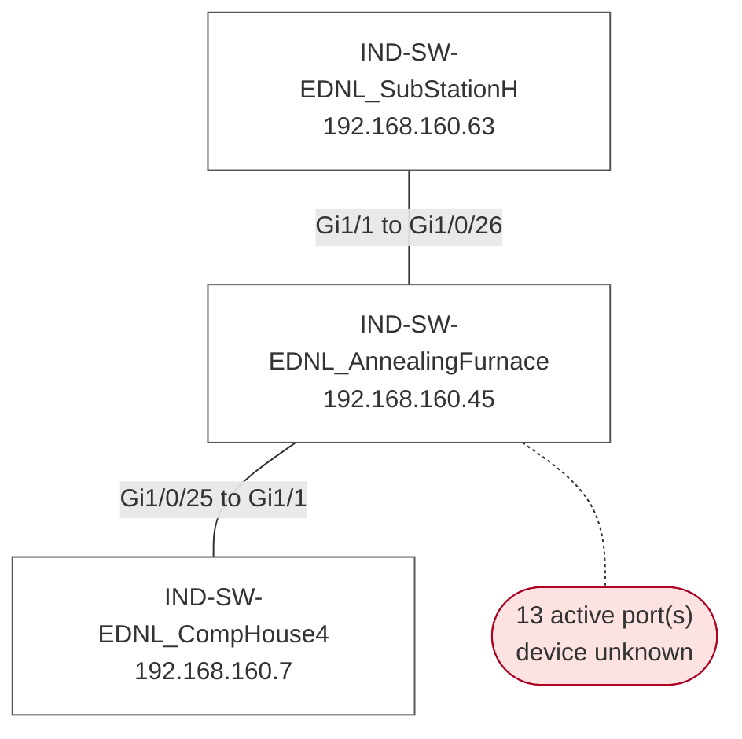

# IND-SW-EDNL_AnnealingFurnace

[Network index](../00-index.md) · [Topology](../01-topology_and_connections.md) · [Inventory](../02-switch_inventory.md) · [Connected devices](../03-connected_devices.md)

> **Placement:** Network_01_EDNL_S6MCCRoom_Provisional (access). Department and physical location are **unknown**.

## 1. Identification

| Field | Value |
|---|---|
| Hostname (as collected) | `IND-SW-EDNL_AnnealingFurnace` |
| Management IP | 192.168.160.45 |
| Role in its network | Access |
| Switch hops from head | 4 |
| Hardware model | WS-C2960X-24TS-L (advertised by neighbours via CDP). SwitchScribe reports IE-3000-8TC: they disagree |
| Firmware / IOS | 15.2(2)E3 (as advertised to neighbours via CDP/LLDP) |
| Ports (SwitchScribe) | 29 reported, 15 up |
| Collection | success (Netmiko SSH, 4.20s) |
| Physical location | Not documented |
| Source note (Device Info and Raw CLI) | [[IND-SW-EDNL_AnnealingFurnace (SwitchScribe)]] |

## 2. Individual topology

Diagram key: solid line = link reported from **both** ends; dotted arrow = reported from **one** end only. Dashed box = upstream boundary (not part of this network). Label = port on the upper device, then port on the lower device.

## 3. Switch-to-switch connections

| Local port | Remote switch | Remote port | Relationship | Evidence | Conflicting observations |
|---|---|---|---|---|---|
| `Gi1/0/25` | [[IND-SW-EDNL_CompHouse4]] | `Gi1/1` | Downstream or lateral | seen from both ends; source CDP/LLDP | LLDP-only record Trunk to IND-SW-EDNL_Subk to Gi1/2 (reported by IND-SW-EDNL_CompHouse4) |
| `Gi1/0/26` | [[IND-SW-EDNL_SubStationH]] | `Gi1/1` | Parent / uplink | seen from both ends; source CDP/LLDP | — |

## 4. Connected end devices

No named end devices were reported by this switch.

**13 active port(s) report no CDP/LLDP neighbour**, so the device on them is unknown: Gi1/0/2, Gi1/0/8-10, Gi1/0/12, Gi1/0/15, Gi1/0/18-19, Gi1/0/21-24, Gi1/0/28.

## 5. Ports and VLANs

29 ports listed; 15 up.

| VLAN | Name | Ports | Port list |
|---|---|---|---|
| 1 | default | 1 | Gi1/0/27 |
| 561 | CESMS | 4 | Gi1/0/6, Gi1/0/13, Gi1/0/15, Gi1/0/23 |
| 574 | IND-AnnealingFurnace | 16 | Gi1/0/1-5, Gi1/0/7-12, Gi1/0/14, Gi1/0/16-19 |
| 590 | EDPowerMeterMngt | 1 | Gi1/0/24 |
| 593 | Ignition | 3 | Gi1/0/20-22 |

## 6. Outstanding questions

- [ ] Confirm the department and physical location of this switch.
- [ ] Photograph the switch and record its rack / panel label.
- [ ] Resolve the model: SwitchScribe says `IE-3000-8TC`, neighbours advertise `WS-C2960X-24TS-L`. The advertised value matches the interface names where checked.
- [ ] Identify the unidentified end devices (MAC/GUID-only neighbours and active ports with no CDP/LLDP data).
- [ ] Review 1 CDP/LLDP port conflict(s) in section 3 (LLDP-only records that name a different port).
