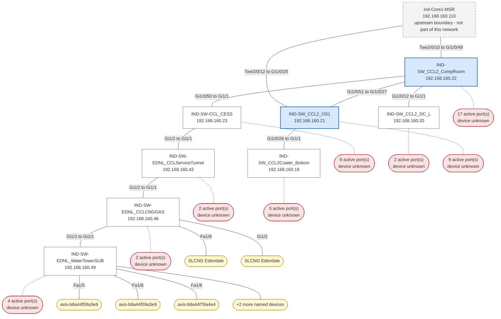

# Topology and connections - Network_02_CCL2_CompRoom_Provisional

[Network index](00-index.md) · [[01-network_overview|Network overview]]

## 1. Upstream boundary

The core layer is the network boundary. The connection to it is recorded as an upstream link; the core and everything beyond it are not part of this network.

| Head switch | Head port | Upstream device | Upstream port | Evidence | Source | Conflicting observations |
|---|---|---|---|---|---|---|
| [[IND-SW_CCL2_CompRoom]] | `Gi1/0/49` | ind-Core1-MSR (probable identity of 192.168.160.110) | `Twe2/0/10` | seen from both ends | CDP+CDP/LLDP | LLDP-only: Gi1/0/49 to Twe1/0/30 |
| [[IND-SW_CCL2_OS1]] | `Gi1/0/25` | ind-Core1-MSR (probable identity of 192.168.160.110) | `Twe2/0/12` | seen from both ends | CDP+CDP/LLDP | LLDP-only: Gi1/0/25 to Twe2/0/19 |

## 2. Topology

Diagram key: solid line = link reported from **both** ends; dotted arrow = reported from **one** end only. Dashed box = upstream boundary (not part of this network). Label = port on the upper device, then port on the lower device.

## 3. Links inside the network

| Upper switch | Port | Port | Lower switch | Media | Evidence | Conflicting observations |
|---|---|---|---|---|---|---|
| [[IND-SW_CCL2_CompRoom]] | `Gi1/0/51` | `Gi1/0/27` | [[IND-SW_CCL2_OS1]] | 1000baseX(FD) | seen from both ends | — |
| [[IND-SW_CCL2_CompRoom]] | `Gi1/0/12` | `Gi1/1` | [[IND-SW_CCL2_DC_L]] | 1000baseT(FD), 100base-T | seen from both ends | — |
| [[IND-SW_CCL2_CompRoom]] | `Gi1/0/50` | `Gi1/1` | [[IND-SW-CCL_CESS]] | — | seen from both ends | — |
| [[IND-SW-CCL_CESS]] | `Gi1/2` | `Gi1/1` | [[IND-SW-EDNL_CCLServiceTunnel]] | — | seen from both ends | — |
| [[IND-SW_CCL2_OS1]] | `Gi1/0/26` | `Gi1/1` | [[IND-SW_CCL2Coater_Bottom]] | 1000baseX(FD) | seen from both ends | — |
| [[IND-SW-EDNL_CCLServiceTunnel]] | `Gi1/2` | `Gi1/1` | [[IND-SW-EDNL_CCLCNGGAS]] | — | seen from both ends | — |
| [[IND-SW-EDNL_CCLCNGGAS]] | `Gi1/2` | `Gi1/1` | [[IND-SW-EDNL_WaterTowerSUB]] | — | seen from both ends | LLDP-only Gi1/2 to Fa1/5; LLDP-only Gi1/1 to Gi1/1 |

## 4. How the switches connect

- **IND-SW_CCL2_CompRoom** (head) connects up to ind-Core1-MSR on `Gi1/0/49`.
- **IND-SW_CCL2_OS1** (head) connects up to ind-Core1-MSR on `Gi1/0/25`.
- `IND-SW-CCL_CESS` `Gi1/2` connects to `IND-SW-EDNL_CCLServiceTunnel` `Gi1/1`.
- `IND-SW-EDNL_CCLCNGGAS` `Gi1/2` connects to `IND-SW-EDNL_WaterTowerSUB` `Gi1/1`.
- `IND-SW-EDNL_CCLServiceTunnel` `Gi1/2` connects to `IND-SW-EDNL_CCLCNGGAS` `Gi1/1`.
- `IND-SW_CCL2_CompRoom` `Gi1/0/12` connects to `IND-SW_CCL2_DC_L` `Gi1/1`.
- `IND-SW_CCL2_CompRoom` `Gi1/0/50` connects to `IND-SW-CCL_CESS` `Gi1/1`.
- `IND-SW_CCL2_OS1` `Gi1/0/26` connects to `IND-SW_CCL2Coater_Bottom` `Gi1/1`.

## 5. Observations

- 2 distribution switches (IND-SW_CCL2_CompRoom, IND-SW_CCL2_OS1) each have an uplink to the core and are also linked to each other below the core. This forms a loop through the core; confirm intent and spanning-tree roots.
- 4 LLDP-only record(s) name different ports from CDP for the same switch pair. CDP is used above; the conflicting records are kept in the link tables. See [[02-network_boundary_method]].
