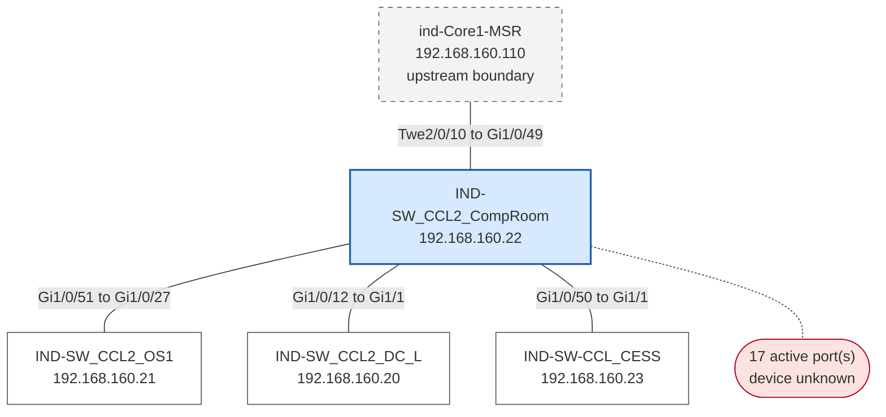

# IND-SW_CCL2_CompRoom

[Network index](../00-index.md) · [Topology](../01-topology_and_connections.md) · [Inventory](../02-switch_inventory.md) · [Connected devices](../03-connected_devices.md)

> **Placement:** Network_02_CCL2_CompRoom_Provisional (head). Department and physical location are **unknown**.

## 1. Identification

| Field | Value |
|---|---|
| Hostname (as collected) | `IND-SW_CCL2_CompRoom` |
| Management IP | 192.168.160.22 |
| Role in its network | Head |
| Switch hops from head | 0 |
| Hardware model | WS-C2960X-48TS-L (advertised by neighbours via CDP). SwitchScribe reports WS-C2960X-24TS-L: they disagree |
| Firmware / IOS | 15.0(2a)EX5 (as advertised to neighbours via CDP/LLDP) |
| Ports (SwitchScribe) | 53 reported, 21 up |
| Collection | success (Netmiko SSH, 4.32s) |
| Physical location | Not documented |
| Source note (Device Info and Raw CLI) | [[IND-SW_CCL2_CompRoom (SwitchScribe)]] |

## 2. Individual topology

Diagram key: solid line = link reported from **both** ends; dotted arrow = reported from **one** end only. Dashed box = upstream boundary (not part of this network). Label = port on the upper device, then port on the lower device.

## 3. Switch-to-switch connections

| Local port | Remote switch | Remote port | Relationship | Evidence | Conflicting observations |
|---|---|---|---|---|---|
| `Gi1/0/12` | [[IND-SW_CCL2_DC_L]] | `Gi1/1` | Downstream or lateral | seen from both ends; source CDP/LLDP | — |
| `Gi1/0/49` | [[Unclassified-192.168.160.110]] (ind-Core1-MSR) | `Twe2/0/10` | Upstream boundary (core) | seen from both ends; source CDP+CDP/LLDP | LLDP-only record Gi1/0/49 to Twe1/0/30 (reported by Unclassified-192.168.160.110) |
| `Gi1/0/50` | [[IND-SW-CCL_CESS]] | `Gi1/1` | Downstream or lateral | seen from both ends; source CDP | — |
| `Gi1/0/51` | [[IND-SW_CCL2_OS1]] | `Gi1/0/27` | Lateral link between two heads | seen from both ends; source CDP/LLDP | — |

## 4. Connected end devices

No named end devices were reported by this switch.

**17 active port(s) report no CDP/LLDP neighbour**, so the device on them is unknown: Gi1/0/2-3, Gi1/0/5, Gi1/0/8, Gi1/0/11, Gi1/0/13-18, Gi1/0/24, Gi1/0/26, Gi1/0/28-29, Gi1/0/35, Gi1/0/43.

## 5. Ports and VLANs

53 ports listed; 21 up.

| VLAN | Name | Ports | Port list |
|---|---|---|---|
| 1 | default | 2 | Gi1/0/33, Gi1/0/52 |
| 501 | CCL_Network | 25 | Gi1/0/1, Gi1/0/3-11, Gi1/0/13-16, Gi1/0/19, Gi1/0/26-32, Gi1/0/34-35, Gi1/0/43 |
| 561 | CESMS | 4 | Gi1/0/2, Gi1/0/17-18, Gi1/0/20 |
| 593 | Ignition | 5 | Gi1/0/21-25 |
| 700 | DrivesVlan | 12 | Gi1/0/36-42, Gi1/0/44-48 |

## 6. Outstanding questions

- [ ] Confirm the department and physical location of this switch.
- [ ] Photograph the switch and record its rack / panel label.
- [ ] Resolve the model: SwitchScribe says `WS-C2960X-24TS-L`, neighbours advertise `WS-C2960X-48TS-L`. The advertised value matches the interface names where checked.
- [ ] Identify the unidentified end devices (MAC/GUID-only neighbours and active ports with no CDP/LLDP data).
- [ ] Review 1 CDP/LLDP port conflict(s) in section 3 (LLDP-only records that name a different port).
