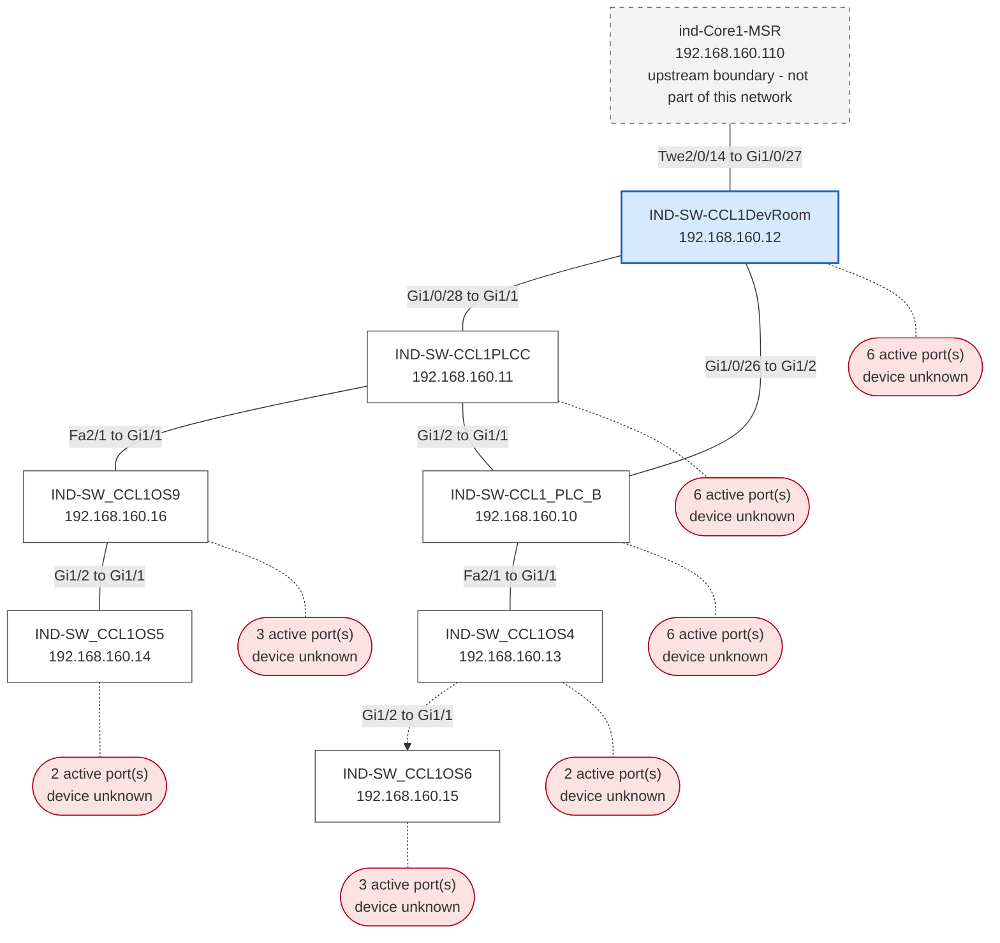

# Topology and connections - Network_03_CCL1DevRoom_Provisional

[Network index](00-index.md) · [[01-network_overview|Network overview]]

## 1. Upstream boundary

The core layer is the network boundary. The connection to it is recorded as an upstream link; the core and everything beyond it are not part of this network.

| Head switch | Head port | Upstream device | Upstream port | Evidence | Source | Conflicting observations |
|---|---|---|---|---|---|---|
| [[IND-SW-CCL1DevRoom]] | `Gi1/0/27` | ind-Core1-MSR (probable identity of 192.168.160.110) | `Twe2/0/14` | seen from both ends | CDP+CDP/LLDP | LLDP-only: Gi1/0/27 to Twe1/0/11 |

## 2. Topology

Diagram key: solid line = link reported from **both** ends; dotted arrow = reported from **one** end only. Dashed box = upstream boundary (not part of this network). Label = port on the upper device, then port on the lower device.

## 3. Links inside the network

| Upper switch | Port | Port | Lower switch | Media | Evidence | Conflicting observations |
|---|---|---|---|---|---|---|
| [[IND-SW-CCL1DevRoom]] | `Gi1/0/28` | `Gi1/1` | [[IND-SW-CCL1PLCC]] | 1000baseX(FD) | seen from both ends | — |
| [[IND-SW-CCL1DevRoom]] | `Gi1/0/26` | `Gi1/2` | [[IND-SW-CCL1_PLC_B]] | 1000baseX(FD) | seen from both ends | — |
| [[IND-SW-CCL1PLCC]] | `Fa2/1` | `Gi1/1` | [[IND-SW_CCL1OS9]] | MAU type 21 | seen from both ends | — |
| [[IND-SW-CCL1PLCC]] | `Gi1/2` | `Gi1/1` | [[IND-SW-CCL1_PLC_B]] | 1000baseX(FD) | seen from both ends | — |
| [[IND-SW-CCL1_PLC_B]] | `Fa2/1` | `Gi1/1` | [[IND-SW_CCL1OS4]] | MAU type 21 | seen from both ends | — |
| [[IND-SW_CCL1OS4]] | `Gi1/2` | `Gi1/1` | [[IND-SW_CCL1OS6]] | 1000baseX(FD) | seen from one end only (the other end not collected / not reporting) | — |
| [[IND-SW_CCL1OS9]] | `Gi1/2` | `Gi1/1` | [[IND-SW_CCL1OS5]] | MAU type 21 | seen from both ends | — |

## 4. How the switches connect

- **IND-SW-CCL1DevRoom** (head) connects up to ind-Core1-MSR on `Gi1/0/27`.
- `IND-SW-CCL1DevRoom` `Gi1/0/28` connects to `IND-SW-CCL1PLCC` `Gi1/1`.
- `IND-SW-CCL1DevRoom` `Gi1/0/26` connects to `IND-SW-CCL1_PLC_B` `Gi1/2`.
- `IND-SW-CCL1PLCC` `Fa2/1` connects to `IND-SW_CCL1OS9` `Gi1/1`.
- `IND-SW-CCL1_PLC_B` `Fa2/1` connects to `IND-SW_CCL1OS4` `Gi1/1`.
- `IND-SW_CCL1OS4` `Gi1/2` connects to `IND-SW_CCL1OS6` `Gi1/1`.
- `IND-SW_CCL1OS9` `Gi1/2` connects to `IND-SW_CCL1OS5` `Gi1/1`.

## 5. Observations

- The internal link count (7) exceeds a tree (6): there is a loop or a redundant path (possibly an intentional ring). Confirm the ring or spanning-tree configuration on these switches.
- 1 LLDP-only record(s) name different ports from CDP for the same switch pair. CDP is used above; the conflicting records are kept in the link tables. See [[02-network_boundary_method]].
