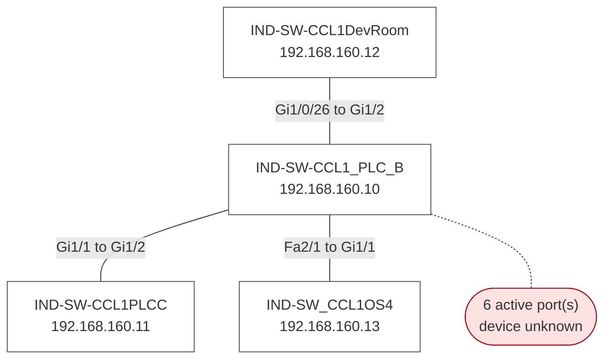

# IND-SW-CCL1_PLC_B

[Network index](../00-index.md) · [Topology](../01-topology_and_connections.md) · [Inventory](../02-switch_inventory.md) · [Connected devices](../03-connected_devices.md)

> **Placement:** Network_03_CCL1DevRoom_Provisional (access). Department and physical location are **unknown**.

## 1. Identification

| Field | Value |
|---|---|
| Hostname (as collected) | `IND-SW-CCL1_PLC_B` |
| Management IP | 192.168.160.10 |
| Role in its network | Access |
| Switch hops from head | 1 |
| Hardware model | IE-3000-8TC (SwitchScribe) |
| Firmware / IOS | 15.0(2)EY3 (as advertised to neighbours via CDP/LLDP) |
| Ports (SwitchScribe) | 18 reported, 9 up |
| Collection | success (Netmiko SSH, 4.77s) |
| Physical location | Not documented |
| Source note (Device Info and Raw CLI) | [[IND-SW-CCL1_PLC_B (SwitchScribe)]] |

## 2. Individual topology

Diagram key: solid line = link reported from **both** ends; dotted arrow = reported from **one** end only. Dashed box = upstream boundary (not part of this network). Label = port on the upper device, then port on the lower device.

## 3. Switch-to-switch connections

| Local port | Remote switch | Remote port | Relationship | Evidence | Conflicting observations |
|---|---|---|---|---|---|
| `Fa2/1` | [[IND-SW_CCL1OS4]] | `Gi1/1` | Downstream or lateral | seen from both ends; source CDP/LLDP | — |
| `Gi1/1` | [[IND-SW-CCL1PLCC]] | `Gi1/2` | Downstream or lateral | seen from both ends; source CDP/LLDP | — |
| `Gi1/2` | [[IND-SW-CCL1DevRoom]] | `Gi1/0/26` | Parent / uplink | seen from both ends; source CDP/LLDP | — |

## 4. Connected end devices

No named end devices were reported by this switch.

**6 active port(s) report no CDP/LLDP neighbour**, so the device on them is unknown: Fa1/1-4, Fa1/7-8.

## 5. Ports and VLANs

18 ports listed; 9 up.

| VLAN | Name | Ports | Port list |
|---|---|---|---|
| 1 | default | 7 | Fa2/2-8 |
| 501 | VLAN0501 | 8 | Fa1/1-8 |

## 6. Outstanding questions

- [ ] Confirm the department and physical location of this switch.
- [ ] Photograph the switch and record its rack / panel label.
- [ ] Identify the unidentified end devices (MAC/GUID-only neighbours and active ports with no CDP/LLDP data).
