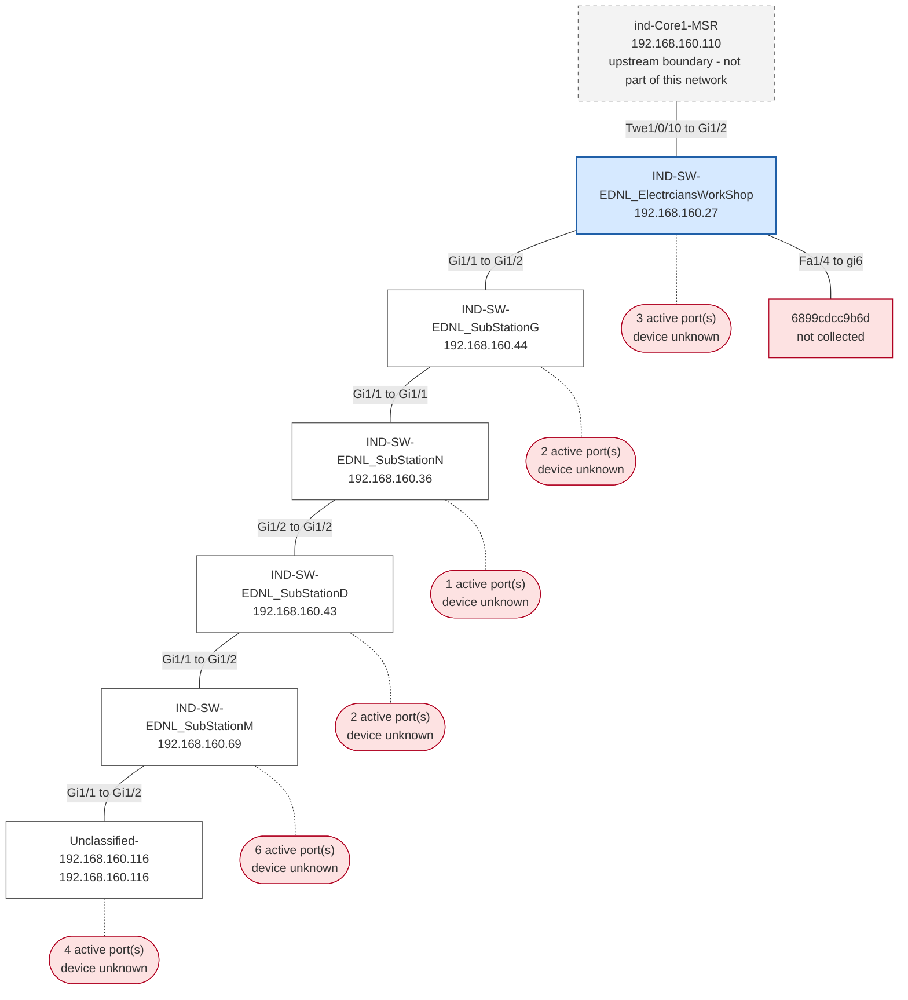

# Topology and connections - Network_04_EDNL_ElectrciansWorkShop_Provisional

[Network index](00-index.md) · [[01-network_overview|Network overview]]

## 1. Upstream boundary

The core layer is the network boundary. The connection to it is recorded as an upstream link; the core and everything beyond it are not part of this network.

| Head switch | Head port | Upstream device | Upstream port | Evidence | Source | Conflicting observations |
|---|---|---|---|---|---|---|
| [[IND-SW-EDNL_ElectrciansWorkShop]] | `Gi1/2` | ind-Core1-MSR (probable identity of 192.168.160.110) | `Twe1/0/10` | seen from both ends | CDP/LLDP | — |

## 2. Topology

Diagram key: solid line = link reported from **both** ends; dotted arrow = reported from **one** end only. Dashed box = upstream boundary (not part of this network). Label = port on the upper device, then port on the lower device.

## 3. Links inside the network

| Upper switch | Port | Port | Lower switch | Media | Evidence | Conflicting observations |
|---|---|---|---|---|---|---|
| [[IND-SW-EDNL_ElectrciansWorkShop]] | `Gi1/1` | `Gi1/2` | [[IND-SW-EDNL_SubStationG]] | 1000baseX(FD) | seen from both ends | — |
| [[IND-SW-EDNL_SubStationG]] | `Gi1/1` | `Gi1/1` | [[IND-SW-EDNL_SubStationN]] | 1000baseX(FD) | seen from both ends | LLDP-only Gi1/1 to Gi1/2 |
| [[IND-SW-EDNL_SubStationD]] | `Gi1/1` | `Gi1/2` | [[IND-SW-EDNL_SubStationM]] | 1000baseX(FD) | seen from both ends | — |
| [[IND-SW-EDNL_SubStationN]] | `Gi1/2` | `Gi1/2` | [[IND-SW-EDNL_SubStationD]] | 1000baseT(FD), 100base-T | seen from both ends | — |
| [[IND-SW-EDNL_SubStationM]] | `Gi1/1` | `Gi1/2` | [[Unclassified-192.168.160.116]] | — | seen from both ends | — |

## 4. How the switches connect

- **IND-SW-EDNL_ElectrciansWorkShop** (head) connects up to ind-Core1-MSR on `Gi1/2`.
- `IND-SW-EDNL_ElectrciansWorkShop` `Gi1/1` connects to `IND-SW-EDNL_SubStationG` `Gi1/2`.
- `IND-SW-EDNL_SubStationD` `Gi1/1` connects to `IND-SW-EDNL_SubStationM` `Gi1/2`.
- `IND-SW-EDNL_SubStationG` `Gi1/1` connects to `IND-SW-EDNL_SubStationN` `Gi1/1`.
- `IND-SW-EDNL_SubStationM` `Gi1/1` connects to `Unclassified-192.168.160.116` `Gi1/2`.
- `IND-SW-EDNL_SubStationN` `Gi1/2` connects to `IND-SW-EDNL_SubStationD` `Gi1/2`.

## 5. Observations

- 1 LLDP-only record(s) name different ports from CDP for the same switch pair. CDP is used above; the conflicting records are kept in the link tables. See [[02-network_boundary_method]].
