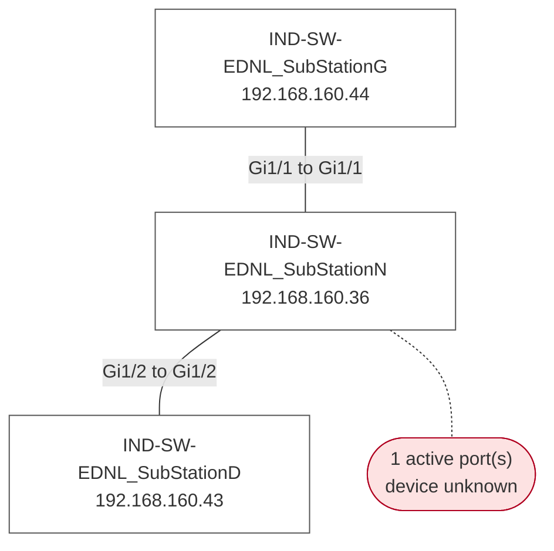

# IND-SW-EDNL_SubStationN

[Network index](../00-index.md) · [Topology](../01-topology_and_connections.md) · [Inventory](../02-switch_inventory.md) · [Connected devices](../03-connected_devices.md)

> **Placement:** Network_04_EDNL_ElectrciansWorkShop_Provisional (access). Department and physical location are **unknown**.

## 1. Identification

| Field | Value |
|---|---|
| Hostname (as collected) | `IND-SW-EDNL_SubStationN` |
| Management IP | 192.168.160.36 |
| Role in its network | Access |
| Switch hops from head | 2 |
| Hardware model | IE-3200-8T2S (advertised by neighbours via CDP). SwitchScribe reports IE-3000-8TC: they disagree |
| Firmware / IOS | 16.12.3 (as advertised to neighbours via CDP/LLDP) |
| Ports (SwitchScribe) | 10 reported, 3 up |
| Collection | success (Netmiko SSH, 4.27s) |
| Physical location | Not documented |
| Source note (Device Info and Raw CLI) | [[IND-SW-EDNL_SubStationN (SwitchScribe)]] |

## 2. Individual topology

Diagram key: solid line = link reported from **both** ends; dotted arrow = reported from **one** end only. Dashed box = upstream boundary (not part of this network). Label = port on the upper device, then port on the lower device.

## 3. Switch-to-switch connections

| Local port | Remote switch | Remote port | Relationship | Evidence | Conflicting observations |
|---|---|---|---|---|---|
| `Gi1/1` | [[IND-SW-EDNL_SubStationG]] | `Gi1/1` | Parent / uplink | seen from both ends; source CDP/LLDP | LLDP-only record Gi1/1 to Gi1/2 (reported by IND-SW-EDNL_SubStationN) |
| `Gi1/2` | [[IND-SW-EDNL_SubStationD]] | `Gi1/2` | Downstream or lateral | seen from both ends; source CDP/LLDP | — |

## 4. Connected end devices

No named end devices were reported by this switch.

**1 active port(s) report no CDP/LLDP neighbour**, so the device on them is unknown: Gi1/3.

## 5. Ports and VLANs

10 ports listed; 3 up.

| VLAN | Name | Ports | Port list |
|---|---|---|---|
| 561 | CESMS | 8 | Gi1/3-10 |

## 6. Outstanding questions

- [ ] Confirm the department and physical location of this switch.
- [ ] Photograph the switch and record its rack / panel label.
- [ ] Resolve the model: SwitchScribe says `IE-3000-8TC`, neighbours advertise `IE-3200-8T2S`. The advertised value matches the interface names where checked.
- [ ] Identify the unidentified end devices (MAC/GUID-only neighbours and active ports with no CDP/LLDP data).
- [ ] Review 1 CDP/LLDP port conflict(s) in section 3 (LLDP-only records that name a different port).
