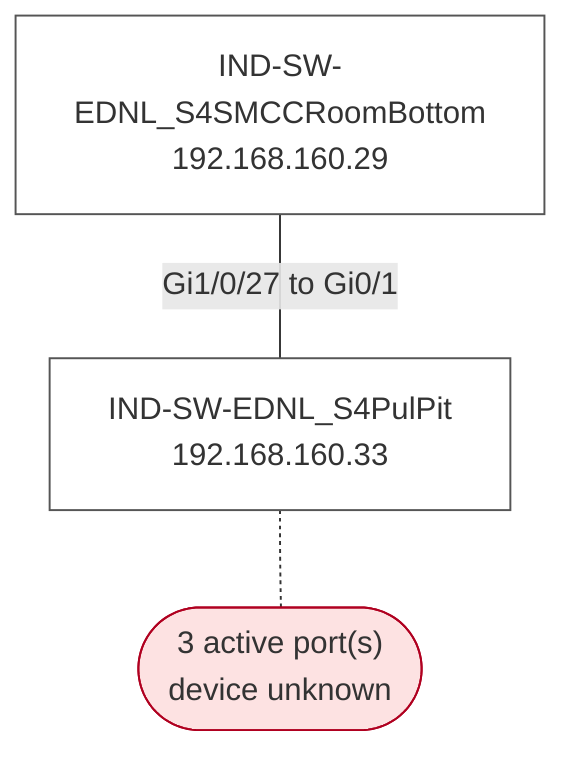

# IND-SW-EDNL_S4PulPit

[Network index](../00-index.md) · [Topology](../01-topology_and_connections.md) · [Inventory](../02-switch_inventory.md) · [Connected devices](../03-connected_devices.md)

> **Placement:** Network_05_EDNL_S4SMCCRoomBottom_Provisional (access). Department and physical location are **unknown**.

## 1. Identification

| Field | Value |
|---|---|
| Hostname (as collected) | `IND-SW-EDNL_S4PulPit` |
| Management IP | 192.168.160.33 |
| Role in its network | Access |
| Switch hops from head | 1 |
| Hardware model | WS-C2960-8TC-L (advertised by neighbours via CDP). SwitchScribe reports WS-C2960X-24TS-L: they disagree |
| Firmware / IOS | 12.2(35)SE5 (as advertised to neighbours via CDP/LLDP) |
| Ports (SwitchScribe) | 9 reported, 4 up |
| Collection | partial (Netmiko Telnet, 6.12s). Error: 2 command(s) could not be collected. |
| Physical location | Not documented |
| Source note (Device Info and Raw CLI) | [[IND-SW-EDNL_S4PulPit (SwitchScribe)]] |

## 2. Individual topology

Diagram key: solid line = link reported from **both** ends; dotted arrow = reported from **one** end only. Dashed box = upstream boundary (not part of this network). Label = port on the upper device, then port on the lower device.

## 3. Switch-to-switch connections

| Local port | Remote switch | Remote port | Relationship | Evidence | Conflicting observations |
|---|---|---|---|---|---|
| `Gi0/1` | [[IND-SW-EDNL_S4SMCCRoomBottom]] | `Gi1/0/27` | Parent / uplink | seen from both ends; source CDP | — |

_Collection status is **partial**: these links come from the neighbours' own reports, not from this switch._

## 4. Connected end devices

Unknown: this switch could not be collected.

**3 active port(s) report no CDP/LLDP neighbour**, so the device on them is unknown: Fa0/1, Fa0/6, Fa0/8.

## 5. Ports and VLANs

9 ports listed; 4 up.

| VLAN | Name | Ports | Port list |
|---|---|---|---|
| 514 | S4_Vlan | 8 | Fa0/1-8 |

## 6. Outstanding questions

- [ ] Confirm the department and physical location of this switch.
- [ ] Photograph the switch and record its rack / panel label.
- [ ] Capture this switch by hand (collection partial); see [[01-Documentation_Guide]].
- [ ] Resolve the model: SwitchScribe says `WS-C2960X-24TS-L`, neighbours advertise `WS-C2960-8TC-L`. The advertised value matches the interface names where checked.
- [ ] Identify the unidentified end devices (MAC/GUID-only neighbours and active ports with no CDP/LLDP data).
