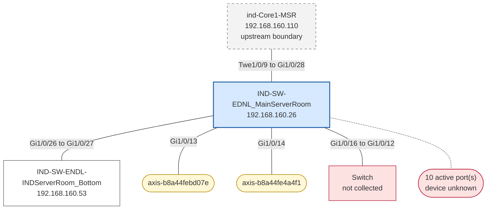

# IND-SW-EDNL_MainServerRoom

[Network index](../00-index.md) · [Topology](../01-topology_and_connections.md) · [Inventory](../02-switch_inventory.md) · [Connected devices](../03-connected_devices.md)

> **Placement:** Network_07_EDNL_MainServerRoom_Provisional (head). Department and physical location are **unknown**.

## 1. Identification

| Field | Value |
|---|---|
| Hostname (as collected) | `IND-SW-EDNL_MainServerRoom` |
| Management IP | 192.168.160.26 |
| Role in its network | Head |
| Switch hops from head | 0 |
| Hardware model | WS-C2960X-24TS-L (advertised by neighbours via CDP) |
| Firmware / IOS | 15.2(2)E3 (as advertised to neighbours via CDP/LLDP) |
| Ports (SwitchScribe) | 29 reported, 14 up |
| Collection | success (Netmiko SSH, 4.19s) |
| Physical location | Not documented |
| Source note (Device Info and Raw CLI) | [[IND-SW-EDNL_MainServerRoom (SwitchScribe)]] |

## 2. Individual topology

Diagram key: solid line = link reported from **both** ends; dotted arrow = reported from **one** end only. Dashed box = upstream boundary (not part of this network). Label = port on the upper device, then port on the lower device.

## 3. Switch-to-switch connections

| Local port | Remote switch | Remote port | Relationship | Evidence | Conflicting observations |
|---|---|---|---|---|---|
| `Gi1/0/26` | [[IND-SW-ENDL-INDServerRoom_Bottom]] | `Gi1/0/27` | Lateral link between two heads | seen from both ends; source CDP | — |
| `Gi1/0/28` | [[Unclassified-192.168.160.110]] (ind-Core1-MSR) | `Twe1/0/9` | Upstream boundary (core) | seen from both ends; source CDP+CDP/LLDP | LLDP-only record Gi1/0/28 to Twe2/0/19 (reported by Unclassified-192.168.160.110) |

Neighbour switches that are **not in the collected inventory**:

| Local port | Neighbour | Remote port | IP | Description |
|---|---|---|---|---|
| `Gi1/0/16` | Switch | Gi1/0/12 | 192.168.1.1 | cisco C9200CX-12P-2X2G |

## 4. Connected end devices

| Port | Device | Type (from LLDP text) | Remote port | IP | LLDP description | Media |
|---|---|---|---|---|---|---|
| `Gi1/0/13` | axis-b8a44febd07e | unclassified endpoint | eth0 | 192.168.162.41 | Linux | 100base-TX(FD), 100base-TX(HD) |
| `Gi1/0/14` | axis-b8a44fe4a4f1 | unclassified endpoint | eth0 | 192.168.162.40 | Linux | 100base-TX(FD), 100base-TX(HD) |

**10 active port(s) report no CDP/LLDP neighbour**, so the device on them is unknown: Gi1/0/2, Gi1/0/4-11, Gi1/0/21.

## 5. Ports and VLANs

31 ports listed; 15 up.

| VLAN | Name | Ports | Port list |
|---|---|---|---|
| 1 | default | 8 | Gi1/0/12, Gi1/0/15, Gi1/0/17-20, Gi1/0/25, Gi1/0/27 |
| 250 | 250 | 8 | Gi1/0/10, Gi1/0/4, Gi1/0/5, Gi1/0/6, Gi1/0/7, Gi1/0/8, Gi1/0/9, active    Gi1/0/3 |
| 515 | FS15 | 1 | active |
| 560 | VLAN0560 | 3 | Gi1/0/22-24 |
| 561 | VLAN0561 | 1 | Gi1/0/11 |
| 562 | IND-CCTV | 3 | Gi1/0/13-14, Gi1/0/16 |
| 585 | A17_Network | 1 | Gi1/0/1 |
| 590 | EDPowerMeters | 1 | Gi1/0/2 |

## 6. Outstanding questions

- [ ] Confirm the department and physical location of this switch.
- [ ] Photograph the switch and record its rack / panel label.
- [ ] Identify the unidentified end devices (MAC/GUID-only neighbours and active ports with no CDP/LLDP data).
- [ ] Collect the neighbour switch(es) listed in section 3 that are not in the inventory.
- [ ] Review 1 CDP/LLDP port conflict(s) in section 3 (LLDP-only records that name a different port).
