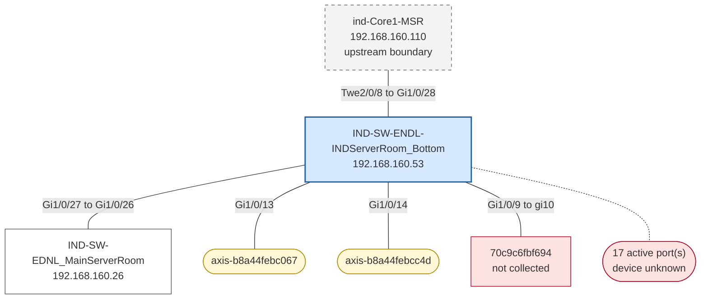

# IND-SW-ENDL-INDServerRoom_Bottom

[Network index](../00-index.md) · [Topology](../01-topology_and_connections.md) · [Inventory](../02-switch_inventory.md) · [Connected devices](../03-connected_devices.md)

> **Placement:** Network_07_EDNL_MainServerRoom_Provisional (head). Department and physical location are **unknown**.

## 1. Identification

| Field | Value |
|---|---|
| Hostname (as collected) | `IND-SW-ENDL-INDServerRoom_Bottom` |
| Management IP | 192.168.160.53 |
| Role in its network | Head |
| Switch hops from head | 0 |
| Hardware model | WS-C2960X-24PS-L (advertised by neighbours via CDP) |
| Firmware / IOS | 15.2(2)E6 (as advertised to neighbours via CDP/LLDP) |
| Ports (SwitchScribe) | 29 reported, 19 up |
| Collection | success (Netmiko SSH, 4.21s) |
| Physical location | Not documented |
| Source note (Device Info and Raw CLI) | [[IND-SW-ENDL-INDServerRoom_Bottom (SwitchScribe)]] |

## 2. Individual topology

Diagram key: solid line = link reported from **both** ends; dotted arrow = reported from **one** end only. Dashed box = upstream boundary (not part of this network). Label = port on the upper device, then port on the lower device.

## 3. Switch-to-switch connections

| Local port | Remote switch | Remote port | Relationship | Evidence | Conflicting observations |
|---|---|---|---|---|---|
| `Gi1/0/27` | [[IND-SW-EDNL_MainServerRoom]] | `Gi1/0/26` | Lateral link between two heads | seen from both ends; source CDP | — |
| `Gi1/0/28` | [[Unclassified-192.168.160.110]] (ind-Core1-MSR) | `Twe2/0/8` | Upstream boundary (core) | seen from both ends; source CDP | — |

Neighbour switches that are **not in the collected inventory**:

| Local port | Neighbour | Remote port | IP | Description |
|---|---|---|---|---|
| `Gi1/0/9` | 70c9c6fbf694 | gi10 | — | Cisco SG350-10SFP (PID:SG350-10SFP-K9)- |

## 4. Connected end devices

| Port | Device | Type (from LLDP text) | Remote port | IP | LLDP description | Media |
|---|---|---|---|---|---|---|
| `Gi1/0/13` | axis-b8a44febc067 | unclassified endpoint | eth0 | 192.168.162.39 | Linux | — |
| `Gi1/0/14` | axis-b8a44febcc4d | unclassified endpoint | eth0 | 192.168.162.38 | Linux | — |

**17 active port(s) report no CDP/LLDP neighbour**, so the device on them is unknown: Gi1/0/1-7, Gi1/0/11-12, Gi1/0/15, Gi1/0/17-20, Gi1/0/22-24.

## 5. Ports and VLANs

30 ports listed; 22 up.

| VLAN | Name | Ports | Port list |
|---|---|---|---|
| 250 | IND-250 | 12 | Gi1/0/5-6, Gi1/0/12, Gi1/0/15-21, Gi1/0/25-26 |
| 501 | CCL2 | 1 | Room                    active    Gi1/0/4 |
| 514 | IND-S4 | 1 | Gi1/0/7 |
| 560 | Management | 1 | Gi1/0/8 |
| 562 | IND-CCTV | 5 | Gi1/0/9-11, Gi1/0/13-14 |

## 6. Outstanding questions

- [ ] Confirm the department and physical location of this switch.
- [ ] Photograph the switch and record its rack / panel label.
- [ ] Identify the unidentified end devices (MAC/GUID-only neighbours and active ports with no CDP/LLDP data).
- [ ] Collect the neighbour switch(es) listed in section 3 that are not in the inventory.
