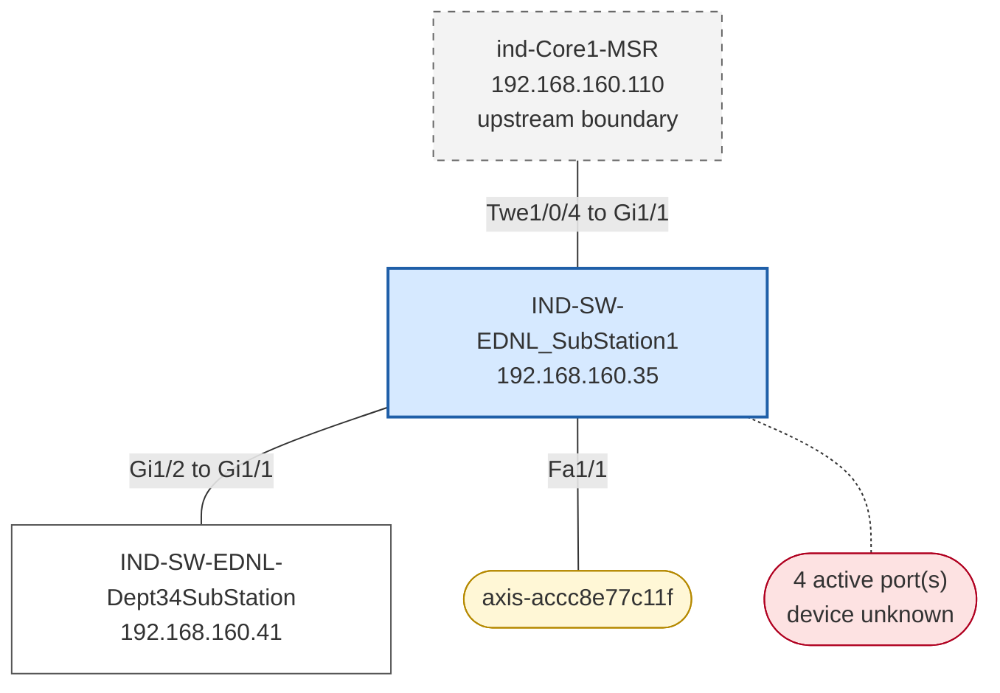

# IND-SW-EDNL_SubStation1

[Network index](../00-index.md) · [Topology](../01-topology_and_connections.md) · [Inventory](../02-switch_inventory.md) · [Connected devices](../03-connected_devices.md)

> **Placement:** Network_08_EDNL_SubStation1_Provisional (head). Department and physical location are **unknown**.

## 1. Identification

| Field | Value |
|---|---|
| Hostname (as collected) | `IND-SW-EDNL_SubStation1` |
| Management IP | 192.168.160.35 |
| Role in its network | Head |
| Switch hops from head | 0 |
| Hardware model | IE-3000-8TC (SwitchScribe) |
| Firmware / IOS | 12.2(58)SE2 (as advertised to neighbours via CDP/LLDP) |
| Ports (SwitchScribe) | 10 reported, 7 up |
| Collection | success (Netmiko SSH, 4.74s) |
| Physical location | Not documented |
| Source note (Device Info and Raw CLI) | [[IND-SW-EDNL_SubStation1 (SwitchScribe)]] |

## 2. Individual topology

Diagram key: solid line = link reported from **both** ends; dotted arrow = reported from **one** end only. Dashed box = upstream boundary (not part of this network). Label = port on the upper device, then port on the lower device.

## 3. Switch-to-switch connections

| Local port | Remote switch | Remote port | Relationship | Evidence | Conflicting observations |
|---|---|---|---|---|---|
| `Gi1/1` | [[Unclassified-192.168.160.110]] (ind-Core1-MSR) | `Twe1/0/4` | Upstream boundary (core) | seen from both ends; source CDP+CDP/LLDP | LLDP-only record Gi1/1 to Twe1/0/27 (reported by Unclassified-192.168.160.110) |
| `Gi1/2` | [[IND-SW-EDNL-Dept34SubStation]] | `Gi1/1` | Downstream or lateral | seen from both ends; source CDP/LLDP | — |

## 4. Connected end devices

| Port | Device | Type (from LLDP text) | Remote port | IP | LLDP description | Media |
|---|---|---|---|---|---|---|
| `Fa1/1` | axis-accc8e77c11f | unclassified endpoint | eth0 | 192.168.162.11 | Linux | 100base-TX(FD), 100base-TX(HD) |

**4 active port(s) report no CDP/LLDP neighbour**, so the device on them is unknown: Fa1/2-5.

## 5. Ports and VLANs

10 ports listed; 7 up.

| VLAN | Name | Ports | Port list |
|---|---|---|---|
| 561 | CESMS | 6 | Fa1/3-8 |
| 562 | IND-CCTV | 2 | Fa1/1-2 |

## 6. Outstanding questions

- [ ] Confirm the department and physical location of this switch.
- [ ] Photograph the switch and record its rack / panel label.
- [ ] Identify the unidentified end devices (MAC/GUID-only neighbours and active ports with no CDP/LLDP data).
- [ ] Review 1 CDP/LLDP port conflict(s) in section 3 (LLDP-only records that name a different port).
