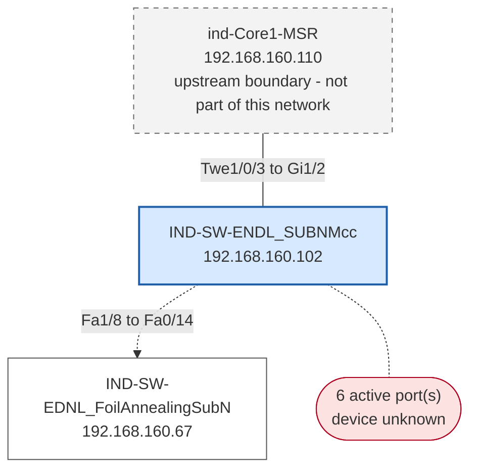

# Topology and connections - Network_10_ENDL_SUBNMcc_Provisional

[Network index](00-index.md) · [[01-network_overview|Network overview]]

## 1. Upstream boundary

The core layer is the network boundary. The connection to it is recorded as an upstream link; the core and everything beyond it are not part of this network.

| Head switch | Head port | Upstream device | Upstream port | Evidence | Source | Conflicting observations |
|---|---|---|---|---|---|---|
| [[IND-SW-ENDL_SUBNMcc]] | `Gi1/2` | ind-Core1-MSR (probable identity of 192.168.160.110) | `Twe1/0/3` | seen from both ends | CDP | LLDP-only: Fa1/3 to Twe1/0/3; LLDP-only: Gi1/2 to Twe2/0/2 |

## 2. Topology

Diagram key: solid line = link reported from **both** ends; dotted arrow = reported from **one** end only. Dashed box = upstream boundary (not part of this network). Label = port on the upper device, then port on the lower device.

## 3. Links inside the network

| Upper switch | Port | Port | Lower switch | Media | Evidence | Conflicting observations |
|---|---|---|---|---|---|---|
| [[IND-SW-ENDL_SUBNMcc]] | `Fa1/8` | `Fa0/14` | [[IND-SW-EDNL_FoilAnnealingSubN]] | — | seen from one end only (the other end not collected / not reporting) | — |

## 4. How the switches connect

- **IND-SW-ENDL_SUBNMcc** (head) connects up to ind-Core1-MSR on `Gi1/2`.
- `IND-SW-ENDL_SUBNMcc` `Fa1/8` connects to `IND-SW-EDNL_FoilAnnealingSubN` `Fa0/14`.

## 5. Observations

- 2 LLDP-only record(s) name different ports from CDP for the same switch pair. CDP is used above; the conflicting records are kept in the link tables. See [[02-network_boundary_method]].
