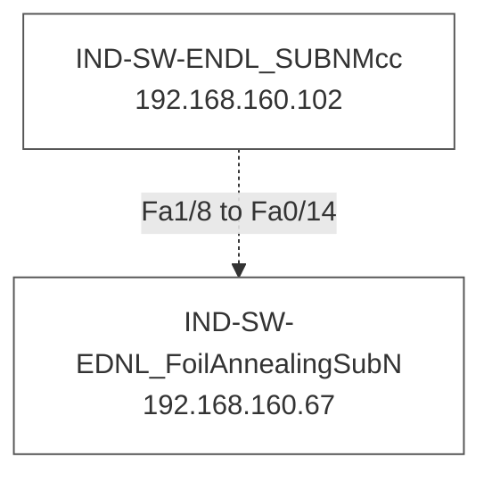

# IND-SW-EDNL_FoilAnnealingSubN

[Network index](../00-index.md) · [Topology](../01-topology_and_connections.md) · [Inventory](../02-switch_inventory.md) · [Connected devices](../03-connected_devices.md)

> **Placement:** Network_10_ENDL_SUBNMcc_Provisional (access). Department and physical location are **unknown**.

## 1. Identification

| Field | Value |
|---|---|
| Hostname (as collected) | `IND-SW-EDNL_FoilAnnealingSubN` |
| Management IP | 192.168.160.67 |
| Role in its network | Access |
| Switch hops from head | 1 |
| Hardware model | WS-C2950SX-24 (SwitchScribe) |
| Firmware / IOS | 12.1(22)EA9 (as advertised to neighbours via CDP/LLDP) |
| Ports (SwitchScribe) | — reported, — up |
| Collection | failed (Netmiko SSH, 10.00s). Error: NetmikoTimeoutException: TCP connection to device failed.  Common causes of this problem are: 1. Incorrect hostname or IP address. 2. Wrong TCP port. 3. Intermediate firewall blocking access.  Device settings: cisco_ios 192.168.160.67:22 |
| Physical location | Not documented |
| Source note (Device Info and Raw CLI) | [[IND-SW-EDNL_FoilAnnealingSubN (SwitchScribe)]] |

## 2. Individual topology

Diagram key: solid line = link reported from **both** ends; dotted arrow = reported from **one** end only. Dashed box = upstream boundary (not part of this network). Label = port on the upper device, then port on the lower device.

## 3. Switch-to-switch connections

| Local port | Remote switch | Remote port | Relationship | Evidence | Conflicting observations |
|---|---|---|---|---|---|
| `Fa0/14` | [[IND-SW-ENDL_SUBNMcc]] | `Fa1/8` | Parent / uplink | seen from one end only (the other end not collected / not reporting); source CDP | — |

_Collection status is **failed**: these links come from the neighbours' own reports, not from this switch._

## 4. Connected end devices

Unknown: this switch could not be collected.

## 5. Ports and VLANs

No port data: collection did not succeed.

## 6. Outstanding questions

- [ ] Confirm the department and physical location of this switch.
- [ ] Photograph the switch and record its rack / panel label.
- [ ] Capture this switch by hand (collection failed); see [[01-Documentation_Guide]].
- [ ] Verify the links seen from one end only (section 3) on the other switch.
