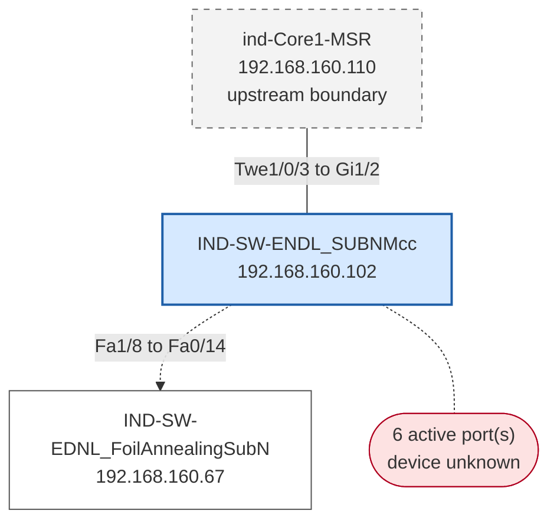

# IND-SW-ENDL_SUBNMcc

[Network index](../00-index.md) · [Topology](../01-topology_and_connections.md) · [Inventory](../02-switch_inventory.md) · [Connected devices](../03-connected_devices.md)

> **Placement:** Network_10_ENDL_SUBNMcc_Provisional (head). Department and physical location are **unknown**.

## 1. Identification

| Field | Value |
|---|---|
| Hostname (as collected) | `IND-SW-ENDL_SUBNMcc` |
| Management IP | 192.168.160.102 |
| Role in its network | Head |
| Switch hops from head | 0 |
| Hardware model | IE-3000-8TC (advertised by neighbours via CDP). SwitchScribe reports C9500-48Y4C: they disagree |
| Firmware / IOS | 15.2(5)E (as advertised to neighbours via CDP/LLDP) |
| Ports (SwitchScribe) | 10 reported, 9 up |
| Collection | success (Netmiko SSH, 4.95s) |
| Physical location | Not documented |
| Source note (Device Info and Raw CLI) | [[IND-SW-ENDL_SUBNMcc (SwitchScribe)]] |

## 2. Individual topology

Diagram key: solid line = link reported from **both** ends; dotted arrow = reported from **one** end only. Dashed box = upstream boundary (not part of this network). Label = port on the upper device, then port on the lower device.

## 3. Switch-to-switch connections

| Local port | Remote switch | Remote port | Relationship | Evidence | Conflicting observations |
|---|---|---|---|---|---|
| `Fa1/8` | [[IND-SW-EDNL_FoilAnnealingSubN]] | `Fa0/14` | Downstream or lateral | seen from one end only (the other end not collected / not reporting); source CDP | — |
| `Gi1/2` | [[Unclassified-192.168.160.110]] (ind-Core1-MSR) | `Twe1/0/3` | Upstream boundary (core) | seen from both ends; source CDP | LLDP-only record Fa1/3 to Twe1/0/3 (reported by IND-SW-ENDL_SUBNMcc); LLDP-only record Gi1/2 to Twe2/0/2 (reported by Unclassified-192.168.160.110) |

## 4. Connected end devices

No named end devices were reported by this switch.

**6 active port(s) report no CDP/LLDP neighbour**, so the device on them is unknown: Fa1/1-2, Fa1/4-7.

## 5. Ports and VLANs

10 ports listed; 9 up.

| VLAN | Name | Ports | Port list |
|---|---|---|---|
| 1 | default | 1 | Gi1/1 |
| 561 | IND-CESMS | 2 | Fa1/5-6 |
| 565 | IND-FoilAnnealing | 1 | Fa1/8 |
| 590 | ED_PowerMeter | 3 | Fa1/1-2, Fa1/7 |
| 593 | Ignition | 1 | Fa1/4 |

## 6. Outstanding questions

- [ ] Confirm the department and physical location of this switch.
- [ ] Photograph the switch and record its rack / panel label.
- [ ] Resolve the model: SwitchScribe says `C9500-48Y4C`, neighbours advertise `IE-3000-8TC`. The advertised value matches the interface names where checked.
- [ ] Identify the unidentified end devices (MAC/GUID-only neighbours and active ports with no CDP/LLDP data).
- [ ] Verify the links seen from one end only (section 3) on the other switch.
- [ ] Review 2 CDP/LLDP port conflict(s) in section 3 (LLDP-only records that name a different port).
