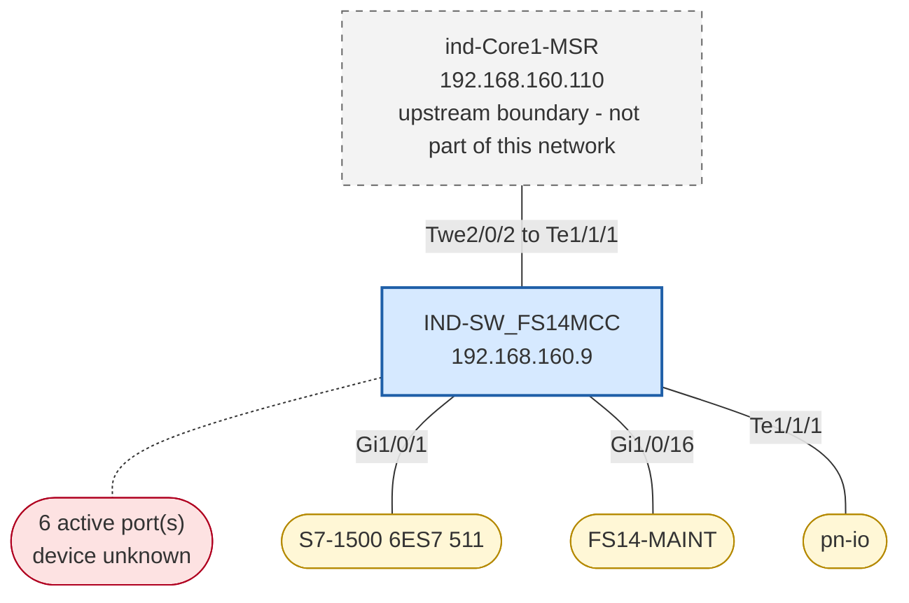

# Topology and connections - Network_14_FS14MCC_Provisional

[Network index](00-index.md) · [[01-network_overview|Network overview]]

## 1. Upstream boundary

The core layer is the network boundary. The connection to it is recorded as an upstream link; the core and everything beyond it are not part of this network.

| Head switch | Head port | Upstream device | Upstream port | Evidence | Source | Conflicting observations |
|---|---|---|---|---|---|---|
| [[IND-SW_FS14MCC]] | `Te1/1/1` | ind-Core1-MSR (probable identity of 192.168.160.110) | `Twe2/0/2` | seen from both ends | CDP | LLDP-only: Gi1/0/9 to Twe2/0/2; LLDP-only: Te1/1/1 to Twe2/0/1 |

## 2. Topology

Diagram key: solid line = link reported from **both** ends; dotted arrow = reported from **one** end only. Dashed box = upstream boundary (not part of this network). Label = port on the upper device, then port on the lower device.

## 3. Links inside the network

None: this network contains a single switch.

## 4. How the switches connect

- **IND-SW_FS14MCC** (head) connects up to ind-Core1-MSR on `Te1/1/1`.

## 5. Observations

- 2 LLDP-only record(s) name different ports from CDP for the same switch pair. CDP is used above; the conflicting records are kept in the link tables. See [[02-network_boundary_method]].
