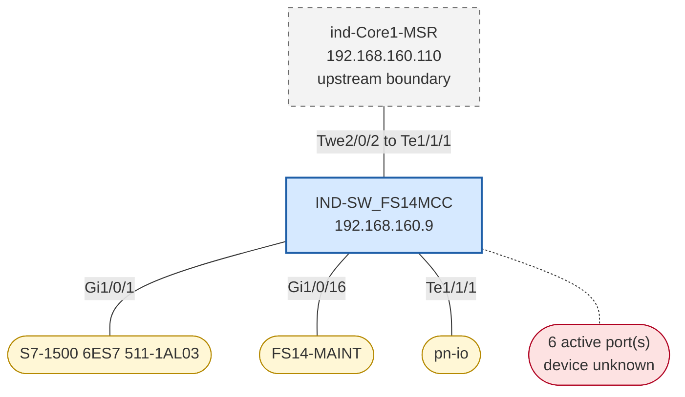

# IND-SW_FS14MCC

[Network index](../00-index.md) · [Topology](../01-topology_and_connections.md) · [Inventory](../02-switch_inventory.md) · [Connected devices](../03-connected_devices.md)

> **Placement:** Network_14_FS14MCC_Provisional (head). Department and physical location are **unknown**.

## 1. Identification

| Field | Value |
|---|---|
| Hostname (as collected) | `IND-SW_FS14MCC` |
| Management IP | 192.168.160.9 |
| Role in its network | Head |
| Switch hops from head | 0 |
| Hardware model | C9200L-24P-4X (advertised by neighbours via CDP). SwitchScribe reports C9500-48Y4C: they disagree |
| Firmware / IOS | 17.12.3 (as advertised to neighbours via CDP/LLDP) |
| Ports (SwitchScribe) | 29 reported, 10 up |
| Collection | success (Netmiko SSH, 4.53s) |
| Physical location | Not documented |
| Source note (Device Info and Raw CLI) | [[IND-SW_FS14MCC (SwitchScribe)]] |

## 2. Individual topology

Diagram key: solid line = link reported from **both** ends; dotted arrow = reported from **one** end only. Dashed box = upstream boundary (not part of this network). Label = port on the upper device, then port on the lower device.

## 3. Switch-to-switch connections

| Local port | Remote switch | Remote port | Relationship | Evidence | Conflicting observations |
|---|---|---|---|---|---|
| `Te1/1/1` | [[Unclassified-192.168.160.110]] (ind-Core1-MSR) | `Twe2/0/2` | Upstream boundary (core) | seen from both ends; source CDP | LLDP-only record Gi1/0/9 to Twe2/0/2 (reported by IND-SW_FS14MCC); LLDP-only record Te1/1/1 to Twe2/0/1 (reported by Unclassified-192.168.160.110) |

## 4. Connected end devices

| Port | Device | Type (from LLDP text) | Remote port | IP | LLDP description | Media |
|---|---|---|---|---|---|---|
| `Gi1/0/1` | S7-1500                   6ES7 511-1AL03-0AB | unclassified endpoint | Siemens, SIMATIC S7, Eth | 192.168.0.43 | Siemens, SIMATIC S7, CPU 1511-1 PN, 6ES7 511-1AL03-0AB0, HW: | 100base-TX(FD), 100base-TX(HD) |
| `Gi1/0/16` | FS14-MAINT | unclassified endpoint | port-001 | 192.168.19.100 | LENOVO 10FWCTO1WW,ThinkCentre M800,S4V62839 + engineering | 1000baseT(FD), 1000baseT(HD),  |
| `Te1/1/1` | pn-io | unclassified endpoint | port-001 | 192.168.19.20 | — | 100base-TX(FD), 100base-TX(HD) |

**6 active port(s) report no CDP/LLDP neighbour**, so the device on them is unknown: Gi1/0/2, Gi1/0/5, Gi1/0/7-8, Gi1/0/14, Gi1/0/17.

## 5. Ports and VLANs

29 ports listed; 10 up.

| VLAN | Name | Ports | Port list |
|---|---|---|---|
| 1 | default | 3 | Te1/1/2-4 |
| 515 | FS15 | 1 | Gi1/0/24 |
| 519 | FS14 | 17 | Gi1/0/1-4, Gi1/0/6-12, Gi1/0/16, Gi1/0/19-23 |
| 561 | cesms | 2 | Gi1/0/13-14 |
| 565 | IND-FoilFinishing | 1 | Gi1/0/15 |
| 590 | ED_Powermeters | 1 | Gi1/0/5 |
| 593 | Ignition | 2 | Gi1/0/17-18 |

## 6. Outstanding questions

- [ ] Confirm the department and physical location of this switch.
- [ ] Photograph the switch and record its rack / panel label.
- [ ] Resolve the model: SwitchScribe says `C9500-48Y4C`, neighbours advertise `C9200L-24P-4X`. The advertised value matches the interface names where checked.
- [ ] Identify the unidentified end devices (MAC/GUID-only neighbours and active ports with no CDP/LLDP data).
- [ ] Review 2 CDP/LLDP port conflict(s) in section 3 (LLDP-only records that name a different port).
