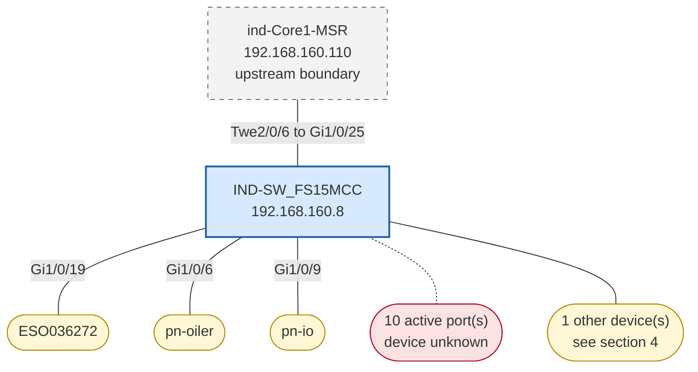

# IND-SW_FS15MCC

[Network index](../00-index.md) · [Topology](../01-topology_and_connections.md) · [Inventory](../02-switch_inventory.md) · [Connected devices](../03-connected_devices.md)

> **Placement:** Network_15_FS15MCC_Provisional (head). Department and physical location are **unknown**.

## 1. Identification

| Field | Value |
|---|---|
| Hostname (as collected) | `IND-SW_FS15MCC` |
| Management IP | 192.168.160.8 |
| Role in its network | Head |
| Switch hops from head | 0 |
| Hardware model | WS-C2960X-24TS-L (advertised by neighbours via CDP). SwitchScribe reports C9500-48Y4C: they disagree |
| Firmware / IOS | 15.2(2)E5 (as advertised to neighbours via CDP/LLDP) |
| Ports (SwitchScribe) | 29 reported, 16 up |
| Collection | success (Netmiko SSH, 4.18s) |
| Physical location | Not documented |
| Source note (Device Info and Raw CLI) | [[IND-SW_FS15MCC (SwitchScribe)]] |

## 2. Individual topology

Diagram key: solid line = link reported from **both** ends; dotted arrow = reported from **one** end only. Dashed box = upstream boundary (not part of this network). Label = port on the upper device, then port on the lower device.

## 3. Switch-to-switch connections

| Local port | Remote switch | Remote port | Relationship | Evidence | Conflicting observations |
|---|---|---|---|---|---|
| `Gi1/0/25` | [[Unclassified-192.168.160.110]] (ind-Core1-MSR) | `Twe2/0/6` | Upstream boundary (core) | seen from both ends; source CDP | LLDP-only record Gi1/0/5 to Twe2/0/6 (reported by IND-SW_FS15MCC); LLDP-only record Gi1/0/25 to Twe2/0/10 (reported by Unclassified-192.168.160.110) |

## 4. Connected end devices

| Port | Device | Type (from LLDP text) | Remote port | IP | LLDP description | Media |
|---|---|---|---|---|---|---|
| `Gi1/0/19` | ESO036272 | unclassified endpoint | e8cf.8352.8c38 | — | — | 1000baseT(FD) |
| `Gi1/0/6` | pn-oiler | unclassified endpoint | Siemens, SIMATIC NET, CP | 192.168.15.150 | Siemens, SIMATIC NET, CP 343-1 Lean, 6GK7 343-1CX10-0XE0, HW | 100base-T2(FD), 100base-T2(HD) |
| `Gi1/0/7` | 9c7b.ef29.73ee | unclassified endpoint | 9c7b.ef29.73ee | — | — | 1000baseT(FD) |
| `Gi1/0/9` | pn-io | unclassified endpoint | port-001 | 192.168.15.20 | — | 100base-TX(FD), 100base-TX(HD) |

1 of these advertise only a MAC address or GUID and are **unidentified**.

**10 active port(s) report no CDP/LLDP neighbour**, so the device on them is unknown: Gi1/0/1, Gi1/0/3-4, Gi1/0/10, Gi1/0/12-16, Gi1/0/22.

## 5. Ports and VLANs

31 ports listed; 16 up.

| VLAN | Name | Ports | Port list |
|---|---|---|---|
| 1 | default | 3 | Gi1/0/26-28 |
| 515 | FS15 | 20 | Gi1/0/10, Gi1/0/11, Gi1/0/12, Gi1/0/17, Gi1/0/18, Gi1/0/19, Gi1/0/2, Gi1/0/20, Gi1/0/21, Gi1/0/22, Gi1/0/23, Gi1/0/24, Gi1/0/3, Gi1/0/4, Gi1/0/5, Gi1/0/6, Gi1/0/7, Gi1/0/8, Gi1/0/9, active    Gi1/0/1 |
| 561 | CESMS | 1 | active |
| 590 | EDPowerMeters | 4 | Gi1/0/13-16 |

## 6. Outstanding questions

- [ ] Confirm the department and physical location of this switch.
- [ ] Photograph the switch and record its rack / panel label.
- [ ] Resolve the model: SwitchScribe says `C9500-48Y4C`, neighbours advertise `WS-C2960X-24TS-L`. The advertised value matches the interface names where checked.
- [ ] Identify the unidentified end devices (MAC/GUID-only neighbours and active ports with no CDP/LLDP data).
- [ ] Review 2 CDP/LLDP port conflict(s) in section 3 (LLDP-only records that name a different port).
