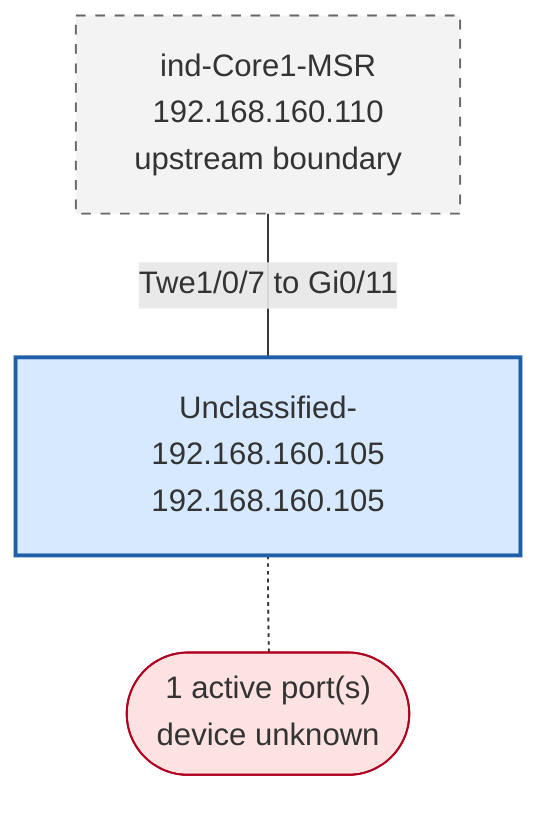

# Unclassified-192.168.160.105

[Network index](../00-index.md) · [Topology](../01-topology_and_connections.md) · [Inventory](../02-switch_inventory.md) · [Connected devices](../03-connected_devices.md)

> **Placement:** Network_16_U160-105_Provisional (head). Department and physical location are **unknown**.

## 1. Identification

| Field | Value |
|---|---|
| Hostname (as collected) | `Unclassified-192.168.160.105` |
| Management IP | 192.168.160.105 |
| Role in its network | Head |
| Switch hops from head | 0 |
| Hardware model | WS-C2960CX-8PC-L (advertised by neighbours via CDP). SwitchScribe reports C9500-48Y4C: they disagree |
| Firmware / IOS | 15.2(7)E7 (as advertised to neighbours via CDP/LLDP) |
| Ports (SwitchScribe) | 12 reported, 2 up |
| Collection | success (Netmiko SSH, 4.75s) |
| Physical location | Not documented |
| Source note (Device Info and Raw CLI) | [[Unclassified-192.168.160.105 (SwitchScribe)]] |

## 2. Individual topology

Diagram key: solid line = link reported from **both** ends; dotted arrow = reported from **one** end only. Dashed box = upstream boundary (not part of this network). Label = port on the upper device, then port on the lower device.

## 3. Switch-to-switch connections

| Local port | Remote switch | Remote port | Relationship | Evidence | Conflicting observations |
|---|---|---|---|---|---|
| `Gi0/11` | [[Unclassified-192.168.160.110]] (ind-Core1-MSR) | `Twe1/0/7` | Upstream boundary (core) | seen from both ends; source CDP+CDP/LLDP | LLDP-only record Gi0/11 to Twe2/0/48 (reported by Unclassified-192.168.160.110) |

## 4. Connected end devices

No named end devices were reported by this switch.

**1 active port(s) report no CDP/LLDP neighbour**, so the device on them is unknown: Gi0/1.

## 5. Ports and VLANs

12 ports listed; 2 up.

| VLAN | Name | Ports | Port list |
|---|---|---|---|
| 1 | default | 1 | Gi0/12 |
| 561 | CESMS | 4 | Gi0/7-10 |
| 562 | IND-CESMS_CCTV | 6 | Gi0/1-6 |

## 6. Outstanding questions

- [ ] Confirm the department and physical location of this switch.
- [ ] Photograph the switch and record its rack / panel label.
- [ ] Resolve the model: SwitchScribe says `C9500-48Y4C`, neighbours advertise `WS-C2960CX-8PC-L`. The advertised value matches the interface names where checked.
- [ ] Identify the unidentified end devices (MAC/GUID-only neighbours and active ports with no CDP/LLDP data).
- [ ] Review 1 CDP/LLDP port conflict(s) in section 3 (LLDP-only records that name a different port).
