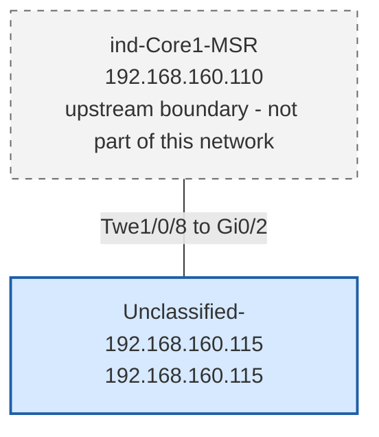

# Topology and connections - Network_17_U160-115_Provisional

[Network index](00-index.md) · [[01-network_overview|Network overview]]

## 1. Upstream boundary

The core layer is the network boundary. The connection to it is recorded as an upstream link; the core and everything beyond it are not part of this network.

| Head switch | Head port | Upstream device | Upstream port | Evidence | Source | Conflicting observations |
|---|---|---|---|---|---|---|
| [[Unclassified-192.168.160.115]] | `Gi0/2` | ind-Core1-MSR (probable identity of 192.168.160.110) | `Twe1/0/8` | seen from both ends | CDP | — |

## 2. Topology

Diagram key: solid line = link reported from **both** ends; dotted arrow = reported from **one** end only. Dashed box = upstream boundary (not part of this network). Label = port on the upper device, then port on the lower device.

## 3. Links inside the network

None: this network contains a single switch.

## 4. How the switches connect

- **Unclassified-192.168.160.115** (head) connects up to ind-Core1-MSR on `Gi0/2`.

## 5. Observations

- No loops, parallel links or CDP/LLDP conflicts were found inside this network.
