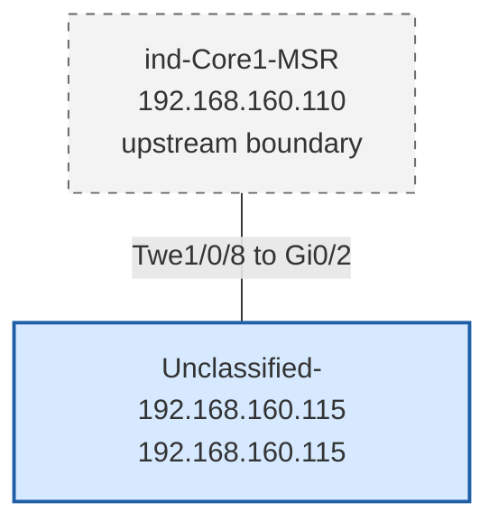

# Unclassified-192.168.160.115

[Network index](../00-index.md) · [Topology](../01-topology_and_connections.md) · [Inventory](../02-switch_inventory.md) · [Connected devices](../03-connected_devices.md)

> **Placement:** Network_17_U160-115_Provisional (head). Department and physical location are **unknown**.

## 1. Identification

| Field | Value |
|---|---|
| Hostname (as collected) | `Unclassified-192.168.160.115` |
| Management IP | 192.168.160.115 |
| Role in its network | Head |
| Switch hops from head | 0 |
| Hardware model | WS-C2960C-8TC-L (advertised by neighbours via CDP). SwitchScribe reports C9500-48Y4C: they disagree |
| Firmware / IOS | 15.0(2)SE8 (as advertised to neighbours via CDP/LLDP) |
| Ports (SwitchScribe) | 10 reported, 1 up |
| Collection | success (Netmiko SSH, 4.83s) |
| Physical location | Not documented |
| Source note (Device Info and Raw CLI) | [[Unclassified-192.168.160.115 (SwitchScribe)]] |

## 2. Individual topology

Diagram key: solid line = link reported from **both** ends; dotted arrow = reported from **one** end only. Dashed box = upstream boundary (not part of this network). Label = port on the upper device, then port on the lower device.

## 3. Switch-to-switch connections

| Local port | Remote switch | Remote port | Relationship | Evidence | Conflicting observations |
|---|---|---|---|---|---|
| `Gi0/2` | [[Unclassified-192.168.160.110]] (ind-Core1-MSR) | `Twe1/0/8` | Upstream boundary (core) | seen from both ends; source CDP | — |

## 4. Connected end devices

No named end devices were reported by this switch.

## 5. Ports and VLANs

10 ports listed; 1 up.

| VLAN | Name | Ports | Port list |
|---|---|---|---|
| 1 | default | 2 | Fa0/8, Gi0/1 |
| 250 | VLAN0250 | 2 | Fa0/5, Fa0/7 |
| 501 | IND-CCL | 1 | Fa0/1 |
| 515 | IND-FS15 | 1 | Fa0/4 |
| 561 | IND-CESMS | 1 | Fa0/6 |
| 593 | Ignition | 1 | Fa0/3 |
| 595 | IND-Test | 1 | Fa0/2 |

## 6. Outstanding questions

- [ ] Confirm the department and physical location of this switch.
- [ ] Photograph the switch and record its rack / panel label.
- [ ] Resolve the model: SwitchScribe says `C9500-48Y4C`, neighbours advertise `WS-C2960C-8TC-L`. The advertised value matches the interface names where checked.
