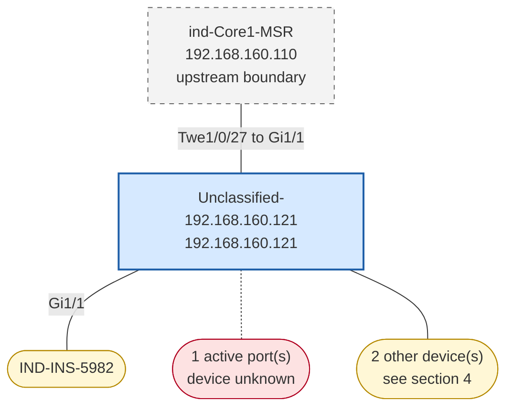

# Unclassified-192.168.160.121

[Network index](../00-index.md) · [Topology](../01-topology_and_connections.md) · [Inventory](../02-switch_inventory.md) · [Connected devices](../03-connected_devices.md)

> **Placement:** Network_18_U160-121_Provisional (head). Department and physical location are **unknown**.

## 1. Identification

| Field | Value |
|---|---|
| Hostname (as collected) | `Unclassified-192.168.160.121` |
| Management IP | 192.168.160.121 |
| Role in its network | Head |
| Switch hops from head | 0 |
| Hardware model | IE-3300-8P2S (advertised by neighbours via CDP). SwitchScribe reports C9500-48Y4C: they disagree |
| Firmware / IOS | 17.9.5c (as advertised to neighbours via CDP/LLDP) |
| Ports (SwitchScribe) | 10 reported, 5 up |
| Collection | success (Netmiko SSH, 4.31s) |
| Physical location | Not documented |
| Source note (Device Info and Raw CLI) | [[Unclassified-192.168.160.121 (SwitchScribe)]] |

## 2. Individual topology

Diagram key: solid line = link reported from **both** ends; dotted arrow = reported from **one** end only. Dashed box = upstream boundary (not part of this network). Label = port on the upper device, then port on the lower device.

## 3. Switch-to-switch connections

| Local port | Remote switch | Remote port | Relationship | Evidence | Conflicting observations |
|---|---|---|---|---|---|
| `Gi1/1` | [[Unclassified-192.168.160.110]] (ind-Core1-MSR) | `Twe1/0/27` | Upstream boundary (core) | seen from both ends; source CDP | LLDP-only record Twe1/0/27 to Gi1/6 (reported by Unclassified-192.168.160.121); LLDP-only record Twe2/0/5 to Gi1/1 (reported by Unclassified-192.168.160.110) |

## 4. Connected end devices

| Port | Device | Type (from LLDP text) | Remote port | IP | LLDP description | Media |
|---|---|---|---|---|---|---|
| `Gi1/1` | IND-INS-5982 | unclassified endpoint | 001b.21f0.9b5e | — | — | 1000baseT(FD) |
| `Gi1/3` | 1cee.c944.ff58 | unclassified endpoint | 1cee.c944.ff58 | — | — | 1000baseT(FD) |
| `Gi1/4` | c8d9.d202.d2f2 | unclassified endpoint | c8d9.d202.d2f2 | — | — | 1000baseT(FD) |

2 of these advertise only a MAC address or GUID and are **unidentified**.

**1 active port(s) report no CDP/LLDP neighbour**, so the device on them is unknown: Gi1/5.

## 5. Ports and VLANs

11 ports listed; 5 up.

| VLAN | Name | Ports | Port list |
|---|---|---|---|
| 1 | default | 2 | Ap1/1, Gi1/10 |
| 595 | LABS | 8 | Gi1/2-9 |

## 6. Outstanding questions

- [ ] Confirm the department and physical location of this switch.
- [ ] Photograph the switch and record its rack / panel label.
- [ ] Resolve the model: SwitchScribe says `C9500-48Y4C`, neighbours advertise `IE-3300-8P2S`. The advertised value matches the interface names where checked.
- [ ] Identify the unidentified end devices (MAC/GUID-only neighbours and active ports with no CDP/LLDP data).
- [ ] Review 2 CDP/LLDP port conflict(s) in section 3 (LLDP-only records that name a different port).
