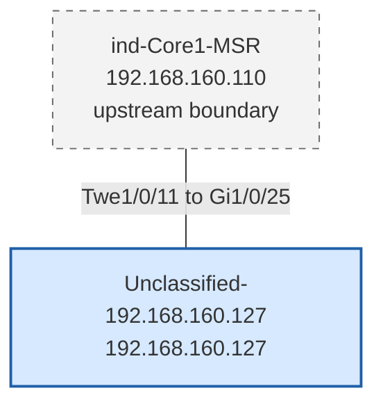

# Unclassified-192.168.160.127

[Network index](../00-index.md) · [Topology](../01-topology_and_connections.md) · [Inventory](../02-switch_inventory.md) · [Connected devices](../03-connected_devices.md)

> **Placement:** Network_20_U160-127_Provisional (head). Department and physical location are **unknown**.

## 1. Identification

| Field | Value |
|---|---|
| Hostname (as collected) | `Unclassified-192.168.160.127` |
| Management IP | 192.168.160.127 |
| Role in its network | Head |
| Switch hops from head | 0 |
| Hardware model | WS-C2960X-24TS-L (advertised by neighbours via CDP). SwitchScribe reports C9500-48Y4C: they disagree |
| Firmware / IOS | 15.2(7)E7 (as advertised to neighbours via CDP/LLDP) |
| Ports (SwitchScribe) | 29 reported, 1 up |
| Collection | success (Netmiko SSH, 4.54s) |
| Physical location | Not documented |
| Source note (Device Info and Raw CLI) | [[Unclassified-192.168.160.127 (SwitchScribe)]] |

## 2. Individual topology

Diagram key: solid line = link reported from **both** ends; dotted arrow = reported from **one** end only. Dashed box = upstream boundary (not part of this network). Label = port on the upper device, then port on the lower device.

## 3. Switch-to-switch connections

| Local port | Remote switch | Remote port | Relationship | Evidence | Conflicting observations |
|---|---|---|---|---|---|
| `Gi1/0/25` | [[Unclassified-192.168.160.110]] (ind-Core1-MSR) | `Twe1/0/11` | Upstream boundary (core) | seen from both ends; source CDP+CDP/LLDP | LLDP-only record Twe1/0/3 to Gi1/0/25 (reported by Unclassified-192.168.160.110) |

## 4. Connected end devices

No named end devices were reported by this switch.

## 5. Ports and VLANs

29 ports listed; 1 up.

| VLAN | Name | Ports | Port list |
|---|---|---|---|
| 1 | default | 2 | Gi1/0/1, Gi1/0/28 |
| 595 | LABS | 25 | Gi1/0/2-24, Gi1/0/26-27 |

## 6. Outstanding questions

- [ ] Confirm the department and physical location of this switch.
- [ ] Photograph the switch and record its rack / panel label.
- [ ] Resolve the model: SwitchScribe says `C9500-48Y4C`, neighbours advertise `WS-C2960X-24TS-L`. The advertised value matches the interface names where checked.
- [ ] Review 1 CDP/LLDP port conflict(s) in section 3 (LLDP-only records that name a different port).
