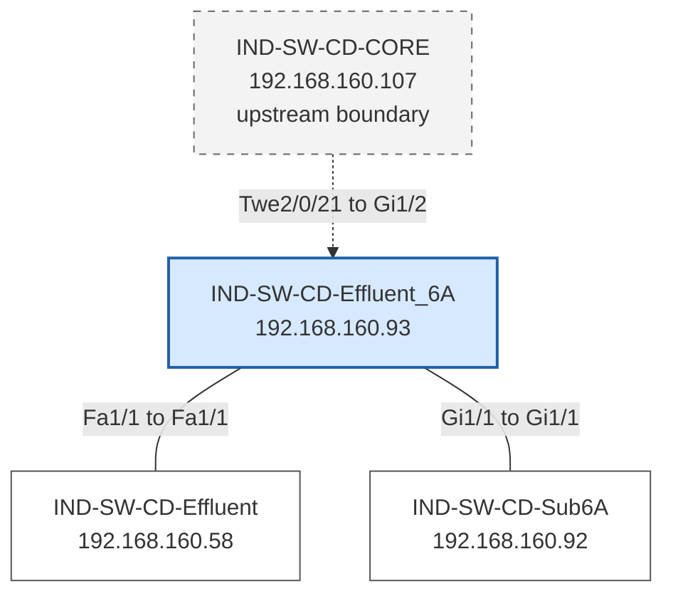

# IND-SW-CD-Effluent_6A

[Network index](../00-index.md) · [Topology](../01-topology_and_connections.md) · [Inventory](../02-switch_inventory.md) · [Connected devices](../03-connected_devices.md)

> **Placement:** Network_21_CD-Effluent_6A_Provisional (head). Department and physical location are **unknown**.

## 1. Identification

| Field | Value |
|---|---|
| Hostname (as collected) | `IND-SW-CD-Effluent_6A` |
| Management IP | 192.168.160.93 |
| Role in its network | Head |
| Switch hops from head | 0 |
| Hardware model | IE-3000-8TC (SwitchScribe) |
| Firmware / IOS | 12.2(58)SE2 (as advertised to neighbours via CDP/LLDP) |
| Ports (SwitchScribe) | 10 reported, 3 up |
| Collection | success (Netmiko SSH, 4.65s) |
| Physical location | Not documented |
| Source note (Device Info and Raw CLI) | [[IND-SW-CD-Effluent_6A (SwitchScribe)]] |

## 2. Individual topology

Diagram key: solid line = link reported from **both** ends; dotted arrow = reported from **one** end only. Dashed box = upstream boundary (not part of this network). Label = port on the upper device, then port on the lower device.

## 3. Switch-to-switch connections

| Local port | Remote switch | Remote port | Relationship | Evidence | Conflicting observations |
|---|---|---|---|---|---|
| `Fa1/1` | [[IND-SW-CD-Effluent]] | `Fa1/1` | Downstream or lateral | seen from both ends; source CDP/LLDP | — |
| `Gi1/1` | [[IND-SW-CD-Sub6A]] | `Gi1/1` | Downstream or lateral | seen from both ends; source CDP/LLDP | LLDP-only record Gi1/1 to Gi1/2 (reported by IND-SW-CD-Sub6A) |
| `Gi1/2` | [[Unclassified-192.168.160.107]] (IND-SW-CD-CORE) | `Twe2/0/21` | Upstream boundary (core) | seen from one end only (the other end not collected / not reporting); source CDP | — |

## 4. Connected end devices

No named end devices were reported by this switch.

## 5. Ports and VLANs

10 ports listed; 3 up.

| VLAN | Name | Ports | Port list |
|---|---|---|---|
| 561 | VLAN0561 | 4 | Fa1/5-8 |
| 562 | IND-CCTV | 3 | Fa1/2-4 |

## 6. Outstanding questions

- [ ] Confirm the department and physical location of this switch.
- [ ] Photograph the switch and record its rack / panel label.
- [ ] Verify the links seen from one end only (section 3) on the other switch.
- [ ] Review 1 CDP/LLDP port conflict(s) in section 3 (LLDP-only records that name a different port).
