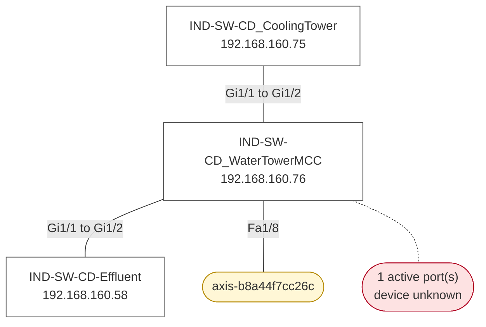

# IND-SW-CD_WaterTowerMCC

[Network index](../00-index.md) · [Topology](../01-topology_and_connections.md) · [Inventory](../02-switch_inventory.md) · [Connected devices](../03-connected_devices.md)

> **Placement:** Network_21_CD-Effluent_6A_Provisional (access). Department and physical location are **unknown**.

## 1. Identification

| Field | Value |
|---|---|
| Hostname (as collected) | `IND-SW-CD_WaterTowerMCC` |
| Management IP | 192.168.160.76 |
| Role in its network | Access |
| Switch hops from head | 1 |
| Hardware model | IE-3000-8TC (advertised by neighbours via CDP) |
| Firmware / IOS | 15.2(4)EA5 (as advertised to neighbours via CDP/LLDP) |
| Ports (SwitchScribe) | 10 reported, 4 up |
| Collection | success (Netmiko SSH, 5.52s) |
| Physical location | Not documented |
| Source note (Device Info and Raw CLI) | [[IND-SW-CD_WaterTowerMCC (SwitchScribe)]] |

## 2. Individual topology

Diagram key: solid line = link reported from **both** ends; dotted arrow = reported from **one** end only. Dashed box = upstream boundary (not part of this network). Label = port on the upper device, then port on the lower device.

## 3. Switch-to-switch connections

| Local port | Remote switch | Remote port | Relationship | Evidence | Conflicting observations |
|---|---|---|---|---|---|
| `Gi1/1` | [[IND-SW-CD-Effluent]] | `Gi1/2` | Downstream or lateral | seen from both ends; source CDP/LLDP | LLDP-only record Gi1/2 to Gi1/2 (reported by IND-SW-CD_WaterTowerMCC) |
| `Gi1/2` | [[IND-SW-CD_CoolingTower]] | `Gi1/1` | Parent / uplink | seen from both ends; source CDP+CDP/LLDP | LLDP-only record Gi1/1 to Fa1/8 (reported by IND-SW-CD_WaterTowerMCC) |

## 4. Connected end devices

| Port | Device | Type (from LLDP text) | Remote port | IP | LLDP description | Media |
|---|---|---|---|---|---|---|
| `Fa1/8` | axis-b8a44f7cc26c | unclassified endpoint | eth0 | 192.168.162.29 | Linux | 1000baseT(FD), 1000baseT(HD),  |

**1 active port(s) report no CDP/LLDP neighbour**, so the device on them is unknown: Fa1/3.

## 5. Ports and VLANs

10 ports listed; 4 up.

| VLAN | Name | Ports | Port list |
|---|---|---|---|
| 561 | VLAN0561 | 6 | Fa1/1-6 |
| 562 | IND-CESMS_CCTV | 2 | Fa1/7-8 |

## 6. Outstanding questions

- [ ] Confirm the department and physical location of this switch.
- [ ] Photograph the switch and record its rack / panel label.
- [ ] Identify the unidentified end devices (MAC/GUID-only neighbours and active ports with no CDP/LLDP data).
- [ ] Review 2 CDP/LLDP port conflict(s) in section 3 (LLDP-only records that name a different port).
