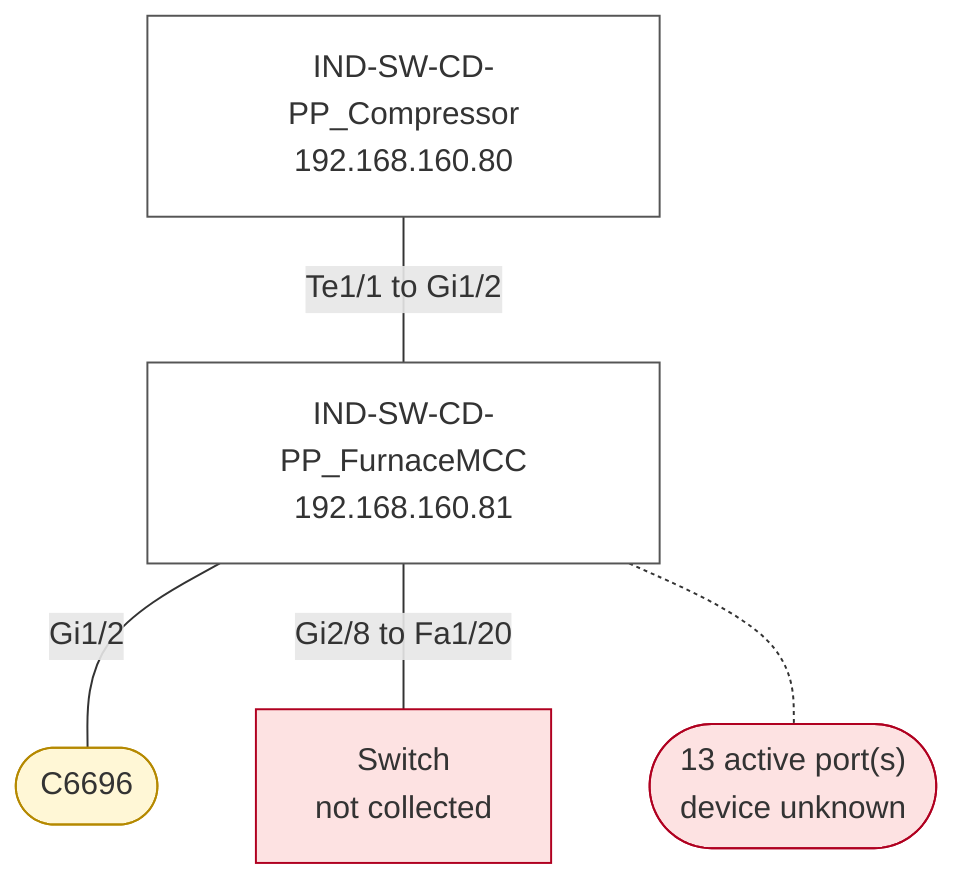

# IND-SW-CD-PP_FurnaceMCC

[Network index](../00-index.md) · [Topology](../01-topology_and_connections.md) · [Inventory](../02-switch_inventory.md) · [Connected devices](../03-connected_devices.md)

> **Placement:** Network_22_CD-PP_CTLSsub_Provisional (access). Department and physical location are **unknown**.

## 1. Identification

| Field | Value |
|---|---|
| Hostname (as collected) | `IND-SW-CD-PP_FurnaceMCC` |
| Management IP | 192.168.160.81 |
| Role in its network | Access |
| Switch hops from head | 3 |
| Hardware model | IE-3300-8T2S (advertised by neighbours via CDP). SwitchScribe reports 1783-BMS20CA: they disagree |
| Firmware / IOS | 16.12.3 (as advertised to neighbours via CDP/LLDP) |
| Ports (SwitchScribe) | 18 reported, 16 up |
| Collection | success (Netmiko SSH, 4.28s) |
| Physical location | Not documented |
| Source note (Device Info and Raw CLI) | [[IND-SW-CD-PP_FurnaceMCC (SwitchScribe)]] |

## 2. Individual topology

Diagram key: solid line = link reported from **both** ends; dotted arrow = reported from **one** end only. Dashed box = upstream boundary (not part of this network). Label = port on the upper device, then port on the lower device.

## 3. Switch-to-switch connections

| Local port | Remote switch | Remote port | Relationship | Evidence | Conflicting observations |
|---|---|---|---|---|---|
| `Gi1/2` | [[IND-SW-CD-PP_Compressor]] | `Te1/1` | Parent / uplink | seen from both ends; source CDP+CDP/LLDP | LLDP-only record Te1/2 to Gi1/2 (reported by IND-SW-CD-PP_Compressor); LLDP-only record Te1/1 to Gi1/10 (reported by IND-SW-CD-PP_FurnaceMCC) |

Neighbour switches that are **not in the collected inventory**:

| Local port | Neighbour | Remote port | IP | Description |
|---|---|---|---|---|
| `Gi2/8` | Switch | Fa1/20 | — | cisco 1783-BMS20CA |

## 4. Connected end devices

| Port | Device | Type (from LLDP text) | Remote port | IP | LLDP description | Media |
|---|---|---|---|---|---|---|
| `Gi1/2` | C6696 | unclassified endpoint | port-001 | 140.80.0.100 | HP HP EliteDesk 800 G6 Tower PC,SBKPF,CZC117CBXQ + engineeri | 1000baseT(FD), 1000baseT(HD),  |

**13 active port(s) report no CDP/LLDP neighbour**, so the device on them is unknown: Gi1/1, Gi1/3-9, Gi2/1-5.

## 5. Ports and VLANs

18 ports listed; 16 up.

| VLAN | Name | Ports | Port list |
|---|---|---|---|
| 1 | default | 2 | Gi2/6, Gi2/8 |
| 561 | vlan561 | 2 | Gi1/6, Gi1/8 |
| 578 | A19_network | 1 | Gi2/5 |
| 580 | Plate_Plant_Network | 2 | Gi1/9-10 |
| 590 | CDPowermeters | 8 | Gi1/3-5, Gi1/7, Gi2/1-4 |
| 593 | Ignition | 1 | Gi2/7 |

## 6. Outstanding questions

- [ ] Confirm the department and physical location of this switch.
- [ ] Photograph the switch and record its rack / panel label.
- [ ] Resolve the model: SwitchScribe says `1783-BMS20CA`, neighbours advertise `IE-3300-8T2S`. The advertised value matches the interface names where checked.
- [ ] Identify the unidentified end devices (MAC/GUID-only neighbours and active ports with no CDP/LLDP data).
- [ ] Collect the neighbour switch(es) listed in section 3 that are not in the inventory.
- [ ] Review 2 CDP/LLDP port conflict(s) in section 3 (LLDP-only records that name a different port).
