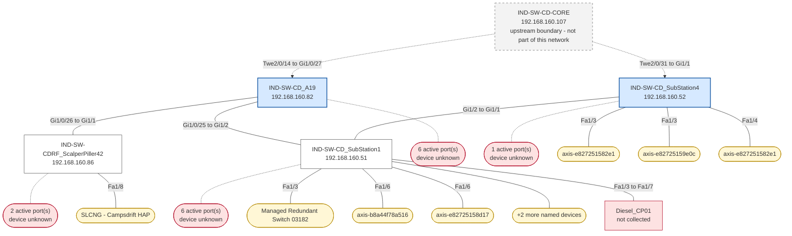

# Topology and connections - Network_23_CD_A19_Provisional

[Network index](00-index.md) · [[01-network_overview|Network overview]]

## 1. Upstream boundary

The core layer is the network boundary. The connection to it is recorded as an upstream link; the core and everything beyond it are not part of this network.

| Head switch | Head port | Upstream device | Upstream port | Evidence | Source | Conflicting observations |
|---|---|---|---|---|---|---|
| [[IND-SW-CD_A19]] | `Gi1/0/27` | IND-SW-CD-CORE (192.168.160.107) | `Twe2/0/14` | seen from one end only (the other end not collected / not reporting) | CDP | — |
| [[IND-SW-CD_SubStation4]] | `Gi1/1` | IND-SW-CD-CORE (192.168.160.107) | `Twe2/0/31` | seen from one end only (the other end not collected / not reporting) | CDP | — |

## 2. Topology

Diagram key: solid line = link reported from **both** ends; dotted arrow = reported from **one** end only. Dashed box = upstream boundary (not part of this network). Label = port on the upper device, then port on the lower device.

## 3. Links inside the network

| Upper switch | Port | Port | Lower switch | Media | Evidence | Conflicting observations |
|---|---|---|---|---|---|---|
| [[IND-SW-CD_A19]] | `Gi1/0/25` | `Gi1/2` | [[IND-SW-CD_SubStation1]] | — | seen from both ends | LLDP-only Gi1/0/25 to Gi1/1; LLDP-only Gi1/0/4 to Gi1/2 |
| [[IND-SW-CD_A19]] | `Gi1/0/26` | `Gi1/1` | [[IND-SW-CDRF_ScalperPiller42]] | 1000baseX(FD) | seen from both ends | LLDP-only Gi1/1 to Gi1/0/25 |
| [[IND-SW-CD_SubStation4]] | `Gi1/2` | `Gi1/1` | [[IND-SW-CD_SubStation1]] | — | seen from both ends | LLDP-only Fa1/6 to Gi1/2; LLDP-only Gi1/1 to Fa1/4 |

## 4. How the switches connect

- **IND-SW-CD_A19** (head) connects up to IND-SW-CD-CORE on `Gi1/0/27`.
- **IND-SW-CD_SubStation4** (head) connects up to IND-SW-CD-CORE on `Gi1/1`.
- `IND-SW-CD_A19` `Gi1/0/25` connects to `IND-SW-CD_SubStation1` `Gi1/2`.
- `IND-SW-CD_A19` `Gi1/0/26` connects to `IND-SW-CDRF_ScalperPiller42` `Gi1/1`.
- `IND-SW-CD_SubStation4` `Gi1/2` connects to `IND-SW-CD_SubStation1` `Gi1/1`.

## 5. Observations

- 2 distribution switches (IND-SW-CD_A19, IND-SW-CD_SubStation4) each have an uplink to the core and are also linked to each other below the core. This forms a loop through the core; confirm intent and spanning-tree roots.
- 5 LLDP-only record(s) name different ports from CDP for the same switch pair. CDP is used above; the conflicting records are kept in the link tables. See [[02-network_boundary_method]].
