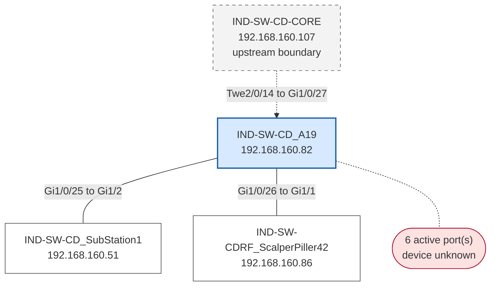

# IND-SW-CD_A19

[Network index](../00-index.md) · [Topology](../01-topology_and_connections.md) · [Inventory](../02-switch_inventory.md) · [Connected devices](../03-connected_devices.md)

> **Placement:** Network_23_CD_A19_Provisional (head). Department and physical location are **unknown**.

## 1. Identification

| Field | Value |
|---|---|
| Hostname (as collected) | `IND-SW-CD_A19` |
| Management IP | 192.168.160.82 |
| Role in its network | Head |
| Switch hops from head | 0 |
| Hardware model | WS-C2960X-24TS-L (advertised by neighbours via CDP). SwitchScribe reports C9500-48Y4C: they disagree |
| Firmware / IOS | 15.2(2)E7 (as advertised to neighbours via CDP/LLDP) |
| Ports (SwitchScribe) | 29 reported, 9 up |
| Collection | success (Netmiko SSH, 4.17s) |
| Physical location | Not documented |
| Source note (Device Info and Raw CLI) | [[IND-SW-CD_A19 (SwitchScribe)]] |

## 2. Individual topology

Diagram key: solid line = link reported from **both** ends; dotted arrow = reported from **one** end only. Dashed box = upstream boundary (not part of this network). Label = port on the upper device, then port on the lower device.

## 3. Switch-to-switch connections

| Local port | Remote switch | Remote port | Relationship | Evidence | Conflicting observations |
|---|---|---|---|---|---|
| `Gi1/0/25` | [[IND-SW-CD_SubStation1]] | `Gi1/2` | Downstream or lateral | seen from both ends; source CDP+CDP/LLDP | LLDP-only record Gi1/0/25 to Gi1/1 (reported by IND-SW-CD_SubStation1); LLDP-only record Gi1/0/4 to Gi1/2 (reported by IND-SW-CD_A19) |
| `Gi1/0/26` | [[IND-SW-CDRF_ScalperPiller42]] | `Gi1/1` | Downstream or lateral | seen from both ends; source CDP/LLDP | LLDP-only record Gi1/1 to Gi1/0/25 (reported by IND-SW-CD_A19) |
| `Gi1/0/27` | [[Unclassified-192.168.160.107]] (IND-SW-CD-CORE) | `Twe2/0/14` | Upstream boundary (core) | seen from one end only (the other end not collected / not reporting); source CDP | — |

## 4. Connected end devices

No named end devices were reported by this switch.

**6 active port(s) report no CDP/LLDP neighbour**, so the device on them is unknown: Gi1/0/1-3, Gi1/0/8, Gi1/0/24, Gi1/0/28.

## 5. Ports and VLANs

29 ports listed; 10 up.

| VLAN | Name | Ports | Port list |
|---|---|---|---|
| 561 | IND-CESMS | 19 | Gi1/0/4-22 |
| 578 | CD_A19_Furnace_Server_Access | 1 | Gi1/0/28 |
| 580 | IND-Plate_Plant | 1 | Gi1/0/23 |

## 6. Outstanding questions

- [ ] Confirm the department and physical location of this switch.
- [ ] Photograph the switch and record its rack / panel label.
- [ ] Resolve the model: SwitchScribe says `C9500-48Y4C`, neighbours advertise `WS-C2960X-24TS-L`. The advertised value matches the interface names where checked.
- [ ] Identify the unidentified end devices (MAC/GUID-only neighbours and active ports with no CDP/LLDP data).
- [ ] Verify the links seen from one end only (section 3) on the other switch.
- [ ] Review 3 CDP/LLDP port conflict(s) in section 3 (LLDP-only records that name a different port).
