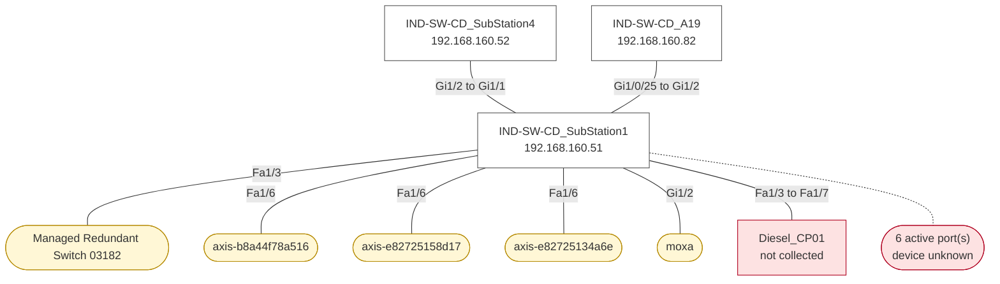

# IND-SW-CD_SubStation1

[Network index](../00-index.md) · [Topology](../01-topology_and_connections.md) · [Inventory](../02-switch_inventory.md) · [Connected devices](../03-connected_devices.md)

> **Placement:** Network_23_CD_A19_Provisional (access). Department and physical location are **unknown**.

## 1. Identification

| Field | Value |
|---|---|
| Hostname (as collected) | `IND-SW-CD_SubStation1` |
| Management IP | 192.168.160.51 |
| Role in its network | Access |
| Switch hops from head | 1 |
| Hardware model | IE-3000-8TC (advertised by neighbours via CDP) |
| Firmware / IOS | 15.2(4)EA5 (as advertised to neighbours via CDP/LLDP) |
| Ports (SwitchScribe) | 10 reported, 10 up |
| Collection | success (Netmiko SSH, 4.93s) |
| Physical location | Not documented |
| Source note (Device Info and Raw CLI) | [[IND-SW-CD_SubStation1 (SwitchScribe)]] |

## 2. Individual topology

Diagram key: solid line = link reported from **both** ends; dotted arrow = reported from **one** end only. Dashed box = upstream boundary (not part of this network). Label = port on the upper device, then port on the lower device.

## 3. Switch-to-switch connections

| Local port | Remote switch | Remote port | Relationship | Evidence | Conflicting observations |
|---|---|---|---|---|---|
| `Gi1/1` | [[IND-SW-CD_SubStation4]] | `Gi1/2` | Downstream or lateral | seen from both ends; source CDP | LLDP-only record Fa1/6 to Gi1/2 (reported by IND-SW-CD_SubStation1); LLDP-only record Gi1/1 to Fa1/4 (reported by IND-SW-CD_SubStation4) |
| `Gi1/2` | [[IND-SW-CD_A19]] | `Gi1/0/25` | Parent / uplink | seen from both ends; source CDP+CDP/LLDP | LLDP-only record Gi1/0/25 to Gi1/1 (reported by IND-SW-CD_SubStation1); LLDP-only record Gi1/0/4 to Gi1/2 (reported by IND-SW-CD_A19) |

Neighbour switches that are **not in the collected inventory**:

| Local port | Neighbour | Remote port | IP | Description |
|---|---|---|---|---|
| `Fa1/3` | Diesel_CP01 | Fa1/7 | 192.168.1.70 | cisco 1783-BMS10CGL |

## 4. Connected end devices

| Port | Device | Type (from LLDP text) | Remote port | IP | LLDP description | Media |
|---|---|---|---|---|---|---|
| `Fa1/3` | Managed Redundant Switch 03182 | unclassified endpoint | 100TX,RJ45. | 192.168.127.253 | EDS-408A-MM-ST | MAU type - not advertised |
| `Fa1/6` | axis-b8a44f78a516 | unclassified endpoint | eth0 | 192.168.162.24 | Linux | 100base-TX(FD), 100base-TX(HD) |
| `Fa1/6` | axis-e82725158d17 | unclassified endpoint | eth0 | 192.168.162.46 | Linux | 100base-TX(FD), 100base-TX(HD) |
| `Fa1/6` | axis-e82725134a6e | unclassified endpoint | eth0 | 192.168.162.45 | Linux | 100base-TX(FD), 100base-TX(HD) |
| `Gi1/2` | moxa | unclassified endpoint | Ethernet Interface Port  | — | — | MAU type - not advertised |

**6 active port(s) report no CDP/LLDP neighbour**, so the device on them is unknown: Fa1/1-2, Fa1/4-5, Fa1/7-8.

## 5. Ports and VLANs

10 ports listed; 10 up.

| VLAN | Name | Ports | Port list |
|---|---|---|---|
| 561 | VLAN0561 | 6 | Fa1/1-5, Fa1/7 |
| 562 | IND-CCTV | 1 | Fa1/6 |
| 576 | VLAN0576 | 1 | Fa1/8 |

## 6. Outstanding questions

- [ ] Confirm the department and physical location of this switch.
- [ ] Photograph the switch and record its rack / panel label.
- [ ] Identify the unidentified end devices (MAC/GUID-only neighbours and active ports with no CDP/LLDP data).
- [ ] Collect the neighbour switch(es) listed in section 3 that are not in the inventory.
- [ ] Review 4 CDP/LLDP port conflict(s) in section 3 (LLDP-only records that name a different port).
