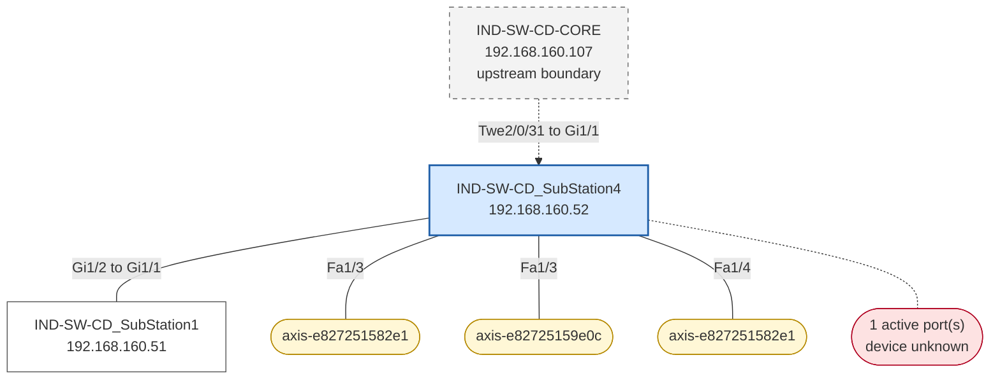

# IND-SW-CD_SubStation4

[Network index](../00-index.md) · [Topology](../01-topology_and_connections.md) · [Inventory](../02-switch_inventory.md) · [Connected devices](../03-connected_devices.md)

> **Placement:** Network_23_CD_A19_Provisional (head). Department and physical location are **unknown**.

## 1. Identification

| Field | Value |
|---|---|
| Hostname (as collected) | `IND-SW-CD_SubStation4` |
| Management IP | 192.168.160.52 |
| Role in its network | Head |
| Switch hops from head | 0 |
| Hardware model | IE-3000-8TC (advertised by neighbours via CDP) |
| Firmware / IOS | 15.2(4)EA5 (as advertised to neighbours via CDP/LLDP) |
| Ports (SwitchScribe) | 10 reported, 5 up |
| Collection | success (Netmiko SSH, 4.93s) |
| Physical location | Not documented |
| Source note (Device Info and Raw CLI) | [[IND-SW-CD_SubStation4 (SwitchScribe)]] |

## 2. Individual topology

Diagram key: solid line = link reported from **both** ends; dotted arrow = reported from **one** end only. Dashed box = upstream boundary (not part of this network). Label = port on the upper device, then port on the lower device.

## 3. Switch-to-switch connections

| Local port | Remote switch | Remote port | Relationship | Evidence | Conflicting observations |
|---|---|---|---|---|---|
| `Gi1/1` | [[Unclassified-192.168.160.107]] (IND-SW-CD-CORE) | `Twe2/0/31` | Upstream boundary (core) | seen from one end only (the other end not collected / not reporting); source CDP | — |
| `Gi1/2` | [[IND-SW-CD_SubStation1]] | `Gi1/1` | Downstream or lateral | seen from both ends; source CDP | LLDP-only record Fa1/6 to Gi1/2 (reported by IND-SW-CD_SubStation1); LLDP-only record Gi1/1 to Fa1/4 (reported by IND-SW-CD_SubStation4) |

## 4. Connected end devices

| Port | Device | Type (from LLDP text) | Remote port | IP | LLDP description | Media |
|---|---|---|---|---|---|---|
| `Fa1/3` | axis-e827251582e1 | unclassified endpoint | eth0 | 192.168.162.47 | AXIS M3125-LVE Dome Camera 11.11.128 | 100base-TX(FD), 100base-TX(HD) |
| `Fa1/3` | axis-e82725159e0c | unclassified endpoint | eth0 | 192.168.162.48 | Linux | 100base-TX(FD), 100base-TX(HD) |
| `Fa1/4` | axis-e827251582e1 | unclassified endpoint | eth0 | 192.168.162.47 | Linux | — |

**1 active port(s) report no CDP/LLDP neighbour**, so the device on them is unknown: Fa1/2.

## 5. Ports and VLANs

10 ports listed; 5 up.

| VLAN | Name | Ports | Port list |
|---|---|---|---|
| 561 | VLAN0561 | 4 | Fa1/5-8 |
| 562 | IND-CCTV | 2 | Fa1/3-4 |
| 590 | CDPowermeters | 2 | Fa1/1-2 |

## 6. Outstanding questions

- [ ] Confirm the department and physical location of this switch.
- [ ] Photograph the switch and record its rack / panel label.
- [ ] Identify the unidentified end devices (MAC/GUID-only neighbours and active ports with no CDP/LLDP data).
- [ ] Verify the links seen from one end only (section 3) on the other switch.
- [ ] Review 2 CDP/LLDP port conflict(s) in section 3 (LLDP-only records that name a different port).
