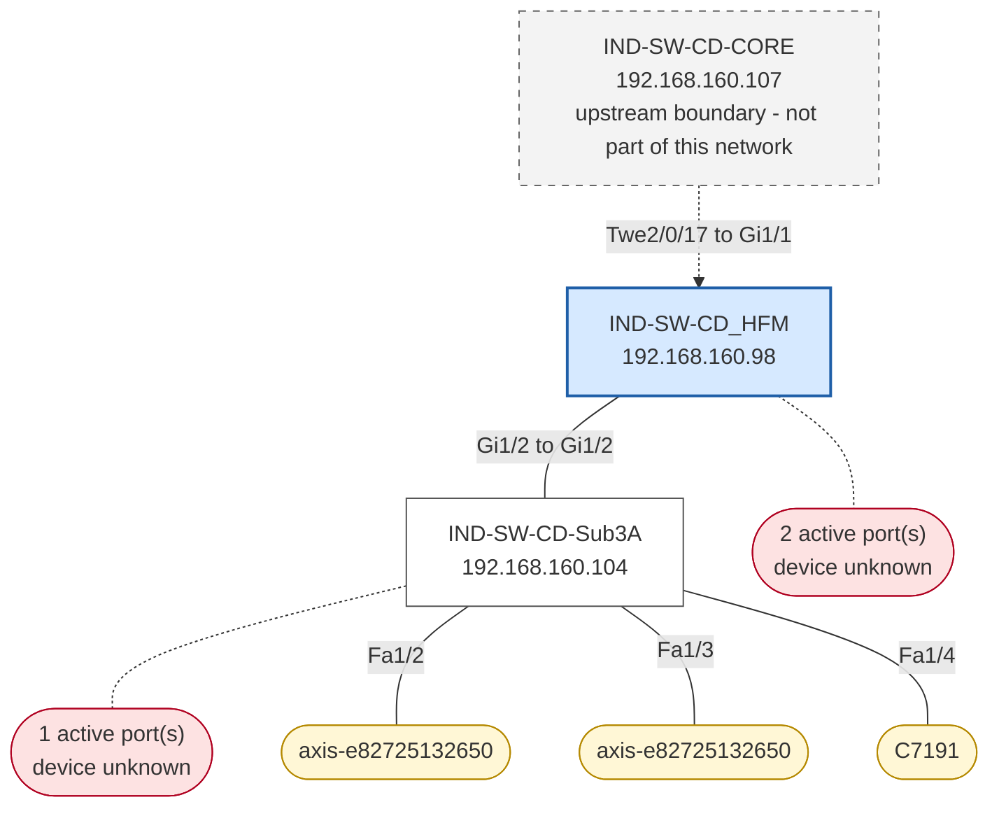

# Topology and connections - Network_24_CD_HFM_Provisional

[Network index](00-index.md) · [[01-network_overview|Network overview]]

## 1. Upstream boundary

The core layer is the network boundary. The connection to it is recorded as an upstream link; the core and everything beyond it are not part of this network.

| Head switch | Head port | Upstream device | Upstream port | Evidence | Source | Conflicting observations |
|---|---|---|---|---|---|---|
| [[IND-SW-CD_HFM]] | `Gi1/1` | IND-SW-CD-CORE (192.168.160.107) | `Twe2/0/17` | seen from one end only (the other end not collected / not reporting) | CDP | — |

## 2. Topology

Diagram key: solid line = link reported from **both** ends; dotted arrow = reported from **one** end only. Dashed box = upstream boundary (not part of this network). Label = port on the upper device, then port on the lower device.

## 3. Links inside the network

| Upper switch | Port | Port | Lower switch | Media | Evidence | Conflicting observations |
|---|---|---|---|---|---|---|
| [[IND-SW-CD_HFM]] | `Gi1/2` | `Gi1/2` | [[IND-SW-CD-Sub3A]] | — | seen from both ends | — |

## 4. How the switches connect

- **IND-SW-CD_HFM** (head) connects up to IND-SW-CD-CORE on `Gi1/1`.
- `IND-SW-CD_HFM` `Gi1/2` connects to `IND-SW-CD-Sub3A` `Gi1/2`.

## 5. Observations

- No loops, parallel links or CDP/LLDP conflicts were found inside this network.
