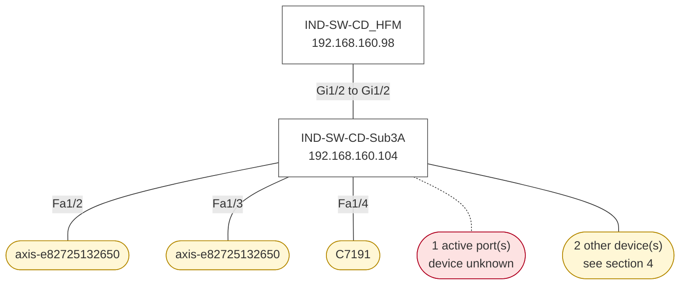

# IND-SW-CD-Sub3A

[Network index](../00-index.md) · [Topology](../01-topology_and_connections.md) · [Inventory](../02-switch_inventory.md) · [Connected devices](../03-connected_devices.md)

> **Placement:** Network_24_CD_HFM_Provisional (access). Department and physical location are **unknown**.

## 1. Identification

| Field | Value |
|---|---|
| Hostname (as collected) | `IND-SW-CD-Sub3A` |
| Management IP | 192.168.160.104 |
| Role in its network | Access |
| Switch hops from head | 1 |
| Hardware model | IE-3000-8TC (advertised by neighbours via CDP). SwitchScribe reports IE-3300-8T2S: they disagree |
| Firmware / IOS | 15.2(7)E2 (as advertised to neighbours via CDP/LLDP) |
| Ports (SwitchScribe) | 10 reported, 5 up |
| Collection | success (Netmiko SSH, 6.11s) |
| Physical location | Not documented |
| Source note (Device Info and Raw CLI) | [[IND-SW-CD-Sub3A (SwitchScribe)]] |

## 2. Individual topology

Diagram key: solid line = link reported from **both** ends; dotted arrow = reported from **one** end only. Dashed box = upstream boundary (not part of this network). Label = port on the upper device, then port on the lower device.

## 3. Switch-to-switch connections

| Local port | Remote switch | Remote port | Relationship | Evidence | Conflicting observations |
|---|---|---|---|---|---|
| `Gi1/2` | [[IND-SW-CD_HFM]] | `Gi1/2` | Parent / uplink | seen from both ends; source CDP | — |

## 4. Connected end devices

| Port | Device | Type (from LLDP text) | Remote port | IP | LLDP description | Media |
|---|---|---|---|---|---|---|
| `Fa1/2` | 021b.1ba6.5b00 | unclassified endpoint | 021b.1ba6.5b00 | — | — | 1000baseT(FD) |
| `Fa1/2` | axis-e82725132650 | unclassified endpoint | eth0 | 192.168.162.49 | Linux | — |
| `Fa1/3` | axis-e82725132650 | unclassified endpoint | eth0 | 192.168.162.49 | AXIS M3125-LVE Dome Camera 11.11.128 | MAU type - not advertised |
| `Fa1/4` | C7191 | unclassified endpoint | port-001 | 0.0.0.0 | HP HP Elite Tower 800 G9 Desktop PC,,4CE335D0NN | MAU type - not advertised |
| `Fa1/4` | 001b.21f0.9b65 | unclassified endpoint | 001b.21f0.9b65 | — | — | 1000baseT(FD) |

2 of these advertise only a MAC address or GUID and are **unidentified**.

**1 active port(s) report no CDP/LLDP neighbour**, so the device on them is unknown: Fa1/1.

## 5. Ports and VLANs

10 ports listed; 5 up.

| VLAN | Name | Ports | Port list |
|---|---|---|---|
| 1 | default | 5 | Fa1/5-8, Gi1/1 |
| 561 | IND-CESMS | 3 | Fa1/1, Fa1/3-4 |
| 562 | IND-CESMS_CCTV | 1 | Fa1/2 |

## 6. Outstanding questions

- [ ] Confirm the department and physical location of this switch.
- [ ] Photograph the switch and record its rack / panel label.
- [ ] Resolve the model: SwitchScribe says `IE-3300-8T2S`, neighbours advertise `IE-3000-8TC`. The advertised value matches the interface names where checked.
- [ ] Identify the unidentified end devices (MAC/GUID-only neighbours and active ports with no CDP/LLDP data).
