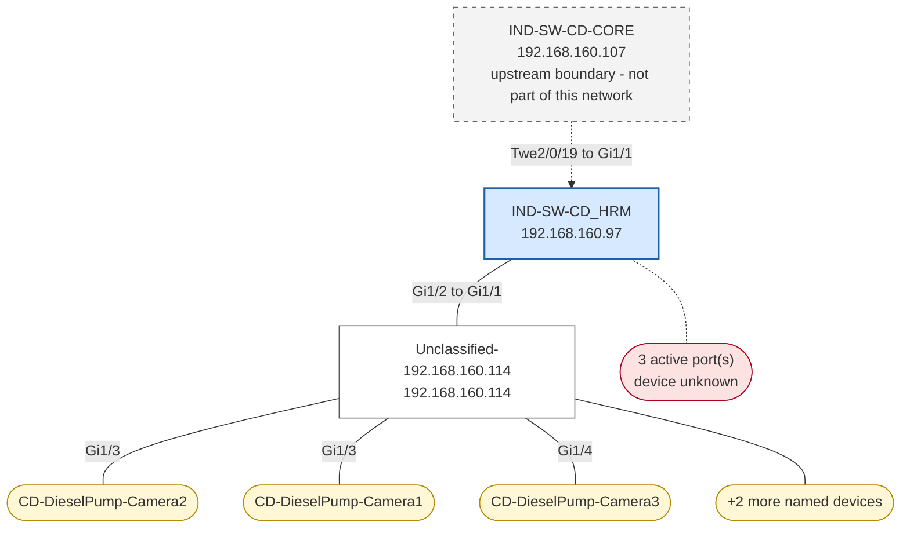

# Topology and connections - Network_25_CD_HRM_Provisional

[Network index](00-index.md) · [[01-network_overview|Network overview]]

## 1. Upstream boundary

The core layer is the network boundary. The connection to it is recorded as an upstream link; the core and everything beyond it are not part of this network.

| Head switch | Head port | Upstream device | Upstream port | Evidence | Source | Conflicting observations |
|---|---|---|---|---|---|---|
| [[IND-SW-CD_HRM]] | `Gi1/1` | IND-SW-CD-CORE (192.168.160.107) | `Twe2/0/19` | seen from one end only (the other end not collected / not reporting) | CDP | — |

## 2. Topology

Diagram key: solid line = link reported from **both** ends; dotted arrow = reported from **one** end only. Dashed box = upstream boundary (not part of this network). Label = port on the upper device, then port on the lower device.

## 3. Links inside the network

| Upper switch | Port | Port | Lower switch | Media | Evidence | Conflicting observations |
|---|---|---|---|---|---|---|
| [[IND-SW-CD_HRM]] | `Gi1/2` | `Gi1/1` | [[Unclassified-192.168.160.114]] | — | seen from both ends | LLDP-only Gi1/2 to Gi1/4; LLDP-only Gi1/5 to Gi1/1 |

## 4. How the switches connect

- **IND-SW-CD_HRM** (head) connects up to IND-SW-CD-CORE on `Gi1/1`.
- `IND-SW-CD_HRM` `Gi1/2` connects to `Unclassified-192.168.160.114` `Gi1/1`.

## 5. Observations

- 2 LLDP-only record(s) name different ports from CDP for the same switch pair. CDP is used above; the conflicting records are kept in the link tables. See [[02-network_boundary_method]].
