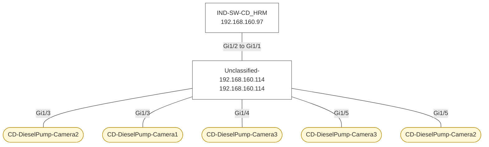

# Unclassified-192.168.160.114

[Network index](../00-index.md) · [Topology](../01-topology_and_connections.md) · [Inventory](../02-switch_inventory.md) · [Connected devices](../03-connected_devices.md)

> **Placement:** Network_25_CD_HRM_Provisional (access). Department and physical location are **unknown**.

## 1. Identification

| Field | Value |
|---|---|
| Hostname (as collected) | `Unclassified-192.168.160.114` |
| Management IP | 192.168.160.114 |
| Role in its network | Access |
| Switch hops from head | 1 |
| Hardware model | IE-3300-8P2S (advertised by neighbours via CDP) |
| Firmware / IOS | 17.9.5c (as advertised to neighbours via CDP/LLDP) |
| Ports (SwitchScribe) | 10 reported, 4 up |
| Collection | success (Netmiko SSH, 4.57s) |
| Physical location | Not documented |
| Source note (Device Info and Raw CLI) | [[Unclassified-192.168.160.114 (SwitchScribe)]] |

## 2. Individual topology

Diagram key: solid line = link reported from **both** ends; dotted arrow = reported from **one** end only. Dashed box = upstream boundary (not part of this network). Label = port on the upper device, then port on the lower device.

## 3. Switch-to-switch connections

| Local port | Remote switch | Remote port | Relationship | Evidence | Conflicting observations |
|---|---|---|---|---|---|
| `Gi1/1` | [[IND-SW-CD_HRM]] | `Gi1/2` | Parent / uplink | seen from both ends; source CDP+CDP/LLDP | LLDP-only record Gi1/2 to Gi1/4 (reported by Unclassified-192.168.160.114); LLDP-only record Gi1/5 to Gi1/1 (reported by IND-SW-CD_HRM) |

## 4. Connected end devices

| Port | Device | Type (from LLDP text) | Remote port | IP | LLDP description | Media |
|---|---|---|---|---|---|---|
| `Gi1/3` | CD-DieselPump-Camera2 | unclassified endpoint | eth0 | 192.168.162.36 | AXIS M2035-LE Bullet Camera 10.12.166 | 100base-TX(FD), 100base-TX(HD) |
| `Gi1/3` | CD-DieselPump-Camera1 | unclassified endpoint | eth0 | 192.168.162.35 | Linux | 100base-TX(FD), 100base-TX(HD) |
| `Gi1/4` | CD-DieselPump-Camera3 | unclassified endpoint | eth0 | 192.168.162.37 | Linux | — |
| `Gi1/5` | CD-DieselPump-Camera3 | unclassified endpoint | eth0 | 192.168.162.37 | AXIS M2035-LE Bullet Camera 10.12.166 | 100base-TX(FD), 100base-TX(HD) |
| `Gi1/5` | CD-DieselPump-Camera2 | unclassified endpoint | eth0 | 192.168.162.36 | Linux | — |

## 5. Ports and VLANs

10 ports listed; 4 up.

| VLAN | Name | Ports | Port list |
|---|---|---|---|
| 1 | default | 1 | Gi1/2 |
| 562 | cameras | 8 | Gi1/3-10 |

## 6. Outstanding questions

- [ ] Confirm the department and physical location of this switch.
- [ ] Photograph the switch and record its rack / panel label.
- [ ] Review 2 CDP/LLDP port conflict(s) in section 3 (LLDP-only records that name a different port).
