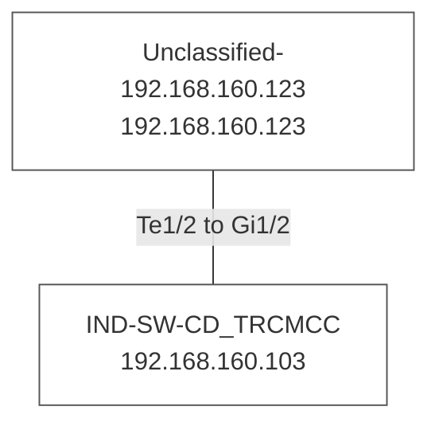

# IND-SW-CD_TRCMCC

[Network index](../00-index.md) · [Topology](../01-topology_and_connections.md) · [Inventory](../02-switch_inventory.md) · [Connected devices](../03-connected_devices.md)

> **Placement:** Network_26_U160-123_Provisional (access). Department and physical location are **unknown**.

## 1. Identification

| Field | Value |
|---|---|
| Hostname (as collected) | `IND-SW-CD_TRCMCC` |
| Management IP | 192.168.160.103 |
| Role in its network | Access |
| Switch hops from head | 1 |
| Hardware model | IE-3200-8T2S (advertised by neighbours via CDP). SwitchScribe reports IE-3300-8T2X: they disagree |
| Firmware / IOS | 16.12.3 (as advertised to neighbours via CDP/LLDP) |
| Ports (SwitchScribe) | 10 reported, 1 up |
| Collection | success (Netmiko SSH, 4.31s) |
| Physical location | Not documented |
| Source note (Device Info and Raw CLI) | [[IND-SW-CD_TRCMCC (SwitchScribe)]] |

## 2. Individual topology

Diagram key: solid line = link reported from **both** ends; dotted arrow = reported from **one** end only. Dashed box = upstream boundary (not part of this network). Label = port on the upper device, then port on the lower device.

## 3. Switch-to-switch connections

| Local port | Remote switch | Remote port | Relationship | Evidence | Conflicting observations |
|---|---|---|---|---|---|
| `Gi1/2` | [[Unclassified-192.168.160.123]] | `Te1/2` | Parent / uplink | seen from both ends; source CDP/LLDP | — |

## 4. Connected end devices

No named end devices were reported by this switch.

## 5. Ports and VLANs

10 ports listed; 1 up.

| VLAN | Name | Ports | Port list |
|---|---|---|---|
| 1 | default | 7 | Gi1/1, Gi1/5-10 |
| 561 | vlan0561 | 2 | Gi1/3-4 |

## 6. Outstanding questions

- [ ] Confirm the department and physical location of this switch.
- [ ] Photograph the switch and record its rack / panel label.
- [ ] Resolve the model: SwitchScribe says `IE-3300-8T2X`, neighbours advertise `IE-3200-8T2S`. The advertised value matches the interface names where checked.
