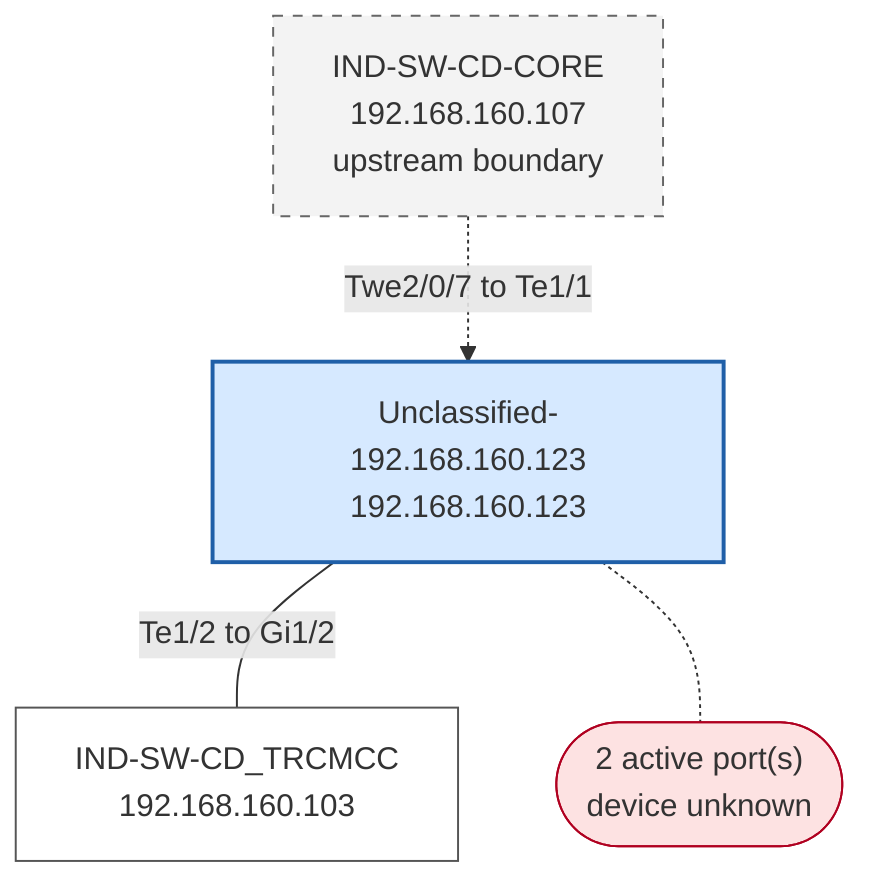

# Unclassified-192.168.160.123

[Network index](../00-index.md) · [Topology](../01-topology_and_connections.md) · [Inventory](../02-switch_inventory.md) · [Connected devices](../03-connected_devices.md)

> **Placement:** Network_26_U160-123_Provisional (head). Department and physical location are **unknown**.

## 1. Identification

| Field | Value |
|---|---|
| Hostname (as collected) | `Unclassified-192.168.160.123` |
| Management IP | 192.168.160.123 |
| Role in its network | Head |
| Switch hops from head | 0 |
| Hardware model | IE-3300-8T2X (advertised by neighbours via CDP). SwitchScribe reports C9500-48Y4C: they disagree |
| Firmware / IOS | 17.12.4 (as advertised to neighbours via CDP/LLDP) |
| Ports (SwitchScribe) | 10 reported, 4 up |
| Collection | success (Netmiko Telnet, 6.30s) |
| Physical location | Not documented |
| Source note (Device Info and Raw CLI) | [[Unclassified-192.168.160.123 (SwitchScribe)]] |

## 2. Individual topology

Diagram key: solid line = link reported from **both** ends; dotted arrow = reported from **one** end only. Dashed box = upstream boundary (not part of this network). Label = port on the upper device, then port on the lower device.

## 3. Switch-to-switch connections

| Local port | Remote switch | Remote port | Relationship | Evidence | Conflicting observations |
|---|---|---|---|---|---|
| `Te1/1` | [[Unclassified-192.168.160.107]] (IND-SW-CD-CORE) | `Twe2/0/7` | Upstream boundary (core) | seen from one end only (the other end not collected / not reporting); source CDP | — |
| `Te1/2` | [[IND-SW-CD_TRCMCC]] | `Gi1/2` | Downstream or lateral | seen from both ends; source CDP/LLDP | — |

## 4. Connected end devices

No named end devices were reported by this switch.

**2 active port(s) report no CDP/LLDP neighbour**, so the device on them is unknown: Gi1/3-4.

## 5. Ports and VLANs

11 ports listed; 4 up.

| VLAN | Name | Ports | Port list |
|---|---|---|---|
| 1 | default | 1 | Ap1/1 |
| 561 | cesms | 8 | Gi1/3-10 |

## 6. Outstanding questions

- [ ] Confirm the department and physical location of this switch.
- [ ] Photograph the switch and record its rack / panel label.
- [ ] Resolve the model: SwitchScribe says `C9500-48Y4C`, neighbours advertise `IE-3300-8T2X`. The advertised value matches the interface names where checked.
- [ ] Identify the unidentified end devices (MAC/GUID-only neighbours and active ports with no CDP/LLDP data).
- [ ] Verify the links seen from one end only (section 3) on the other switch.
