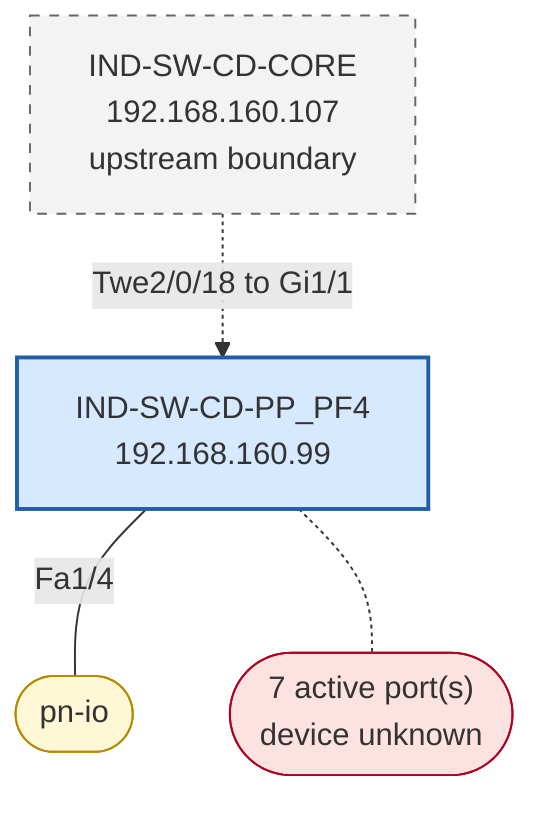

# IND-SW-CD-PP_PF4

[Network index](../00-index.md) · [Topology](../01-topology_and_connections.md) · [Inventory](../02-switch_inventory.md) · [Connected devices](../03-connected_devices.md)

> **Placement:** Network_27_CD-PP_PF4_Provisional (head). Department and physical location are **unknown**.

## 1. Identification

| Field | Value |
|---|---|
| Hostname (as collected) | `IND-SW-CD-PP_PF4` |
| Management IP | 192.168.160.99 |
| Role in its network | Head |
| Switch hops from head | 0 |
| Hardware model | C9500-48Y4C (SwitchScribe) |
| Firmware / IOS | Unknown (not in the collected data) |
| Ports (SwitchScribe) | 10 reported, 9 up |
| Collection | success (Netmiko SSH, 4.94s) |
| Physical location | Not documented |
| Source note (Device Info and Raw CLI) | [[IND-SW-CD-PP_PF4 (SwitchScribe)]] |

## 2. Individual topology

Diagram key: solid line = link reported from **both** ends; dotted arrow = reported from **one** end only. Dashed box = upstream boundary (not part of this network). Label = port on the upper device, then port on the lower device.

## 3. Switch-to-switch connections

| Local port | Remote switch | Remote port | Relationship | Evidence | Conflicting observations |
|---|---|---|---|---|---|
| `Gi1/1` | [[Unclassified-192.168.160.107]] (IND-SW-CD-CORE) | `Twe2/0/18` | Upstream boundary (core) | seen from one end only (the other end not collected / not reporting); source CDP | — |

## 4. Connected end devices

| Port | Device | Type (from LLDP text) | Remote port | IP | LLDP description | Media |
|---|---|---|---|---|---|---|
| `Fa1/4` | pn-io | unclassified endpoint | Siemens, SIMATIC NET, Fa | 192.168.180.3 | Siemens, SIMATIC NET, CP 343-1 Lean, 6GK7 343-1CX10-0XE0, HW | 100base-TX(FD), 100base-TX(HD) |

**7 active port(s) report no CDP/LLDP neighbour**, so the device on them is unknown: Fa1/1-3, Fa1/5-8.

## 5. Ports and VLANs

12 ports listed; 9 up.

| VLAN | Name | Ports | Port list |
|---|---|---|---|
| 1 | default | 1 | Gi1/2 |
| 561 | VLAN0561 | 1 | Fa1/6 |
| 578 | A19 | 1 | active    Fa1/7 |
| 580 | Plate | 1 | Network              active    Fa1/4 |
| 590 | CDPowermeters | 5 | Fa1/1-3, Fa1/5, Fa1/8 |

## 6. Outstanding questions

- [ ] Confirm the department and physical location of this switch.
- [ ] Photograph the switch and record its rack / panel label.
- [ ] Identify the unidentified end devices (MAC/GUID-only neighbours and active ports with no CDP/LLDP data).
- [ ] Verify the links seen from one end only (section 3) on the other switch.
