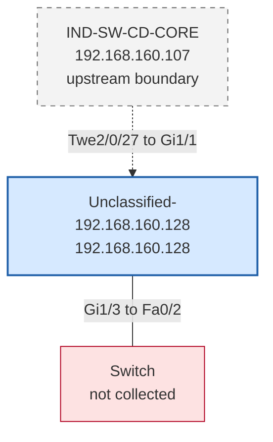

# Unclassified-192.168.160.128

[Network index](../00-index.md) · [Topology](../01-topology_and_connections.md) · [Inventory](../02-switch_inventory.md) · [Connected devices](../03-connected_devices.md)

> **Placement:** Network_34_U160-128_Provisional (head). Department and physical location are **unknown**.

## 1. Identification

| Field | Value |
|---|---|
| Hostname (as collected) | `Unclassified-192.168.160.128` |
| Management IP | 192.168.160.128 |
| Role in its network | Head |
| Switch hops from head | 0 |
| Hardware model | WS-C2950SX-24 (SwitchScribe) |
| Firmware / IOS | Unknown (not in the collected data) |
| Ports (SwitchScribe) | 10 reported, 2 up |
| Collection | success (Netmiko SSH, 4.47s) |
| Physical location | Not documented |
| Source note (Device Info and Raw CLI) | [[Unclassified-192.168.160.128 (SwitchScribe)]] |

## 2. Individual topology

Diagram key: solid line = link reported from **both** ends; dotted arrow = reported from **one** end only. Dashed box = upstream boundary (not part of this network). Label = port on the upper device, then port on the lower device.

## 3. Switch-to-switch connections

| Local port | Remote switch | Remote port | Relationship | Evidence | Conflicting observations |
|---|---|---|---|---|---|
| `Gi1/1` | [[Unclassified-192.168.160.107]] (IND-SW-CD-CORE) | `Twe2/0/27` | Upstream boundary (core) | seen from one end only (the other end not collected / not reporting); source CDP | — |

Neighbour switches that are **not in the collected inventory**:

| Local port | Neighbour | Remote port | IP | Description |
|---|---|---|---|---|
| `Gi1/3` | Switch | Fa0/2 | — | cisco WS-C2950SX-24 |

## 4. Connected end devices

No named end devices were reported by this switch.

## 5. Ports and VLANs

11 ports listed; 2 up.

| VLAN | Name | Ports | Port list |
|---|---|---|---|
| 1 | default | 2 | Ap1/1, Gi1/2 |
| 564 | CDHotMill_L1 | 8 | Gi1/3-10 |

## 6. Outstanding questions

- [ ] Confirm the department and physical location of this switch.
- [ ] Photograph the switch and record its rack / panel label.
- [ ] Collect the neighbour switch(es) listed in section 3 that are not in the inventory.
- [ ] Verify the links seen from one end only (section 3) on the other switch.
