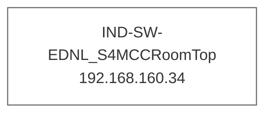

# IND-SW-EDNL_S4MCCRoomTop

[Unplaced switches](00-index.md)

> **Placement:** Unplaced: this switch has no neighbour data and no other switch reported it as a neighbour. Department and physical location are **unknown**.

## 1. Identification

| Field | Value |
|---|---|
| Hostname (as collected) | `IND-SW-EDNL_S4MCCRoomTop` |
| Management IP | 192.168.160.34 |
| Role in its network | Not placed (no neighbour data) |
| Switch hops from head | — |
| Hardware model | Unknown |
| Firmware / IOS | Unknown (not in the collected data) |
| Ports (SwitchScribe) | — reported, — up |
| Collection | failed (Netmiko SSH, 10.01s). Error: NetmikoTimeoutException: TCP connection to device failed.  Common causes of this problem are: 1. Incorrect hostname or IP address. 2. Wrong TCP port. 3. Intermediate firewall blocking access.  Device settings: cisco_ios 192.168.160.34:22 |
| Physical location | Not documented |
| Source note (Device Info and Raw CLI) | [[IND-SW-EDNL_S4MCCRoomTop (SwitchScribe)]] |

## 2. Individual topology

Diagram key: solid line = link reported from **both** ends; dotted arrow = reported from **one** end only. Dashed box = upstream boundary (not part of this network). Label = port on the upper device, then port on the lower device.

## 3. Switch-to-switch connections

No switch neighbour was resolved for this switch.

## 4. Connected end devices

Unknown: this switch could not be collected.

## 5. Ports and VLANs

No port data: collection did not succeed.

## 6. Outstanding questions

- [ ] Confirm the department and physical location of this switch.
- [ ] Photograph the switch and record its rack / panel label.
- [ ] Capture this switch by hand (collection failed); see [[01-Documentation_Guide]].
