# Topology and Connections — Cluster_01

> Scope: Cluster_01 only. This is a provisional LLDP/CDP discovery group, not a confirmed department or physical area.
> Source: the SwitchScribe records stored alongside this document.
> Links below are included only when a discovered neighbour could be matched to another switch record in this same cluster.

## 1. Switch inventory

| Switch | Management IP | Reported model | Source record |
|---|---|---|---|
| IND-SW-CCL1DevRoom | 192.168.160.12 | cisco IE-3000-8TC | [IND-SW-CCL1DevRoom.md](IND-SW-CCL1DevRoom.md) |
| IND-SW-CCL1PLCC | 192.168.160.11 | cisco IE-3000-8TC | [IND-SW-CCL1PLCC.md](IND-SW-CCL1PLCC.md) |
| IND-SW-CCL1_PLC_B | 192.168.160.10 | cisco IE-3000-8TC | [IND-SW-CCL1_PLC_B.md](IND-SW-CCL1_PLC_B.md) |
| IND-SW-CCL_CESS | 192.168.160.23 | cisco WS-C2960X-48TS-L | [IND-SW-CCL_CESS.md](IND-SW-CCL_CESS.md) |
| IND-SW-CD-BulkWaterTank | 192.168.160.57 | cisco IE-3000-8TC | [IND-SW-CD-BulkWaterTank.md](IND-SW-CD-BulkWaterTank.md) |
| IND-SW-CD-Effluent | 192.168.160.58 | cisco IE-3000-8TC | [IND-SW-CD-Effluent.md](IND-SW-CD-Effluent.md) |
| IND-SW-CD-Effluent_6A | 192.168.160.93 | cisco IE-3000-8TC | [IND-SW-CD-Effluent_6A.md](IND-SW-CD-Effluent_6A.md) |
| IND-SW-CD-Effluent_6A_Control | 192.168.160.94 | cisco IE-3000-8TC | [IND-SW-CD-Effluent_6A_Control.md](IND-SW-CD-Effluent_6A_Control.md) |
| IND-SW-CD-PP_CTLSsub | 192.168.160.78 | cisco C9500-48Y4C | [IND-SW-CD-PP_CTLSsub.md](IND-SW-CD-PP_CTLSsub.md) |
| IND-SW-CD-PP_Compressor | 192.168.160.80 | cisco IE-3300-8T2S | [IND-SW-CD-PP_Compressor.md](IND-SW-CD-PP_Compressor.md) |
| IND-SW-CD-PP_FurnaceMCC | 192.168.160.81 | cisco 1783-BMS20CA | [IND-SW-CD-PP_FurnaceMCC.md](IND-SW-CD-PP_FurnaceMCC.md) |
| IND-SW-CD-PP_HSHTFsub | 192.168.160.79 | cisco IE-3000-8TC | [IND-SW-CD-PP_HSHTFsub.md](IND-SW-CD-PP_HSHTFsub.md) |
| IND-SW-CD-PP_PF4 | 192.168.160.99 | cisco C9500-48Y4C | [IND-SW-CD-PP_PF4.md](IND-SW-CD-PP_PF4.md) |
| IND-SW-CD-Sub3A | 192.168.160.104 | cisco IE-3300-8T2S | [IND-SW-CD-Sub3A.md](IND-SW-CD-Sub3A.md) |
| IND-SW-CD-Sub6A | 192.168.160.92 | Linux | [IND-SW-CD-Sub6A.md](IND-SW-CD-Sub6A.md) |
| IND-SW-CDHL_CoolingTowers | 192.168.160.87 | cisco C9500-48Y4C | [IND-SW-CDHL_CoolingTowers.md](IND-SW-CDHL_CoolingTowers.md) |
| IND-SW-CDRF_ScalperPiller42 | 192.168.160.86 | MikroTik | [IND-SW-CDRF_ScalperPiller42.md](IND-SW-CDRF_ScalperPiller42.md) |
| IND-SW-CD_A19 | 192.168.160.82 | cisco C9500-48Y4C | [IND-SW-CD_A19.md](IND-SW-CD_A19.md) |
| IND-SW-CD_CompHouse5 | 192.168.160.47 | cisco C9500-48Y4C | [IND-SW-CD_CompHouse5.md](IND-SW-CD_CompHouse5.md) |
| IND-SW-CD_CoolingTower | 192.168.160.75 | cisco C9500-48Y4C | [IND-SW-CD_CoolingTower.md](IND-SW-CD_CoolingTower.md) |
| IND-SW-CD_HFM | 192.168.160.98 | cisco IE-3000-8TC | [IND-SW-CD_HFM.md](IND-SW-CD_HFM.md) |
| IND-SW-CD_HRM | 192.168.160.97 | cisco C9500-48Y4C | [IND-SW-CD_HRM.md](IND-SW-CD_HRM.md) |
| IND-SW-CD_MainServerRoom | 192.168.160.74 | cisco WS-C2960X-24TS-L | [IND-SW-CD_MainServerRoom.md](IND-SW-CD_MainServerRoom.md) |
| IND-SW-CD_Sub5MCC | 192.168.160.96 | cisco WS-C2960C-12PC-L | [IND-SW-CD_Sub5MCC.md](IND-SW-CD_Sub5MCC.md) |
| IND-SW-CD_SubStation1 | 192.168.160.51 | Linux | [IND-SW-CD_SubStation1.md](IND-SW-CD_SubStation1.md) |
| IND-SW-CD_SubStation2 | 192.168.160.100 | Linux | [IND-SW-CD_SubStation2.md](IND-SW-CD_SubStation2.md) |
| IND-SW-CD_SubStation4 | 192.168.160.52 | Linux | [IND-SW-CD_SubStation4.md](IND-SW-CD_SubStation4.md) |
| IND-SW-CD_TRCMCC | 192.168.160.103 | cisco IE-3300-8T2X | [IND-SW-CD_TRCMCC.md](IND-SW-CD_TRCMCC.md) |
| IND-SW-CD_UBC | 192.168.160.89 | cisco C9500-48Y4C | [IND-SW-CD_UBC.md](IND-SW-CD_UBC.md) |
| IND-SW-CD_WaterTowerMCC | 192.168.160.76 | Linux | [IND-SW-CD_WaterTowerMCC.md](IND-SW-CD_WaterTowerMCC.md) |
| IND-SW-EDNL-Dept34SubStation | 192.168.160.41 | cisco IE-3000-8TC | [IND-SW-EDNL-Dept34SubStation.md](IND-SW-EDNL-Dept34SubStation.md) |
| IND-SW-EDNL_AdminMCC | 192.168.160.77 | cisco C9500-48Y4C | [IND-SW-EDNL_AdminMCC.md](IND-SW-EDNL_AdminMCC.md) |
| IND-SW-EDNL_AnnealingFurnace | 192.168.160.45 | cisco IE-3000-8TC | [IND-SW-EDNL_AnnealingFurnace.md](IND-SW-EDNL_AnnealingFurnace.md) |
| IND-SW-EDNL_CCLCNGGAS | 192.168.160.48 | cisco IE-3000-8TC | [IND-SW-EDNL_CCLCNGGAS.md](IND-SW-EDNL_CCLCNGGAS.md) |
| IND-SW-EDNL_CCLServiceTunnel | 192.168.160.42 | cisco IE-3000-8TC | [IND-SW-EDNL_CCLServiceTunnel.md](IND-SW-EDNL_CCLServiceTunnel.md) |
| IND-SW-EDNL_CompHouse1 | 192.168.160.5 | Not reported | [IND-SW-EDNL_CompHouse1.md](IND-SW-EDNL_CompHouse1.md) |
| IND-SW-EDNL_CompHouse2&3_2ndSW | 192.168.160.95 | cisco WS-C2960X-24PD-L | [IND-SW-EDNL_CompHouse2_3_2ndSW.md](IND-SW-EDNL_CompHouse2_3_2ndSW.md) |
| IND-SW-EDNL_CompHouse2and3 | 192.168.160.6 | cisco IE-3000-8TC | [IND-SW-EDNL_CompHouse2and3.md](IND-SW-EDNL_CompHouse2and3.md) |
| IND-SW-EDNL_CompHouse4 | 192.168.160.7 | cisco WS-C2960X-24TS-L | [IND-SW-EDNL_CompHouse4.md](IND-SW-EDNL_CompHouse4.md) |
| IND-SW-EDNL_EffluentPlant | 192.168.160.91 | cisco C9500-48Y4C | [IND-SW-EDNL_EffluentPlant.md](IND-SW-EDNL_EffluentPlant.md) |
| IND-SW-EDNL_ElectrciansWorkShop | 192.168.160.27 | Cisco SG200-10FP (PID:SG200-10FP)-VSD | [IND-SW-EDNL_ElectrciansWorkShop.md](IND-SW-EDNL_ElectrciansWorkShop.md) |
| IND-SW-EDNL_FoilAnnealingSubN | 192.168.160.67 | cisco WS-C2950SX-24 | [IND-SW-EDNL_FoilAnnealingSubN.md](IND-SW-EDNL_FoilAnnealingSubN.md) |
| IND-SW-EDNL_FoilColingTowers | 192.168.160.37 | cisco IE-3000-8TC | [IND-SW-EDNL_FoilColingTowers.md](IND-SW-EDNL_FoilColingTowers.md) |
| IND-SW-EDNL_GeneratorSub | 192.168.160.28 | cisco C9500-48Y4C | [IND-SW-EDNL_GeneratorSub.md](IND-SW-EDNL_GeneratorSub.md) |
| IND-SW-EDNL_MainServerRoom | 192.168.160.26 | Linux | [IND-SW-EDNL_MainServerRoom.md](IND-SW-EDNL_MainServerRoom.md) |
| IND-SW-EDNL_S4GaugeCab | 192.168.160.32 | cisco WS-C2960X-24TS-L | [IND-SW-EDNL_S4GaugeCab.md](IND-SW-EDNL_S4GaugeCab.md) |
| IND-SW-EDNL_S4PulPit | 192.168.160.33 | cisco WS-C2960X-24TS-L | [IND-SW-EDNL_S4PulPit.md](IND-SW-EDNL_S4PulPit.md) |
| IND-SW-EDNL_S4SMCCRoomBottom | 192.168.160.29 | cisco IE-3000-8TC | [IND-SW-EDNL_S4SMCCRoomBottom.md](IND-SW-EDNL_S4SMCCRoomBottom.md) |
| IND-SW-EDNL_S6MCCRoom | 192.168.160.61 | cisco IE-3000-8TC | [IND-SW-EDNL_S6MCCRoom.md](IND-SW-EDNL_S6MCCRoom.md) |
| IND-SW-EDNL_SL6MCCRoom | 192.168.160.64 | cisco IE-3000-8TC | [IND-SW-EDNL_SL6MCCRoom.md](IND-SW-EDNL_SL6MCCRoom.md) |
| IND-SW-EDNL_SubStation1 | 192.168.160.35 | cisco IE-3000-8TC | [IND-SW-EDNL_SubStation1.md](IND-SW-EDNL_SubStation1.md) |
| IND-SW-EDNL_SubStationA | 192.168.160.39 | cisco IE-3000-8TC | [IND-SW-EDNL_SubStationA.md](IND-SW-EDNL_SubStationA.md) |
| IND-SW-EDNL_SubStationB | 192.168.160.40 | cisco IE-3000-8TC | [IND-SW-EDNL_SubStationB.md](IND-SW-EDNL_SubStationB.md) |
| IND-SW-EDNL_SubStationD | 192.168.160.43 | cisco IE-3000-8TC | [IND-SW-EDNL_SubStationD.md](IND-SW-EDNL_SubStationD.md) |
| IND-SW-EDNL_SubStationE | 192.168.160.60 | cisco IE-3000-8TC | [IND-SW-EDNL_SubStationE.md](IND-SW-EDNL_SubStationE.md) |
| IND-SW-EDNL_SubStationG | 192.168.160.44 | cisco IE-3000-8TC | [IND-SW-EDNL_SubStationG.md](IND-SW-EDNL_SubStationG.md) |
| IND-SW-EDNL_SubStationH | 192.168.160.63 | cisco IE-3000-8TC | [IND-SW-EDNL_SubStationH.md](IND-SW-EDNL_SubStationH.md) |
| IND-SW-EDNL_SubStationJ | 192.168.160.38 | cisco IE-3000-8TC | [IND-SW-EDNL_SubStationJ.md](IND-SW-EDNL_SubStationJ.md) |
| IND-SW-EDNL_SubStationK | 192.168.160.62 | cisco IE-3000-8TC | [IND-SW-EDNL_SubStationK.md](IND-SW-EDNL_SubStationK.md) |
| IND-SW-EDNL_SubStationM | 192.168.160.69 | cisco IE-3000-8TC | [IND-SW-EDNL_SubStationM.md](IND-SW-EDNL_SubStationM.md) |
| IND-SW-EDNL_SubStationN | 192.168.160.36 | cisco IE-3000-8TC | [IND-SW-EDNL_SubStationN.md](IND-SW-EDNL_SubStationN.md) |
| IND-SW-EDNL_WaterTowerSUB | 192.168.160.49 | cisco IE-3000-8TC | [IND-SW-EDNL_WaterTowerSUB.md](IND-SW-EDNL_WaterTowerSUB.md) |
| IND-SW-ENDL-INDServerRoom_Bottom | 192.168.160.53 | Linux | [IND-SW-ENDL-INDServerRoom_Bottom.md](IND-SW-ENDL-INDServerRoom_Bottom.md) |
| IND-SW-ENDL_SUBNMcc | 192.168.160.102 | cisco C9500-48Y4C | [IND-SW-ENDL_SUBNMcc.md](IND-SW-ENDL_SUBNMcc.md) |
| IND-SW_CCL1OS4 | 192.168.160.13 | cisco IE-3000-8TC | [IND-SW_CCL1OS4.md](IND-SW_CCL1OS4.md) |
| IND-SW_CCL1OS5 | 192.168.160.14 | cisco IE-3000-4TC | [IND-SW_CCL1OS5.md](IND-SW_CCL1OS5.md) |
| IND-SW_CCL1OS6 | 192.168.160.15 | IE-3300-8P2S | [IND-SW_CCL1OS6.md](IND-SW_CCL1OS6.md) |
| IND-SW_CCL1OS9 | 192.168.160.16 | cisco IE-3000-8TC | [IND-SW_CCL1OS9.md](IND-SW_CCL1OS9.md) |
| IND-SW_CCL2Coater_Bottom | 192.168.160.18 | cisco WS-C2960X-24TS-L | [IND-SW_CCL2Coater_Bottom.md](IND-SW_CCL2Coater_Bottom.md) |
| IND-SW_CCL2_CompRoom | 192.168.160.22 | cisco WS-C2960X-24TS-L | [IND-SW_CCL2_CompRoom.md](IND-SW_CCL2_CompRoom.md) |
| IND-SW_CCL2_DC_L | 192.168.160.20 | cisco WS-C2960X-48TS-L | [IND-SW_CCL2_DC_L.md](IND-SW_CCL2_DC_L.md) |
| IND-SW_CCL2_OS1 | 192.168.160.21 | cisco WS-C2960X-48TS-L | [IND-SW_CCL2_OS1.md](IND-SW_CCL2_OS1.md) |
| IND-SW_FS14MCC | 192.168.160.9 | cisco C9500-48Y4C | [IND-SW_FS14MCC.md](IND-SW_FS14MCC.md) |
| IND-SW_FS15MCC | 192.168.160.8 | cisco C9500-48Y4C | [IND-SW_FS15MCC.md](IND-SW_FS15MCC.md) |
| Unclassified-192.168.160.105 | 192.168.160.105 | cisco C9500-48Y4C | [Unclassified-192.168.160.105.md](Unclassified-192.168.160.105.md) |
| Unclassified-192.168.160.106 | 192.168.160.106 | cisco C9500-48Y4C | [Unclassified-192.168.160.106.md](Unclassified-192.168.160.106.md) |
| Unclassified-192.168.160.107 | 192.168.160.107 | cisco C9500-48Y4C | [Unclassified-192.168.160.107.md](Unclassified-192.168.160.107.md) |
| Unclassified-192.168.160.110 | 192.168.160.110 | N5K-C5672UP | [Unclassified-192.168.160.110.md](Unclassified-192.168.160.110.md) |
| Unclassified-192.168.160.114 | 192.168.160.114 | Linux | [Unclassified-192.168.160.114.md](Unclassified-192.168.160.114.md) |
| Unclassified-192.168.160.115 | 192.168.160.115 | cisco C9500-48Y4C | [Unclassified-192.168.160.115.md](Unclassified-192.168.160.115.md) |
| Unclassified-192.168.160.116 | 192.168.160.116 | cisco IE-3000-8TC | [Unclassified-192.168.160.116.md](Unclassified-192.168.160.116.md) |
| Unclassified-192.168.160.120 | 192.168.160.120 | cisco C9500-48Y4C | [Unclassified-192.168.160.120.md](Unclassified-192.168.160.120.md) |
| Unclassified-192.168.160.121 | 192.168.160.121 | cisco C9500-48Y4C | [Unclassified-192.168.160.121.md](Unclassified-192.168.160.121.md) |
| Unclassified-192.168.160.123 | 192.168.160.123 | cisco C9500-48Y4C | [Unclassified-192.168.160.123.md](Unclassified-192.168.160.123.md) |
| Unclassified-192.168.160.127 | 192.168.160.127 | cisco C9500-48Y4C | [Unclassified-192.168.160.127.md](Unclassified-192.168.160.127.md) |
| Unclassified-192.168.160.128 | 192.168.160.128 | cisco WS-C2950SX-24 | [Unclassified-192.168.160.128.md](Unclassified-192.168.160.128.md) |
| Unclassified-192.168.160.4 | 192.168.160.4 | cisco IE-3000-8TC | [Unclassified-192.168.160.4.md](Unclassified-192.168.160.4.md) |

## 2. Discovered switch topology

```mermaid
flowchart TD
    S0["IND-SW-CCL1DevRoom<br/>192.168.160.12"]
    S1["IND-SW-CCL1PLCC<br/>192.168.160.11"]
    S2["IND-SW-CCL1_PLC_B<br/>192.168.160.10"]
    S3["IND-SW-CCL_CESS<br/>192.168.160.23"]
    S4["IND-SW-CD-BulkWaterTank<br/>192.168.160.57"]
    S5["IND-SW-CD-Effluent<br/>192.168.160.58"]
    S6["IND-SW-CD-Effluent_6A<br/>192.168.160.93"]
    S7["IND-SW-CD-Effluent_6A_Control<br/>192.168.160.94"]
    S8["IND-SW-CD-PP_CTLSsub<br/>192.168.160.78"]
    S9["IND-SW-CD-PP_Compressor<br/>192.168.160.80"]
    S10["IND-SW-CD-PP_FurnaceMCC<br/>192.168.160.81"]
    S11["IND-SW-CD-PP_HSHTFsub<br/>192.168.160.79"]
    S12["IND-SW-CD-PP_PF4<br/>192.168.160.99"]
    S13["IND-SW-CD-Sub3A<br/>192.168.160.104"]
    S14["IND-SW-CD-Sub6A<br/>192.168.160.92"]
    S15["IND-SW-CDHL_CoolingTowers<br/>192.168.160.87"]
    S16["IND-SW-CDRF_ScalperPiller42<br/>192.168.160.86"]
    S17["IND-SW-CD_A19<br/>192.168.160.82"]
    S18["IND-SW-CD_CompHouse5<br/>192.168.160.47"]
    S19["IND-SW-CD_CoolingTower<br/>192.168.160.75"]
    S20["IND-SW-CD_HFM<br/>192.168.160.98"]
    S21["IND-SW-CD_HRM<br/>192.168.160.97"]
    S22["IND-SW-CD_MainServerRoom<br/>192.168.160.74"]
    S23["IND-SW-CD_Sub5MCC<br/>192.168.160.96"]
    S24["IND-SW-CD_SubStation1<br/>192.168.160.51"]
    S25["IND-SW-CD_SubStation2<br/>192.168.160.100"]
    S26["IND-SW-CD_SubStation4<br/>192.168.160.52"]
    S27["IND-SW-CD_TRCMCC<br/>192.168.160.103"]
    S28["IND-SW-CD_UBC<br/>192.168.160.89"]
    S29["IND-SW-CD_WaterTowerMCC<br/>192.168.160.76"]
    S30["IND-SW-EDNL-Dept34SubStation<br/>192.168.160.41"]
    S31["IND-SW-EDNL_AdminMCC<br/>192.168.160.77"]
    S32["IND-SW-EDNL_AnnealingFurnace<br/>192.168.160.45"]
    S33["IND-SW-EDNL_CCLCNGGAS<br/>192.168.160.48"]
    S34["IND-SW-EDNL_CCLServiceTunnel<br/>192.168.160.42"]
    S35["IND-SW-EDNL_CompHouse1<br/>192.168.160.5"]
    S36["IND-SW-EDNL_CompHouse2&3_2ndSW<br/>192.168.160.95"]
    S37["IND-SW-EDNL_CompHouse2and3<br/>192.168.160.6"]
    S38["IND-SW-EDNL_CompHouse4<br/>192.168.160.7"]
    S39["IND-SW-EDNL_EffluentPlant<br/>192.168.160.91"]
    S40["IND-SW-EDNL_ElectrciansWorkShop<br/>192.168.160.27"]
    S41["IND-SW-EDNL_FoilAnnealingSubN<br/>192.168.160.67"]
    S42["IND-SW-EDNL_FoilColingTowers<br/>192.168.160.37"]
    S43["IND-SW-EDNL_GeneratorSub<br/>192.168.160.28"]
    S44["IND-SW-EDNL_MainServerRoom<br/>192.168.160.26"]
    S45["IND-SW-EDNL_S4GaugeCab<br/>192.168.160.32"]
    S46["IND-SW-EDNL_S4PulPit<br/>192.168.160.33"]
    S47["IND-SW-EDNL_S4SMCCRoomBottom<br/>192.168.160.29"]
    S48["IND-SW-EDNL_S6MCCRoom<br/>192.168.160.61"]
    S49["IND-SW-EDNL_SL6MCCRoom<br/>192.168.160.64"]
    S50["IND-SW-EDNL_SubStation1<br/>192.168.160.35"]
    S51["IND-SW-EDNL_SubStationA<br/>192.168.160.39"]
    S52["IND-SW-EDNL_SubStationB<br/>192.168.160.40"]
    S53["IND-SW-EDNL_SubStationD<br/>192.168.160.43"]
    S54["IND-SW-EDNL_SubStationE<br/>192.168.160.60"]
    S55["IND-SW-EDNL_SubStationG<br/>192.168.160.44"]
    S56["IND-SW-EDNL_SubStationH<br/>192.168.160.63"]
    S57["IND-SW-EDNL_SubStationJ<br/>192.168.160.38"]
    S58["IND-SW-EDNL_SubStationK<br/>192.168.160.62"]
    S59["IND-SW-EDNL_SubStationM<br/>192.168.160.69"]
    S60["IND-SW-EDNL_SubStationN<br/>192.168.160.36"]
    S61["IND-SW-EDNL_WaterTowerSUB<br/>192.168.160.49"]
    S62["IND-SW-ENDL-INDServerRoom_Bottom<br/>192.168.160.53"]
    S63["IND-SW-ENDL_SUBNMcc<br/>192.168.160.102"]
    S64["IND-SW_CCL1OS4<br/>192.168.160.13"]
    S65["IND-SW_CCL1OS5<br/>192.168.160.14"]
    S66["IND-SW_CCL1OS6<br/>192.168.160.15"]
    S67["IND-SW_CCL1OS9<br/>192.168.160.16"]
    S68["IND-SW_CCL2Coater_Bottom<br/>192.168.160.18"]
    S69["IND-SW_CCL2_CompRoom<br/>192.168.160.22"]
    S70["IND-SW_CCL2_DC_L<br/>192.168.160.20"]
    S71["IND-SW_CCL2_OS1<br/>192.168.160.21"]
    S72["IND-SW_FS14MCC<br/>192.168.160.9"]
    S73["IND-SW_FS15MCC<br/>192.168.160.8"]
    S74["Unclassified-192.168.160.105<br/>192.168.160.105"]
    S75["Unclassified-192.168.160.106<br/>192.168.160.106"]
    S76["Unclassified-192.168.160.107<br/>192.168.160.107"]
    S77["Unclassified-192.168.160.110<br/>192.168.160.110"]
    S78["Unclassified-192.168.160.114<br/>192.168.160.114"]
    S79["Unclassified-192.168.160.115<br/>192.168.160.115"]
    S80["Unclassified-192.168.160.116<br/>192.168.160.116"]
    S81["Unclassified-192.168.160.120<br/>192.168.160.120"]
    S82["Unclassified-192.168.160.121<br/>192.168.160.121"]
    S83["Unclassified-192.168.160.123<br/>192.168.160.123"]
    S84["Unclassified-192.168.160.127<br/>192.168.160.127"]
    S85["Unclassified-192.168.160.128<br/>192.168.160.128"]
    S86["Unclassified-192.168.160.4<br/>192.168.160.4"]
    S0 ---|"**GigabitEthernet1/0/26** ↔ GigabitEthernet1/2"| S2
    S0 ---|"**GigabitEthernet1/0/28** ↔ GigabitEthernet1/1"| S1
    S1 ---|"**FastEthernet2/1** ↔ GigabitEthernet1/1"| S67
    S1 ---|"**GigabitEthernet1/1** ↔ GigabitEthernet1/0/28"| S0
    S1 ---|"**GigabitEthernet1/2** ↔ GigabitEthernet1/1"| S2
    S2 ---|"**FastEthernet2/1** ↔ GigabitEthernet1/1"| S64
    S2 ---|"**GigabitEthernet1/1** ↔ GigabitEthernet1/2"| S1
    S2 ---|"**GigabitEthernet1/2** ↔ GigabitEthernet1/0/26"| S0
    S3 ---|"**GigabitEthernet1/1** ↔ GigabitEthernet1/0/50"| S69
    S3 ---|"**GigabitEthernet1/2** ↔ GigabitEthernet1/1"| S34
    S4 ---|"**GigabitEthernet1/1** ↔ GigabitEthernet1/1"| S5
    S5 ---|"**FastEthernet1/1** ↔ FastEthernet1/1"| S6
    S5 ---|"**GigabitEthernet1/2** ↔ GigabitEthernet1/1"| S29
    S6 ---|"**GigabitEthernet1/1** ↔ GigabitEthernet1/1"| S14
    S6 ---|"**GigabitEthernet1/2** ↔ TwentyFiveGigE2/0/21"| S76
    S7 ---|"**GigabitEthernet0/2** ↔ GigabitEthernet1/2"| S23
    S8 ---|"**Fa1/8** ↔ GigabitEthernet1/1 | 580 Plate"| S11
    S8 ---|"**GigabitEthernet1/1** ↔ TwentyFiveGigE2/0/20"| S76
    S8 ---|"**GigabitEthernet1/2** ↔ GigabitEthernet1/1"| S11
    S9 ---|"**Gi1/5** ↔ GigabitEthernet1/2 | 580 Plate-Plant-Network"| S11
    S9 ---|"**Te1/2** ↔ GigabitEthernet1/2"| S10
    S9 ---|"**TenGigabitEthernet1/1** ↔ GigabitEthernet1/2"| S10
    S9 ---|"**TenGigabitEthernet1/2** ↔ GigabitEthernet1/2"| S11
    S10 ---|"**Gi1/10** ↔ TenGigabitEthernet1/1 | 580 Plate_Plant_Network"| S9
    S10 ---|"**GigabitEthernet1/2** ↔ TenGigabitEthernet1/1"| S9
    S11 ---|"**Gi1/1** ↔ TenGigabitEthernet1/2"| S9
    S11 ---|"**GigabitEthernet1/1** ↔ GigabitEthernet1/2"| S8
    S11 ---|"**GigabitEthernet1/2** ↔ TenGigabitEthernet1/2"| S9
    S12 ---|"**GigabitEthernet1/1** ↔ TwentyFiveGigE2/0/18"| S76
    S13 ---|"**GigabitEthernet1/2** ↔ GigabitEthernet1/2"| S20
    S14 ---|"**Fa1/7** ↔ GigabitEthernet1/1 | 562 IND-CCTV"| S23
    S14 ---|"**Gi1/2** ↔ GigabitEthernet1/1"| S6
    S14 ---|"**GigabitEthernet1/2** ↔ GigabitEthernet1/1"| S23
    S15 ---|"**GigabitEthernet1/1** ↔ TwentyFiveGigE2/0/35"| S76
    S16 ---|"**GigabitEthernet1/1** ↔ GigabitEthernet1/0/26"| S17
    S17 ---|"**Gi1/0/25** ↔ GigabitEthernet1/1"| S16
    S17 ---|"**Gi1/0/4** ↔ GigabitEthernet1/2 | 561 IND-CESMS"| S24
    S17 ---|"**GigabitEthernet1/0/25** ↔ GigabitEthernet1/2"| S24
    S17 ---|"**GigabitEthernet1/0/26** ↔ GigabitEthernet1/1"| S16
    S17 ---|"**GigabitEthernet1/0/27** ↔ TwentyFiveGigE2/0/14"| S76
    S18 ---|"**GigabitEthernet1/0/25** ↔ TwentyFiveGigE2/0/29"| S76
    S19 ---|"**GigabitEthernet1/1** ↔ GigabitEthernet1/2"| S29
    S19 ---|"**GigabitEthernet1/2** ↔ TwentyFiveGigE2/0/37"| S76
    S20 ---|"**GigabitEthernet1/1** ↔ TwentyFiveGigE2/0/17"| S76
    S21 ---|"**Gi1/5** ↔ GigabitEthernet1/1 | 561 VLAN0561"| S78
    S21 ---|"**GigabitEthernet1/1** ↔ TwentyFiveGigE2/0/19"| S76
    S21 ---|"**GigabitEthernet1/2** ↔ GigabitEthernet1/1"| S78
    S22 ---|"**GigabitEthernet1/1** ↔ GigabitEthernet1/0/3"| S47
    S23 ---|"**GigabitEthernet1/1** ↔ GigabitEthernet1/2"| S14
    S23 ---|"**GigabitEthernet1/2** ↔ GigabitEthernet0/2"| S7
    S24 ---|"**Fa1/6** ↔ GigabitEthernet1/2 | 562 IND-CCTV"| S26
    S24 ---|"**Gi1/1** ↔ GigabitEthernet1/0/25"| S17
    S24 ---|"**GigabitEthernet1/1** ↔ GigabitEthernet1/2"| S26
    S24 ---|"**GigabitEthernet1/2** ↔ GigabitEthernet1/0/25"| S17
    S25 ---|"**GigabitEthernet1/1** ↔ TwentyFiveGigE2/0/15"| S76
    S26 ---|"**Fa1/4** ↔ GigabitEthernet1/1 | 562 IND-CCTV"| S24
    S26 ---|"**GigabitEthernet1/1** ↔ TwentyFiveGigE2/0/31"| S76
    S26 ---|"**GigabitEthernet1/2** ↔ GigabitEthernet1/1"| S24
    S27 ---|"**GigabitEthernet1/2** ↔ TenGigabitEthernet1/2"| S83
    S28 ---|"**GigabitEthernet1/1** ↔ TwentyFiveGigE2/0/41"| S76
    S29 ---|"**Fa1/8** ↔ GigabitEthernet1/1 | 562 IND-CESMS_CCTV"| S19
    S29 ---|"**Gi1/2** ↔ GigabitEthernet1/2"| S5
    S29 ---|"**GigabitEthernet1/1** ↔ GigabitEthernet1/2"| S5
    S29 ---|"**GigabitEthernet1/2** ↔ GigabitEthernet1/1"| S19
    S30 ---|"**GigabitEthernet1/1** ↔ GigabitEthernet1/2"| S50
    S32 ---|"**GigabitEthernet1/0/25** ↔ GigabitEthernet1/1"| S38
    S32 ---|"**GigabitEthernet1/0/26** ↔ GigabitEthernet1/1"| S56
    S33 ---|"**Gi1/1** ↔ GigabitEthernet1/1"| S61
    S33 ---|"**GigabitEthernet1/1** ↔ GigabitEthernet1/2"| S34
    S33 ---|"**GigabitEthernet1/2** ↔ GigabitEthernet1/1"| S61
    S34 ---|"**GigabitEthernet1/1** ↔ GigabitEthernet1/2"| S3
    S34 ---|"**GigabitEthernet1/2** ↔ GigabitEthernet1/1"| S33
    S36 ---|"**GigabitEthernet0/8** ↔ GigabitEthernet1/0/24"| S37
    S37 ---|"**Gi1/0/25** ↔ Trunk to IND-SW_Core1"| S38
    S37 ---|"**Gi1/0/26** ↔ GigabitEthernet0/8"| S36
    S37 ---|"**GigabitEthernet1/0/24** ↔ GigabitEthernet0/8"| S36
    S37 ---|"**GigabitEthernet1/0/25** ↔ GigabitEthernet1/1"| S54
    S37 ---|"**GigabitEthernet1/0/26** ↔ GigabitEthernet1/2"| S38
    S38 ---|"**Gi1/2** ↔ Trunk to IND-SW-EDNL_Subk"| S32
    S38 ---|"**GigabitEthernet1/1** ↔ GigabitEthernet1/0/25"| S32
    S38 ---|"**GigabitEthernet1/2** ↔ GigabitEthernet1/0/26"| S37
    S40 ---|"**GigabitEthernet1/1** ↔ GigabitEthernet1/2"| S55
    S42 ---|"**GigabitEthernet1/1** ↔ GigabitEthernet1/2"| S57
    S45 ---|"**Fa1/1** ↔ GigabitEthernet1/0/1 | 514 s4_Vlan"| S47
    S45 ---|"**GigabitEthernet1/1** ↔ GigabitEthernet1/0/1"| S47
    S46 ---|"**GigabitEthernet0/1** ↔ GigabitEthernet1/0/27"| S47
    S47 ---|"**GigabitEthernet1/0/1** ↔ GigabitEthernet1/1"| S45
    S47 ---|"**GigabitEthernet1/0/27** ↔ GigabitEthernet0/1"| S46
    S47 ---|"**GigabitEthernet1/0/3** ↔ GigabitEthernet1/1"| S22
    S48 ---|"**GigabitEthernet1/2** ↔ GigabitEthernet1/1"| S58
    S49 ---|"**Fa1/4** ↔ GigabitEthernet1/2 | 582 IND-SL6"| S56
    S49 ---|"**Gi1/2** ↔ GigabitEthernet1/2"| S58
    S49 ---|"**GigabitEthernet1/1** ↔ GigabitEthernet1/2"| S58
    S49 ---|"**GigabitEthernet1/2** ↔ GigabitEthernet1/2"| S56
    S50 ---|"**GigabitEthernet1/2** ↔ GigabitEthernet1/1"| S30
    S51 ---|"**GigabitEthernet1/2** ↔ GigabitEthernet1/2"| S52
    S53 ---|"**GigabitEthernet1/1** ↔ GigabitEthernet1/2"| S59
    S53 ---|"**GigabitEthernet1/2** ↔ GigabitEthernet1/2"| S60
    S54 ---|"**Gi1/1** ↔ GigabitEthernet1/1"| S86
    S54 ---|"**GigabitEthernet1/1** ↔ GigabitEthernet1/0/25"| S37
    S54 ---|"**GigabitEthernet1/2** ↔ GigabitEthernet1/1"| S86
    S55 ---|"**GigabitEthernet1/1** ↔ GigabitEthernet1/1"| S60
    S55 ---|"**GigabitEthernet1/2** ↔ GigabitEthernet1/1"| S40
    S56 ---|"**Gi1/1** ↔ GigabitEthernet1/2"| S49
    S56 ---|"**GigabitEthernet1/1** ↔ GigabitEthernet1/0/26"| S32
    S57 ---|"**GigabitEthernet1/2** ↔ GigabitEthernet1/1"| S42
    S58 ---|"**Gi1/1** ↔ GigabitEthernet1/1"| S49
    S58 ---|"**GigabitEthernet1/1** ↔ GigabitEthernet1/2"| S48
    S58 ---|"**GigabitEthernet1/2** ↔ GigabitEthernet1/1"| S49
    S59 ---|"**GigabitEthernet1/1** ↔ GigabitEthernet1/2"| S80
    S59 ---|"**GigabitEthernet1/2** ↔ GigabitEthernet1/1"| S53
    S60 ---|"**Gi1/2** ↔ GigabitEthernet1/1"| S55
    S61 ---|"**Fa1/5** ↔ GigabitEthernet1/2 | 562 IND-CCTV"| S33
    S61 ---|"**GigabitEthernet1/1** ↔ GigabitEthernet1/2"| S33
    S62 ---|"**GigabitEthernet1/0/27** ↔ GigabitEthernet1/0/26"| S44
    S63 ---|"**FastEthernet1/8** ↔ FastEthernet0/14"| S41
    S64 ---|"**GigabitEthernet1/1** ↔ FastEthernet2/1"| S2
    S65 ---|"**GigabitEthernet1/1** ↔ GigabitEthernet1/2"| S67
    S66 ---|"**Gi1/1** ↔ Gi1/2"| S64
    S67 ---|"**GigabitEthernet1/1** ↔ FastEthernet2/1"| S1
    S67 ---|"**GigabitEthernet1/2** ↔ GigabitEthernet1/1"| S65
    S68 ---|"**GigabitEthernet1/1** ↔ GigabitEthernet1/0/26"| S71
    S69 ---|"**GigabitEthernet1/0/12** ↔ GigabitEthernet1/1"| S70
    S69 ---|"**GigabitEthernet1/0/50** ↔ GigabitEthernet1/1"| S3
    S69 ---|"**GigabitEthernet1/0/51** ↔ GigabitEthernet1/0/27"| S71
    S70 ---|"**GigabitEthernet1/1** ↔ GigabitEthernet1/0/12"| S69
    S71 ---|"**GigabitEthernet1/0/26** ↔ GigabitEthernet1/1"| S68
    S71 ---|"**GigabitEthernet1/0/27** ↔ GigabitEthernet1/0/51"| S69
    S75 ---|"**GigabitEthernet1/1** ↔ TwentyFiveGigE2/0/13"| S76
    S77 ---|"**Twe1/0/1** ↔ GigabitEthernet1/1"| S48
    S77 ---|"**Twe1/0/11** ↔ GigabitEthernet1/0/27"| S0
    S77 ---|"**Twe1/0/20** ↔ GigabitEthernet1/0/25"| S47
    S77 ---|"**Twe1/0/27** ↔ GigabitEthernet1/1"| S50
    S77 ---|"**Twe1/0/3** ↔ GigabitEthernet1/0/25"| S84
    S77 ---|"**Twe1/0/30** ↔ GigabitEthernet1/0/49 | 251 Simplivity_Data"| S69
    S77 ---|"**Twe1/0/43** ↔ Trunk to IND-SW-Core_MainServerRoom | 250 IND-250"| S31
    S77 ---|"**Twe1/0/7** ↔ GigabitEthernet1/1"| S39
    S77 ---|"**Twe2/0/1** ↔ TenGigabitEthernet1/1/1"| S72
    S77 ---|"**Twe2/0/10** ↔ GigabitEthernet1/0/25"| S73
    S77 ---|"**Twe2/0/19** ↔ GigabitEthernet1/0/28"| S44
    S77 ---|"**Twe2/0/19** ↔ GigabitEthernet1/0/25"| S71
    S77 ---|"**Twe2/0/2** ↔ GigabitEthernet1/2"| S63
    S77 ---|"**Twe2/0/20** ↔ GigabitEthernet1/2"| S42
    S77 ---|"**Twe2/0/20** ↔ GigabitEthernet1/1"| S51
    S77 ---|"**Twe2/0/32** ↔ GigabitEthernet1/2 | 251 Simplivity_Data"| S43
    S77 ---|"**Twe2/0/48** ↔ GigabitEthernet0/11"| S74
    S77 ---|"**Twe2/0/5** ↔ GigabitEthernet1/1"| S82
    S77 ---|"**TwentyFiveGigE1/0/1** ↔ GigabitEthernet1/1"| S31
    S77 ---|"**TwentyFiveGigE1/0/10** ↔ GigabitEthernet1/2"| S40
    S77 ---|"**TwentyFiveGigE1/0/11** ↔ GigabitEthernet1/0/25"| S84
    S77 ---|"**TwentyFiveGigE1/0/2** ↔ GigabitEthernet1/2"| S42
    S77 ---|"**TwentyFiveGigE1/0/27** ↔ GigabitEthernet1/1"| S82
    S77 ---|"**TwentyFiveGigE1/0/3** ↔ GigabitEthernet1/2"| S63
    S77 ---|"**TwentyFiveGigE1/0/4** ↔ GigabitEthernet1/1"| S50
    S77 ---|"**TwentyFiveGigE1/0/45** ↔ TwentyFiveGigE2/0/45"| S76
    S77 ---|"**TwentyFiveGigE1/0/5** ↔ GigabitEthernet1/2"| S43
    S77 ---|"**TwentyFiveGigE1/0/6** ↔ GigabitEthernet1/1"| S39
    S77 ---|"**TwentyFiveGigE1/0/7** ↔ GigabitEthernet0/11"| S74
    S77 ---|"**TwentyFiveGigE1/0/8** ↔ GigabitEthernet0/2"| S79
    S77 ---|"**TwentyFiveGigE1/0/9** ↔ GigabitEthernet1/0/28"| S44
    S77 ---|"**TwentyFiveGigE2/0/1** ↔ GigabitEthernet1/1"| S51
    S77 ---|"**TwentyFiveGigE2/0/10** ↔ GigabitEthernet1/0/49"| S69
    S77 ---|"**TwentyFiveGigE2/0/12** ↔ GigabitEthernet1/0/25"| S71
    S77 ---|"**TwentyFiveGigE2/0/14** ↔ GigabitEthernet1/0/27"| S0
    S77 ---|"**TwentyFiveGigE2/0/2** ↔ TenGigabitEthernet1/1/1"| S72
    S77 ---|"**TwentyFiveGigE2/0/3** ↔ GigabitEthernet1/0/25"| S47
    S77 ---|"**TwentyFiveGigE2/0/45** ↔ TwentyFiveGigE1/0/45"| S76
    S77 ---|"**TwentyFiveGigE2/0/5** ↔ GigabitEthernet1/1"| S48
    S77 ---|"**TwentyFiveGigE2/0/6** ↔ GigabitEthernet1/0/25"| S73
    S77 ---|"**TwentyFiveGigE2/0/9** ↔ TwentyFiveGigE2/0/25"| S76
    S78 ---|"**Gi1/4** ↔ GigabitEthernet1/2 | 562 cameras"| S21
    S78 ---|"**GigabitEthernet1/1** ↔ GigabitEthernet1/2"| S21
    S80 ---|"**GigabitEthernet1/2** ↔ GigabitEthernet1/1"| S59
    S81 ---|"**GigabitEthernet1/0/25** ↔ TwentyFiveGigE2/0/9"| S76
    S83 ---|"**TenGigabitEthernet1/1** ↔ TwentyFiveGigE2/0/7"| S76
    S83 ---|"**TenGigabitEthernet1/2** ↔ GigabitEthernet1/2"| S27
    S85 ---|"**GigabitEthernet1/1** ↔ TwentyFiveGigE2/0/27"| S76
    S86 ---|"**GigabitEthernet1/1** ↔ GigabitEthernet1/2"| S54
```

## 3. Switch-to-switch link table

| Switch A | Local port | Switch B | Remote port | Neighbour identity | Remote IP | Discovery |
|---|---|---|---|---|---|---|
| IND-SW-CCL1DevRoom | **GigabitEthernet1/0/26** | IND-SW-CCL1_PLC_B | GigabitEthernet1/2 | IND-SW-CCL1_PLC_B | 192.168.160.10 | CDP/LLDP |
| IND-SW-CCL1DevRoom | **GigabitEthernet1/0/28** | IND-SW-CCL1PLCC | GigabitEthernet1/1 | IND-SW-CCL1PLCC | 192.168.160.11 | CDP/LLDP |
| IND-SW-CCL1PLCC | **FastEthernet2/1** | IND-SW_CCL1OS9 | GigabitEthernet1/1 | IND-SW_CCL1OS9 | 192.168.160.16 | CDP/LLDP |
| IND-SW-CCL1PLCC | **GigabitEthernet1/1** | IND-SW-CCL1DevRoom | GigabitEthernet1/0/28 | IND-SW-CCL1DevRoom | 192.168.160.12 | CDP/LLDP |
| IND-SW-CCL1PLCC | **GigabitEthernet1/2** | IND-SW-CCL1_PLC_B | GigabitEthernet1/1 | IND-SW-CCL1_PLC_B | 192.168.160.10 | CDP/LLDP |
| IND-SW-CCL1_PLC_B | **FastEthernet2/1** | IND-SW_CCL1OS4 | GigabitEthernet1/1 | IND-SW_CCL1OS4 | 192.168.160.13 | CDP/LLDP |
| IND-SW-CCL1_PLC_B | **GigabitEthernet1/1** | IND-SW-CCL1PLCC | GigabitEthernet1/2 | IND-SW-CCL1PLCC | 192.168.160.11 | CDP/LLDP |
| IND-SW-CCL1_PLC_B | **GigabitEthernet1/2** | IND-SW-CCL1DevRoom | GigabitEthernet1/0/26 | IND-SW-CCL1DevRoom | 192.168.160.12 | CDP/LLDP |
| IND-SW-CCL_CESS | **GigabitEthernet1/1** | IND-SW_CCL2_CompRoom | GigabitEthernet1/0/50 | IND-SW_CCL2_CompRoom | 192.168.160.22 | CDP |
| IND-SW-CCL_CESS | **GigabitEthernet1/2** | IND-SW-EDNL_CCLServiceTunnel | GigabitEthernet1/1 | IND-SW-EDNL_CCLServiceTunnel | 192.168.160.42 | CDP |
| IND-SW-CD-BulkWaterTank | **GigabitEthernet1/1** | IND-SW-CD-Effluent | GigabitEthernet1/1 | IND-SW-CD-Effluent | 192.168.160.58 | CDP/LLDP |
| IND-SW-CD-Effluent | **FastEthernet1/1** | IND-SW-CD-Effluent_6A | FastEthernet1/1 | IND-SW-CD-Effluent_6A | 192.168.160.93 | CDP/LLDP |
| IND-SW-CD-Effluent | **GigabitEthernet1/2** | IND-SW-CD_WaterTowerMCC | GigabitEthernet1/1 | IND-SW-CD_WaterTowerMCC | 192.168.160.76 | CDP/LLDP |
| IND-SW-CD-Effluent_6A | **GigabitEthernet1/1** | IND-SW-CD-Sub6A | GigabitEthernet1/1 | IND-SW-CD-Sub6A | 192.168.160.92 | CDP/LLDP |
| IND-SW-CD-Effluent_6A | **GigabitEthernet1/2** | Unclassified-192.168.160.107 | TwentyFiveGigE2/0/21 | Unclassified-192.168.160.107 | 192.168.160.107 | CDP |
| IND-SW-CD-Effluent_6A_Control | **GigabitEthernet0/2** | IND-SW-CD_Sub5MCC | GigabitEthernet1/2 | IND-SW-CD_Sub5MCC | 192.168.160.96 | CDP/LLDP |
| IND-SW-CD-PP_CTLSsub | **Fa1/8** | IND-SW-CD-PP_HSHTFsub | GigabitEthernet1/1 | IND-SW-CD-PP_HSHTFsub | 192.168.160.79 | LLDP |
| IND-SW-CD-PP_CTLSsub | **GigabitEthernet1/1** | Unclassified-192.168.160.107 | TwentyFiveGigE2/0/20 | Unclassified-192.168.160.107 | 192.168.160.107 | CDP |
| IND-SW-CD-PP_CTLSsub | **GigabitEthernet1/2** | IND-SW-CD-PP_HSHTFsub | GigabitEthernet1/1 | IND-SW-CD-PP_HSHTFsub | 192.168.160.79 | CDP |
| IND-SW-CD-PP_Compressor | **Gi1/5** | IND-SW-CD-PP_HSHTFsub | GigabitEthernet1/2 | IND-SW-CD-PP_HSHTFsub | 192.168.160.79 | LLDP |
| IND-SW-CD-PP_Compressor | **Te1/2** | IND-SW-CD-PP_FurnaceMCC | GigabitEthernet1/2 | IND-SW-CD-PP_FurnaceMCC | 192.168.160.81 | LLDP |
| IND-SW-CD-PP_Compressor | **TenGigabitEthernet1/1** | IND-SW-CD-PP_FurnaceMCC | GigabitEthernet1/2 | IND-SW-CD-PP_FurnaceMCC | 192.168.160.81 | CDP/LLDP |
| IND-SW-CD-PP_Compressor | **TenGigabitEthernet1/2** | IND-SW-CD-PP_HSHTFsub | GigabitEthernet1/2 | IND-SW-CD-PP_HSHTFsub | 192.168.160.79 | CDP |
| IND-SW-CD-PP_FurnaceMCC | **Gi1/10** | IND-SW-CD-PP_Compressor | TenGigabitEthernet1/1 | IND-SW-CD-PP_Compressor | 192.168.160.80 | LLDP |
| IND-SW-CD-PP_FurnaceMCC | **GigabitEthernet1/2** | IND-SW-CD-PP_Compressor | TenGigabitEthernet1/1 | IND-SW-CD-PP_Compressor | 192.168.160.80 | CDP |
| IND-SW-CD-PP_HSHTFsub | **Gi1/1** | IND-SW-CD-PP_Compressor | TenGigabitEthernet1/2 | IND-SW-CD-PP_Compressor | 192.168.160.80 | LLDP |
| IND-SW-CD-PP_HSHTFsub | **GigabitEthernet1/1** | IND-SW-CD-PP_CTLSsub | GigabitEthernet1/2 | IND-SW-CD-PP_CTLSsub | 192.168.160.78 | CDP/LLDP |
| IND-SW-CD-PP_HSHTFsub | **GigabitEthernet1/2** | IND-SW-CD-PP_Compressor | TenGigabitEthernet1/2 | IND-SW-CD-PP_Compressor | 192.168.160.80 | CDP |
| IND-SW-CD-PP_PF4 | **GigabitEthernet1/1** | Unclassified-192.168.160.107 | TwentyFiveGigE2/0/18 | Unclassified-192.168.160.107 | 192.168.160.107 | CDP |
| IND-SW-CD-Sub3A | **GigabitEthernet1/2** | IND-SW-CD_HFM | GigabitEthernet1/2 | IND-SW-CD_HFM | 192.168.160.98 | CDP |
| IND-SW-CD-Sub6A | **Fa1/7** | IND-SW-CD_Sub5MCC | GigabitEthernet1/1 | IND-SW-CD_Sub5MCC | 192.168.160.96 | LLDP |
| IND-SW-CD-Sub6A | **Gi1/2** | IND-SW-CD-Effluent_6A | GigabitEthernet1/1 | IND-SW-CD-Effluent_6A | 192.168.160.93 | LLDP |
| IND-SW-CD-Sub6A | **GigabitEthernet1/2** | IND-SW-CD_Sub5MCC | GigabitEthernet1/1 | IND-SW-CD_Sub5MCC | 192.168.160.96 | CDP/LLDP |
| IND-SW-CDHL_CoolingTowers | **GigabitEthernet1/1** | Unclassified-192.168.160.107 | TwentyFiveGigE2/0/35 | Unclassified-192.168.160.107 | 192.168.160.107 | CDP |
| IND-SW-CDRF_ScalperPiller42 | **GigabitEthernet1/1** | IND-SW-CD_A19 | GigabitEthernet1/0/26 | IND-SW-CD_A19 | 192.168.160.82 | CDP/LLDP |
| IND-SW-CD_A19 | **Gi1/0/25** | IND-SW-CDRF_ScalperPiller42 | GigabitEthernet1/1 | IND-SW-CDRF_ScalperPiller42 | 192.168.160.86 | LLDP |
| IND-SW-CD_A19 | **Gi1/0/4** | IND-SW-CD_SubStation1 | GigabitEthernet1/2 | IND-SW-CD_SubStation1 | 192.168.160.51 | LLDP |
| IND-SW-CD_A19 | **GigabitEthernet1/0/25** | IND-SW-CD_SubStation1 | GigabitEthernet1/2 | IND-SW-CD_SubStation1 | 192.168.160.51 | CDP |
| IND-SW-CD_A19 | **GigabitEthernet1/0/26** | IND-SW-CDRF_ScalperPiller42 | GigabitEthernet1/1 | IND-SW-CDRF_ScalperPiller42 | 192.168.160.86 | CDP/LLDP |
| IND-SW-CD_A19 | **GigabitEthernet1/0/27** | Unclassified-192.168.160.107 | TwentyFiveGigE2/0/14 | Unclassified-192.168.160.107 | 192.168.160.107 | CDP |
| IND-SW-CD_CompHouse5 | **GigabitEthernet1/0/25** | Unclassified-192.168.160.107 | TwentyFiveGigE2/0/29 | Unclassified-192.168.160.107 | 192.168.160.107 | CDP |
| IND-SW-CD_CoolingTower | **GigabitEthernet1/1** | IND-SW-CD_WaterTowerMCC | GigabitEthernet1/2 | IND-SW-CD_WaterTowerMCC | 192.168.160.76 | CDP/LLDP |
| IND-SW-CD_CoolingTower | **GigabitEthernet1/2** | Unclassified-192.168.160.107 | TwentyFiveGigE2/0/37 | Unclassified-192.168.160.107 | 192.168.160.107 | CDP |
| IND-SW-CD_HFM | **GigabitEthernet1/1** | Unclassified-192.168.160.107 | TwentyFiveGigE2/0/17 | Unclassified-192.168.160.107 | 192.168.160.107 | CDP |
| IND-SW-CD_HRM | **Gi1/5** | Unclassified-192.168.160.114 | GigabitEthernet1/1 | Unclassified-192.168.160.114 | 192.168.160.114 | LLDP |
| IND-SW-CD_HRM | **GigabitEthernet1/1** | Unclassified-192.168.160.107 | TwentyFiveGigE2/0/19 | Unclassified-192.168.160.107 | 192.168.160.107 | CDP |
| IND-SW-CD_HRM | **GigabitEthernet1/2** | Unclassified-192.168.160.114 | GigabitEthernet1/1 | Unclassified-192.168.160.114 | 192.168.160.114 | CDP |
| IND-SW-CD_MainServerRoom | **GigabitEthernet1/1** | IND-SW-EDNL_S4SMCCRoomBottom | GigabitEthernet1/0/3 | IND-SW-EDNL_S4SMCCRoomBottom | 192.168.160.29 | CDP/LLDP |
| IND-SW-CD_Sub5MCC | **GigabitEthernet1/1** | IND-SW-CD-Sub6A | GigabitEthernet1/2 | IND-SW-CD-Sub6A | 192.168.160.92 | CDP/LLDP |
| IND-SW-CD_Sub5MCC | **GigabitEthernet1/2** | IND-SW-CD-Effluent_6A_Control | GigabitEthernet0/2 | IND-SW-CD-Effluent_6A_Control | 192.168.160.94 | CDP/LLDP |
| IND-SW-CD_SubStation1 | **Fa1/6** | IND-SW-CD_SubStation4 | GigabitEthernet1/2 | IND-SW-CD_SubStation4 | 192.168.160.52 | LLDP |
| IND-SW-CD_SubStation1 | **Gi1/1** | IND-SW-CD_A19 | GigabitEthernet1/0/25 | IND-SW-CD_A19 | 192.168.160.82 | LLDP |
| IND-SW-CD_SubStation1 | **GigabitEthernet1/1** | IND-SW-CD_SubStation4 | GigabitEthernet1/2 | IND-SW-CD_SubStation4 | 192.168.160.52 | CDP |
| IND-SW-CD_SubStation1 | **GigabitEthernet1/2** | IND-SW-CD_A19 | GigabitEthernet1/0/25 | IND-SW-CD_A19 | 192.168.160.82 | CDP/LLDP |
| IND-SW-CD_SubStation2 | **GigabitEthernet1/1** | Unclassified-192.168.160.107 | TwentyFiveGigE2/0/15 | Unclassified-192.168.160.107 | 192.168.160.107 | CDP |
| IND-SW-CD_SubStation4 | **Fa1/4** | IND-SW-CD_SubStation1 | GigabitEthernet1/1 | IND-SW-CD_SubStation1 | 192.168.160.51 | LLDP |
| IND-SW-CD_SubStation4 | **GigabitEthernet1/1** | Unclassified-192.168.160.107 | TwentyFiveGigE2/0/31 | Unclassified-192.168.160.107 | 192.168.160.107 | CDP |
| IND-SW-CD_SubStation4 | **GigabitEthernet1/2** | IND-SW-CD_SubStation1 | GigabitEthernet1/1 | IND-SW-CD_SubStation1 | 192.168.160.51 | CDP |
| IND-SW-CD_TRCMCC | **GigabitEthernet1/2** | Unclassified-192.168.160.123 | TenGigabitEthernet1/2 | Unclassified-192.168.160.123 | 192.168.160.123 | CDP/LLDP |
| IND-SW-CD_UBC | **GigabitEthernet1/1** | Unclassified-192.168.160.107 | TwentyFiveGigE2/0/41 | Unclassified-192.168.160.107 | 192.168.160.107 | CDP |
| IND-SW-CD_WaterTowerMCC | **Fa1/8** | IND-SW-CD_CoolingTower | GigabitEthernet1/1 | IND-SW-CD_CoolingTower | 192.168.160.75 | LLDP |
| IND-SW-CD_WaterTowerMCC | **Gi1/2** | IND-SW-CD-Effluent | GigabitEthernet1/2 | IND-SW-CD-Effluent | 192.168.160.58 | LLDP |
| IND-SW-CD_WaterTowerMCC | **GigabitEthernet1/1** | IND-SW-CD-Effluent | GigabitEthernet1/2 | IND-SW-CD-Effluent | 192.168.160.58 | CDP/LLDP |
| IND-SW-CD_WaterTowerMCC | **GigabitEthernet1/2** | IND-SW-CD_CoolingTower | GigabitEthernet1/1 | IND-SW-CD_CoolingTower | 192.168.160.75 | CDP |
| IND-SW-EDNL-Dept34SubStation | **GigabitEthernet1/1** | IND-SW-EDNL_SubStation1 | GigabitEthernet1/2 | IND-SW-EDNL_SubStation1 | 192.168.160.35 | CDP/LLDP |
| IND-SW-EDNL_AnnealingFurnace | **GigabitEthernet1/0/25** | IND-SW-EDNL_CompHouse4 | GigabitEthernet1/1 | IND-SW-EDNL_CompHouse4 | 192.168.160.7 | CDP/LLDP |
| IND-SW-EDNL_AnnealingFurnace | **GigabitEthernet1/0/26** | IND-SW-EDNL_SubStationH | GigabitEthernet1/1 | IND-SW-EDNL_SubStationH | 192.168.160.63 | CDP/LLDP |
| IND-SW-EDNL_CCLCNGGAS | **Gi1/1** | IND-SW-EDNL_WaterTowerSUB | GigabitEthernet1/1 | IND-SW-EDNL_WaterTowerSUB | 192.168.160.49 | LLDP |
| IND-SW-EDNL_CCLCNGGAS | **GigabitEthernet1/1** | IND-SW-EDNL_CCLServiceTunnel | GigabitEthernet1/2 | IND-SW-EDNL_CCLServiceTunnel | 192.168.160.42 | CDP/LLDP |
| IND-SW-EDNL_CCLCNGGAS | **GigabitEthernet1/2** | IND-SW-EDNL_WaterTowerSUB | GigabitEthernet1/1 | IND-SW-EDNL_WaterTowerSUB | 192.168.160.49 | CDP |
| IND-SW-EDNL_CCLServiceTunnel | **GigabitEthernet1/1** | IND-SW-CCL_CESS | GigabitEthernet1/2 | IND-SW-CCL_CESS | 192.168.160.23 | CDP |
| IND-SW-EDNL_CCLServiceTunnel | **GigabitEthernet1/2** | IND-SW-EDNL_CCLCNGGAS | GigabitEthernet1/1 | IND-SW-EDNL_CCLCNGGAS | 192.168.160.48 | CDP/LLDP |
| IND-SW-EDNL_CompHouse2&3_2ndSW | **GigabitEthernet0/8** | IND-SW-EDNL_CompHouse2and3 | GigabitEthernet1/0/24 | IND-SW-EDNL_CompHouse2and3 | 192.168.160.6 | CDP/LLDP |
| IND-SW-EDNL_CompHouse2and3 | **Gi1/0/25** | IND-SW-EDNL_CompHouse4 | Trunk to IND-SW_Core1 | IND-SW-EDNL_CompHouse4 | 192.168.160.7 | LLDP |
| IND-SW-EDNL_CompHouse2and3 | **Gi1/0/26** | IND-SW-EDNL_CompHouse2&3_2ndSW | GigabitEthernet0/8 | IND-SW-EDNL_CompHouse2&3_2ndSW | 192.168.160.95 | LLDP |
| IND-SW-EDNL_CompHouse2and3 | **GigabitEthernet1/0/24** | IND-SW-EDNL_CompHouse2&3_2ndSW | GigabitEthernet0/8 | IND-SW-EDNL_CompHouse2&3_2ndSW | 192.168.160.95 | CDP/LLDP |
| IND-SW-EDNL_CompHouse2and3 | **GigabitEthernet1/0/25** | IND-SW-EDNL_SubStationE | GigabitEthernet1/1 | IND-SW-EDNL_SubStationE | 192.168.160.60 | CDP/LLDP |
| IND-SW-EDNL_CompHouse2and3 | **GigabitEthernet1/0/26** | IND-SW-EDNL_CompHouse4 | GigabitEthernet1/2 | IND-SW-EDNL_CompHouse4 | 192.168.160.7 | CDP |
| IND-SW-EDNL_CompHouse4 | **Gi1/2** | IND-SW-EDNL_AnnealingFurnace | Trunk to IND-SW-EDNL_Subk | IND-SW-EDNL_AnnealingFurnace | 192.168.160.45 | LLDP |
| IND-SW-EDNL_CompHouse4 | **GigabitEthernet1/1** | IND-SW-EDNL_AnnealingFurnace | GigabitEthernet1/0/25 | IND-SW-EDNL_AnnealingFurnace | 192.168.160.45 | CDP/LLDP |
| IND-SW-EDNL_CompHouse4 | **GigabitEthernet1/2** | IND-SW-EDNL_CompHouse2and3 | GigabitEthernet1/0/26 | IND-SW-EDNL_CompHouse2and3 | 192.168.160.6 | CDP/LLDP |
| IND-SW-EDNL_ElectrciansWorkShop | **GigabitEthernet1/1** | IND-SW-EDNL_SubStationG | GigabitEthernet1/2 | IND-SW-EDNL_SubStationG | 192.168.160.44 | CDP/LLDP |
| IND-SW-EDNL_FoilColingTowers | **GigabitEthernet1/1** | IND-SW-EDNL_SubStationJ | GigabitEthernet1/2 | IND-SW-EDNL_SubStationJ | 192.168.160.38 | CDP/LLDP |
| IND-SW-EDNL_S4GaugeCab | **Fa1/1** | IND-SW-EDNL_S4SMCCRoomBottom | GigabitEthernet1/0/1 | IND-SW-EDNL_S4SMCCRoomBottom | 192.168.160.29 | LLDP |
| IND-SW-EDNL_S4GaugeCab | **GigabitEthernet1/1** | IND-SW-EDNL_S4SMCCRoomBottom | GigabitEthernet1/0/1 | IND-SW-EDNL_S4SMCCRoomBottom | 192.168.160.29 | CDP/LLDP |
| IND-SW-EDNL_S4PulPit | **GigabitEthernet0/1** | IND-SW-EDNL_S4SMCCRoomBottom | GigabitEthernet1/0/27 | IND-SW-EDNL_S4SMCCRoomBottom | 192.168.160.29 | CDP |
| IND-SW-EDNL_S4SMCCRoomBottom | **GigabitEthernet1/0/1** | IND-SW-EDNL_S4GaugeCab | GigabitEthernet1/1 | IND-SW-EDNL_S4GaugeCab | 192.168.160.32 | CDP/LLDP |
| IND-SW-EDNL_S4SMCCRoomBottom | **GigabitEthernet1/0/27** | IND-SW-EDNL_S4PulPit | GigabitEthernet0/1 | IND-SW-EDNL_S4PulPit | 192.168.160.33 | CDP |
| IND-SW-EDNL_S4SMCCRoomBottom | **GigabitEthernet1/0/3** | IND-SW-CD_MainServerRoom | GigabitEthernet1/1 | IND-SW-CD_MainServerRoom | 192.168.160.74 | CDP/LLDP |
| IND-SW-EDNL_S6MCCRoom | **GigabitEthernet1/2** | IND-SW-EDNL_SubStationK | GigabitEthernet1/1 | IND-SW-EDNL_SubStationK | 192.168.160.62 | CDP/LLDP |
| IND-SW-EDNL_SL6MCCRoom | **Fa1/4** | IND-SW-EDNL_SubStationH | GigabitEthernet1/2 | IND-SW-EDNL_SubStationH | 192.168.160.63 | LLDP |
| IND-SW-EDNL_SL6MCCRoom | **Gi1/2** | IND-SW-EDNL_SubStationK | GigabitEthernet1/2 | IND-SW-EDNL_SubStationK | 192.168.160.62 | LLDP |
| IND-SW-EDNL_SL6MCCRoom | **GigabitEthernet1/1** | IND-SW-EDNL_SubStationK | GigabitEthernet1/2 | IND-SW-EDNL_SubStationK | 192.168.160.62 | CDP |
| IND-SW-EDNL_SL6MCCRoom | **GigabitEthernet1/2** | IND-SW-EDNL_SubStationH | GigabitEthernet1/2 | IND-SW-EDNL_SubStationH | 192.168.160.63 | CDP |
| IND-SW-EDNL_SubStation1 | **GigabitEthernet1/2** | IND-SW-EDNL-Dept34SubStation | GigabitEthernet1/1 | IND-SW-EDNL-Dept34SubStation | 192.168.160.41 | CDP/LLDP |
| IND-SW-EDNL_SubStationA | **GigabitEthernet1/2** | IND-SW-EDNL_SubStationB | GigabitEthernet1/2 | IND-SW-EDNL_SubStationB | 192.168.160.40 | CDP/LLDP |
| IND-SW-EDNL_SubStationD | **GigabitEthernet1/1** | IND-SW-EDNL_SubStationM | GigabitEthernet1/2 | IND-SW-EDNL_SubStationM | 192.168.41.111 | CDP/LLDP |
| IND-SW-EDNL_SubStationD | **GigabitEthernet1/2** | IND-SW-EDNL_SubStationN | GigabitEthernet1/2 | IND-SW-EDNL_SubStationN | 192.168.160.36 | CDP/LLDP |
| IND-SW-EDNL_SubStationE | **Gi1/1** | Unclassified-192.168.160.4 | GigabitEthernet1/1 | Unclassified-192.168.160.4 | 192.168.160.4 | LLDP |
| IND-SW-EDNL_SubStationE | **GigabitEthernet1/1** | IND-SW-EDNL_CompHouse2and3 | GigabitEthernet1/0/25 | IND-SW-EDNL_CompHouse2and3 | 192.168.160.6 | CDP/LLDP |
| IND-SW-EDNL_SubStationE | **GigabitEthernet1/2** | Unclassified-192.168.160.4 | GigabitEthernet1/1 | Unclassified-192.168.160.4 | 192.168.160.4 | CDP/LLDP |
| IND-SW-EDNL_SubStationG | **GigabitEthernet1/1** | IND-SW-EDNL_SubStationN | GigabitEthernet1/1 | IND-SW-EDNL_SubStationN | 192.168.160.36 | CDP/LLDP |
| IND-SW-EDNL_SubStationG | **GigabitEthernet1/2** | IND-SW-EDNL_ElectrciansWorkShop | GigabitEthernet1/1 | IND-SW-EDNL_ElectrciansWorkShop | 192.168.160.27 | CDP/LLDP |
| IND-SW-EDNL_SubStationH | **Gi1/1** | IND-SW-EDNL_SL6MCCRoom | GigabitEthernet1/2 | IND-SW-EDNL_SL6MCCRoom | 192.168.160.64 | LLDP |
| IND-SW-EDNL_SubStationH | **GigabitEthernet1/1** | IND-SW-EDNL_AnnealingFurnace | GigabitEthernet1/0/26 | IND-SW-EDNL_AnnealingFurnace | 192.168.160.45 | CDP/LLDP |
| IND-SW-EDNL_SubStationJ | **GigabitEthernet1/2** | IND-SW-EDNL_FoilColingTowers | GigabitEthernet1/1 | IND-SW-EDNL_FoilColingTowers | 192.168.160.37 | CDP/LLDP |
| IND-SW-EDNL_SubStationK | **Gi1/1** | IND-SW-EDNL_SL6MCCRoom | GigabitEthernet1/1 | IND-SW-EDNL_SL6MCCRoom | 192.168.160.64 | LLDP |
| IND-SW-EDNL_SubStationK | **GigabitEthernet1/1** | IND-SW-EDNL_S6MCCRoom | GigabitEthernet1/2 | IND-SW-EDNL_S6MCCRoom | 192.168.160.61 | CDP/LLDP |
| IND-SW-EDNL_SubStationK | **GigabitEthernet1/2** | IND-SW-EDNL_SL6MCCRoom | GigabitEthernet1/1 | IND-SW-EDNL_SL6MCCRoom | 192.168.160.64 | CDP |
| IND-SW-EDNL_SubStationM | **GigabitEthernet1/1** | Unclassified-192.168.160.116 | GigabitEthernet1/2 | Unclassified-192.168.160.116 | 192.168.160.116 | CDP |
| IND-SW-EDNL_SubStationM | **GigabitEthernet1/2** | IND-SW-EDNL_SubStationD | GigabitEthernet1/1 | IND-SW-EDNL_SubStationD | 192.168.160.43 | CDP/LLDP |
| IND-SW-EDNL_SubStationN | **Gi1/2** | IND-SW-EDNL_SubStationG | GigabitEthernet1/1 | IND-SW-EDNL_SubStationG | 192.168.160.44 | LLDP |
| IND-SW-EDNL_WaterTowerSUB | **Fa1/5** | IND-SW-EDNL_CCLCNGGAS | GigabitEthernet1/2 | IND-SW-EDNL_CCLCNGGAS | 192.168.160.48 | LLDP |
| IND-SW-EDNL_WaterTowerSUB | **GigabitEthernet1/1** | IND-SW-EDNL_CCLCNGGAS | GigabitEthernet1/2 | IND-SW-EDNL_CCLCNGGAS | 192.168.160.48 | CDP |
| IND-SW-ENDL-INDServerRoom_Bottom | **GigabitEthernet1/0/27** | IND-SW-EDNL_MainServerRoom | GigabitEthernet1/0/26 | IND-SW-EDNL_MainServerRoom | 192.168.160.26 | CDP |
| IND-SW-ENDL_SUBNMcc | **FastEthernet1/8** | IND-SW-EDNL_FoilAnnealingSubN | FastEthernet0/14 | IND-SW-EDNL_FoilAnnealingSubN | 192.168.165.250 | CDP |
| IND-SW_CCL1OS4 | **GigabitEthernet1/1** | IND-SW-CCL1_PLC_B | FastEthernet2/1 | IND-SW-CCL1_PLC_B | 192.168.160.10 | CDP/LLDP |
| IND-SW_CCL1OS5 | **GigabitEthernet1/1** | IND-SW_CCL1OS9 | GigabitEthernet1/2 | IND-SW_CCL1OS9 | 192.168.160.16 | CDP/LLDP |
| IND-SW_CCL1OS6 | **Gi1/1** | IND-SW_CCL1OS4 | Gi1/2 | IND-SW_CCL1OS4 | 192.168.160.13 | LLDP |
| IND-SW_CCL1OS9 | **GigabitEthernet1/1** | IND-SW-CCL1PLCC | FastEthernet2/1 | IND-SW-CCL1PLCC | 192.168.160.11 | CDP/LLDP |
| IND-SW_CCL1OS9 | **GigabitEthernet1/2** | IND-SW_CCL1OS5 | GigabitEthernet1/1 | IND-SW_CCL1OS5 | 192.168.160.14 | CDP/LLDP |
| IND-SW_CCL2Coater_Bottom | **GigabitEthernet1/1** | IND-SW_CCL2_OS1 | GigabitEthernet1/0/26 | IND-SW_CCL2_OS1 | 192.168.160.21 | CDP/LLDP |
| IND-SW_CCL2_CompRoom | **GigabitEthernet1/0/12** | IND-SW_CCL2_DC_L | GigabitEthernet1/1 | IND-SW_CCL2_DC_L | 192.168.160.20 | CDP/LLDP |
| IND-SW_CCL2_CompRoom | **GigabitEthernet1/0/50** | IND-SW-CCL_CESS | GigabitEthernet1/1 | IND-SW-CCL_CESS | 192.168.160.23 | CDP |
| IND-SW_CCL2_CompRoom | **GigabitEthernet1/0/51** | IND-SW_CCL2_OS1 | GigabitEthernet1/0/27 | IND-SW_CCL2_OS1 | 192.168.160.21 | CDP/LLDP |
| IND-SW_CCL2_DC_L | **GigabitEthernet1/1** | IND-SW_CCL2_CompRoom | GigabitEthernet1/0/12 | IND-SW_CCL2_CompRoom | 192.168.160.22 | CDP/LLDP |
| IND-SW_CCL2_OS1 | **GigabitEthernet1/0/26** | IND-SW_CCL2Coater_Bottom | GigabitEthernet1/1 | IND-SW_CCL2Coater_Bottom | 192.168.160.18 | CDP/LLDP |
| IND-SW_CCL2_OS1 | **GigabitEthernet1/0/27** | IND-SW_CCL2_CompRoom | GigabitEthernet1/0/51 | IND-SW_CCL2_CompRoom | 192.168.160.22 | CDP/LLDP |
| Unclassified-192.168.160.106 | **GigabitEthernet1/1** | Unclassified-192.168.160.107 | TwentyFiveGigE2/0/13 | Unclassified-192.168.160.107 | 192.168.160.107 | CDP |
| Unclassified-192.168.160.110 | **Twe1/0/1** | IND-SW-EDNL_S6MCCRoom | GigabitEthernet1/1 | IND-SW-EDNL_S6MCCRoom | 192.168.160.61 | LLDP |
| Unclassified-192.168.160.110 | **Twe1/0/11** | IND-SW-CCL1DevRoom | GigabitEthernet1/0/27 | IND-SW-CCL1DevRoom | 192.168.160.12 | LLDP |
| Unclassified-192.168.160.110 | **Twe1/0/20** | IND-SW-EDNL_S4SMCCRoomBottom | GigabitEthernet1/0/25 | IND-SW-EDNL_S4SMCCRoomBottom | 192.168.160.29 | LLDP |
| Unclassified-192.168.160.110 | **Twe1/0/27** | IND-SW-EDNL_SubStation1 | GigabitEthernet1/1 | IND-SW-EDNL_SubStation1 | 192.168.160.35 | LLDP |
| Unclassified-192.168.160.110 | **Twe1/0/3** | Unclassified-192.168.160.127 | GigabitEthernet1/0/25 | Unclassified-192.168.160.127 | 192.168.160.127 | LLDP |
| Unclassified-192.168.160.110 | **Twe1/0/30** | IND-SW_CCL2_CompRoom | GigabitEthernet1/0/49 | IND-SW_CCL2_CompRoom | 192.168.160.22 | LLDP |
| Unclassified-192.168.160.110 | **Twe1/0/43** | IND-SW-EDNL_AdminMCC | Trunk to IND-SW-Core_MainServerRoom | IND-SW-EDNL_AdminMCC | 192.168.160.77 | LLDP |
| Unclassified-192.168.160.110 | **Twe1/0/7** | IND-SW-EDNL_EffluentPlant | GigabitEthernet1/1 | IND-SW-EDNL_EffluentPlant | 192.168.160.91 | LLDP |
| Unclassified-192.168.160.110 | **Twe2/0/1** | IND-SW_FS14MCC | TenGigabitEthernet1/1/1 | IND-SW_FS14MCC | 192.168.160.9 | LLDP |
| Unclassified-192.168.160.110 | **Twe2/0/10** | IND-SW_FS15MCC | GigabitEthernet1/0/25 | IND-SW_FS15MCC | 192.168.160.8 | LLDP |
| Unclassified-192.168.160.110 | **Twe2/0/19** | IND-SW-EDNL_MainServerRoom | GigabitEthernet1/0/28 | IND-SW-EDNL_MainServerRoom | 192.168.160.26 | LLDP |
| Unclassified-192.168.160.110 | **Twe2/0/19** | IND-SW_CCL2_OS1 | GigabitEthernet1/0/25 | IND-SW_CCL2_OS1 | 192.168.160.21 | LLDP |
| Unclassified-192.168.160.110 | **Twe2/0/2** | IND-SW-ENDL_SUBNMcc | GigabitEthernet1/2 | IND-SW-ENDL_SUBNMcc | 192.168.160.102 | LLDP |
| Unclassified-192.168.160.110 | **Twe2/0/20** | IND-SW-EDNL_FoilColingTowers | GigabitEthernet1/2 | IND-SW-EDNL_FoilColingTowers | 192.168.160.37 | LLDP |
| Unclassified-192.168.160.110 | **Twe2/0/20** | IND-SW-EDNL_SubStationA | GigabitEthernet1/1 | IND-SW-EDNL_SubStationA | 192.168.160.39 | LLDP |
| Unclassified-192.168.160.110 | **Twe2/0/32** | IND-SW-EDNL_GeneratorSub | GigabitEthernet1/2 | IND-SW-EDNL_GeneratorSub | 192.168.160.28 | LLDP |
| Unclassified-192.168.160.110 | **Twe2/0/48** | Unclassified-192.168.160.105 | GigabitEthernet0/11 | Unclassified-192.168.160.105 | 192.168.160.105 | LLDP |
| Unclassified-192.168.160.110 | **Twe2/0/5** | Unclassified-192.168.160.121 | GigabitEthernet1/1 | Unclassified-192.168.160.121 | 192.168.160.121 | LLDP |
| Unclassified-192.168.160.110 | **TwentyFiveGigE1/0/1** | IND-SW-EDNL_AdminMCC | GigabitEthernet1/1 | IND-SW-EDNL_AdminMCC | 192.168.160.77 | CDP |
| Unclassified-192.168.160.110 | **TwentyFiveGigE1/0/10** | IND-SW-EDNL_ElectrciansWorkShop | GigabitEthernet1/2 | IND-SW-EDNL_ElectrciansWorkShop | 192.168.160.27 | CDP/LLDP |
| Unclassified-192.168.160.110 | **TwentyFiveGigE1/0/11** | Unclassified-192.168.160.127 | GigabitEthernet1/0/25 | Unclassified-192.168.160.127 | 192.168.160.127 | CDP |
| Unclassified-192.168.160.110 | **TwentyFiveGigE1/0/2** | IND-SW-EDNL_FoilColingTowers | GigabitEthernet1/2 | IND-SW-EDNL_FoilColingTowers | 192.168.160.37 | CDP |
| Unclassified-192.168.160.110 | **TwentyFiveGigE1/0/27** | Unclassified-192.168.160.121 | GigabitEthernet1/1 | Unclassified-192.168.160.121 | 192.168.160.121 | CDP |
| Unclassified-192.168.160.110 | **TwentyFiveGigE1/0/3** | IND-SW-ENDL_SUBNMcc | GigabitEthernet1/2 | IND-SW-ENDL_SUBNMcc | 192.168.160.102 | CDP |
| Unclassified-192.168.160.110 | **TwentyFiveGigE1/0/4** | IND-SW-EDNL_SubStation1 | GigabitEthernet1/1 | IND-SW-EDNL_SubStation1 | 192.168.160.35 | CDP |
| Unclassified-192.168.160.110 | **TwentyFiveGigE1/0/45** | Unclassified-192.168.160.107 | TwentyFiveGigE2/0/45 | Unclassified-192.168.160.107 | 192.168.160.107 | CDP |
| Unclassified-192.168.160.110 | **TwentyFiveGigE1/0/5** | IND-SW-EDNL_GeneratorSub | GigabitEthernet1/2 | IND-SW-EDNL_GeneratorSub | 192.168.160.28 | CDP |
| Unclassified-192.168.160.110 | **TwentyFiveGigE1/0/6** | IND-SW-EDNL_EffluentPlant | GigabitEthernet1/1 | IND-SW-EDNL_EffluentPlant | 192.168.160.91 | CDP |
| Unclassified-192.168.160.110 | **TwentyFiveGigE1/0/7** | Unclassified-192.168.160.105 | GigabitEthernet0/11 | Unclassified-192.168.160.105 | 192.168.160.105 | CDP |
| Unclassified-192.168.160.110 | **TwentyFiveGigE1/0/8** | Unclassified-192.168.160.115 | GigabitEthernet0/2 | Unclassified-192.168.160.115 | 192.168.160.115 | CDP |
| Unclassified-192.168.160.110 | **TwentyFiveGigE1/0/9** | IND-SW-EDNL_MainServerRoom | GigabitEthernet1/0/28 | IND-SW-EDNL_MainServerRoom | 192.168.160.26 | CDP |
| Unclassified-192.168.160.110 | **TwentyFiveGigE2/0/1** | IND-SW-EDNL_SubStationA | GigabitEthernet1/1 | IND-SW-EDNL_SubStationA | 192.168.160.39 | CDP |
| Unclassified-192.168.160.110 | **TwentyFiveGigE2/0/10** | IND-SW_CCL2_CompRoom | GigabitEthernet1/0/49 | IND-SW_CCL2_CompRoom | 192.168.160.22 | CDP |
| Unclassified-192.168.160.110 | **TwentyFiveGigE2/0/12** | IND-SW_CCL2_OS1 | GigabitEthernet1/0/25 | IND-SW_CCL2_OS1 | 192.168.160.21 | CDP |
| Unclassified-192.168.160.110 | **TwentyFiveGigE2/0/14** | IND-SW-CCL1DevRoom | GigabitEthernet1/0/27 | IND-SW-CCL1DevRoom | 192.168.160.12 | CDP |
| Unclassified-192.168.160.110 | **TwentyFiveGigE2/0/2** | IND-SW_FS14MCC | TenGigabitEthernet1/1/1 | IND-SW_FS14MCC | 192.168.160.9 | CDP |
| Unclassified-192.168.160.110 | **TwentyFiveGigE2/0/3** | IND-SW-EDNL_S4SMCCRoomBottom | GigabitEthernet1/0/25 | IND-SW-EDNL_S4SMCCRoomBottom | 192.168.160.29 | CDP |
| Unclassified-192.168.160.110 | **TwentyFiveGigE2/0/45** | Unclassified-192.168.160.107 | TwentyFiveGigE1/0/45 | Unclassified-192.168.160.107 | 192.168.160.107 | CDP |
| Unclassified-192.168.160.110 | **TwentyFiveGigE2/0/5** | IND-SW-EDNL_S6MCCRoom | GigabitEthernet1/1 | IND-SW-EDNL_S6MCCRoom | 192.168.160.61 | CDP |
| Unclassified-192.168.160.110 | **TwentyFiveGigE2/0/6** | IND-SW_FS15MCC | GigabitEthernet1/0/25 | IND-SW_FS15MCC | 192.168.160.8 | CDP |
| Unclassified-192.168.160.110 | **TwentyFiveGigE2/0/9** | Unclassified-192.168.160.107 | TwentyFiveGigE2/0/25 | Unclassified-192.168.160.107 | 192.168.160.107 | CDP |
| Unclassified-192.168.160.114 | **Gi1/4** | IND-SW-CD_HRM | GigabitEthernet1/2 | IND-SW-CD_HRM | 192.168.160.97 | LLDP |
| Unclassified-192.168.160.114 | **GigabitEthernet1/1** | IND-SW-CD_HRM | GigabitEthernet1/2 | IND-SW-CD_HRM | 192.168.160.97 | CDP/LLDP |
| Unclassified-192.168.160.116 | **GigabitEthernet1/2** | IND-SW-EDNL_SubStationM | GigabitEthernet1/1 | IND-SW-EDNL_SubStationM | 192.168.41.111 | CDP |
| Unclassified-192.168.160.120 | **GigabitEthernet1/0/25** | Unclassified-192.168.160.107 | TwentyFiveGigE2/0/9 | Unclassified-192.168.160.107 | 192.168.160.107 | CDP |
| Unclassified-192.168.160.123 | **TenGigabitEthernet1/1** | Unclassified-192.168.160.107 | TwentyFiveGigE2/0/7 | Unclassified-192.168.160.107 | 192.168.160.107 | CDP |
| Unclassified-192.168.160.123 | **TenGigabitEthernet1/2** | IND-SW-CD_TRCMCC | GigabitEthernet1/2 | IND-SW-CD_TRCMCC | 192.168.160.103 | CDP/LLDP |
| Unclassified-192.168.160.128 | **GigabitEthernet1/1** | Unclassified-192.168.160.107 | TwentyFiveGigE2/0/27 | Unclassified-192.168.160.107 | 192.168.160.107 | CDP |
| Unclassified-192.168.160.4 | **GigabitEthernet1/1** | IND-SW-EDNL_SubStationE | GigabitEthernet1/2 | IND-SW-EDNL_SubStationE | 192.168.160.60 | CDP/LLDP |

## 4. Neighbours outside this cluster and end devices

These are named neighbours that did not match a switch record in this cluster. They may be endpoints, switches documented elsewhere, or devices whose identity differs between records.

| Local switch | Local port | Neighbour | IP | Remote port | Platform | VLAN | Seen by |
|---|---|---|---|---|---|---|---|
| IND-SW-CCL1DevRoom | **GigabitEthernet1/0/11** | Unknown (not seen by CDP/LLDP) | — | — | — | — | — |
| IND-SW-CCL1DevRoom | **GigabitEthernet1/0/13** | Unknown (not seen by CDP/LLDP) | — | — | — | — | — |
| IND-SW-CCL1DevRoom | **GigabitEthernet1/0/17** | Unknown (not seen by CDP/LLDP) | — | — | — | — | — |
| IND-SW-CCL1DevRoom | **GigabitEthernet1/0/18** | Unknown (not seen by CDP/LLDP) | — | — | — | — | — |
| IND-SW-CCL1DevRoom | **GigabitEthernet1/0/27** | ind-Core1-MSR.plant.hulamin.co.za | 192.168.1.1 | TwentyFiveGigE2/0/14 | cisco C9500-48Y4C | — | CDP/LLDP |
| IND-SW-CCL1DevRoom | **GigabitEthernet1/0/3** | Unknown (not seen by CDP/LLDP) | — | — | — | — | — |
| IND-SW-CCL1DevRoom | **GigabitEthernet1/0/9** | Unknown (not seen by CDP/LLDP) | — | — | — | — | — |
| IND-SW-CCL1PLCC | **FastEthernet1/2** | Unknown (not seen by CDP/LLDP) | — | — | — | — | — |
| IND-SW-CCL1PLCC | **FastEthernet1/3** | Unknown (not seen by CDP/LLDP) | — | — | — | — | — |
| IND-SW-CCL1PLCC | **FastEthernet1/4** | Unknown (not seen by CDP/LLDP) | — | — | — | — | — |
| IND-SW-CCL1PLCC | **FastEthernet1/6** | Unknown (not seen by CDP/LLDP) | — | — | — | — | — |
| IND-SW-CCL1PLCC | **FastEthernet1/7** | Unknown (not seen by CDP/LLDP) | — | — | — | — | — |
| IND-SW-CCL1PLCC | **FastEthernet1/8** | Unknown (not seen by CDP/LLDP) | — | — | — | — | — |
| IND-SW-CCL1_PLC_B | **FastEthernet1/1** | Unknown (not seen by CDP/LLDP) | — | — | — | — | — |
| IND-SW-CCL1_PLC_B | **FastEthernet1/2** | Unknown (not seen by CDP/LLDP) | — | — | — | — | — |
| IND-SW-CCL1_PLC_B | **FastEthernet1/3** | Unknown (not seen by CDP/LLDP) | — | — | — | — | — |
| IND-SW-CCL1_PLC_B | **FastEthernet1/4** | Unknown (not seen by CDP/LLDP) | — | — | — | — | — |
| IND-SW-CCL1_PLC_B | **FastEthernet1/7** | Unknown (not seen by CDP/LLDP) | — | — | — | — | — |
| IND-SW-CCL1_PLC_B | **FastEthernet1/8** | Unknown (not seen by CDP/LLDP) | — | — | — | — | — |
| IND-SW-CCL_CESS | **GigabitEthernet1/10** | Unknown (not seen by CDP/LLDP) | — | — | — | — | — |
| IND-SW-CCL_CESS | **GigabitEthernet1/5** | Unknown (not seen by CDP/LLDP) | — | — | — | — | — |
| IND-SW-CCL_CESS | **GigabitEthernet1/7** | Unknown (not seen by CDP/LLDP) | — | — | — | — | — |
| IND-SW-CCL_CESS | **GigabitEthernet1/8** | Unknown (not seen by CDP/LLDP) | — | — | — | — | — |
| IND-SW-CCL_CESS | **GigabitEthernet1/9** | Unknown (not seen by CDP/LLDP) | — | — | — | — | — |
| IND-SW-CCL_CESS | **GigabitEthernet2/1** | Unknown (not seen by CDP/LLDP) | — | — | — | — | — |
| IND-SW-CCL_CESS | **GigabitEthernet2/4** | Unknown (not seen by CDP/LLDP) | — | — | — | — | — |
| IND-SW-CCL_CESS | **GigabitEthernet2/5** | Unknown (not seen by CDP/LLDP) | — | — | — | — | — |
| IND-SW-CCL_CESS | **GigabitEthernet2/6** | Unknown (not seen by CDP/LLDP) | — | — | — | — | — |
| IND-SW-CD-BulkWaterTank | **FastEthernet1/1** | Unknown (not seen by CDP/LLDP) | — | — | — | — | — |
| IND-SW-CD-BulkWaterTank | **FastEthernet1/2** | Unknown (not seen by CDP/LLDP) | — | — | — | — | — |
| IND-SW-CD-BulkWaterTank | **FastEthernet1/3** | Unknown (not seen by CDP/LLDP) | — | — | — | — | — |
| IND-SW-CD-BulkWaterTank | **FastEthernet1/6** | Unknown (not seen by CDP/LLDP) | — | — | — | — | — |
| IND-SW-CD-Effluent | **FastEthernet1/7** | Unknown (not seen by CDP/LLDP) | — | — | — | — | — |
| IND-SW-CD-Effluent | **FastEthernet1/8** | Unknown (not seen by CDP/LLDP) | — | — | — | — | — |
| IND-SW-CD-Effluent_6A_Control | **FastEthernet0/5** | Unknown (not seen by CDP/LLDP) | — | — | — | — | — |
| IND-SW-CD-Effluent_6A_Control | **FastEthernet0/7** | Unknown (not seen by CDP/LLDP) | — | — | — | — | — |
| IND-SW-CD-PP_CTLSsub | **FastEthernet1/2** | Unknown (not seen by CDP/LLDP) | — | — | — | — | — |
| IND-SW-CD-PP_CTLSsub | **FastEthernet1/3** | Unknown (not seen by CDP/LLDP) | — | — | — | — | — |
| IND-SW-CD-PP_CTLSsub | **FastEthernet1/4** | Unknown (not seen by CDP/LLDP) | — | — | — | — | — |
| IND-SW-CD-PP_CTLSsub | **FastEthernet1/8** | Unknown (not seen by CDP/LLDP) | — | — | — | — | — |
| IND-SW-CD-PP_Compressor | **GigabitEthernet1/3** | Unknown (not seen by CDP/LLDP) | — | — | — | — | — |
| IND-SW-CD-PP_Compressor | **GigabitEthernet1/4** | Unknown (not seen by CDP/LLDP) | — | — | — | — | — |
| IND-SW-CD-PP_Compressor | **GigabitEthernet1/5** | Unknown (not seen by CDP/LLDP) | — | — | — | — | — |
| IND-SW-CD-PP_Compressor | **GigabitEthernet1/6** | Unknown (not seen by CDP/LLDP) | — | — | — | — | — |
| IND-SW-CD-PP_Compressor | **GigabitEthernet1/7** | Unknown (not seen by CDP/LLDP) | — | — | — | — | — |
| IND-SW-CD-PP_FurnaceMCC | **Gi1/2** | C6696 | 140.80.0.100 | port-001 | HP HP EliteDesk 800 G6 Tower PC,SBKPF,CZC117CBXQ + engineering | — | LLDP |
| IND-SW-CD-PP_FurnaceMCC | **GigabitEthernet1/1** | Unknown (not seen by CDP/LLDP) | — | — | — | — | — |
| IND-SW-CD-PP_FurnaceMCC | **GigabitEthernet1/10** | Unknown (not seen by CDP/LLDP) | — | — | — | — | — |
| IND-SW-CD-PP_FurnaceMCC | **GigabitEthernet1/3** | Unknown (not seen by CDP/LLDP) | — | — | — | — | — |
| IND-SW-CD-PP_FurnaceMCC | **GigabitEthernet1/4** | Unknown (not seen by CDP/LLDP) | — | — | — | — | — |
| IND-SW-CD-PP_FurnaceMCC | **GigabitEthernet1/5** | Unknown (not seen by CDP/LLDP) | — | — | — | — | — |
| IND-SW-CD-PP_FurnaceMCC | **GigabitEthernet1/6** | Unknown (not seen by CDP/LLDP) | — | — | — | — | — |
| IND-SW-CD-PP_FurnaceMCC | **GigabitEthernet1/7** | Unknown (not seen by CDP/LLDP) | — | — | — | — | — |
| IND-SW-CD-PP_FurnaceMCC | **GigabitEthernet1/8** | Unknown (not seen by CDP/LLDP) | — | — | — | — | — |
| IND-SW-CD-PP_FurnaceMCC | **GigabitEthernet1/9** | Unknown (not seen by CDP/LLDP) | — | — | — | — | — |
| IND-SW-CD-PP_FurnaceMCC | **GigabitEthernet2/1** | Unknown (not seen by CDP/LLDP) | — | — | — | — | — |
| IND-SW-CD-PP_FurnaceMCC | **GigabitEthernet2/2** | Unknown (not seen by CDP/LLDP) | — | — | — | — | — |
| IND-SW-CD-PP_FurnaceMCC | **GigabitEthernet2/3** | Unknown (not seen by CDP/LLDP) | — | — | — | — | — |
| IND-SW-CD-PP_FurnaceMCC | **GigabitEthernet2/4** | Unknown (not seen by CDP/LLDP) | — | — | — | — | — |
| IND-SW-CD-PP_FurnaceMCC | **GigabitEthernet2/5** | Unknown (not seen by CDP/LLDP) | — | — | — | — | — |
| IND-SW-CD-PP_FurnaceMCC | **GigabitEthernet2/8** | Switch | — | FastEthernet1/20 | cisco 1783-BMS20CA | — | CDP |
| IND-SW-CD-PP_HSHTFsub | **FastEthernet1/1** | Unknown (not seen by CDP/LLDP) | — | — | — | — | — |
| IND-SW-CD-PP_HSHTFsub | **FastEthernet1/2** | Unknown (not seen by CDP/LLDP) | — | — | — | — | — |
| IND-SW-CD-PP_HSHTFsub | **FastEthernet1/3** | Unknown (not seen by CDP/LLDP) | — | — | — | — | — |
| IND-SW-CD-PP_HSHTFsub | **FastEthernet1/4** | Unknown (not seen by CDP/LLDP) | — | — | — | — | — |
| IND-SW-CD-PP_HSHTFsub | **FastEthernet1/5** | Unknown (not seen by CDP/LLDP) | — | — | — | — | — |
| IND-SW-CD-PP_HSHTFsub | **FastEthernet1/6** | Unknown (not seen by CDP/LLDP) | — | — | — | — | — |
| IND-SW-CD-PP_HSHTFsub | **FastEthernet1/7** | Unknown (not seen by CDP/LLDP) | — | — | — | — | — |
| IND-SW-CD-PP_HSHTFsub | **FastEthernet1/8** | Unknown (not seen by CDP/LLDP) | — | — | — | — | — |
| IND-SW-CD-PP_PF4 | **Fa1/4** | pn-io | 192.168.180.3 | Siemens, SIMATIC NET, Fast Ethernet Switch Port 1, 100 Mbit, full duplex, autonegotiation, link | Siemens, SIMATIC NET, CP 343-1 Lean, 6GK7 343-1CX10-0XE0, HW: Version 4, FW: Version V2.3.2, VPB3507735 | — | LLDP |
| IND-SW-CD-PP_PF4 | **FastEthernet1/1** | Unknown (not seen by CDP/LLDP) | — | — | — | — | — |
| IND-SW-CD-PP_PF4 | **FastEthernet1/2** | Unknown (not seen by CDP/LLDP) | — | — | — | — | — |
| IND-SW-CD-PP_PF4 | **FastEthernet1/3** | Unknown (not seen by CDP/LLDP) | — | — | — | — | — |
| IND-SW-CD-PP_PF4 | **FastEthernet1/4** | Unknown (not seen by CDP/LLDP) | — | — | — | — | — |
| IND-SW-CD-PP_PF4 | **FastEthernet1/5** | Unknown (not seen by CDP/LLDP) | — | — | — | — | — |
| IND-SW-CD-PP_PF4 | **FastEthernet1/6** | Unknown (not seen by CDP/LLDP) | — | — | — | — | — |
| IND-SW-CD-PP_PF4 | **FastEthernet1/7** | Unknown (not seen by CDP/LLDP) | — | — | — | — | — |
| IND-SW-CD-PP_PF4 | **FastEthernet1/8** | Unknown (not seen by CDP/LLDP) | — | — | — | — | — |
| IND-SW-CD-Sub3A | **Fa1/2** | 021b.1ba6.5b00 | — | 021b.1ba6.5b00 | — | 562 IND-CESMS_CCTV | LLDP |
| IND-SW-CD-Sub3A | **Fa1/3** | axis-e82725132650 | 192.168.162.49 | eth0 | AXIS M3125-LVE Dome Camera 11.11.128 | 561 IND-CESMS | LLDP |
| IND-SW-CD-Sub3A | **Fa1/4** | C7191 | 0.0.0.0 | port-001 | HP HP Elite Tower 800 G9 Desktop PC,,4CE335D0NN | 561 IND-CESMS | LLDP |
| IND-SW-CD-Sub3A | **Fa1/4** | 001b.21f0.9b65 | — | 001b.21f0.9b65 | — | 561 IND-CESMS | LLDP |
| IND-SW-CD-Sub3A | **FastEthernet1/1** | Unknown (not seen by CDP/LLDP) | — | — | — | — | — |
| IND-SW-CD-Sub3A | **FastEthernet1/2** | axis-e82725132650 | 192.168.162.49 | eth0 | Linux | — | CDP |
| IND-SW-CD-Sub3A | **FastEthernet1/3** | Unknown (not seen by CDP/LLDP) | — | — | — | — | — |
| IND-SW-CD-Sub3A | **FastEthernet1/4** | Unknown (not seen by CDP/LLDP) | — | — | — | — | — |
| IND-SW-CD-Sub6A | **Fa1/5** | axis-b8a44f78a515 | 192.168.162.23 | eth0 | AXIS M3115-LVE Network Camera 10.11.85 | 562 IND-CCTV | LLDP |
| IND-SW-CD-Sub6A | **Fa1/6** | axis-b8a44f78a507 | 192.168.162.22 | eth0 | AXIS M3115-LVE Network Camera 10.11.85 | 562 IND-CCTV | LLDP |
| IND-SW-CD-Sub6A | **FastEthernet1/1** | Unknown (not seen by CDP/LLDP) | — | — | — | — | — |
| IND-SW-CD-Sub6A | **FastEthernet1/2** | Unknown (not seen by CDP/LLDP) | — | — | — | — | — |
| IND-SW-CD-Sub6A | **FastEthernet1/3** | Unknown (not seen by CDP/LLDP) | — | — | — | — | — |
| IND-SW-CD-Sub6A | **FastEthernet1/4** | Unknown (not seen by CDP/LLDP) | — | — | — | — | — |
| IND-SW-CD-Sub6A | **FastEthernet1/5** | axis-b8a44f78a507 | 192.168.162.22 | eth0 | Linux | — | CDP |
| IND-SW-CD-Sub6A | **FastEthernet1/6** | axis-b8a44f66ba0b | 192.168.162.21 | eth0 | Linux | — | CDP/LLDP |
| IND-SW-CD-Sub6A | **FastEthernet1/7** | axis-b8a44f78a515 | 192.168.162.23 | eth0 | Linux | — | CDP |
| IND-SW-CDHL_CoolingTowers | **FastEthernet1/1** | Unknown (not seen by CDP/LLDP) | — | — | — | — | — |
| IND-SW-CDHL_CoolingTowers | **FastEthernet1/3** | Unknown (not seen by CDP/LLDP) | — | — | — | — | — |
| IND-SW-CDHL_CoolingTowers | **FastEthernet1/4** | Unknown (not seen by CDP/LLDP) | — | — | — | — | — |
| IND-SW-CDRF_ScalperPiller42 | **FastEthernet1/1** | Unknown (not seen by CDP/LLDP) | — | — | — | — | — |
| IND-SW-CDRF_ScalperPiller42 | **FastEthernet1/4** | Unknown (not seen by CDP/LLDP) | — | — | — | — | — |
| IND-SW-CDRF_ScalperPiller42 | **FastEthernet1/8** | SLCNG - Campsdrift HAP | 192.168.177.2 | Hulamin/ether1 | MikroTik | — | CDP/LLDP |
| IND-SW-CD_A19 | **GigabitEthernet1/0/1** | Unknown (not seen by CDP/LLDP) | — | — | — | — | — |
| IND-SW-CD_A19 | **GigabitEthernet1/0/2** | Unknown (not seen by CDP/LLDP) | — | — | — | — | — |
| IND-SW-CD_A19 | **GigabitEthernet1/0/24** | Unknown (not seen by CDP/LLDP) | — | — | — | — | — |
| IND-SW-CD_A19 | **GigabitEthernet1/0/28** | Unknown (not seen by CDP/LLDP) | — | — | — | — | — |
| IND-SW-CD_A19 | **GigabitEthernet1/0/3** | Unknown (not seen by CDP/LLDP) | — | — | — | — | — |
| IND-SW-CD_A19 | **GigabitEthernet1/0/4** | Unknown (not seen by CDP/LLDP) | — | — | — | — | — |
| IND-SW-CD_A19 | **GigabitEthernet1/0/8** | Unknown (not seen by CDP/LLDP) | — | — | — | — | — |
| IND-SW-CD_CompHouse5 | **GigabitEthernet1/0/1** | Unknown (not seen by CDP/LLDP) | — | — | — | — | — |
| IND-SW-CD_CompHouse5 | **GigabitEthernet1/0/10** | Unknown (not seen by CDP/LLDP) | — | — | — | — | — |
| IND-SW-CD_CompHouse5 | **GigabitEthernet1/0/11** | Unknown (not seen by CDP/LLDP) | — | — | — | — | — |
| IND-SW-CD_CompHouse5 | **GigabitEthernet1/0/13** | Unknown (not seen by CDP/LLDP) | — | — | — | — | — |
| IND-SW-CD_CompHouse5 | **GigabitEthernet1/0/14** | Unknown (not seen by CDP/LLDP) | — | — | — | — | — |
| IND-SW-CD_CompHouse5 | **GigabitEthernet1/0/16** | Unknown (not seen by CDP/LLDP) | — | — | — | — | — |
| IND-SW-CD_CompHouse5 | **GigabitEthernet1/0/19** | Unknown (not seen by CDP/LLDP) | — | — | — | — | — |
| IND-SW-CD_CompHouse5 | **GigabitEthernet1/0/2** | Unknown (not seen by CDP/LLDP) | — | — | — | — | — |
| IND-SW-CD_CompHouse5 | **GigabitEthernet1/0/20** | Unknown (not seen by CDP/LLDP) | — | — | — | — | — |
| IND-SW-CD_CompHouse5 | **GigabitEthernet1/0/21** | Unknown (not seen by CDP/LLDP) | — | — | — | — | — |
| IND-SW-CD_CompHouse5 | **GigabitEthernet1/0/22** | Unknown (not seen by CDP/LLDP) | — | — | — | — | — |
| IND-SW-CD_CompHouse5 | **GigabitEthernet1/0/23** | Unknown (not seen by CDP/LLDP) | — | — | — | — | — |
| IND-SW-CD_CompHouse5 | **GigabitEthernet1/0/24** | Unknown (not seen by CDP/LLDP) | — | — | — | — | — |
| IND-SW-CD_CompHouse5 | **GigabitEthernet1/0/4** | Unknown (not seen by CDP/LLDP) | — | — | — | — | — |
| IND-SW-CD_CompHouse5 | **GigabitEthernet1/0/5** | Unknown (not seen by CDP/LLDP) | — | — | — | — | — |
| IND-SW-CD_CompHouse5 | **GigabitEthernet1/0/6** | Unknown (not seen by CDP/LLDP) | — | — | — | — | — |
| IND-SW-CD_CompHouse5 | **GigabitEthernet1/0/7** | Unknown (not seen by CDP/LLDP) | — | — | — | — | — |
| IND-SW-CD_CompHouse5 | **GigabitEthernet1/0/8** | Unknown (not seen by CDP/LLDP) | — | — | — | — | — |
| IND-SW-CD_CompHouse5 | **GigabitEthernet1/0/9** | Unknown (not seen by CDP/LLDP) | — | — | — | — | — |
| IND-SW-CD_CoolingTower | **FastEthernet1/1** | Unknown (not seen by CDP/LLDP) | — | — | — | — | — |
| IND-SW-CD_CoolingTower | **FastEthernet1/2** | Unknown (not seen by CDP/LLDP) | — | — | — | — | — |
| IND-SW-CD_CoolingTower | **FastEthernet1/3** | Unknown (not seen by CDP/LLDP) | — | — | — | — | — |
| IND-SW-CD_CoolingTower | **FastEthernet1/4** | Unknown (not seen by CDP/LLDP) | — | — | — | — | — |
| IND-SW-CD_CoolingTower | **FastEthernet1/7** | Unknown (not seen by CDP/LLDP) | — | — | — | — | — |
| IND-SW-CD_HFM | **GigabitEthernet1/3** | Unknown (not seen by CDP/LLDP) | — | — | — | — | — |
| IND-SW-CD_HFM | **GigabitEthernet1/4** | Unknown (not seen by CDP/LLDP) | — | — | — | — | — |
| IND-SW-CD_HRM | **GigabitEthernet1/3** | Unknown (not seen by CDP/LLDP) | — | — | — | — | — |
| IND-SW-CD_HRM | **GigabitEthernet1/4** | Unknown (not seen by CDP/LLDP) | — | — | — | — | — |
| IND-SW-CD_HRM | **GigabitEthernet1/5** | Unknown (not seen by CDP/LLDP) | — | — | — | — | — |
| IND-SW-CD_HRM | **GigabitEthernet1/6** | Unknown (not seen by CDP/LLDP) | — | — | — | — | — |
| IND-SW-CD_Sub5MCC | **FastEthernet1/1** | Unknown (not seen by CDP/LLDP) | — | — | — | — | — |
| IND-SW-CD_Sub5MCC | **FastEthernet1/2** | Unknown (not seen by CDP/LLDP) | — | — | — | — | — |
| IND-SW-CD_Sub5MCC | **FastEthernet1/5** | Unknown (not seen by CDP/LLDP) | — | — | — | — | — |
| IND-SW-CD_Sub5MCC | **FastEthernet1/8** | Unknown (not seen by CDP/LLDP) | — | — | — | — | — |
| IND-SW-CD_SubStation1 | **Fa1/3** | Managed Redundant Switch 03182 | 192.168.127.253 | 100TX,RJ45. | EDS-408A-MM-ST | 561 VLAN0561 | LLDP |
| IND-SW-CD_SubStation1 | **FastEthernet1/1** | Unknown (not seen by CDP/LLDP) | — | — | — | — | — |
| IND-SW-CD_SubStation1 | **FastEthernet1/2** | Unknown (not seen by CDP/LLDP) | — | — | — | — | — |
| IND-SW-CD_SubStation1 | **FastEthernet1/3** | Diesel_CP01 | 192.168.1.70 | FastEthernet1/7 | cisco 1783-BMS10CGL | — | CDP |
| IND-SW-CD_SubStation1 | **FastEthernet1/4** | Unknown (not seen by CDP/LLDP) | — | — | — | — | — |
| IND-SW-CD_SubStation1 | **FastEthernet1/5** | Unknown (not seen by CDP/LLDP) | — | — | — | — | — |
| IND-SW-CD_SubStation1 | **FastEthernet1/6** | axis-b8a44f78a516 | 192.168.162.24 | eth0 | Linux | — | CDP/LLDP |
| IND-SW-CD_SubStation1 | **FastEthernet1/6** | axis-e82725158d17 | 192.168.162.46 | eth0 | Linux | — | CDP/LLDP |
| IND-SW-CD_SubStation1 | **FastEthernet1/6** | axis-e82725134a6e | 192.168.162.45 | eth0 | Linux | — | CDP/LLDP |
| IND-SW-CD_SubStation1 | **FastEthernet1/7** | Unknown (not seen by CDP/LLDP) | — | — | — | — | — |
| IND-SW-CD_SubStation1 | **FastEthernet1/8** | Unknown (not seen by CDP/LLDP) | — | — | — | — | — |
| IND-SW-CD_SubStation1 | **Gi1/2** | moxa | — | Ethernet Interface Port 08 | — | — | LLDP |
| IND-SW-CD_SubStation2 | **GigabitEthernet1/3** | Unknown (not seen by CDP/LLDP) | — | — | — | — | — |
| IND-SW-CD_SubStation2 | **GigabitEthernet1/5** | axis-e827251571c5 | 192.168.162.50 | eth0 | Linux | — | CDP/LLDP |
| IND-SW-CD_SubStation4 | **Fa1/3** | axis-e827251582e1 | 192.168.162.47 | eth0 | AXIS M3125-LVE Dome Camera 11.11.128 | 562 IND-CCTV | LLDP |
| IND-SW-CD_SubStation4 | **FastEthernet1/2** | Unknown (not seen by CDP/LLDP) | — | — | — | — | — |
| IND-SW-CD_SubStation4 | **FastEthernet1/3** | axis-e82725159e0c | 192.168.162.48 | eth0 | Linux | — | CDP/LLDP |
| IND-SW-CD_SubStation4 | **FastEthernet1/4** | axis-e827251582e1 | 192.168.162.47 | eth0 | Linux | — | CDP |
| IND-SW-CD_UBC | **FastEthernet1/1** | Unknown (not seen by CDP/LLDP) | — | — | — | — | — |
| IND-SW-CD_UBC | **FastEthernet1/2** | Unknown (not seen by CDP/LLDP) | — | — | — | — | — |
| IND-SW-CD_UBC | **FastEthernet1/3** | Unknown (not seen by CDP/LLDP) | — | — | — | — | — |
| IND-SW-CD_UBC | **FastEthernet1/4** | Unknown (not seen by CDP/LLDP) | — | — | — | — | — |
| IND-SW-CD_UBC | **FastEthernet1/5** | Unknown (not seen by CDP/LLDP) | — | — | — | — | — |
| IND-SW-CD_WaterTowerMCC | **FastEthernet1/3** | Unknown (not seen by CDP/LLDP) | — | — | — | — | — |
| IND-SW-CD_WaterTowerMCC | **FastEthernet1/8** | axis-b8a44f7cc26c | 192.168.162.29 | eth0 | Linux | — | CDP/LLDP |
| IND-SW-EDNL-Dept34SubStation | **FastEthernet1/1** | Unknown (not seen by CDP/LLDP) | — | — | — | — | — |
| IND-SW-EDNL-Dept34SubStation | **FastEthernet1/2** | Unknown (not seen by CDP/LLDP) | — | — | — | — | — |
| IND-SW-EDNL_AdminMCC | **FastEthernet1/1** | Unknown (not seen by CDP/LLDP) | — | — | — | — | — |
| IND-SW-EDNL_AdminMCC | **FastEthernet1/2** | Unknown (not seen by CDP/LLDP) | — | — | — | — | — |
| IND-SW-EDNL_AdminMCC | **FastEthernet1/3** | Unknown (not seen by CDP/LLDP) | — | — | — | — | — |
| IND-SW-EDNL_AdminMCC | **GigabitEthernet1/1** | ind-Core1-MSR.plant.hulamin.co.za | 192.168.1.1 | TwentyFiveGigE1/0/1 | cisco C9500-48Y4C | — | CDP/LLDP |
| IND-SW-EDNL_AnnealingFurnace | **GigabitEthernet1/0/10** | Unknown (not seen by CDP/LLDP) | — | — | — | — | — |
| IND-SW-EDNL_AnnealingFurnace | **GigabitEthernet1/0/12** | Unknown (not seen by CDP/LLDP) | — | — | — | — | — |
| IND-SW-EDNL_AnnealingFurnace | **GigabitEthernet1/0/15** | Unknown (not seen by CDP/LLDP) | — | — | — | — | — |
| IND-SW-EDNL_AnnealingFurnace | **GigabitEthernet1/0/18** | Unknown (not seen by CDP/LLDP) | — | — | — | — | — |
| IND-SW-EDNL_AnnealingFurnace | **GigabitEthernet1/0/19** | Unknown (not seen by CDP/LLDP) | — | — | — | — | — |
| IND-SW-EDNL_AnnealingFurnace | **GigabitEthernet1/0/2** | Unknown (not seen by CDP/LLDP) | — | — | — | — | — |
| IND-SW-EDNL_AnnealingFurnace | **GigabitEthernet1/0/21** | Unknown (not seen by CDP/LLDP) | — | — | — | — | — |
| IND-SW-EDNL_AnnealingFurnace | **GigabitEthernet1/0/22** | Unknown (not seen by CDP/LLDP) | — | — | — | — | — |
| IND-SW-EDNL_AnnealingFurnace | **GigabitEthernet1/0/23** | Unknown (not seen by CDP/LLDP) | — | — | — | — | — |
| IND-SW-EDNL_AnnealingFurnace | **GigabitEthernet1/0/24** | Unknown (not seen by CDP/LLDP) | — | — | — | — | — |
| IND-SW-EDNL_AnnealingFurnace | **GigabitEthernet1/0/28** | Unknown (not seen by CDP/LLDP) | — | — | — | — | — |
| IND-SW-EDNL_AnnealingFurnace | **GigabitEthernet1/0/8** | Unknown (not seen by CDP/LLDP) | — | — | — | — | — |
| IND-SW-EDNL_AnnealingFurnace | **GigabitEthernet1/0/9** | Unknown (not seen by CDP/LLDP) | — | — | — | — | — |
| IND-SW-EDNL_CCLCNGGAS | **FastEthernet1/1** | Unknown (not seen by CDP/LLDP) | — | — | — | — | — |
| IND-SW-EDNL_CCLCNGGAS | **FastEthernet1/3** | Unknown (not seen by CDP/LLDP) | — | — | — | — | — |
| IND-SW-EDNL_CCLCNGGAS | **FastEthernet1/8** | SLCNG Edendale | 192.168.173.2 | Hulamin/ether6 | MikroTik | — | CDP |
| IND-SW-EDNL_CCLCNGGAS | **Gi1/2** | SLCNG Edendale | 192.168.173.2 | Hulamin/ether6 | MikroTik RouterOS 7.17.1 (stable) 2025-01-30 10:29:49 L41G-2axD&FG621-EA | — | LLDP |
| IND-SW-EDNL_CCLServiceTunnel | **FastEthernet1/1** | Unknown (not seen by CDP/LLDP) | — | — | — | — | — |
| IND-SW-EDNL_CCLServiceTunnel | **FastEthernet1/3** | Unknown (not seen by CDP/LLDP) | — | — | — | — | — |
| IND-SW-EDNL_CompHouse1 | — | No port or neighbour data was returned. | — | — | — | — | — |
| IND-SW-EDNL_CompHouse2&3_2ndSW | **GigabitEthernet0/1** | Unknown (not seen by CDP/LLDP) | — | — | — | — | — |
| IND-SW-EDNL_CompHouse2&3_2ndSW | **GigabitEthernet0/2** | Unknown (not seen by CDP/LLDP) | — | — | — | — | — |
| IND-SW-EDNL_CompHouse2&3_2ndSW | **GigabitEthernet0/3** | Unknown (not seen by CDP/LLDP) | — | — | — | — | — |
| IND-SW-EDNL_CompHouse2&3_2ndSW | **GigabitEthernet0/4** | Unknown (not seen by CDP/LLDP) | — | — | — | — | — |
| IND-SW-EDNL_CompHouse2&3_2ndSW | **GigabitEthernet0/5** | Unknown (not seen by CDP/LLDP) | — | — | — | — | — |
| IND-SW-EDNL_CompHouse2&3_2ndSW | **GigabitEthernet0/6** | Unknown (not seen by CDP/LLDP) | — | — | — | — | — |
| IND-SW-EDNL_CompHouse2and3 | **GigabitEthernet1/0/10** | Unknown (not seen by CDP/LLDP) | — | — | — | — | — |
| IND-SW-EDNL_CompHouse2and3 | **GigabitEthernet1/0/12** | Unknown (not seen by CDP/LLDP) | — | — | — | — | — |
| IND-SW-EDNL_CompHouse2and3 | **GigabitEthernet1/0/13** | Unknown (not seen by CDP/LLDP) | — | — | — | — | — |
| IND-SW-EDNL_CompHouse2and3 | **GigabitEthernet1/0/14** | Unknown (not seen by CDP/LLDP) | — | — | — | — | — |
| IND-SW-EDNL_CompHouse2and3 | **GigabitEthernet1/0/15** | Unknown (not seen by CDP/LLDP) | — | — | — | — | — |
| IND-SW-EDNL_CompHouse2and3 | **GigabitEthernet1/0/16** | Unknown (not seen by CDP/LLDP) | — | — | — | — | — |
| IND-SW-EDNL_CompHouse2and3 | **GigabitEthernet1/0/17** | Unknown (not seen by CDP/LLDP) | — | — | — | — | — |
| IND-SW-EDNL_CompHouse2and3 | **GigabitEthernet1/0/18** | Unknown (not seen by CDP/LLDP) | — | — | — | — | — |
| IND-SW-EDNL_CompHouse2and3 | **GigabitEthernet1/0/19** | Unknown (not seen by CDP/LLDP) | — | — | — | — | — |
| IND-SW-EDNL_CompHouse2and3 | **GigabitEthernet1/0/2** | Unknown (not seen by CDP/LLDP) | — | — | — | — | — |
| IND-SW-EDNL_CompHouse2and3 | **GigabitEthernet1/0/20** | Unknown (not seen by CDP/LLDP) | — | — | — | — | — |
| IND-SW-EDNL_CompHouse2and3 | **GigabitEthernet1/0/21** | Unknown (not seen by CDP/LLDP) | — | — | — | — | — |
| IND-SW-EDNL_CompHouse2and3 | **GigabitEthernet1/0/22** | Unknown (not seen by CDP/LLDP) | — | — | — | — | — |
| IND-SW-EDNL_CompHouse2and3 | **GigabitEthernet1/0/23** | Unknown (not seen by CDP/LLDP) | — | — | — | — | — |
| IND-SW-EDNL_CompHouse2and3 | **GigabitEthernet1/0/3** | Unknown (not seen by CDP/LLDP) | — | — | — | — | — |
| IND-SW-EDNL_CompHouse2and3 | **GigabitEthernet1/0/5** | Unknown (not seen by CDP/LLDP) | — | — | — | — | — |
| IND-SW-EDNL_CompHouse2and3 | **GigabitEthernet1/0/6** | Unknown (not seen by CDP/LLDP) | — | — | — | — | — |
| IND-SW-EDNL_CompHouse2and3 | **GigabitEthernet1/0/7** | Unknown (not seen by CDP/LLDP) | — | — | — | — | — |
| IND-SW-EDNL_CompHouse2and3 | **GigabitEthernet1/0/8** | Unknown (not seen by CDP/LLDP) | — | — | — | — | — |
| IND-SW-EDNL_CompHouse2and3 | **GigabitEthernet1/0/9** | Unknown (not seen by CDP/LLDP) | — | — | — | — | — |
| IND-SW-EDNL_CompHouse4 | **FastEthernet1/1** | Unknown (not seen by CDP/LLDP) | — | — | — | — | — |
| IND-SW-EDNL_CompHouse4 | **FastEthernet1/2** | Unknown (not seen by CDP/LLDP) | — | — | — | — | — |
| IND-SW-EDNL_CompHouse4 | **FastEthernet1/3** | Unknown (not seen by CDP/LLDP) | — | — | — | — | — |
| IND-SW-EDNL_CompHouse4 | **FastEthernet1/4** | Unknown (not seen by CDP/LLDP) | — | — | — | — | — |
| IND-SW-EDNL_CompHouse4 | **FastEthernet1/5** | Unknown (not seen by CDP/LLDP) | — | — | — | — | — |
| IND-SW-EDNL_CompHouse4 | **FastEthernet1/6** | Unknown (not seen by CDP/LLDP) | — | — | — | — | — |
| IND-SW-EDNL_CompHouse4 | **FastEthernet1/7** | Unknown (not seen by CDP/LLDP) | — | — | — | — | — |
| IND-SW-EDNL_EffluentPlant | **Fa1/2** | ind-Core1-MSR.plant.hulamin.co.za | 192.168.1.1 | TwentyFiveGigE1/0/6 | Cisco IOS Software [Cupertino], Catalyst L3 Switch Software (CAT9K_IOSXE), Version 17.9.4, RELEASE SOFTWARE (fc5) | 587 VLAN0587 | LLDP |
| IND-SW-EDNL_EffluentPlant | **Fa1/8** | Managed Redundant Switch 02474 | 192.168.127.253 | 100TX,RJ45. | EDS-518A | 593 Ignition | LLDP |
| IND-SW-EDNL_EffluentPlant | **FastEthernet1/2** | Unknown (not seen by CDP/LLDP) | — | — | — | — | — |
| IND-SW-EDNL_EffluentPlant | **FastEthernet1/8** | Unknown (not seen by CDP/LLDP) | — | — | — | — | — |
| IND-SW-EDNL_EffluentPlant | **GigabitEthernet1/1** | ind-Core1-MSR.plant.hulamin.co.za | 192.168.1.1 | TwentyFiveGigE1/0/6 | cisco C9500-48Y4C | — | CDP |
| IND-SW-EDNL_ElectrciansWorkShop | **FastEthernet1/2** | Unknown (not seen by CDP/LLDP) | — | — | — | — | — |
| IND-SW-EDNL_ElectrciansWorkShop | **FastEthernet1/3** | Unknown (not seen by CDP/LLDP) | — | — | — | — | — |
| IND-SW-EDNL_ElectrciansWorkShop | **FastEthernet1/4** | 6899cdcc9b6d | 192.168.1.254 | gi6 | Cisco SG200-10FP (PID:SG200-10FP)-VSD | — | CDP |
| IND-SW-EDNL_ElectrciansWorkShop | **FastEthernet1/6** | Unknown (not seen by CDP/LLDP) | — | — | — | — | — |
| IND-SW-EDNL_ElectrciansWorkShop | **GigabitEthernet1/2** | ind-Core1-MSR.plant.hulamin.co.za | 192.168.1.1 | TwentyFiveGigE1/0/10 | cisco C9500-48Y4C | — | CDP/LLDP |
| IND-SW-EDNL_FoilAnnealingSubN | — | No port or neighbour data was returned. | — | — | — | — | — |
| IND-SW-EDNL_FoilColingTowers | **FastEthernet1/1** | Unknown (not seen by CDP/LLDP) | — | — | — | — | — |
| IND-SW-EDNL_FoilColingTowers | **FastEthernet1/2** | Unknown (not seen by CDP/LLDP) | — | — | — | — | — |
| IND-SW-EDNL_FoilColingTowers | **FastEthernet1/4** | Unknown (not seen by CDP/LLDP) | — | — | — | — | — |
| IND-SW-EDNL_FoilColingTowers | **FastEthernet1/5** | Unknown (not seen by CDP/LLDP) | — | — | — | — | — |
| IND-SW-EDNL_FoilColingTowers | **FastEthernet1/6** | Unknown (not seen by CDP/LLDP) | — | — | — | — | — |
| IND-SW-EDNL_FoilColingTowers | **FastEthernet1/7** | Unknown (not seen by CDP/LLDP) | — | — | — | — | — |
| IND-SW-EDNL_FoilColingTowers | **FastEthernet1/8** | Unknown (not seen by CDP/LLDP) | — | — | — | — | — |
| IND-SW-EDNL_FoilColingTowers | **GigabitEthernet1/2** | ind-Core1-MSR.plant.hulamin.co.za | 192.168.1.1 | TwentyFiveGigE1/0/2 | cisco C9500-48Y4C | — | CDP/LLDP |
| IND-SW-EDNL_GeneratorSub | **FastEthernet1/1** | Unknown (not seen by CDP/LLDP) | — | — | — | — | — |
| IND-SW-EDNL_GeneratorSub | **FastEthernet1/2** | Unknown (not seen by CDP/LLDP) | — | — | — | — | — |
| IND-SW-EDNL_GeneratorSub | **FastEthernet1/3** | Unknown (not seen by CDP/LLDP) | — | — | — | — | — |
| IND-SW-EDNL_GeneratorSub | **FastEthernet1/4** | Unknown (not seen by CDP/LLDP) | — | — | — | — | — |
| IND-SW-EDNL_GeneratorSub | **FastEthernet1/5** | Unknown (not seen by CDP/LLDP) | — | — | — | — | — |
| IND-SW-EDNL_GeneratorSub | **FastEthernet1/6** | Unknown (not seen by CDP/LLDP) | — | — | — | — | — |
| IND-SW-EDNL_GeneratorSub | **GigabitEthernet1/2** | ind-Core1-MSR.plant.hulamin.co.za | 192.168.1.1 | TwentyFiveGigE1/0/5 | cisco C9500-48Y4C | — | CDP/LLDP |
| IND-SW-EDNL_MainServerRoom | **GigabitEthernet1/0/10** | Unknown (not seen by CDP/LLDP) | — | — | — | — | — |
| IND-SW-EDNL_MainServerRoom | **GigabitEthernet1/0/11** | Unknown (not seen by CDP/LLDP) | — | — | — | — | — |
| IND-SW-EDNL_MainServerRoom | **GigabitEthernet1/0/13** | axis-b8a44febd07e | 192.168.162.41 | eth0 | Linux | — | CDP/LLDP |
| IND-SW-EDNL_MainServerRoom | **GigabitEthernet1/0/14** | axis-b8a44fe4a4f1 | 192.168.162.40 | eth0 | Linux | — | CDP/LLDP |
| IND-SW-EDNL_MainServerRoom | **GigabitEthernet1/0/16** | Switch | 192.168.1.1 | GigabitEthernet1/0/12 | cisco C9200CX-12P-2X2G | — | CDP |
| IND-SW-EDNL_MainServerRoom | **GigabitEthernet1/0/2** | Unknown (not seen by CDP/LLDP) | — | — | — | — | — |
| IND-SW-EDNL_MainServerRoom | **GigabitEthernet1/0/21** | Unknown (not seen by CDP/LLDP) | — | — | — | — | — |
| IND-SW-EDNL_MainServerRoom | **GigabitEthernet1/0/26** | IND-SW-EDNL_INDServerRoom_Bottom.hulamin | 192.168.1.61 | GigabitEthernet1/0/27 | cisco WS-C2960X-24PS-L | — | CDP |
| IND-SW-EDNL_MainServerRoom | **GigabitEthernet1/0/28** | ind-Core1-MSR.plant.hulamin.co.za | 192.168.1.1 | TwentyFiveGigE1/0/9 | cisco C9500-48Y4C | — | CDP/LLDP |
| IND-SW-EDNL_MainServerRoom | **GigabitEthernet1/0/4** | Unknown (not seen by CDP/LLDP) | — | — | — | — | — |
| IND-SW-EDNL_MainServerRoom | **GigabitEthernet1/0/5** | Unknown (not seen by CDP/LLDP) | — | — | — | — | — |
| IND-SW-EDNL_MainServerRoom | **GigabitEthernet1/0/6** | Unknown (not seen by CDP/LLDP) | — | — | — | — | — |
| IND-SW-EDNL_MainServerRoom | **GigabitEthernet1/0/7** | Unknown (not seen by CDP/LLDP) | — | — | — | — | — |
| IND-SW-EDNL_MainServerRoom | **GigabitEthernet1/0/8** | Unknown (not seen by CDP/LLDP) | — | — | — | — | — |
| IND-SW-EDNL_MainServerRoom | **GigabitEthernet1/0/9** | Unknown (not seen by CDP/LLDP) | — | — | — | — | — |
| IND-SW-EDNL_S4GaugeCab | **FastEthernet1/1** | Unknown (not seen by CDP/LLDP) | — | — | — | — | — |
| IND-SW-EDNL_S4PulPit | **FastEthernet0/1** | Unknown (not seen by CDP/LLDP) | — | — | — | — | — |
| IND-SW-EDNL_S4PulPit | **FastEthernet0/6** | Unknown (not seen by CDP/LLDP) | — | — | — | — | — |
| IND-SW-EDNL_S4PulPit | **FastEthernet0/8** | Unknown (not seen by CDP/LLDP) | — | — | — | — | — |
| IND-SW-EDNL_S4SMCCRoomBottom | **GigabitEthernet1/0/11** | Unknown (not seen by CDP/LLDP) | — | — | — | — | — |
| IND-SW-EDNL_S4SMCCRoomBottom | **GigabitEthernet1/0/12** | Unknown (not seen by CDP/LLDP) | — | — | — | — | — |
| IND-SW-EDNL_S4SMCCRoomBottom | **GigabitEthernet1/0/14** | Unknown (not seen by CDP/LLDP) | — | — | — | — | — |
| IND-SW-EDNL_S4SMCCRoomBottom | **GigabitEthernet1/0/16** | Unknown (not seen by CDP/LLDP) | — | — | — | — | — |
| IND-SW-EDNL_S4SMCCRoomBottom | **GigabitEthernet1/0/17** | Unknown (not seen by CDP/LLDP) | — | — | — | — | — |
| IND-SW-EDNL_S4SMCCRoomBottom | **GigabitEthernet1/0/19** | Unknown (not seen by CDP/LLDP) | — | — | — | — | — |
| IND-SW-EDNL_S4SMCCRoomBottom | **GigabitEthernet1/0/20** | Unknown (not seen by CDP/LLDP) | — | — | — | — | — |
| IND-SW-EDNL_S4SMCCRoomBottom | **GigabitEthernet1/0/25** | ind-Core1-MSR.plant.hulamin.co.za | 192.168.1.1 | TwentyFiveGigE2/0/3 | cisco C9500-48Y4C | — | CDP/LLDP |
| IND-SW-EDNL_S4SMCCRoomBottom | **GigabitEthernet1/0/5** | Unknown (not seen by CDP/LLDP) | — | — | — | — | — |
| IND-SW-EDNL_S6MCCRoom | **Gi1/2** | ind-Core1-MSR.plant.hulamin.co.za | 192.168.1.1 | TwentyFiveGigE2/0/5 | Cisco IOS Software [Cupertino], Catalyst L3 Switch Software (CAT9K_IOSXE), Version 17.9.4, RELEASE SOFTWARE (fc5) | — | LLDP |
| IND-SW-EDNL_S6MCCRoom | **GigabitEthernet1/1** | ind-Core1-MSR.plant.hulamin.co.za | 192.168.1.1 | TwentyFiveGigE2/0/5 | cisco C9500-48Y4C | — | CDP |
| IND-SW-EDNL_SL6MCCRoom | **Fa1/5** | 40a6.b7ae.9be7 | — | 40a6.b7ae.9be7 | — | 582 IND-SL6 | LLDP |
| IND-SW-EDNL_SL6MCCRoom | **FastEthernet1/1** | Unknown (not seen by CDP/LLDP) | — | — | — | — | — |
| IND-SW-EDNL_SL6MCCRoom | **FastEthernet1/2** | Unknown (not seen by CDP/LLDP) | — | — | — | — | — |
| IND-SW-EDNL_SL6MCCRoom | **FastEthernet1/4** | Unknown (not seen by CDP/LLDP) | — | — | — | — | — |
| IND-SW-EDNL_SL6MCCRoom | **FastEthernet1/5** | Unknown (not seen by CDP/LLDP) | — | — | — | — | — |
| IND-SW-EDNL_SubStation1 | **FastEthernet1/1** | axis-accc8e77c11f | 192.168.162.11 | eth0 | Linux | — | CDP/LLDP |
| IND-SW-EDNL_SubStation1 | **FastEthernet1/2** | Unknown (not seen by CDP/LLDP) | — | — | — | — | — |
| IND-SW-EDNL_SubStation1 | **FastEthernet1/3** | Unknown (not seen by CDP/LLDP) | — | — | — | — | — |
| IND-SW-EDNL_SubStation1 | **FastEthernet1/4** | Unknown (not seen by CDP/LLDP) | — | — | — | — | — |
| IND-SW-EDNL_SubStation1 | **FastEthernet1/5** | Unknown (not seen by CDP/LLDP) | — | — | — | — | — |
| IND-SW-EDNL_SubStation1 | **GigabitEthernet1/1** | ind-Core1-MSR.plant.hulamin.co.za | 192.168.1.1 | TwentyFiveGigE1/0/4 | cisco C9500-48Y4C | — | CDP/LLDP |
| IND-SW-EDNL_SubStationA | **FastEthernet1/1** | Unknown (not seen by CDP/LLDP) | — | — | — | — | — |
| IND-SW-EDNL_SubStationA | **FastEthernet1/2** | Unknown (not seen by CDP/LLDP) | — | — | — | — | — |
| IND-SW-EDNL_SubStationA | **FastEthernet1/3** | Unknown (not seen by CDP/LLDP) | — | — | — | — | — |
| IND-SW-EDNL_SubStationA | **FastEthernet1/4** | Unknown (not seen by CDP/LLDP) | — | — | — | — | — |
| IND-SW-EDNL_SubStationA | **FastEthernet1/5** | Unknown (not seen by CDP/LLDP) | — | — | — | — | — |
| IND-SW-EDNL_SubStationA | **FastEthernet1/6** | Unknown (not seen by CDP/LLDP) | — | — | — | — | — |
| IND-SW-EDNL_SubStationA | **GigabitEthernet1/1** | ind-Core1-MSR.plant.hulamin.co.za | 192.168.1.1 | TwentyFiveGigE2/0/1 | cisco C9500-48Y4C | — | CDP/LLDP |
| IND-SW-EDNL_SubStationB | **FastEthernet1/1** | Unknown (not seen by CDP/LLDP) | — | — | — | — | — |
| IND-SW-EDNL_SubStationB | **FastEthernet1/2** | Unknown (not seen by CDP/LLDP) | — | — | — | — | — |
| IND-SW-EDNL_SubStationD | **FastEthernet1/1** | Unknown (not seen by CDP/LLDP) | — | — | — | — | — |
| IND-SW-EDNL_SubStationD | **FastEthernet1/2** | Unknown (not seen by CDP/LLDP) | — | — | — | — | — |
| IND-SW-EDNL_SubStationE | **FastEthernet1/1** | Unknown (not seen by CDP/LLDP) | — | — | — | — | — |
| IND-SW-EDNL_SubStationG | **FastEthernet1/1** | Unknown (not seen by CDP/LLDP) | — | — | — | — | — |
| IND-SW-EDNL_SubStationG | **FastEthernet1/2** | Unknown (not seen by CDP/LLDP) | — | — | — | — | — |
| IND-SW-EDNL_SubStationH | **FastEthernet1/3** | Unknown (not seen by CDP/LLDP) | — | — | — | — | — |
| IND-SW-EDNL_SubStationH | **FastEthernet1/4** | Unknown (not seen by CDP/LLDP) | — | — | — | — | — |
| IND-SW-EDNL_SubStationJ | **FastEthernet1/1** | Unknown (not seen by CDP/LLDP) | — | — | — | — | — |
| IND-SW-EDNL_SubStationJ | **FastEthernet1/2** | Unknown (not seen by CDP/LLDP) | — | — | — | — | — |
| IND-SW-EDNL_SubStationK | **FastEthernet1/1** | Unknown (not seen by CDP/LLDP) | — | — | — | — | — |
| IND-SW-EDNL_SubStationK | **FastEthernet1/3** | Unknown (not seen by CDP/LLDP) | — | — | — | — | — |
| IND-SW-EDNL_SubStationM | **FastEthernet1/2** | Unknown (not seen by CDP/LLDP) | — | — | — | — | — |
| IND-SW-EDNL_SubStationM | **FastEthernet1/3** | Unknown (not seen by CDP/LLDP) | — | — | — | — | — |
| IND-SW-EDNL_SubStationM | **FastEthernet1/4** | Unknown (not seen by CDP/LLDP) | — | — | — | — | — |
| IND-SW-EDNL_SubStationM | **FastEthernet1/5** | Unknown (not seen by CDP/LLDP) | — | — | — | — | — |
| IND-SW-EDNL_SubStationM | **FastEthernet1/6** | Unknown (not seen by CDP/LLDP) | — | — | — | — | — |
| IND-SW-EDNL_SubStationM | **FastEthernet1/7** | Unknown (not seen by CDP/LLDP) | — | — | — | — | — |
| IND-SW-EDNL_SubStationN | **GigabitEthernet1/3** | Unknown (not seen by CDP/LLDP) | — | — | — | — | — |
| IND-SW-EDNL_WaterTowerSUB | **Fa1/6** | axis-b8a44f59a3e9 | 192.168.162.25 | eth0 | AXIS M2025-LE Network Camera 9.80.47 | 562 IND-CCTV | LLDP |
| IND-SW-EDNL_WaterTowerSUB | **Fa1/7** | axis-b8a44f78a4e4 | 192.168.162.26 | eth0 | AXIS M3115-LVE Network Camera 10.11.85 | 562 IND-CCTV | LLDP |
| IND-SW-EDNL_WaterTowerSUB | **FastEthernet1/1** | Unknown (not seen by CDP/LLDP) | — | — | — | — | — |
| IND-SW-EDNL_WaterTowerSUB | **FastEthernet1/2** | Unknown (not seen by CDP/LLDP) | — | — | — | — | — |
| IND-SW-EDNL_WaterTowerSUB | **FastEthernet1/3** | Unknown (not seen by CDP/LLDP) | — | — | — | — | — |
| IND-SW-EDNL_WaterTowerSUB | **FastEthernet1/4** | Unknown (not seen by CDP/LLDP) | — | — | — | — | — |
| IND-SW-EDNL_WaterTowerSUB | **FastEthernet1/5** | axis-b8a44f59a3e9 | 192.168.162.25 | eth0 | Linux | — | CDP |
| IND-SW-EDNL_WaterTowerSUB | **FastEthernet1/6** | axis-b8a44f78a4e4 | 192.168.162.26 | eth0 | Linux | — | CDP |
| IND-SW-EDNL_WaterTowerSUB | **FastEthernet1/7** | axis-b8a44f7df417 | 192.168.162.27 | eth0 | Linux | — | CDP/LLDP |
| IND-SW-ENDL-INDServerRoom_Bottom | **GigabitEthernet1/0/1** | Unknown (not seen by CDP/LLDP) | — | — | — | — | — |
| IND-SW-ENDL-INDServerRoom_Bottom | **GigabitEthernet1/0/11** | Unknown (not seen by CDP/LLDP) | — | — | — | — | — |
| IND-SW-ENDL-INDServerRoom_Bottom | **GigabitEthernet1/0/12** | Unknown (not seen by CDP/LLDP) | — | — | — | — | — |
| IND-SW-ENDL-INDServerRoom_Bottom | **GigabitEthernet1/0/13** | axis-b8a44febc067 | 192.168.162.39 | eth0 | Linux | — | CDP |
| IND-SW-ENDL-INDServerRoom_Bottom | **GigabitEthernet1/0/14** | axis-b8a44febcc4d | 192.168.162.38 | eth0 | Linux | — | CDP |
| IND-SW-ENDL-INDServerRoom_Bottom | **GigabitEthernet1/0/15** | Unknown (not seen by CDP/LLDP) | — | — | — | — | — |
| IND-SW-ENDL-INDServerRoom_Bottom | **GigabitEthernet1/0/17** | Unknown (not seen by CDP/LLDP) | — | — | — | — | — |
| IND-SW-ENDL-INDServerRoom_Bottom | **GigabitEthernet1/0/18** | Unknown (not seen by CDP/LLDP) | — | — | — | — | — |
| IND-SW-ENDL-INDServerRoom_Bottom | **GigabitEthernet1/0/19** | Unknown (not seen by CDP/LLDP) | — | — | — | — | — |
| IND-SW-ENDL-INDServerRoom_Bottom | **GigabitEthernet1/0/2** | Unknown (not seen by CDP/LLDP) | — | — | — | — | — |
| IND-SW-ENDL-INDServerRoom_Bottom | **GigabitEthernet1/0/20** | Unknown (not seen by CDP/LLDP) | — | — | — | — | — |
| IND-SW-ENDL-INDServerRoom_Bottom | **GigabitEthernet1/0/22** | Unknown (not seen by CDP/LLDP) | — | — | — | — | — |
| IND-SW-ENDL-INDServerRoom_Bottom | **GigabitEthernet1/0/23** | Unknown (not seen by CDP/LLDP) | — | — | — | — | — |
| IND-SW-ENDL-INDServerRoom_Bottom | **GigabitEthernet1/0/24** | Unknown (not seen by CDP/LLDP) | — | — | — | — | — |
| IND-SW-ENDL-INDServerRoom_Bottom | **GigabitEthernet1/0/28** | ind-Core1-MSR.plant.hulamin.co.za | 192.168.1.1 | TwentyFiveGigE2/0/8 | cisco C9500-48Y4C | — | CDP |
| IND-SW-ENDL-INDServerRoom_Bottom | **GigabitEthernet1/0/3** | Unknown (not seen by CDP/LLDP) | — | — | — | — | — |
| IND-SW-ENDL-INDServerRoom_Bottom | **GigabitEthernet1/0/4** | Unknown (not seen by CDP/LLDP) | — | — | — | — | — |
| IND-SW-ENDL-INDServerRoom_Bottom | **GigabitEthernet1/0/5** | Unknown (not seen by CDP/LLDP) | — | — | — | — | — |
| IND-SW-ENDL-INDServerRoom_Bottom | **GigabitEthernet1/0/6** | Unknown (not seen by CDP/LLDP) | — | — | — | — | — |
| IND-SW-ENDL-INDServerRoom_Bottom | **GigabitEthernet1/0/7** | Unknown (not seen by CDP/LLDP) | — | — | — | — | — |
| IND-SW-ENDL-INDServerRoom_Bottom | **GigabitEthernet1/0/9** | 70c9c6fbf694 | — | gi10 | Cisco SG350-10SFP (PID:SG350-10SFP-K9)- | — | CDP |
| IND-SW-ENDL_SUBNMcc | **Fa1/3** | ind-Core1-MSR.plant.hulamin.co.za | 192.168.1.1 | TwentyFiveGigE1/0/3 | Cisco IOS Software [Cupertino], Catalyst L3 Switch Software (CAT9K_IOSXE), Version 17.9.4, RELEASE SOFTWARE (fc5) | — | LLDP |
| IND-SW-ENDL_SUBNMcc | **FastEthernet1/1** | Unknown (not seen by CDP/LLDP) | — | — | — | — | — |
| IND-SW-ENDL_SUBNMcc | **FastEthernet1/2** | Unknown (not seen by CDP/LLDP) | — | — | — | — | — |
| IND-SW-ENDL_SUBNMcc | **FastEthernet1/3** | Unknown (not seen by CDP/LLDP) | — | — | — | — | — |
| IND-SW-ENDL_SUBNMcc | **FastEthernet1/4** | Unknown (not seen by CDP/LLDP) | — | — | — | — | — |
| IND-SW-ENDL_SUBNMcc | **FastEthernet1/5** | Unknown (not seen by CDP/LLDP) | — | — | — | — | — |
| IND-SW-ENDL_SUBNMcc | **FastEthernet1/6** | Unknown (not seen by CDP/LLDP) | — | — | — | — | — |
| IND-SW-ENDL_SUBNMcc | **FastEthernet1/7** | Unknown (not seen by CDP/LLDP) | — | — | — | — | — |
| IND-SW-ENDL_SUBNMcc | **GigabitEthernet1/2** | ind-Core1-MSR.plant.hulamin.co.za | 192.168.1.1 | TwentyFiveGigE1/0/3 | cisco C9500-48Y4C | — | CDP |
| IND-SW_CCL1OS4 | **FastEthernet1/4** | Unknown (not seen by CDP/LLDP) | — | — | — | — | — |
| IND-SW_CCL1OS4 | **GigabitEthernet1/2** | Unknown (not seen by CDP/LLDP) | — | — | — | — | — |
| IND-SW_CCL1OS5 | **FastEthernet1/2** | Unknown (not seen by CDP/LLDP) | — | — | — | — | — |
| IND-SW_CCL1OS5 | **FastEthernet1/4** | Unknown (not seen by CDP/LLDP) | — | — | — | — | — |
| IND-SW_CCL1OS6 | **GigabitEthernet1/1** | Unknown (not seen by CDP/LLDP) | — | — | — | — | — |
| IND-SW_CCL1OS6 | **GigabitEthernet1/10** | Unknown (not seen by CDP/LLDP) | — | — | — | — | — |
| IND-SW_CCL1OS6 | **GigabitEthernet1/3** | Unknown (not seen by CDP/LLDP) | — | — | — | — | — |
| IND-SW_CCL1OS6 | **GigabitEthernet1/4** | Unknown (not seen by CDP/LLDP) | — | — | — | — | — |
| IND-SW_CCL1OS9 | **FastEthernet1/1** | Unknown (not seen by CDP/LLDP) | — | — | — | — | — |
| IND-SW_CCL1OS9 | **FastEthernet1/3** | Unknown (not seen by CDP/LLDP) | — | — | — | — | — |
| IND-SW_CCL1OS9 | **FastEthernet1/4** | Unknown (not seen by CDP/LLDP) | — | — | — | — | — |
| IND-SW_CCL2Coater_Bottom | **GigabitEthernet1/4** | Unknown (not seen by CDP/LLDP) | — | — | — | — | — |
| IND-SW_CCL2Coater_Bottom | **GigabitEthernet1/5** | Unknown (not seen by CDP/LLDP) | — | — | — | — | — |
| IND-SW_CCL2Coater_Bottom | **GigabitEthernet1/6** | Unknown (not seen by CDP/LLDP) | — | — | — | — | — |
| IND-SW_CCL2Coater_Bottom | **GigabitEthernet1/8** | Unknown (not seen by CDP/LLDP) | — | — | — | — | — |
| IND-SW_CCL2Coater_Bottom | **GigabitEthernet1/9** | Unknown (not seen by CDP/LLDP) | — | — | — | — | — |
| IND-SW_CCL2_CompRoom | **GigabitEthernet1/0/11** | Unknown (not seen by CDP/LLDP) | — | — | — | — | — |
| IND-SW_CCL2_CompRoom | **GigabitEthernet1/0/13** | Unknown (not seen by CDP/LLDP) | — | — | — | — | — |
| IND-SW_CCL2_CompRoom | **GigabitEthernet1/0/14** | Unknown (not seen by CDP/LLDP) | — | — | — | — | — |
| IND-SW_CCL2_CompRoom | **GigabitEthernet1/0/15** | Unknown (not seen by CDP/LLDP) | — | — | — | — | — |
| IND-SW_CCL2_CompRoom | **GigabitEthernet1/0/16** | Unknown (not seen by CDP/LLDP) | — | — | — | — | — |
| IND-SW_CCL2_CompRoom | **GigabitEthernet1/0/17** | Unknown (not seen by CDP/LLDP) | — | — | — | — | — |
| IND-SW_CCL2_CompRoom | **GigabitEthernet1/0/18** | Unknown (not seen by CDP/LLDP) | — | — | — | — | — |
| IND-SW_CCL2_CompRoom | **GigabitEthernet1/0/2** | Unknown (not seen by CDP/LLDP) | — | — | — | — | — |
| IND-SW_CCL2_CompRoom | **GigabitEthernet1/0/24** | Unknown (not seen by CDP/LLDP) | — | — | — | — | — |
| IND-SW_CCL2_CompRoom | **GigabitEthernet1/0/26** | Unknown (not seen by CDP/LLDP) | — | — | — | — | — |
| IND-SW_CCL2_CompRoom | **GigabitEthernet1/0/28** | Unknown (not seen by CDP/LLDP) | — | — | — | — | — |
| IND-SW_CCL2_CompRoom | **GigabitEthernet1/0/29** | Unknown (not seen by CDP/LLDP) | — | — | — | — | — |
| IND-SW_CCL2_CompRoom | **GigabitEthernet1/0/3** | Unknown (not seen by CDP/LLDP) | — | — | — | — | — |
| IND-SW_CCL2_CompRoom | **GigabitEthernet1/0/35** | Unknown (not seen by CDP/LLDP) | — | — | — | — | — |
| IND-SW_CCL2_CompRoom | **GigabitEthernet1/0/43** | Unknown (not seen by CDP/LLDP) | — | — | — | — | — |
| IND-SW_CCL2_CompRoom | **GigabitEthernet1/0/49** | ind-Core1-MSR.plant.hulamin.co.za | 192.168.1.1 | TwentyFiveGigE2/0/10 | cisco C9500-48Y4C | — | CDP/LLDP |
| IND-SW_CCL2_CompRoom | **GigabitEthernet1/0/5** | Unknown (not seen by CDP/LLDP) | — | — | — | — | — |
| IND-SW_CCL2_CompRoom | **GigabitEthernet1/0/8** | Unknown (not seen by CDP/LLDP) | — | — | — | — | — |
| IND-SW_CCL2_DC_L | **FastEthernet1/3** | Unknown (not seen by CDP/LLDP) | — | — | — | — | — |
| IND-SW_CCL2_DC_L | **FastEthernet1/4** | Unknown (not seen by CDP/LLDP) | — | — | — | — | — |
| IND-SW_CCL2_OS1 | **GigabitEthernet1/0/10** | Unknown (not seen by CDP/LLDP) | — | — | — | — | — |
| IND-SW_CCL2_OS1 | **GigabitEthernet1/0/11** | Unknown (not seen by CDP/LLDP) | — | — | — | — | — |
| IND-SW_CCL2_OS1 | **GigabitEthernet1/0/14** | Unknown (not seen by CDP/LLDP) | — | — | — | — | — |
| IND-SW_CCL2_OS1 | **GigabitEthernet1/0/15** | Unknown (not seen by CDP/LLDP) | — | — | — | — | — |
| IND-SW_CCL2_OS1 | **GigabitEthernet1/0/2** | Unknown (not seen by CDP/LLDP) | — | — | — | — | — |
| IND-SW_CCL2_OS1 | **GigabitEthernet1/0/25** | ind-Core1-MSR.plant.hulamin.co.za | 192.168.1.1 | TwentyFiveGigE2/0/12 | cisco C9500-48Y4C | — | CDP/LLDP |
| IND-SW_CCL2_OS1 | **GigabitEthernet1/0/4** | Unknown (not seen by CDP/LLDP) | — | — | — | — | — |
| IND-SW_CCL2_OS1 | **GigabitEthernet1/0/5** | Unknown (not seen by CDP/LLDP) | — | — | — | — | — |
| IND-SW_CCL2_OS1 | **GigabitEthernet1/0/6** | Unknown (not seen by CDP/LLDP) | — | — | — | — | — |
| IND-SW_CCL2_OS1 | **GigabitEthernet1/0/7** | Unknown (not seen by CDP/LLDP) | — | — | — | — | — |
| IND-SW_FS14MCC | **Gi1/0/1** | S7-1500                   6ES7 511-1AL03-0AB0  S C-U1A113QZ2026     4 V  4  0  0 | 192.168.0.43 | Siemens, SIMATIC S7, Ethernet Port, X1 P1R | Siemens, SIMATIC S7, CPU 1511-1 PN, 6ES7 511-1AL03-0AB0, HW: Version 4, FW: Version V4.0.0, S C-U1A113QZ2026 | 519 FS14 | LLDP |
| IND-SW_FS14MCC | **Gi1/0/16** | FS14-MAINT | 192.168.19.100 | port-001 | LENOVO 10FWCTO1WW,ThinkCentre M800,S4V62839 + engineering | 519 FS14 | LLDP |
| IND-SW_FS14MCC | **Gi1/0/9** | ind-Core1-MSR.plant.hulamin.co.za | 192.168.1.1 | TwentyFiveGigE2/0/2 | Cisco IOS Software [Cupertino], Catalyst L3 Switch Software (CAT9K_IOSXE), Version 17.9.4, RELEASE SOFTWARE (fc5) | 519 FS14 | LLDP |
| IND-SW_FS14MCC | **GigabitEthernet1/0/1** | Unknown (not seen by CDP/LLDP) | — | — | — | — | — |
| IND-SW_FS14MCC | **GigabitEthernet1/0/14** | Unknown (not seen by CDP/LLDP) | — | — | — | — | — |
| IND-SW_FS14MCC | **GigabitEthernet1/0/16** | Unknown (not seen by CDP/LLDP) | — | — | — | — | — |
| IND-SW_FS14MCC | **GigabitEthernet1/0/17** | Unknown (not seen by CDP/LLDP) | — | — | — | — | — |
| IND-SW_FS14MCC | **GigabitEthernet1/0/2** | Unknown (not seen by CDP/LLDP) | — | — | — | — | — |
| IND-SW_FS14MCC | **GigabitEthernet1/0/5** | Unknown (not seen by CDP/LLDP) | — | — | — | — | — |
| IND-SW_FS14MCC | **GigabitEthernet1/0/7** | Unknown (not seen by CDP/LLDP) | — | — | — | — | — |
| IND-SW_FS14MCC | **GigabitEthernet1/0/8** | Unknown (not seen by CDP/LLDP) | — | — | — | — | — |
| IND-SW_FS14MCC | **GigabitEthernet1/0/9** | Unknown (not seen by CDP/LLDP) | — | — | — | — | — |
| IND-SW_FS14MCC | **Te1/1/1** | pn-io | 192.168.19.20 | port-001 | — | — | LLDP |
| IND-SW_FS14MCC | **TenGigabitEthernet1/1/1** | ind-Core1-MSR.plant.hulamin.co.za | 192.168.1.1 | TwentyFiveGigE2/0/2 | cisco C9500-48Y4C | — | CDP |
| IND-SW_FS15MCC | **Gi1/0/19** | ESO036272 | — | e8cf.8352.8c38 | — | 515 FS15 | LLDP |
| IND-SW_FS15MCC | **Gi1/0/5** | ind-Core1-MSR.plant.hulamin.co.za | 192.168.1.1 | TwentyFiveGigE2/0/6 | Cisco IOS Software [Cupertino], Catalyst L3 Switch Software (CAT9K_IOSXE), Version 17.9.4, RELEASE SOFTWARE (fc5) | 515 FS15 | LLDP |
| IND-SW_FS15MCC | **Gi1/0/6** | pn-oiler | 192.168.15.150 | Siemens, SIMATIC NET, CP 343-1 Lean, 6GK7 343-1CX10-0XE0 , HW: 7, FW: V3.0.23, Ethernet Port, X1 P2 | Siemens, SIMATIC NET, CP 343-1 Lean, 6GK7 343-1CX10-0XE0, HW: Version 7, FW: Version V3.0.23, VPD2504501 | 515 FS15 | LLDP |
| IND-SW_FS15MCC | **Gi1/0/7** | 9c7b.ef29.73ee | — | 9c7b.ef29.73ee | — | 515 FS15 | LLDP |
| IND-SW_FS15MCC | **Gi1/0/9** | pn-io | 192.168.15.20 | port-001 | — | 515 FS15 | LLDP |
| IND-SW_FS15MCC | **GigabitEthernet1/0/1** | Unknown (not seen by CDP/LLDP) | — | — | — | — | — |
| IND-SW_FS15MCC | **GigabitEthernet1/0/10** | Unknown (not seen by CDP/LLDP) | — | — | — | — | — |
| IND-SW_FS15MCC | **GigabitEthernet1/0/12** | Unknown (not seen by CDP/LLDP) | — | — | — | — | — |
| IND-SW_FS15MCC | **GigabitEthernet1/0/13** | Unknown (not seen by CDP/LLDP) | — | — | — | — | — |
| IND-SW_FS15MCC | **GigabitEthernet1/0/14** | Unknown (not seen by CDP/LLDP) | — | — | — | — | — |
| IND-SW_FS15MCC | **GigabitEthernet1/0/15** | Unknown (not seen by CDP/LLDP) | — | — | — | — | — |
| IND-SW_FS15MCC | **GigabitEthernet1/0/16** | Unknown (not seen by CDP/LLDP) | — | — | — | — | — |
| IND-SW_FS15MCC | **GigabitEthernet1/0/19** | Unknown (not seen by CDP/LLDP) | — | — | — | — | — |
| IND-SW_FS15MCC | **GigabitEthernet1/0/22** | Unknown (not seen by CDP/LLDP) | — | — | — | — | — |
| IND-SW_FS15MCC | **GigabitEthernet1/0/25** | ind-Core1-MSR.plant.hulamin.co.za | 192.168.1.1 | TwentyFiveGigE2/0/6 | cisco C9500-48Y4C | — | CDP |
| IND-SW_FS15MCC | **GigabitEthernet1/0/3** | Unknown (not seen by CDP/LLDP) | — | — | — | — | — |
| IND-SW_FS15MCC | **GigabitEthernet1/0/4** | Unknown (not seen by CDP/LLDP) | — | — | — | — | — |
| IND-SW_FS15MCC | **GigabitEthernet1/0/5** | Unknown (not seen by CDP/LLDP) | — | — | — | — | — |
| IND-SW_FS15MCC | **GigabitEthernet1/0/6** | Unknown (not seen by CDP/LLDP) | — | — | — | — | — |
| IND-SW_FS15MCC | **GigabitEthernet1/0/7** | Unknown (not seen by CDP/LLDP) | — | — | — | — | — |
| IND-SW_FS15MCC | **GigabitEthernet1/0/9** | Unknown (not seen by CDP/LLDP) | — | — | — | — | — |
| Unclassified-192.168.160.105 | **GigabitEthernet0/1** | Unknown (not seen by CDP/LLDP) | — | — | — | — | — |
| Unclassified-192.168.160.105 | **GigabitEthernet0/11** | ind-Core1-MSR.plant.hulamin.co.za | 192.168.1.1 | TwentyFiveGigE1/0/7 | cisco C9500-48Y4C | — | CDP/LLDP |
| Unclassified-192.168.160.106 | **FastEthernet1/1** | Unknown (not seen by CDP/LLDP) | — | — | — | — | — |
| Unclassified-192.168.160.106 | **FastEthernet1/3** | Unknown (not seen by CDP/LLDP) | — | — | — | — | — |
| Unclassified-192.168.160.106 | **FastEthernet1/4** | Unknown (not seen by CDP/LLDP) | — | — | — | — | — |
| Unclassified-192.168.160.107 | — | No port or neighbour data was returned. | — | — | — | — | — |
| Unclassified-192.168.160.110 | **Twe1/0/10** | IND-A10A11-ENG | 192.168.169.45 | port-001 | VMware, Inc. VMware Virtual Platform,None,VMware-42 16 cd 5d f3 e5 d6 e9-21 2f 71 62 39 76 39 63 + HMI | — | LLDP |
| Unclassified-192.168.160.110 | **Twe1/0/19** | 38443851-4131-5A43-3232-353230304730 | — | 5ced.8c1c.f1ac | — | — | LLDP |
| Unclassified-192.168.160.110 | **Twe1/0/2** | 38443851-4131-5A43-3232-35323030465A | — | b47a.f1bd.02ec | — | — | LLDP |
| Unclassified-192.168.160.110 | **Twe1/0/21** | IND-SENG1 | 192.168.161.46 | port-001 | SIEMENS AG SIMATIC PC | — | LLDP |
| Unclassified-192.168.160.110 | **Twe1/0/31** | 38443851-4131-5A43-3232-353230304732 | 192.168.250.221 | Embedded ALOM, Port 1 | ProLiant DL380 Gen10 | 251 Simplivity_Data | LLDP |
| Unclassified-192.168.160.110 | **Twe1/0/33** | SW-EDNL-ICompRoomN5K.hulamin.co.za | — | Ethernet1/7 | Cisco Nexus Operating System (NX-OS) Software 7.0(6)N1(1) | 251 Simplivity_Data | LLDP |
| Unclassified-192.168.160.110 | **Twe1/0/4** | 38443851-4131-5A43-3232-35323030465A | 192.168.250.222 | PCI-E Slot 4, Port 2 | ProLiant DL380 Gen10 | — | LLDP |
| Unclassified-192.168.160.110 | **Twe1/0/5** | IND-SW-Dept34_Distr | 192.168.160.117 | TenGigabitEthernet1/0/27 | Cisco IOS Software [Dublin], Catalyst L3 Switch Software (IE9K_IOSXE), Version 17.12.2, RELEASE SOFTWARE (fc2) | — | LLDP |
| Unclassified-192.168.160.110 | **Twe1/0/6** | SW-EDNL-MCompRoomN5K.hulamin.co.za | — | Ethernet1/45 | Cisco Nexus Operating System (NX-OS) Software 7.0(6)N1(1) | — | LLDP |
| Unclassified-192.168.160.110 | **Twe2/0/12** | 38443851-4131-5A43-3232-353230304732 | 192.168.250.221 | Embedded ALOM, Port 2 | ProLiant DL380 Gen10 | — | LLDP |
| Unclassified-192.168.160.110 | **Twe2/0/14** | 38443851-4131-5A43-3232-353230304730 | — | b47a.f1bd.1204 | — | — | LLDP |
| Unclassified-192.168.160.110 | **Twe2/0/19** | 38443851-4131-5A43-3232-353230304732 | — | 5ced.8c1c.656c | — | — | LLDP |
| Unclassified-192.168.160.110 | **Twe2/0/3** | IND-CCL1RTO | 192.168.1.196 | port-001 | VMware, Inc. None,VMware-42 34 3a 25 36 6e ac 1f-6e ca 2f 70 2f e2 c9 4c,VMware7,1 + engineering | — | LLDP |
| Unclassified-192.168.160.110 | **Twe2/0/31** | 38443851-4131-5A43-3232-353230304731 | — | 5ced.8c1c.752c | — | 251 Simplivity_Data | LLDP |
| Unclassified-192.168.160.110 | **Twe2/0/33** | 38443851-4131-5A43-3232-353230304731 | — | b47a.f1bd.b1a4 | — | 251 Simplivity_Data | LLDP |
| Unclassified-192.168.160.110 | **Twe2/0/6** | 38443851-4131-5A43-3232-353230304730 | — | b47a.f1bd.1200 | — | — | LLDP |
| Unclassified-192.168.160.110 | **TwentyFiveGigE1/0/21** | IND-SW-Dept34_Distr | 192.168.160.117 | TenGigabitEthernet1/0/27 | cisco IE-9320-22S2C4X | — | CDP |
| Unclassified-192.168.160.110 | **TwentyFiveGigE1/0/43** | SW-EDNL-MCompRoomN5K.hulamin.co.za(FOC1850R0ES) | 10.10.1.2 | Ethernet1/45 | N5K-C5672UP | — | CDP |
| Unclassified-192.168.160.110 | **TwentyFiveGigE2/0/13** | IND-SW-S6 | 192.168.126.12 | GigabitEthernet1/1/1 | cisco C9200L-24P-4G | — | CDP |
| Unclassified-192.168.160.110 | **TwentyFiveGigE2/0/48** | SW-EDNL-ICompRoomN5K.hulamin.co.za(FOC1850R0F2) | 10.10.44.3 | Ethernet1/7 | N5K-C5672UP | — | CDP |
| Unclassified-192.168.160.110 | **TwentyFiveGigE2/0/8** | IND-SW-EDNL_INDServerRoom_Bottom.hulamin | 192.168.1.61 | GigabitEthernet1/0/28 | cisco WS-C2960X-24PS-L | — | CDP |
| Unclassified-192.168.160.114 | **Gi1/3** | CD-DieselPump-Camera2 | 192.168.162.36 | eth0 | AXIS M2035-LE Bullet Camera 10.12.166 | 562 cameras | LLDP |
| Unclassified-192.168.160.114 | **Gi1/5** | CD-DieselPump-Camera3 | 192.168.162.37 | eth0 | AXIS M2035-LE Bullet Camera 10.12.166 | 562 cameras | LLDP |
| Unclassified-192.168.160.114 | **GigabitEthernet1/3** | CD-DieselPump-Camera1 | 192.168.162.35 | eth0 | Linux | — | CDP/LLDP |
| Unclassified-192.168.160.114 | **GigabitEthernet1/4** | CD-DieselPump-Camera3 | 192.168.162.37 | eth0 | Linux | — | CDP |
| Unclassified-192.168.160.114 | **GigabitEthernet1/5** | CD-DieselPump-Camera2 | 192.168.162.36 | eth0 | Linux | — | CDP |
| Unclassified-192.168.160.115 | **GigabitEthernet0/2** | ind-Core1-MSR.plant.hulamin.co.za | 192.168.1.1 | TwentyFiveGigE1/0/8 | cisco C9500-48Y4C | — | CDP |
| Unclassified-192.168.160.116 | **GigabitEthernet1/4** | Unknown (not seen by CDP/LLDP) | — | — | — | — | — |
| Unclassified-192.168.160.116 | **GigabitEthernet1/7** | Unknown (not seen by CDP/LLDP) | — | — | — | — | — |
| Unclassified-192.168.160.116 | **GigabitEthernet1/8** | Unknown (not seen by CDP/LLDP) | — | — | — | — | — |
| Unclassified-192.168.160.116 | **GigabitEthernet1/9** | Unknown (not seen by CDP/LLDP) | — | — | — | — | — |
| Unclassified-192.168.160.120 | **GigabitEthernet1/0/1** | Unknown (not seen by CDP/LLDP) | — | — | — | — | — |
| Unclassified-192.168.160.120 | **GigabitEthernet1/0/3** | Unknown (not seen by CDP/LLDP) | — | — | — | — | — |
| Unclassified-192.168.160.120 | **GigabitEthernet1/0/5** | Unknown (not seen by CDP/LLDP) | — | — | — | — | — |
| Unclassified-192.168.160.120 | **GigabitEthernet1/0/7** | Unknown (not seen by CDP/LLDP) | — | — | — | — | — |
| Unclassified-192.168.160.121 | **Gi1/1** | IND-INS-5982 | — | 001b.21f0.9b5e | — | — | LLDP |
| Unclassified-192.168.160.121 | **Gi1/3** | 1cee.c944.ff58 | — | 1cee.c944.ff58 | — | 595 LABS | LLDP |
| Unclassified-192.168.160.121 | **Gi1/4** | c8d9.d202.d2f2 | — | c8d9.d202.d2f2 | — | 595 LABS | LLDP |
| Unclassified-192.168.160.121 | **Gi1/6** | ind-Core1-MSR.plant.hulamin.co.za | 192.168.1.1 | TwentyFiveGigE1/0/27 | Cisco IOS Software [Cupertino], Catalyst L3 Switch Software (CAT9K_IOSXE), Version 17.9.4, RELEASE SOFTWARE (fc5) | 595 LABS | LLDP |
| Unclassified-192.168.160.121 | **GigabitEthernet1/1** | ind-Core1-MSR.plant.hulamin.co.za | 192.168.1.1 | TwentyFiveGigE1/0/27 | cisco C9500-48Y4C | — | CDP |
| Unclassified-192.168.160.121 | **GigabitEthernet1/3** | Unknown (not seen by CDP/LLDP) | — | — | — | — | — |
| Unclassified-192.168.160.121 | **GigabitEthernet1/4** | Unknown (not seen by CDP/LLDP) | — | — | — | — | — |
| Unclassified-192.168.160.121 | **GigabitEthernet1/5** | Unknown (not seen by CDP/LLDP) | — | — | — | — | — |
| Unclassified-192.168.160.121 | **GigabitEthernet1/6** | Unknown (not seen by CDP/LLDP) | — | — | — | — | — |
| Unclassified-192.168.160.123 | **GigabitEthernet1/3** | Unknown (not seen by CDP/LLDP) | — | — | — | — | — |
| Unclassified-192.168.160.123 | **GigabitEthernet1/4** | Unknown (not seen by CDP/LLDP) | — | — | — | — | — |
| Unclassified-192.168.160.127 | **GigabitEthernet1/0/25** | ind-Core1-MSR.plant.hulamin.co.za | 192.168.1.1 | TwentyFiveGigE1/0/11 | cisco C9500-48Y4C | — | CDP/LLDP |
| Unclassified-192.168.160.128 | **GigabitEthernet1/3** | Switch | — | FastEthernet0/2 | cisco WS-C2950SX-24 | — | CDP |
| Unclassified-192.168.160.4 | **FastEthernet1/2** | Unknown (not seen by CDP/LLDP) | — | — | — | — | — |
| Unclassified-192.168.160.4 | **FastEthernet1/3** | Unknown (not seen by CDP/LLDP) | — | — | — | — | — |

## 5. Unresolved active ports

These ports had state or VLAN information but no advertised neighbour identity.

| Switch | Local port | State | VLAN |
|---|---|---|---|
| IND-SW-CCL1DevRoom | **Gi1/0/1** | Not reported | 501 VLAN0501 |
| IND-SW-CCL1DevRoom | **Gi1/0/10** | Not reported | 501 VLAN0501 |
| IND-SW-CCL1DevRoom | **Gi1/0/11** | Not reported | 501 VLAN0501 |
| IND-SW-CCL1DevRoom | **Gi1/0/12** | Not reported | 501 VLAN0501 |
| IND-SW-CCL1DevRoom | **Gi1/0/13** | Not reported | 501 VLAN0501 |
| IND-SW-CCL1DevRoom | **Gi1/0/14** | Not reported | 501 VLAN0501 |
| IND-SW-CCL1DevRoom | **Gi1/0/15** | Not reported | 501 VLAN0501 |
| IND-SW-CCL1DevRoom | **Gi1/0/16** | Not reported | 501 VLAN0501 |
| IND-SW-CCL1DevRoom | **Gi1/0/17** | Not reported | 501 VLAN0501 |
| IND-SW-CCL1DevRoom | **Gi1/0/18** | Not reported | 501 VLAN0501 |
| IND-SW-CCL1DevRoom | **Gi1/0/19** | Not reported | 501 VLAN0501 |
| IND-SW-CCL1DevRoom | **Gi1/0/2** | Not reported | 501 VLAN0501 |
| IND-SW-CCL1DevRoom | **Gi1/0/20** | Not reported | 501 VLAN0501 |
| IND-SW-CCL1DevRoom | **Gi1/0/21** | Not reported | 501 VLAN0501 |
| IND-SW-CCL1DevRoom | **Gi1/0/22** | Not reported | 501 VLAN0501 |
| IND-SW-CCL1DevRoom | **Gi1/0/23** | Not reported | 501 VLAN0501 |
| IND-SW-CCL1DevRoom | **Gi1/0/24** | Not reported | 501 VLAN0501 |
| IND-SW-CCL1DevRoom | **Gi1/0/25** | Not reported | 1 default |
| IND-SW-CCL1DevRoom | **Gi1/0/3** | Not reported | 501 VLAN0501 |
| IND-SW-CCL1DevRoom | **Gi1/0/4** | Not reported | 501 VLAN0501 |
| IND-SW-CCL1DevRoom | **Gi1/0/5** | Not reported | 501 VLAN0501 |
| IND-SW-CCL1DevRoom | **Gi1/0/6** | Not reported | 501 VLAN0501 |
| IND-SW-CCL1DevRoom | **Gi1/0/7** | Not reported | 501 VLAN0501 |
| IND-SW-CCL1DevRoom | **Gi1/0/8** | Not reported | 501 VLAN0501 |
| IND-SW-CCL1DevRoom | **Gi1/0/9** | Not reported | 501 VLAN0501 |
| IND-SW-CCL1PLCC | **Fa1/1** | Not reported | 501 VLAN0501 |
| IND-SW-CCL1PLCC | **Fa1/2** | Not reported | 501 VLAN0501 |
| IND-SW-CCL1PLCC | **Fa1/3** | Not reported | 501 VLAN0501 |
| IND-SW-CCL1PLCC | **Fa1/4** | Not reported | 501 VLAN0501 |
| IND-SW-CCL1PLCC | **Fa1/5** | Not reported | 561 VLAN0561 |
| IND-SW-CCL1PLCC | **Fa1/6** | Not reported | 501 VLAN0501 |
| IND-SW-CCL1PLCC | **Fa1/7** | Not reported | 501 VLAN0501 |
| IND-SW-CCL1PLCC | **Fa1/8** | Not reported | 501 VLAN0501 |
| IND-SW-CCL1PLCC | **Fa2/2** | Not reported | 1 default |
| IND-SW-CCL1PLCC | **Fa2/3** | Not reported | 1 default |
| IND-SW-CCL1PLCC | **Fa2/4** | Not reported | 1 default |
| IND-SW-CCL1PLCC | **Fa2/5** | Not reported | 1 default |
| IND-SW-CCL1PLCC | **Fa2/6** | Not reported | 1 default |
| IND-SW-CCL1PLCC | **Fa2/7** | Not reported | 1 default |
| IND-SW-CCL1PLCC | **Fa2/8** | Not reported | 1 default |
| IND-SW-CCL1_PLC_B | **Fa1/1** | Not reported | 501 VLAN0501 |
| IND-SW-CCL1_PLC_B | **Fa1/2** | Not reported | 501 VLAN0501 |
| IND-SW-CCL1_PLC_B | **Fa1/3** | Not reported | 501 VLAN0501 |
| IND-SW-CCL1_PLC_B | **Fa1/4** | Not reported | 501 VLAN0501 |
| IND-SW-CCL1_PLC_B | **Fa1/5** | Not reported | 501 VLAN0501 |
| IND-SW-CCL1_PLC_B | **Fa1/6** | Not reported | 501 VLAN0501 |
| IND-SW-CCL1_PLC_B | **Fa1/7** | Not reported | 501 VLAN0501 |
| IND-SW-CCL1_PLC_B | **Fa1/8** | Not reported | 501 VLAN0501 |
| IND-SW-CCL1_PLC_B | **Fa2/2** | Not reported | 1 default |
| IND-SW-CCL1_PLC_B | **Fa2/3** | Not reported | 1 default |
| IND-SW-CCL1_PLC_B | **Fa2/4** | Not reported | 1 default |
| IND-SW-CCL1_PLC_B | **Fa2/5** | Not reported | 1 default |
| IND-SW-CCL1_PLC_B | **Fa2/6** | Not reported | 1 default |
| IND-SW-CCL1_PLC_B | **Fa2/7** | Not reported | 1 default |
| IND-SW-CCL1_PLC_B | **Fa2/8** | Not reported | 1 default |
| IND-SW-CCL_CESS | **Gi1/10** | Not reported | 501 IND-CCL2Network |
| IND-SW-CCL_CESS | **Gi1/3** | Not reported | 563 CCL-CES |
| IND-SW-CCL_CESS | **Gi1/4** | Not reported | 563 CCL-CES |
| IND-SW-CCL_CESS | **Gi1/5** | Not reported | 563 CCL-CES |
| IND-SW-CCL_CESS | **Gi1/6** | Not reported | 563 CCL-CES |
| IND-SW-CCL_CESS | **Gi1/7** | Not reported | 563 CCL-CES |
| IND-SW-CCL_CESS | **Gi1/8** | Not reported | 563 CCL-CES |
| IND-SW-CCL_CESS | **Gi1/9** | Not reported | 563 CCL-CES |
| IND-SW-CCL_CESS | **Gi2/1** | Not reported | 590 EDPowermeters |
| IND-SW-CCL_CESS | **Gi2/2** | Not reported | 563 CCL-CES |
| IND-SW-CCL_CESS | **Gi2/3** | Not reported | 563 CCL-CES |
| IND-SW-CCL_CESS | **Gi2/4** | Not reported | 563 CCL-CES |
| IND-SW-CCL_CESS | **Gi2/5** | Not reported | 563 CCL-CES |
| IND-SW-CCL_CESS | **Gi2/6** | Not reported | 563 CCL-CES |
| IND-SW-CCL_CESS | **Gi2/7** | Not reported | 563 CCL-CES |
| IND-SW-CCL_CESS | **Gi2/8** | Not reported | 563 CCL-CES |
| IND-SW-CD-BulkWaterTank | **Fa1/1** | Not reported | 561 VLAN0561 |
| IND-SW-CD-BulkWaterTank | **Fa1/2** | Not reported | 590 CDPowermeters |
| IND-SW-CD-BulkWaterTank | **Fa1/3** | Not reported | 561 VLAN0561 |
| IND-SW-CD-BulkWaterTank | **Fa1/5** | Not reported | 561 VLAN0561 |
| IND-SW-CD-BulkWaterTank | **Fa1/6** | Not reported | 561 VLAN0561 |
| IND-SW-CD-BulkWaterTank | **Fa1/7** | Not reported | 561 VLAN0561 |
| IND-SW-CD-BulkWaterTank | **Fa1/8** | Not reported | 561 VLAN0561 |
| IND-SW-CD-BulkWaterTank | **Gi1/2** | Not reported | 1 default |
| IND-SW-CD-Effluent | **Fa1/2** | Not reported | 561 VLAN0561 |
| IND-SW-CD-Effluent | **Fa1/3** | Not reported | 561 VLAN0561 |
| IND-SW-CD-Effluent | **Fa1/4** | Not reported | 561 VLAN0561 |
| IND-SW-CD-Effluent | **Fa1/5** | Not reported | 561 VLAN0561 |
| IND-SW-CD-Effluent | **Fa1/6** | Not reported | 561 VLAN0561 |
| IND-SW-CD-Effluent | **Fa1/7** | Not reported | 561 VLAN0561 |
| IND-SW-CD-Effluent | **Fa1/8** | Not reported | 593 Ignition |
| IND-SW-CD-Effluent_6A | **Fa1/2** | Not reported | 562 IND-CCTV |
| IND-SW-CD-Effluent_6A | **Fa1/3** | Not reported | 562 IND-CCTV |
| IND-SW-CD-Effluent_6A | **Fa1/4** | Not reported | 562 IND-CCTV |
| IND-SW-CD-Effluent_6A | **Fa1/5** | Not reported | 561 VLAN0561 |
| IND-SW-CD-Effluent_6A | **Fa1/6** | Not reported | 561 VLAN0561 |
| IND-SW-CD-Effluent_6A | **Fa1/7** | Not reported | 561 VLAN0561 |
| IND-SW-CD-Effluent_6A | **Fa1/8** | Not reported | 561 VLAN0561 |
| IND-SW-CD-Effluent_6A_Control | **Fa0/1** | Not reported | 561 VLAN0561 |
| IND-SW-CD-Effluent_6A_Control | **Fa0/10** | Not reported | 561 VLAN0561 |
| IND-SW-CD-Effluent_6A_Control | **Fa0/11** | Not reported | 561 VLAN0561 |
| IND-SW-CD-Effluent_6A_Control | **Fa0/12** | Not reported | 561 VLAN0561 |
| IND-SW-CD-Effluent_6A_Control | **Fa0/2** | Not reported | 561 VLAN0561 |
| IND-SW-CD-Effluent_6A_Control | **Fa0/3** | Not reported | 561 VLAN0561 |
| IND-SW-CD-Effluent_6A_Control | **Fa0/4** | Not reported | 561 VLAN0561 |
| IND-SW-CD-Effluent_6A_Control | **Fa0/5** | Not reported | 561 VLAN0561 |
| IND-SW-CD-Effluent_6A_Control | **Fa0/6** | Not reported | 561 VLAN0561 |
| IND-SW-CD-Effluent_6A_Control | **Fa0/7** | Not reported | 561 VLAN0561 |
| IND-SW-CD-Effluent_6A_Control | **Fa0/8** | Not reported | 561 VLAN0561 |
| IND-SW-CD-Effluent_6A_Control | **Fa0/9** | Not reported | 561 VLAN0561 |
| IND-SW-CD-Effluent_6A_Control | **Gi0/1** | Not reported | 1 default |
| IND-SW-CD-PP_CTLSsub | **active    Fa1/1** | Not reported | 578 A19 |
| IND-SW-CD-PP_CTLSsub | **Fa1/2** | Not reported | 578 A19 |
| IND-SW-CD-PP_CTLSsub | **Fa1/4** | Not reported | 590 CDPowermeters |
| IND-SW-CD-PP_CTLSsub | **Fa1/5** | Not reported | 561 VLAN0561 |
| IND-SW-CD-PP_CTLSsub | **Fa1/6** | Not reported | 561 VLAN0561 |
| IND-SW-CD-PP_CTLSsub | **Fa1/7** | Not reported | 561 VLAN0561 |
| IND-SW-CD-PP_CTLSsub | **Network              active    Fa1/3** | Not reported | 580 Plate |
| IND-SW-CD-PP_Compressor | **Ap1/1** | Not reported | 1 default |
| IND-SW-CD-PP_Compressor | **Gi1/10** | Not reported | 1 default |
| IND-SW-CD-PP_Compressor | **Gi1/3** | Not reported | 561 cesms |
| IND-SW-CD-PP_Compressor | **Gi1/4** | Not reported | 590 Poweremeters |
| IND-SW-CD-PP_Compressor | **Gi1/6** | Not reported | 590 Poweremeters |
| IND-SW-CD-PP_Compressor | **Gi1/7** | Not reported | 561 cesms |
| IND-SW-CD-PP_Compressor | **Gi1/8** | Not reported | 1 default |
| IND-SW-CD-PP_Compressor | **Gi1/9** | Not reported | 1 default |
| IND-SW-CD-PP_FurnaceMCC | **Gi1/3** | Not reported | 590 CDPowermeters |
| IND-SW-CD-PP_FurnaceMCC | **Gi1/4** | Not reported | 590 CDPowermeters |
| IND-SW-CD-PP_FurnaceMCC | **Gi1/5** | Not reported | 590 CDPowermeters |
| IND-SW-CD-PP_FurnaceMCC | **Gi1/6** | Not reported | 561 vlan561 |
| IND-SW-CD-PP_FurnaceMCC | **Gi1/7** | Not reported | 590 CDPowermeters |
| IND-SW-CD-PP_FurnaceMCC | **Gi1/8** | Not reported | 561 vlan561 |
| IND-SW-CD-PP_FurnaceMCC | **Gi1/9** | Not reported | 580 Plate_Plant_Network |
| IND-SW-CD-PP_FurnaceMCC | **Gi2/1** | Not reported | 590 CDPowermeters |
| IND-SW-CD-PP_FurnaceMCC | **Gi2/2** | Not reported | 590 CDPowermeters |
| IND-SW-CD-PP_FurnaceMCC | **Gi2/3** | Not reported | 590 CDPowermeters |
| IND-SW-CD-PP_FurnaceMCC | **Gi2/4** | Not reported | 590 CDPowermeters |
| IND-SW-CD-PP_FurnaceMCC | **Gi2/5** | Not reported | 578 A19_network |
| IND-SW-CD-PP_FurnaceMCC | **Gi2/6** | Not reported | 1 default |
| IND-SW-CD-PP_FurnaceMCC | **Gi2/7** | Not reported | 593 Ignition |
| IND-SW-CD-PP_FurnaceMCC | **Gi2/8** | Not reported | 1 default |
| IND-SW-CD-PP_HSHTFsub | **active    Fa1/4** | Not reported | 578 A19 |
| IND-SW-CD-PP_HSHTFsub | **Fa1/1** | Not reported | 590 CDPowermeters |
| IND-SW-CD-PP_HSHTFsub | **Fa1/2** | Not reported | 561 VLAN0561 |
| IND-SW-CD-PP_HSHTFsub | **Fa1/3** | Not reported | 561 VLAN0561 |
| IND-SW-CD-PP_HSHTFsub | **Fa1/5** | Not reported | 590 CDPowermeters |
| IND-SW-CD-PP_HSHTFsub | **Fa1/6** | Not reported | 590 CDPowermeters |
| IND-SW-CD-PP_HSHTFsub | **Fa1/7** | Not reported | 578 A19 |
| IND-SW-CD-PP_HSHTFsub | **Network              active    Fa1/8** | Not reported | 580 Plate |
| IND-SW-CD-PP_PF4 | **active    Fa1/7** | Not reported | 578 A19 |
| IND-SW-CD-PP_PF4 | **Fa1/1** | Not reported | 590 CDPowermeters |
| IND-SW-CD-PP_PF4 | **Fa1/2** | Not reported | 590 CDPowermeters |
| IND-SW-CD-PP_PF4 | **Fa1/3** | Not reported | 590 CDPowermeters |
| IND-SW-CD-PP_PF4 | **Fa1/5** | Not reported | 590 CDPowermeters |
| IND-SW-CD-PP_PF4 | **Fa1/6** | Not reported | 561 VLAN0561 |
| IND-SW-CD-PP_PF4 | **Fa1/8** | Not reported | 590 CDPowermeters |
| IND-SW-CD-PP_PF4 | **Gi1/2** | Not reported | 1 default |
| IND-SW-CD-PP_PF4 | **Network              active    Fa1/4** | Not reported | 580 Plate |
| IND-SW-CD-Sub3A | **Fa1/1** | Not reported | 561 IND-CESMS |
| IND-SW-CD-Sub3A | **Fa1/5** | Not reported | 1 default |
| IND-SW-CD-Sub3A | **Fa1/6** | Not reported | 1 default |
| IND-SW-CD-Sub3A | **Fa1/7** | Not reported | 1 default |
| IND-SW-CD-Sub3A | **Fa1/8** | Not reported | 1 default |
| IND-SW-CD-Sub3A | **Gi1/1** | Not reported | 1 default |
| IND-SW-CD-Sub6A | **Fa1/1** | Not reported | 561 IND-CESMS |
| IND-SW-CD-Sub6A | **Fa1/2** | Not reported | 561 IND-CESMS |
| IND-SW-CD-Sub6A | **Fa1/3** | Not reported | 561 IND-CESMS |
| IND-SW-CD-Sub6A | **Fa1/4** | Not reported | 561 IND-CESMS |
| IND-SW-CD-Sub6A | **Fa1/8** | Not reported | 561 IND-CESMS |
| IND-SW-CDHL_CoolingTowers | **Fa1/1** | Not reported | 561 VLAN0561 |
| IND-SW-CDHL_CoolingTowers | **Fa1/2** | Not reported | 561 VLAN0561 |
| IND-SW-CDHL_CoolingTowers | **Fa1/3** | Not reported | 561 VLAN0561 |
| IND-SW-CDHL_CoolingTowers | **Fa1/4** | Not reported | 561 VLAN0561 |
| IND-SW-CDHL_CoolingTowers | **Fa1/5** | Not reported | 561 VLAN0561 |
| IND-SW-CDHL_CoolingTowers | **Fa1/6** | Not reported | 561 VLAN0561 |
| IND-SW-CDHL_CoolingTowers | **Fa1/7** | Not reported | 561 VLAN0561 |
| IND-SW-CDHL_CoolingTowers | **Fa1/8** | Not reported | 593 Ignition |
| IND-SW-CDHL_CoolingTowers | **Gi1/2** | Not reported | 1 default |
| IND-SW-CDRF_ScalperPiller42 | **Fa1/1** | Not reported | 561 VLAN0561 |
| IND-SW-CDRF_ScalperPiller42 | **Fa1/2** | Not reported | 561 VLAN0561 |
| IND-SW-CDRF_ScalperPiller42 | **Fa1/3** | Not reported | 561 VLAN0561 |
| IND-SW-CDRF_ScalperPiller42 | **Fa1/4** | Not reported | 590 CDPowermeters |
| IND-SW-CDRF_ScalperPiller42 | **Fa1/5** | Not reported | 561 VLAN0561 |
| IND-SW-CDRF_ScalperPiller42 | **Fa1/6** | Not reported | 561 VLAN0561 |
| IND-SW-CDRF_ScalperPiller42 | **Fa1/7** | Not reported | 561 VLAN0561 |
| IND-SW-CDRF_ScalperPiller42 | **Fa1/8** | Not reported | 577 SLG_PLC |
| IND-SW-CDRF_ScalperPiller42 | **Gi1/2** | Not reported | 1 default |
| IND-SW-CD_A19 | **Gi1/0/10** | Not reported | 561 IND-CESMS |
| IND-SW-CD_A19 | **Gi1/0/11** | Not reported | 561 IND-CESMS |
| IND-SW-CD_A19 | **Gi1/0/12** | Not reported | 561 IND-CESMS |
| IND-SW-CD_A19 | **Gi1/0/13** | Not reported | 561 IND-CESMS |
| IND-SW-CD_A19 | **Gi1/0/14** | Not reported | 561 IND-CESMS |
| IND-SW-CD_A19 | **Gi1/0/15** | Not reported | 561 IND-CESMS |
| IND-SW-CD_A19 | **Gi1/0/16** | Not reported | 561 IND-CESMS |
| IND-SW-CD_A19 | **Gi1/0/17** | Not reported | 561 IND-CESMS |
| IND-SW-CD_A19 | **Gi1/0/18** | Not reported | 561 IND-CESMS |
| IND-SW-CD_A19 | **Gi1/0/19** | Not reported | 561 IND-CESMS |
| IND-SW-CD_A19 | **Gi1/0/20** | Not reported | 561 IND-CESMS |
| IND-SW-CD_A19 | **Gi1/0/21** | Not reported | 561 IND-CESMS |
| IND-SW-CD_A19 | **Gi1/0/22** | Not reported | 561 IND-CESMS |
| IND-SW-CD_A19 | **Gi1/0/23** | Not reported | 580 IND-Plate_Plant |
| IND-SW-CD_A19 | **Gi1/0/28** | Not reported | 578 CD_A19_Furnace_Server_Access |
| IND-SW-CD_A19 | **Gi1/0/5** | Not reported | 561 IND-CESMS |
| IND-SW-CD_A19 | **Gi1/0/6** | Not reported | 561 IND-CESMS |
| IND-SW-CD_A19 | **Gi1/0/7** | Not reported | 561 IND-CESMS |
| IND-SW-CD_A19 | **Gi1/0/8** | Not reported | 561 IND-CESMS |
| IND-SW-CD_A19 | **Gi1/0/9** | Not reported | 561 IND-CESMS |
| IND-SW-CD_CompHouse5 | **Gi1/0/1** | Not reported | 590 CDPowermeters |
| IND-SW-CD_CompHouse5 | **Gi1/0/10** | Not reported | 590 CDPowermeters |
| IND-SW-CD_CompHouse5 | **Gi1/0/11** | Not reported | 590 CDPowermeters |
| IND-SW-CD_CompHouse5 | **Gi1/0/12** | Not reported | 561 IND_CESMS |
| IND-SW-CD_CompHouse5 | **Gi1/0/13** | Not reported | 561 IND_CESMS |
| IND-SW-CD_CompHouse5 | **Gi1/0/14** | Not reported | 590 CDPowermeters |
| IND-SW-CD_CompHouse5 | **Gi1/0/15** | Not reported | 561 IND_CESMS |
| IND-SW-CD_CompHouse5 | **Gi1/0/16** | Not reported | 561 IND_CESMS |
| IND-SW-CD_CompHouse5 | **Gi1/0/17** | Not reported | 561 IND_CESMS |
| IND-SW-CD_CompHouse5 | **Gi1/0/18** | Not reported | 561 IND_CESMS |
| IND-SW-CD_CompHouse5 | **Gi1/0/19** | Not reported | 590 CDPowermeters |
| IND-SW-CD_CompHouse5 | **Gi1/0/2** | Not reported | 590 CDPowermeters |
| IND-SW-CD_CompHouse5 | **Gi1/0/20** | Not reported | 590 CDPowermeters |
| IND-SW-CD_CompHouse5 | **Gi1/0/21** | Not reported | 590 CDPowermeters |
| IND-SW-CD_CompHouse5 | **Gi1/0/22** | Not reported | 590 CDPowermeters |
| IND-SW-CD_CompHouse5 | **Gi1/0/23** | Not reported | 590 CDPowermeters |
| IND-SW-CD_CompHouse5 | **Gi1/0/24** | Not reported | 590 CDPowermeters |
| IND-SW-CD_CompHouse5 | **Gi1/0/26** | Not reported | 1 default |
| IND-SW-CD_CompHouse5 | **Gi1/0/27** | Not reported | 1 default |
| IND-SW-CD_CompHouse5 | **Gi1/0/28** | Not reported | 1 default |
| IND-SW-CD_CompHouse5 | **Gi1/0/3** | Not reported | 590 CDPowermeters |
| IND-SW-CD_CompHouse5 | **Gi1/0/4** | Not reported | 590 CDPowermeters |
| IND-SW-CD_CompHouse5 | **Gi1/0/5** | Not reported | 590 CDPowermeters |
| IND-SW-CD_CompHouse5 | **Gi1/0/6** | Not reported | 590 CDPowermeters |
| IND-SW-CD_CompHouse5 | **Gi1/0/7** | Not reported | 561 IND_CESMS |
| IND-SW-CD_CompHouse5 | **Gi1/0/8** | Not reported | 590 CDPowermeters |
| IND-SW-CD_CompHouse5 | **Gi1/0/9** | Not reported | 561 IND_CESMS |
| IND-SW-CD_CoolingTower | **Fa1/1** | Not reported | 561 VLAN0561 |
| IND-SW-CD_CoolingTower | **Fa1/2** | Not reported | 561 VLAN0561 |
| IND-SW-CD_CoolingTower | **Fa1/3** | Not reported | 561 VLAN0561 |
| IND-SW-CD_CoolingTower | **Fa1/4** | Not reported | 561 VLAN0561 |
| IND-SW-CD_CoolingTower | **Fa1/5** | Not reported | 561 VLAN0561 |
| IND-SW-CD_CoolingTower | **Fa1/6** | Not reported | 561 VLAN0561 |
| IND-SW-CD_CoolingTower | **Fa1/7** | Not reported | 561 VLAN0561 |
| IND-SW-CD_CoolingTower | **Fa1/8** | Not reported | 561 VLAN0561 |
| IND-SW-CD_HFM | **Gi1/10** | Not reported | 561 IND-CESMS |
| IND-SW-CD_HFM | **Gi1/3** | Not reported | 590 ED_PowerMeter |
| IND-SW-CD_HFM | **Gi1/4** | Not reported | 561 IND-CESMS |
| IND-SW-CD_HFM | **Gi1/5** | Not reported | 561 IND-CESMS |
| IND-SW-CD_HFM | **Gi1/6** | Not reported | 561 IND-CESMS |
| IND-SW-CD_HFM | **Gi1/7** | Not reported | 561 IND-CESMS |
| IND-SW-CD_HFM | **Gi1/8** | Not reported | 561 IND-CESMS |
| IND-SW-CD_HFM | **Gi1/9** | Not reported | 561 IND-CESMS |
| IND-SW-CD_HRM | **Gi1/10** | Not reported | 561 VLAN0561 |
| IND-SW-CD_HRM | **Gi1/3** | Not reported | 590 CDPowermeters |
| IND-SW-CD_HRM | **Gi1/4** | Not reported | 561 VLAN0561 |
| IND-SW-CD_HRM | **Gi1/6** | Not reported | 561 VLAN0561 |
| IND-SW-CD_HRM | **Gi1/7** | Not reported | 561 VLAN0561 |
| IND-SW-CD_HRM | **Gi1/8** | Not reported | 561 VLAN0561 |
| IND-SW-CD_HRM | **Gi1/9** | Not reported | 561 VLAN0561 |
| IND-SW-CD_MainServerRoom | **active** | Not reported | 578 A19 |
| IND-SW-CD_MainServerRoom | **Gi1/10** | Not reported | 561 CESMS |
| IND-SW-CD_MainServerRoom | **Gi1/11** | Not reported | 561 CESMS |
| IND-SW-CD_MainServerRoom | **Gi1/12** | Not reported | 561 CESMS |
| IND-SW-CD_MainServerRoom | **Gi1/13** | Not reported | 1 default |
| IND-SW-CD_MainServerRoom | **Gi1/14** | Not reported | 1 default |
| IND-SW-CD_MainServerRoom | **Gi1/15** | Not reported | 1 default |
| IND-SW-CD_MainServerRoom | **Gi1/16** | Not reported | 1 default |
| IND-SW-CD_MainServerRoom | **Gi1/17** | Not reported | 1 default |
| IND-SW-CD_MainServerRoom | **Gi1/18** | Not reported | 1 default |
| IND-SW-CD_MainServerRoom | **Gi1/19** | Not reported | 1 default |
| IND-SW-CD_MainServerRoom | **Gi1/2** | Not reported | 561 CESMS |
| IND-SW-CD_MainServerRoom | **Gi1/20** | Not reported | 1 default |
| IND-SW-CD_MainServerRoom | **Gi1/21** | Not reported | 1 default |
| IND-SW-CD_MainServerRoom | **Gi1/22** | Not reported | 1 default |
| IND-SW-CD_MainServerRoom | **Gi1/23** | Not reported | 1 default |
| IND-SW-CD_MainServerRoom | **Gi1/24** | Not reported | 1 default |
| IND-SW-CD_MainServerRoom | **Gi1/25** | Not reported | 1 default |
| IND-SW-CD_MainServerRoom | **Gi1/26** | Not reported | 1 default |
| IND-SW-CD_MainServerRoom | **Gi1/27** | Not reported | 564 CDHotMill_L1 |
| IND-SW-CD_MainServerRoom | **Gi1/28** | Not reported | 1 default |
| IND-SW-CD_MainServerRoom | **Gi1/3** | Not reported | 561 CESMS |
| IND-SW-CD_MainServerRoom | **Gi1/4** | Not reported | 561 CESMS |
| IND-SW-CD_MainServerRoom | **Gi1/5** | Not reported | 561 CESMS |
| IND-SW-CD_MainServerRoom | **Gi1/6** | Not reported | 561 CESMS |
| IND-SW-CD_MainServerRoom | **Gi1/7** | Not reported | 561 CESMS |
| IND-SW-CD_MainServerRoom | **Gi1/8** | Not reported | 561 CESMS |
| IND-SW-CD_MainServerRoom | **Gi1/9** | Not reported | 561 CESMS |
| IND-SW-CD_MainServerRoom | **Network              active** | Not reported | 580 Plate |
| IND-SW-CD_Sub5MCC | **Fa1/1** | Not reported | 561 VLAN0561 |
| IND-SW-CD_Sub5MCC | **Fa1/2** | Not reported | 561 VLAN0561 |
| IND-SW-CD_Sub5MCC | **Fa1/3** | Not reported | 561 VLAN0561 |
| IND-SW-CD_Sub5MCC | **Fa1/4** | Not reported | 590 Powermeters |
| IND-SW-CD_Sub5MCC | **Fa1/5** | Not reported | 561 VLAN0561 |
| IND-SW-CD_Sub5MCC | **Fa1/6** | Not reported | 561 VLAN0561 |
| IND-SW-CD_Sub5MCC | **Fa1/7** | Not reported | 561 VLAN0561 |
| IND-SW-CD_Sub5MCC | **Fa1/8** | Not reported | 590 Powermeters |
| IND-SW-CD_SubStation1 | **Fa1/1** | Not reported | 561 VLAN0561 |
| IND-SW-CD_SubStation1 | **Fa1/2** | Not reported | 561 VLAN0561 |
| IND-SW-CD_SubStation1 | **Fa1/4** | Not reported | 561 VLAN0561 |
| IND-SW-CD_SubStation1 | **Fa1/5** | Not reported | 561 VLAN0561 |
| IND-SW-CD_SubStation1 | **Fa1/7** | Not reported | 561 VLAN0561 |
| IND-SW-CD_SubStation1 | **Fa1/8** | Not reported | 576 VLAN0576 |
| IND-SW-CD_SubStation2 | **Gi1/10** | Not reported | 561 VLAN0561 |
| IND-SW-CD_SubStation2 | **Gi1/2** | Not reported | 1 default |
| IND-SW-CD_SubStation2 | **Gi1/3** | Not reported | 590 CDPowermeters |
| IND-SW-CD_SubStation2 | **Gi1/4** | Not reported | 590 CDPowermeters |
| IND-SW-CD_SubStation2 | **Gi1/5** | Not reported | 562 IND-CESMS_CCTV |
| IND-SW-CD_SubStation2 | **Gi1/6** | Not reported | 590 CDPowermeters |
| IND-SW-CD_SubStation2 | **Gi1/7** | Not reported | 561 VLAN0561 |
| IND-SW-CD_SubStation2 | **Gi1/8** | Not reported | 561 VLAN0561 |
| IND-SW-CD_SubStation2 | **Gi1/9** | Not reported | 561 VLAN0561 |
| IND-SW-CD_SubStation4 | **Fa1/1** | Not reported | 590 CDPowermeters |
| IND-SW-CD_SubStation4 | **Fa1/2** | Not reported | 590 CDPowermeters |
| IND-SW-CD_SubStation4 | **Fa1/5** | Not reported | 561 VLAN0561 |
| IND-SW-CD_SubStation4 | **Fa1/6** | Not reported | 561 VLAN0561 |
| IND-SW-CD_SubStation4 | **Fa1/7** | Not reported | 561 VLAN0561 |
| IND-SW-CD_SubStation4 | **Fa1/8** | Not reported | 561 VLAN0561 |
| IND-SW-CD_TRCMCC | **Gi1/1** | Not reported | 1 default |
| IND-SW-CD_TRCMCC | **Gi1/10** | Not reported | 1 default |
| IND-SW-CD_TRCMCC | **Gi1/3** | Not reported | 561 vlan0561 |
| IND-SW-CD_TRCMCC | **Gi1/4** | Not reported | 561 vlan0561 |
| IND-SW-CD_TRCMCC | **Gi1/5** | Not reported | 1 default |
| IND-SW-CD_TRCMCC | **Gi1/6** | Not reported | 1 default |
| IND-SW-CD_TRCMCC | **Gi1/7** | Not reported | 1 default |
| IND-SW-CD_TRCMCC | **Gi1/8** | Not reported | 1 default |
| IND-SW-CD_TRCMCC | **Gi1/9** | Not reported | 1 default |
| IND-SW-CD_UBC | **Fa1/1** | Not reported | 590 CDPowermeters |
| IND-SW-CD_UBC | **Fa1/2** | Not reported | 590 CDPowermeters |
| IND-SW-CD_UBC | **Fa1/3** | Not reported | 561 VLAN0561 |
| IND-SW-CD_UBC | **Fa1/4** | Not reported | 561 VLAN0561 |
| IND-SW-CD_UBC | **Fa1/5** | Not reported | 590 CDPowermeters |
| IND-SW-CD_UBC | **Fa1/6** | Not reported | 561 VLAN0561 |
| IND-SW-CD_UBC | **Fa1/7** | Not reported | 561 VLAN0561 |
| IND-SW-CD_UBC | **Fa1/8** | Not reported | 561 VLAN0561 |
| IND-SW-CD_UBC | **Gi1/2** | Not reported | 1 default |
| IND-SW-CD_WaterTowerMCC | **Fa1/1** | Not reported | 561 VLAN0561 |
| IND-SW-CD_WaterTowerMCC | **Fa1/2** | Not reported | 561 VLAN0561 |
| IND-SW-CD_WaterTowerMCC | **Fa1/3** | Not reported | 561 VLAN0561 |
| IND-SW-CD_WaterTowerMCC | **Fa1/4** | Not reported | 561 VLAN0561 |
| IND-SW-CD_WaterTowerMCC | **Fa1/5** | Not reported | 561 VLAN0561 |
| IND-SW-CD_WaterTowerMCC | **Fa1/6** | Not reported | 561 VLAN0561 |
| IND-SW-CD_WaterTowerMCC | **Fa1/7** | Not reported | 562 IND-CESMS_CCTV |
| IND-SW-EDNL-Dept34SubStation | **Fa1/1** | Not reported | 561 CESMS |
| IND-SW-EDNL-Dept34SubStation | **Fa1/2** | Not reported | 561 CESMS |
| IND-SW-EDNL-Dept34SubStation | **Fa1/3** | Not reported | 561 CESMS |
| IND-SW-EDNL-Dept34SubStation | **Fa1/4** | Not reported | 561 CESMS |
| IND-SW-EDNL-Dept34SubStation | **Fa1/5** | Not reported | 561 CESMS |
| IND-SW-EDNL-Dept34SubStation | **Fa1/6** | Not reported | 561 CESMS |
| IND-SW-EDNL-Dept34SubStation | **Fa1/7** | Not reported | 561 CESMS |
| IND-SW-EDNL-Dept34SubStation | **Fa1/8** | Not reported | 561 CESMS |
| IND-SW-EDNL-Dept34SubStation | **Gi1/2** | Not reported | 1 default |
| IND-SW-EDNL_AdminMCC | **Fa1/1** | Not reported | 561 VLAN0561 |
| IND-SW-EDNL_AdminMCC | **Fa1/2** | Not reported | 590 EDPowerMeterMngt |
| IND-SW-EDNL_AdminMCC | **Fa1/3** | Not reported | 590 EDPowerMeterMngt |
| IND-SW-EDNL_AdminMCC | **Fa1/4** | Not reported | 561 VLAN0561 |
| IND-SW-EDNL_AdminMCC | **Gi1/2** | Not reported | 1 default |
| IND-SW-EDNL_AnnealingFurnace | **Gi1/0/1** | Not reported | 574 IND-AnnealingFurnace |
| IND-SW-EDNL_AnnealingFurnace | **Gi1/0/10** | Not reported | 574 IND-AnnealingFurnace |
| IND-SW-EDNL_AnnealingFurnace | **Gi1/0/11** | Not reported | 574 IND-AnnealingFurnace |
| IND-SW-EDNL_AnnealingFurnace | **Gi1/0/12** | Not reported | 574 IND-AnnealingFurnace |
| IND-SW-EDNL_AnnealingFurnace | **Gi1/0/13** | Not reported | 561 CESMS |
| IND-SW-EDNL_AnnealingFurnace | **Gi1/0/14** | Not reported | 574 IND-AnnealingFurnace |
| IND-SW-EDNL_AnnealingFurnace | **Gi1/0/15** | Not reported | 561 CESMS |
| IND-SW-EDNL_AnnealingFurnace | **Gi1/0/16** | Not reported | 574 IND-AnnealingFurnace |
| IND-SW-EDNL_AnnealingFurnace | **Gi1/0/17** | Not reported | 574 IND-AnnealingFurnace |
| IND-SW-EDNL_AnnealingFurnace | **Gi1/0/18** | Not reported | 574 IND-AnnealingFurnace |
| IND-SW-EDNL_AnnealingFurnace | **Gi1/0/19** | Not reported | 574 IND-AnnealingFurnace |
| IND-SW-EDNL_AnnealingFurnace | **Gi1/0/2** | Not reported | 574 IND-AnnealingFurnace |
| IND-SW-EDNL_AnnealingFurnace | **Gi1/0/20** | Not reported | 593 Ignition |
| IND-SW-EDNL_AnnealingFurnace | **Gi1/0/21** | Not reported | 593 Ignition |
| IND-SW-EDNL_AnnealingFurnace | **Gi1/0/22** | Not reported | 593 Ignition |
| IND-SW-EDNL_AnnealingFurnace | **Gi1/0/23** | Not reported | 561 CESMS |
| IND-SW-EDNL_AnnealingFurnace | **Gi1/0/24** | Not reported | 590 EDPowerMeterMngt |
| IND-SW-EDNL_AnnealingFurnace | **Gi1/0/27** | Not reported | 1 default |
| IND-SW-EDNL_AnnealingFurnace | **Gi1/0/3** | Not reported | 574 IND-AnnealingFurnace |
| IND-SW-EDNL_AnnealingFurnace | **Gi1/0/4** | Not reported | 574 IND-AnnealingFurnace |
| IND-SW-EDNL_AnnealingFurnace | **Gi1/0/5** | Not reported | 574 IND-AnnealingFurnace |
| IND-SW-EDNL_AnnealingFurnace | **Gi1/0/6** | Not reported | 561 CESMS |
| IND-SW-EDNL_AnnealingFurnace | **Gi1/0/7** | Not reported | 574 IND-AnnealingFurnace |
| IND-SW-EDNL_AnnealingFurnace | **Gi1/0/8** | Not reported | 574 IND-AnnealingFurnace |
| IND-SW-EDNL_AnnealingFurnace | **Gi1/0/9** | Not reported | 574 IND-AnnealingFurnace |
| IND-SW-EDNL_CCLCNGGAS | **Fa1/1** | Not reported | 561 VLAN0561 |
| IND-SW-EDNL_CCLCNGGAS | **Fa1/2** | Not reported | 590 EDPowerMeterMngt |
| IND-SW-EDNL_CCLCNGGAS | **Fa1/3** | Not reported | 590 EDPowerMeterMngt |
| IND-SW-EDNL_CCLCNGGAS | **Fa1/4** | Not reported | 561 VLAN0561 |
| IND-SW-EDNL_CCLCNGGAS | **Fa1/5** | Not reported | 561 VLAN0561 |
| IND-SW-EDNL_CCLCNGGAS | **Fa1/6** | Not reported | 561 VLAN0561 |
| IND-SW-EDNL_CCLCNGGAS | **Fa1/7** | Not reported | 573 VLAN0573 |
| IND-SW-EDNL_CCLCNGGAS | **Fa1/8** | Not reported | 573 VLAN0573 |
| IND-SW-EDNL_CCLServiceTunnel | **Fa1/1** | Not reported | 561 CESMS |
| IND-SW-EDNL_CCLServiceTunnel | **Fa1/2** | Not reported | 561 CESMS |
| IND-SW-EDNL_CCLServiceTunnel | **Fa1/3** | Not reported | 561 CESMS |
| IND-SW-EDNL_CCLServiceTunnel | **Fa1/4** | Not reported | 561 CESMS |
| IND-SW-EDNL_CCLServiceTunnel | **Fa1/5** | Not reported | 561 CESMS |
| IND-SW-EDNL_CCLServiceTunnel | **Fa1/6** | Not reported | 561 CESMS |
| IND-SW-EDNL_CCLServiceTunnel | **Fa1/7** | Not reported | 561 CESMS |
| IND-SW-EDNL_CCLServiceTunnel | **Fa1/8** | Not reported | 561 CESMS |
| IND-SW-EDNL_CompHouse2&3_2ndSW | **Gi0/1** | Not reported | 590 EDPowerMeterMngt |
| IND-SW-EDNL_CompHouse2&3_2ndSW | **Gi0/2** | Not reported | 590 EDPowerMeterMngt |
| IND-SW-EDNL_CompHouse2&3_2ndSW | **Gi0/3** | Not reported | 590 EDPowerMeterMngt |
| IND-SW-EDNL_CompHouse2&3_2ndSW | **Gi0/4** | Not reported | 561 VLAN0561 |
| IND-SW-EDNL_CompHouse2&3_2ndSW | **Gi0/5** | Not reported | 561 VLAN0561 |
| IND-SW-EDNL_CompHouse2&3_2ndSW | **Gi0/6** | Not reported | 561 VLAN0561 |
| IND-SW-EDNL_CompHouse2&3_2ndSW | **Gi0/7** | Not reported | 561 VLAN0561 |
| IND-SW-EDNL_CompHouse2and3 | **Gi1/0/1** | Not reported | 590 EDPowerMeters |
| IND-SW-EDNL_CompHouse2and3 | **Gi1/0/10** | Not reported | 561 VLAN0561 |
| IND-SW-EDNL_CompHouse2and3 | **Gi1/0/11** | Not reported | 561 VLAN0561 |
| IND-SW-EDNL_CompHouse2and3 | **Gi1/0/12** | Not reported | 561 VLAN0561 |
| IND-SW-EDNL_CompHouse2and3 | **Gi1/0/13** | Not reported | 590 EDPowerMeters |
| IND-SW-EDNL_CompHouse2and3 | **Gi1/0/14** | Not reported | 561 VLAN0561 |
| IND-SW-EDNL_CompHouse2and3 | **Gi1/0/15** | Not reported | 590 EDPowerMeters |
| IND-SW-EDNL_CompHouse2and3 | **Gi1/0/16** | Not reported | 561 VLAN0561 |
| IND-SW-EDNL_CompHouse2and3 | **Gi1/0/17** | Not reported | 590 EDPowerMeters |
| IND-SW-EDNL_CompHouse2and3 | **Gi1/0/18** | Not reported | 590 EDPowerMeters |
| IND-SW-EDNL_CompHouse2and3 | **Gi1/0/19** | Not reported | 590 EDPowerMeters |
| IND-SW-EDNL_CompHouse2and3 | **Gi1/0/2** | Not reported | 590 EDPowerMeters |
| IND-SW-EDNL_CompHouse2and3 | **Gi1/0/20** | Not reported | 590 EDPowerMeters |
| IND-SW-EDNL_CompHouse2and3 | **Gi1/0/21** | Not reported | 590 EDPowerMeters |
| IND-SW-EDNL_CompHouse2and3 | **Gi1/0/22** | Not reported | 561 VLAN0561 |
| IND-SW-EDNL_CompHouse2and3 | **Gi1/0/23** | Not reported | 590 EDPowerMeters |
| IND-SW-EDNL_CompHouse2and3 | **Gi1/0/3** | Not reported | 590 EDPowerMeters |
| IND-SW-EDNL_CompHouse2and3 | **Gi1/0/4** | Not reported | 561 VLAN0561 |
| IND-SW-EDNL_CompHouse2and3 | **Gi1/0/5** | Not reported | 590 EDPowerMeters |
| IND-SW-EDNL_CompHouse2and3 | **Gi1/0/6** | Not reported | 590 EDPowerMeters |
| IND-SW-EDNL_CompHouse2and3 | **Gi1/0/7** | Not reported | 590 EDPowerMeters |
| IND-SW-EDNL_CompHouse2and3 | **Gi1/0/8** | Not reported | 590 EDPowerMeters |
| IND-SW-EDNL_CompHouse2and3 | **Gi1/0/9** | Not reported | 590 EDPowerMeters |
| IND-SW-EDNL_CompHouse4 | **Fa1/1** | Not reported | 590 EDPowerMeterMngt |
| IND-SW-EDNL_CompHouse4 | **Fa1/2** | Not reported | 590 EDPowerMeterMngt |
| IND-SW-EDNL_CompHouse4 | **Fa1/3** | Not reported | 561 VLAN0561 |
| IND-SW-EDNL_CompHouse4 | **Fa1/4** | Not reported | 561 VLAN0561 |
| IND-SW-EDNL_CompHouse4 | **Fa1/5** | Not reported | 590 EDPowerMeterMngt |
| IND-SW-EDNL_CompHouse4 | **Fa1/6** | Not reported | 561 VLAN0561 |
| IND-SW-EDNL_CompHouse4 | **Fa1/7** | Not reported | 561 VLAN0561 |
| IND-SW-EDNL_CompHouse4 | **Fa1/8** | Not reported | 561 VLAN0561 |
| IND-SW-EDNL_EffluentPlant | **Fa1/1** | Not reported | 587 VLAN0587 |
| IND-SW-EDNL_EffluentPlant | **Fa1/3** | Not reported | 587 VLAN0587 |
| IND-SW-EDNL_EffluentPlant | **Fa1/4** | Not reported | 587 VLAN0587 |
| IND-SW-EDNL_EffluentPlant | **Fa1/5** | Not reported | 561 CESMS |
| IND-SW-EDNL_EffluentPlant | **Fa1/6** | Not reported | 587 VLAN0587 |
| IND-SW-EDNL_EffluentPlant | **Fa1/7** | Not reported | 587 VLAN0587 |
| IND-SW-EDNL_EffluentPlant | **Gi1/2** | Not reported | 1 default |
| IND-SW-EDNL_ElectrciansWorkShop | **Fa1/1** | Not reported | 561 VLAN0561 |
| IND-SW-EDNL_ElectrciansWorkShop | **Fa1/2** | Not reported | 561 VLAN0561 |
| IND-SW-EDNL_ElectrciansWorkShop | **Fa1/3** | Not reported | 561 VLAN0561 |
| IND-SW-EDNL_ElectrciansWorkShop | **Fa1/4** | Not reported | 562 IND-CCTV |
| IND-SW-EDNL_ElectrciansWorkShop | **Fa1/5** | Not reported | 593 Ignition |
| IND-SW-EDNL_ElectrciansWorkShop | **Fa1/6** | Not reported | 561 VLAN0561 |
| IND-SW-EDNL_ElectrciansWorkShop | **Fa1/7** | Not reported | 561 VLAN0561 |
| IND-SW-EDNL_ElectrciansWorkShop | **Fa1/8** | Not reported | 562 IND-CCTV |
| IND-SW-EDNL_FoilColingTowers | **Fa1/1** | Not reported | 590 EDPowerMeterMngt |
| IND-SW-EDNL_FoilColingTowers | **Fa1/2** | Not reported | 561 CESMS_Network |
| IND-SW-EDNL_FoilColingTowers | **Fa1/3** | Not reported | 561 CESMS_Network |
| IND-SW-EDNL_FoilColingTowers | **Fa1/4** | Not reported | 561 CESMS_Network |
| IND-SW-EDNL_FoilColingTowers | **Fa1/5** | Not reported | 561 CESMS_Network |
| IND-SW-EDNL_FoilColingTowers | **Fa1/6** | Not reported | 561 CESMS_Network |
| IND-SW-EDNL_FoilColingTowers | **Fa1/7** | Not reported | 561 CESMS_Network |
| IND-SW-EDNL_FoilColingTowers | **Fa1/8** | Not reported | 561 CESMS_Network |
| IND-SW-EDNL_GeneratorSub | **Fa1/1** | Not reported | 561 VLAN0561 |
| IND-SW-EDNL_GeneratorSub | **Fa1/2** | Not reported | 561 VLAN0561 |
| IND-SW-EDNL_GeneratorSub | **Fa1/3** | Not reported | 590 ED_Powermeters |
| IND-SW-EDNL_GeneratorSub | **Fa1/4** | Not reported | 590 ED_Powermeters |
| IND-SW-EDNL_GeneratorSub | **Fa1/5** | Not reported | 561 VLAN0561 |
| IND-SW-EDNL_GeneratorSub | **Fa1/6** | Not reported | 561 VLAN0561 |
| IND-SW-EDNL_GeneratorSub | **Fa1/7** | Not reported | 561 VLAN0561 |
| IND-SW-EDNL_GeneratorSub | **Fa1/8** | Not reported | 561 VLAN0561 |
| IND-SW-EDNL_GeneratorSub | **Gi1/1** | Not reported | 1 default |
| IND-SW-EDNL_MainServerRoom | **active** | Not reported | 515 FS15 |
| IND-SW-EDNL_MainServerRoom | **active    Gi1/0/3** | Not reported | 250 250 |
| IND-SW-EDNL_MainServerRoom | **Gi1/0/1** | Not reported | 585 A17_Network |
| IND-SW-EDNL_MainServerRoom | **Gi1/0/10** | Not reported | 250 250 |
| IND-SW-EDNL_MainServerRoom | **Gi1/0/11** | Not reported | 561 VLAN0561 |
| IND-SW-EDNL_MainServerRoom | **Gi1/0/12** | Not reported | 1 default |
| IND-SW-EDNL_MainServerRoom | **Gi1/0/13** | Not reported | 562 IND-CCTV |
| IND-SW-EDNL_MainServerRoom | **Gi1/0/14** | Not reported | 562 IND-CCTV |
| IND-SW-EDNL_MainServerRoom | **Gi1/0/15** | Not reported | 1 default |
| IND-SW-EDNL_MainServerRoom | **Gi1/0/16** | Not reported | 562 IND-CCTV |
| IND-SW-EDNL_MainServerRoom | **Gi1/0/17** | Not reported | 1 default |
| IND-SW-EDNL_MainServerRoom | **Gi1/0/18** | Not reported | 1 default |
| IND-SW-EDNL_MainServerRoom | **Gi1/0/19** | Not reported | 1 default |
| IND-SW-EDNL_MainServerRoom | **Gi1/0/2** | Not reported | 590 EDPowerMeters |
| IND-SW-EDNL_MainServerRoom | **Gi1/0/20** | Not reported | 1 default |
| IND-SW-EDNL_MainServerRoom | **Gi1/0/22** | Not reported | 560 VLAN0560 |
| IND-SW-EDNL_MainServerRoom | **Gi1/0/23** | Not reported | 560 VLAN0560 |
| IND-SW-EDNL_MainServerRoom | **Gi1/0/24** | Not reported | 560 VLAN0560 |
| IND-SW-EDNL_MainServerRoom | **Gi1/0/25** | Not reported | 1 default |
| IND-SW-EDNL_MainServerRoom | **Gi1/0/27** | Not reported | 1 default |
| IND-SW-EDNL_MainServerRoom | **Gi1/0/4** | Not reported | 250 250 |
| IND-SW-EDNL_MainServerRoom | **Gi1/0/5** | Not reported | 250 250 |
| IND-SW-EDNL_MainServerRoom | **Gi1/0/6** | Not reported | 250 250 |
| IND-SW-EDNL_MainServerRoom | **Gi1/0/7** | Not reported | 250 250 |
| IND-SW-EDNL_MainServerRoom | **Gi1/0/8** | Not reported | 250 250 |
| IND-SW-EDNL_MainServerRoom | **Gi1/0/9** | Not reported | 250 250 |
| IND-SW-EDNL_S4GaugeCab | **Fa1/2** | Not reported | 514 s4_Vlan |
| IND-SW-EDNL_S4GaugeCab | **Fa1/3** | Not reported | 514 s4_Vlan |
| IND-SW-EDNL_S4GaugeCab | **Fa1/4** | Not reported | 514 s4_Vlan |
| IND-SW-EDNL_S4GaugeCab | **Fa1/5** | Not reported | 514 s4_Vlan |
| IND-SW-EDNL_S4GaugeCab | **Fa1/6** | Not reported | 514 s4_Vlan |
| IND-SW-EDNL_S4GaugeCab | **Fa1/7** | Not reported | 514 s4_Vlan |
| IND-SW-EDNL_S4GaugeCab | **Fa1/8** | Not reported | 514 s4_Vlan |
| IND-SW-EDNL_S4GaugeCab | **Gi1/2** | Not reported | 1 default |
| IND-SW-EDNL_S4PulPit | **Fa0/1** | Not reported | 514 S4_Vlan |
| IND-SW-EDNL_S4PulPit | **Fa0/2** | Not reported | 514 S4_Vlan |
| IND-SW-EDNL_S4PulPit | **Fa0/3** | Not reported | 514 S4_Vlan |
| IND-SW-EDNL_S4PulPit | **Fa0/4** | Not reported | 514 S4_Vlan |
| IND-SW-EDNL_S4PulPit | **Fa0/5** | Not reported | 514 S4_Vlan |
| IND-SW-EDNL_S4PulPit | **Fa0/6** | Not reported | 514 S4_Vlan |
| IND-SW-EDNL_S4PulPit | **Fa0/7** | Not reported | 514 S4_Vlan |
| IND-SW-EDNL_S4PulPit | **Fa0/8** | Not reported | 514 S4_Vlan |
| IND-SW-EDNL_S4SMCCRoomBottom | **Gi1/0/10** | Not reported | 514 s4network |
| IND-SW-EDNL_S4SMCCRoomBottom | **Gi1/0/11** | Not reported | 514 s4network |
| IND-SW-EDNL_S4SMCCRoomBottom | **Gi1/0/12** | Not reported | 514 s4network |
| IND-SW-EDNL_S4SMCCRoomBottom | **Gi1/0/13** | Not reported | 588 RG9 |
| IND-SW-EDNL_S4SMCCRoomBottom | **Gi1/0/15** | Not reported | 588 RG9 |
| IND-SW-EDNL_S4SMCCRoomBottom | **Gi1/0/16** | Not reported | 561 IND-CESMS |
| IND-SW-EDNL_S4SMCCRoomBottom | **Gi1/0/17** | Not reported | 514 s4network |
| IND-SW-EDNL_S4SMCCRoomBottom | **Gi1/0/18** | Not reported | 514 s4network |
| IND-SW-EDNL_S4SMCCRoomBottom | **Gi1/0/19** | Not reported | 514 s4network |
| IND-SW-EDNL_S4SMCCRoomBottom | **Gi1/0/2** | Not reported | 1 default |
| IND-SW-EDNL_S4SMCCRoomBottom | **Gi1/0/20** | Not reported | 514 s4network |
| IND-SW-EDNL_S4SMCCRoomBottom | **Gi1/0/21** | Not reported | 1 default |
| IND-SW-EDNL_S4SMCCRoomBottom | **Gi1/0/22** | Not reported | 1 default |
| IND-SW-EDNL_S4SMCCRoomBottom | **Gi1/0/23** | Not reported | 1 default |
| IND-SW-EDNL_S4SMCCRoomBottom | **Gi1/0/26** | Not reported | 1 default |
| IND-SW-EDNL_S4SMCCRoomBottom | **Gi1/0/28** | Not reported | 1 default |
| IND-SW-EDNL_S4SMCCRoomBottom | **Gi1/0/4** | Not reported | 1 default |
| IND-SW-EDNL_S4SMCCRoomBottom | **Gi1/0/5** | Not reported | 514 s4network |
| IND-SW-EDNL_S4SMCCRoomBottom | **Gi1/0/6** | Not reported | 1 default |
| IND-SW-EDNL_S4SMCCRoomBottom | **Gi1/0/7** | Not reported | 514 s4network |
| IND-SW-EDNL_S4SMCCRoomBottom | **Gi1/0/8** | Not reported | 1 default |
| IND-SW-EDNL_S4SMCCRoomBottom | **Gi1/0/9** | Not reported | 514 s4network |
| IND-SW-EDNL_S6MCCRoom | **Fa1/1** | Not reported | 561 CESMS |
| IND-SW-EDNL_S6MCCRoom | **Fa1/2** | Not reported | 561 CESMS |
| IND-SW-EDNL_S6MCCRoom | **Fa1/3** | Not reported | 561 CESMS |
| IND-SW-EDNL_S6MCCRoom | **Fa1/4** | Not reported | 561 CESMS |
| IND-SW-EDNL_S6MCCRoom | **Fa1/5** | Not reported | 561 CESMS |
| IND-SW-EDNL_S6MCCRoom | **Fa1/6** | Not reported | 561 CESMS |
| IND-SW-EDNL_S6MCCRoom | **Fa1/7** | Not reported | 561 CESMS |
| IND-SW-EDNL_S6MCCRoom | **Fa1/8** | Not reported | 561 CESMS |
| IND-SW-EDNL_SL6MCCRoom | **Fa1/1** | Not reported | 582 IND-SL6 |
| IND-SW-EDNL_SL6MCCRoom | **Fa1/2** | Not reported | 582 IND-SL6 |
| IND-SW-EDNL_SL6MCCRoom | **Fa1/3** | Not reported | 582 IND-SL6 |
| IND-SW-EDNL_SL6MCCRoom | **Fa1/6** | Not reported | 582 IND-SL6 |
| IND-SW-EDNL_SL6MCCRoom | **Fa1/7** | Not reported | 582 IND-SL6 |
| IND-SW-EDNL_SL6MCCRoom | **Fa1/8** | Not reported | 582 IND-SL6 |
| IND-SW-EDNL_SubStation1 | **Fa1/1** | Not reported | 562 IND-CCTV |
| IND-SW-EDNL_SubStation1 | **Fa1/2** | Not reported | 562 IND-CCTV |
| IND-SW-EDNL_SubStation1 | **Fa1/3** | Not reported | 561 CESMS |
| IND-SW-EDNL_SubStation1 | **Fa1/4** | Not reported | 561 CESMS |
| IND-SW-EDNL_SubStation1 | **Fa1/5** | Not reported | 561 CESMS |
| IND-SW-EDNL_SubStation1 | **Fa1/6** | Not reported | 561 CESMS |
| IND-SW-EDNL_SubStation1 | **Fa1/7** | Not reported | 561 CESMS |
| IND-SW-EDNL_SubStation1 | **Fa1/8** | Not reported | 561 CESMS |
| IND-SW-EDNL_SubStationA | **Fa1/1** | Not reported | 561 CESMS |
| IND-SW-EDNL_SubStationA | **Fa1/2** | Not reported | 590 EDPowermeters |
| IND-SW-EDNL_SubStationA | **Fa1/3** | Not reported | 561 CESMS |
| IND-SW-EDNL_SubStationA | **Fa1/4** | Not reported | 561 CESMS |
| IND-SW-EDNL_SubStationA | **Fa1/5** | Not reported | 561 CESMS |
| IND-SW-EDNL_SubStationA | **Fa1/6** | Not reported | 561 CESMS |
| IND-SW-EDNL_SubStationA | **Fa1/7** | Not reported | 561 CESMS |
| IND-SW-EDNL_SubStationA | **Fa1/8** | Not reported | 590 EDPowermeters |
| IND-SW-EDNL_SubStationB | **Fa1/1** | Not reported | 561 CESMS |
| IND-SW-EDNL_SubStationB | **Fa1/2** | Not reported | 590 EDPowermeters |
| IND-SW-EDNL_SubStationB | **Fa1/3** | Not reported | 561 CESMS |
| IND-SW-EDNL_SubStationB | **Fa1/4** | Not reported | 561 CESMS |
| IND-SW-EDNL_SubStationB | **Fa1/5** | Not reported | 561 CESMS |
| IND-SW-EDNL_SubStationB | **Fa1/6** | Not reported | 561 CESMS |
| IND-SW-EDNL_SubStationB | **Fa1/7** | Not reported | 561 CESMS |
| IND-SW-EDNL_SubStationB | **Fa1/8** | Not reported | 561 CESMS |
| IND-SW-EDNL_SubStationB | **Gi1/1** | Not reported | 1 default |
| IND-SW-EDNL_SubStationD | **Fa1/1** | Not reported | 561 IND-CESMS |
| IND-SW-EDNL_SubStationD | **Fa1/2** | Not reported | 590 EDPowermeters |
| IND-SW-EDNL_SubStationD | **Fa1/3** | Not reported | 561 IND-CESMS |
| IND-SW-EDNL_SubStationD | **Fa1/4** | Not reported | 561 IND-CESMS |
| IND-SW-EDNL_SubStationD | **Fa1/5** | Not reported | 561 IND-CESMS |
| IND-SW-EDNL_SubStationD | **Fa1/6** | Not reported | 561 IND-CESMS |
| IND-SW-EDNL_SubStationD | **Fa1/7** | Not reported | 561 IND-CESMS |
| IND-SW-EDNL_SubStationD | **Fa1/8** | Not reported | 561 IND-CESMS |
| IND-SW-EDNL_SubStationE | **Fa1/1** | Not reported | 561 IND-CESMSNetwork |
| IND-SW-EDNL_SubStationE | **Fa1/2** | Not reported | 561 IND-CESMSNetwork |
| IND-SW-EDNL_SubStationE | **Fa1/3** | Not reported | 561 IND-CESMSNetwork |
| IND-SW-EDNL_SubStationE | **Fa1/4** | Not reported | 561 IND-CESMSNetwork |
| IND-SW-EDNL_SubStationE | **Fa1/5** | Not reported | 561 IND-CESMSNetwork |
| IND-SW-EDNL_SubStationE | **Fa1/6** | Not reported | 561 IND-CESMSNetwork |
| IND-SW-EDNL_SubStationE | **Fa1/7** | Not reported | 561 IND-CESMSNetwork |
| IND-SW-EDNL_SubStationE | **Fa1/8** | Not reported | 561 IND-CESMSNetwork |
| IND-SW-EDNL_SubStationG | **Fa1/1** | Not reported | 561 CESMS |
| IND-SW-EDNL_SubStationG | **Fa1/2** | Not reported | 561 CESMS |
| IND-SW-EDNL_SubStationG | **Fa1/3** | Not reported | 561 CESMS |
| IND-SW-EDNL_SubStationG | **Fa1/4** | Not reported | 562 IND-CCTV |
| IND-SW-EDNL_SubStationG | **Fa1/5** | Not reported | 1 default |
| IND-SW-EDNL_SubStationG | **Fa1/6** | Not reported | 1 default |
| IND-SW-EDNL_SubStationG | **Fa1/7** | Not reported | 1 default |
| IND-SW-EDNL_SubStationG | **Fa1/8** | Not reported | 1 default |
| IND-SW-EDNL_SubStationH | **Fa1/1** | Not reported | 561 CESMS |
| IND-SW-EDNL_SubStationH | **Fa1/2** | Not reported | 561 CESMS |
| IND-SW-EDNL_SubStationH | **Fa1/3** | Not reported | 561 CESMS |
| IND-SW-EDNL_SubStationH | **Fa1/4** | Not reported | 590 Power_Meters |
| IND-SW-EDNL_SubStationH | **Fa1/5** | Not reported | 561 CESMS |
| IND-SW-EDNL_SubStationH | **Fa1/6** | Not reported | 561 CESMS |
| IND-SW-EDNL_SubStationH | **Fa1/7** | Not reported | 561 CESMS |
| IND-SW-EDNL_SubStationH | **Fa1/8** | Not reported | 561 CESMS |
| IND-SW-EDNL_SubStationJ | **Fa1/1** | Not reported | 561 IND-CESMS |
| IND-SW-EDNL_SubStationJ | **Fa1/2** | Not reported | 561 IND-CESMS |
| IND-SW-EDNL_SubStationJ | **Fa1/3** | Not reported | 561 IND-CESMS |
| IND-SW-EDNL_SubStationJ | **Fa1/4** | Not reported | 561 IND-CESMS |
| IND-SW-EDNL_SubStationJ | **Fa1/5** | Not reported | 561 IND-CESMS |
| IND-SW-EDNL_SubStationJ | **Fa1/6** | Not reported | 561 IND-CESMS |
| IND-SW-EDNL_SubStationJ | **Fa1/7** | Not reported | 561 IND-CESMS |
| IND-SW-EDNL_SubStationJ | **Fa1/8** | Not reported | 561 IND-CESMS |
| IND-SW-EDNL_SubStationJ | **Gi1/1** | Not reported | 1 default |
| IND-SW-EDNL_SubStationK | **Fa1/1** | Not reported | 561 CESMS |
| IND-SW-EDNL_SubStationK | **Fa1/2** | Not reported | 561 CESMS |
| IND-SW-EDNL_SubStationK | **Fa1/3** | Not reported | 561 CESMS |
| IND-SW-EDNL_SubStationK | **Fa1/4** | Not reported | 561 CESMS |
| IND-SW-EDNL_SubStationK | **Fa1/5** | Not reported | 561 CESMS |
| IND-SW-EDNL_SubStationK | **Fa1/6** | Not reported | 561 CESMS |
| IND-SW-EDNL_SubStationK | **Fa1/7** | Not reported | 561 CESMS |
| IND-SW-EDNL_SubStationK | **Fa1/8** | Not reported | 590 Power_Meters |
| IND-SW-EDNL_SubStationM | **Fa1/1** | Not reported | 561 VLAN0561 |
| IND-SW-EDNL_SubStationM | **Fa1/2** | Not reported | 561 VLAN0561 |
| IND-SW-EDNL_SubStationM | **Fa1/3** | Not reported | 561 VLAN0561 |
| IND-SW-EDNL_SubStationM | **Fa1/4** | Not reported | 590 EDPowermeters |
| IND-SW-EDNL_SubStationM | **Fa1/5** | Not reported | 561 VLAN0561 |
| IND-SW-EDNL_SubStationM | **Fa1/6** | Not reported | 561 VLAN0561 |
| IND-SW-EDNL_SubStationM | **Fa1/7** | Not reported | 541 IND-Extrusions |
| IND-SW-EDNL_SubStationM | **Fa1/8** | Not reported | 541 IND-Extrusions |
| IND-SW-EDNL_SubStationN | **Gi1/10** | Not reported | 561 CESMS |
| IND-SW-EDNL_SubStationN | **Gi1/3** | Not reported | 561 CESMS |
| IND-SW-EDNL_SubStationN | **Gi1/4** | Not reported | 561 CESMS |
| IND-SW-EDNL_SubStationN | **Gi1/5** | Not reported | 561 CESMS |
| IND-SW-EDNL_SubStationN | **Gi1/6** | Not reported | 561 CESMS |
| IND-SW-EDNL_SubStationN | **Gi1/7** | Not reported | 561 CESMS |
| IND-SW-EDNL_SubStationN | **Gi1/8** | Not reported | 561 CESMS |
| IND-SW-EDNL_SubStationN | **Gi1/9** | Not reported | 561 CESMS |
| IND-SW-EDNL_WaterTowerSUB | **Fa1/1** | Not reported | 561 VLAN0561 |
| IND-SW-EDNL_WaterTowerSUB | **Fa1/2** | Not reported | 561 VLAN0561 |
| IND-SW-EDNL_WaterTowerSUB | **Fa1/3** | Not reported | 590 VLAN0590 |
| IND-SW-EDNL_WaterTowerSUB | **Fa1/4** | Not reported | 561 VLAN0561 |
| IND-SW-EDNL_WaterTowerSUB | **Fa1/8** | Not reported | 561 VLAN0561 |
| IND-SW-EDNL_WaterTowerSUB | **Gi1/2** | Not reported | 1 default |
| IND-SW-ENDL-INDServerRoom_Bottom | **Gi1/0/10** | Not reported | 562 IND-CCTV |
| IND-SW-ENDL-INDServerRoom_Bottom | **Gi1/0/11** | Not reported | 562 IND-CCTV |
| IND-SW-ENDL-INDServerRoom_Bottom | **Gi1/0/12** | Not reported | 250 IND-250 |
| IND-SW-ENDL-INDServerRoom_Bottom | **Gi1/0/13** | Not reported | 562 IND-CCTV |
| IND-SW-ENDL-INDServerRoom_Bottom | **Gi1/0/14** | Not reported | 562 IND-CCTV |
| IND-SW-ENDL-INDServerRoom_Bottom | **Gi1/0/15** | Not reported | 250 IND-250 |
| IND-SW-ENDL-INDServerRoom_Bottom | **Gi1/0/16** | Not reported | 250 IND-250 |
| IND-SW-ENDL-INDServerRoom_Bottom | **Gi1/0/17** | Not reported | 250 IND-250 |
| IND-SW-ENDL-INDServerRoom_Bottom | **Gi1/0/18** | Not reported | 250 IND-250 |
| IND-SW-ENDL-INDServerRoom_Bottom | **Gi1/0/19** | Not reported | 250 IND-250 |
| IND-SW-ENDL-INDServerRoom_Bottom | **Gi1/0/20** | Not reported | 250 IND-250 |
| IND-SW-ENDL-INDServerRoom_Bottom | **Gi1/0/21** | Not reported | 250 IND-250 |
| IND-SW-ENDL-INDServerRoom_Bottom | **Gi1/0/25** | Not reported | 250 IND-250 |
| IND-SW-ENDL-INDServerRoom_Bottom | **Gi1/0/26** | Not reported | 250 IND-250 |
| IND-SW-ENDL-INDServerRoom_Bottom | **Gi1/0/5** | Not reported | 250 IND-250 |
| IND-SW-ENDL-INDServerRoom_Bottom | **Gi1/0/6** | Not reported | 250 IND-250 |
| IND-SW-ENDL-INDServerRoom_Bottom | **Gi1/0/7** | Not reported | 514 IND-S4 |
| IND-SW-ENDL-INDServerRoom_Bottom | **Gi1/0/8** | Not reported | 560 Management |
| IND-SW-ENDL-INDServerRoom_Bottom | **Gi1/0/9** | Not reported | 562 IND-CCTV |
| IND-SW-ENDL-INDServerRoom_Bottom | **Room                    active    Gi1/0/4** | Not reported | 501 CCL2 |
| IND-SW-ENDL_SUBNMcc | **Fa1/1** | Not reported | 590 ED_PowerMeter |
| IND-SW-ENDL_SUBNMcc | **Fa1/2** | Not reported | 590 ED_PowerMeter |
| IND-SW-ENDL_SUBNMcc | **Fa1/4** | Not reported | 593 Ignition |
| IND-SW-ENDL_SUBNMcc | **Fa1/5** | Not reported | 561 IND-CESMS |
| IND-SW-ENDL_SUBNMcc | **Fa1/6** | Not reported | 561 IND-CESMS |
| IND-SW-ENDL_SUBNMcc | **Fa1/7** | Not reported | 590 ED_PowerMeter |
| IND-SW-ENDL_SUBNMcc | **Fa1/8** | Not reported | 565 IND-FoilAnnealing |
| IND-SW-ENDL_SUBNMcc | **Gi1/1** | Not reported | 1 default |
| IND-SW_CCL1OS4 | **Fa1/1** | Not reported | 501 VLAN0501 |
| IND-SW_CCL1OS4 | **Fa1/2** | Not reported | 501 VLAN0501 |
| IND-SW_CCL1OS4 | **Fa1/3** | Not reported | 501 VLAN0501 |
| IND-SW_CCL1OS4 | **Fa1/4** | Not reported | 501 VLAN0501 |
| IND-SW_CCL1OS5 | **Fa1/1** | Not reported | 501 VLAN0501 |
| IND-SW_CCL1OS5 | **Fa1/2** | Not reported | 501 VLAN0501 |
| IND-SW_CCL1OS5 | **Fa1/3** | Not reported | 501 VLAN0501 |
| IND-SW_CCL1OS5 | **Fa1/4** | Not reported | 501 VLAN0501 |
| IND-SW_CCL1OS5 | **Gi1/2** | Not reported | 1 default |
| IND-SW_CCL1OS6 | **Ap1/1** | Not reported | 1 default |
| IND-SW_CCL1OS6 | **Gi1/10** | Not reported | 592 CCL_Ruler |
| IND-SW_CCL1OS6 | **Gi1/2** | Not reported | 1 default |
| IND-SW_CCL1OS6 | **Gi1/3** | Not reported | 501 VLAN0501 |
| IND-SW_CCL1OS6 | **Gi1/4** | Not reported | 501 VLAN0501 |
| IND-SW_CCL1OS6 | **Gi1/5** | Not reported | 501 VLAN0501 |
| IND-SW_CCL1OS6 | **Gi1/6** | Not reported | 501 VLAN0501 |
| IND-SW_CCL1OS6 | **Gi1/7** | Not reported | 592 CCL_Ruler |
| IND-SW_CCL1OS6 | **Gi1/8** | Not reported | 592 CCL_Ruler |
| IND-SW_CCL1OS6 | **Gi1/9** | Not reported | 592 CCL_Ruler |
| IND-SW_CCL1OS9 | **Fa1/1** | Not reported | 501 VLAN0501 |
| IND-SW_CCL1OS9 | **Fa1/2** | Not reported | 501 VLAN0501 |
| IND-SW_CCL1OS9 | **Fa1/3** | Not reported | 501 VLAN0501 |
| IND-SW_CCL1OS9 | **Fa1/4** | Not reported | 501 VLAN0501 |
| IND-SW_CCL2Coater_Bottom | **Gi1/10** | Not reported | 593 ignition |
| IND-SW_CCL2Coater_Bottom | **Gi1/2** | Not reported | 1 default |
| IND-SW_CCL2Coater_Bottom | **Gi1/3** | Not reported | 593 ignition |
| IND-SW_CCL2Coater_Bottom | **Gi1/4** | Not reported | 501 VLAN0501 |
| IND-SW_CCL2Coater_Bottom | **Gi1/5** | Not reported | 501 VLAN0501 |
| IND-SW_CCL2Coater_Bottom | **Gi1/6** | Not reported | 501 VLAN0501 |
| IND-SW_CCL2Coater_Bottom | **Gi1/7** | Not reported | 501 VLAN0501 |
| IND-SW_CCL2Coater_Bottom | **Gi1/8** | Not reported | 501 VLAN0501 |
| IND-SW_CCL2Coater_Bottom | **Gi1/9** | Not reported | 593 ignition |
| IND-SW_CCL2_CompRoom | **Gi1/0/1** | Not reported | 501 CCL_Network |
| IND-SW_CCL2_CompRoom | **Gi1/0/10** | Not reported | 501 CCL_Network |
| IND-SW_CCL2_CompRoom | **Gi1/0/11** | Not reported | 501 CCL_Network |
| IND-SW_CCL2_CompRoom | **Gi1/0/13** | Not reported | 501 CCL_Network |
| IND-SW_CCL2_CompRoom | **Gi1/0/14** | Not reported | 501 CCL_Network |
| IND-SW_CCL2_CompRoom | **Gi1/0/15** | Not reported | 501 CCL_Network |
| IND-SW_CCL2_CompRoom | **Gi1/0/16** | Not reported | 501 CCL_Network |
| IND-SW_CCL2_CompRoom | **Gi1/0/17** | Not reported | 561 CESMS |
| IND-SW_CCL2_CompRoom | **Gi1/0/18** | Not reported | 561 CESMS |
| IND-SW_CCL2_CompRoom | **Gi1/0/19** | Not reported | 501 CCL_Network |
| IND-SW_CCL2_CompRoom | **Gi1/0/2** | Not reported | 561 CESMS |
| IND-SW_CCL2_CompRoom | **Gi1/0/20** | Not reported | 561 CESMS |
| IND-SW_CCL2_CompRoom | **Gi1/0/21** | Not reported | 593 Ignition |
| IND-SW_CCL2_CompRoom | **Gi1/0/22** | Not reported | 593 Ignition |
| IND-SW_CCL2_CompRoom | **Gi1/0/23** | Not reported | 593 Ignition |
| IND-SW_CCL2_CompRoom | **Gi1/0/24** | Not reported | 593 Ignition |
| IND-SW_CCL2_CompRoom | **Gi1/0/25** | Not reported | 593 Ignition |
| IND-SW_CCL2_CompRoom | **Gi1/0/26** | Not reported | 501 CCL_Network |
| IND-SW_CCL2_CompRoom | **Gi1/0/27** | Not reported | 501 CCL_Network |
| IND-SW_CCL2_CompRoom | **Gi1/0/28** | Not reported | 501 CCL_Network |
| IND-SW_CCL2_CompRoom | **Gi1/0/29** | Not reported | 501 CCL_Network |
| IND-SW_CCL2_CompRoom | **Gi1/0/3** | Not reported | 501 CCL_Network |
| IND-SW_CCL2_CompRoom | **Gi1/0/30** | Not reported | 501 CCL_Network |
| IND-SW_CCL2_CompRoom | **Gi1/0/31** | Not reported | 501 CCL_Network |
| IND-SW_CCL2_CompRoom | **Gi1/0/32** | Not reported | 501 CCL_Network |
| IND-SW_CCL2_CompRoom | **Gi1/0/33** | Not reported | 1 default |
| IND-SW_CCL2_CompRoom | **Gi1/0/34** | Not reported | 501 CCL_Network |
| IND-SW_CCL2_CompRoom | **Gi1/0/35** | Not reported | 501 CCL_Network |
| IND-SW_CCL2_CompRoom | **Gi1/0/36** | Not reported | 700 DrivesVlan |
| IND-SW_CCL2_CompRoom | **Gi1/0/37** | Not reported | 700 DrivesVlan |
| IND-SW_CCL2_CompRoom | **Gi1/0/38** | Not reported | 700 DrivesVlan |
| IND-SW_CCL2_CompRoom | **Gi1/0/39** | Not reported | 700 DrivesVlan |
| IND-SW_CCL2_CompRoom | **Gi1/0/4** | Not reported | 501 CCL_Network |
| IND-SW_CCL2_CompRoom | **Gi1/0/40** | Not reported | 700 DrivesVlan |
| IND-SW_CCL2_CompRoom | **Gi1/0/41** | Not reported | 700 DrivesVlan |
| IND-SW_CCL2_CompRoom | **Gi1/0/42** | Not reported | 700 DrivesVlan |
| IND-SW_CCL2_CompRoom | **Gi1/0/43** | Not reported | 501 CCL_Network |
| IND-SW_CCL2_CompRoom | **Gi1/0/44** | Not reported | 700 DrivesVlan |
| IND-SW_CCL2_CompRoom | **Gi1/0/45** | Not reported | 700 DrivesVlan |
| IND-SW_CCL2_CompRoom | **Gi1/0/46** | Not reported | 700 DrivesVlan |
| IND-SW_CCL2_CompRoom | **Gi1/0/47** | Not reported | 700 DrivesVlan |
| IND-SW_CCL2_CompRoom | **Gi1/0/48** | Not reported | 700 DrivesVlan |
| IND-SW_CCL2_CompRoom | **Gi1/0/5** | Not reported | 501 CCL_Network |
| IND-SW_CCL2_CompRoom | **Gi1/0/52** | Not reported | 1 default |
| IND-SW_CCL2_CompRoom | **Gi1/0/6** | Not reported | 501 CCL_Network |
| IND-SW_CCL2_CompRoom | **Gi1/0/7** | Not reported | 501 CCL_Network |
| IND-SW_CCL2_CompRoom | **Gi1/0/8** | Not reported | 501 CCL_Network |
| IND-SW_CCL2_CompRoom | **Gi1/0/9** | Not reported | 501 CCL_Network |
| IND-SW_CCL2_DC_L | **Fa1/1** | Not reported | 501 VLAN0501 |
| IND-SW_CCL2_DC_L | **Fa1/2** | Not reported | 501 VLAN0501 |
| IND-SW_CCL2_DC_L | **Fa1/3** | Not reported | 501 VLAN0501 |
| IND-SW_CCL2_DC_L | **Fa1/4** | Not reported | 501 VLAN0501 |
| IND-SW_CCL2_DC_L | **Fa1/5** | Not reported | 501 VLAN0501 |
| IND-SW_CCL2_DC_L | **Fa1/6** | Not reported | 501 VLAN0501 |
| IND-SW_CCL2_DC_L | **Fa1/7** | Not reported | 501 VLAN0501 |
| IND-SW_CCL2_DC_L | **Fa1/8** | Not reported | 501 VLAN0501 |
| IND-SW_CCL2_DC_L | **Gi1/2** | Not reported | 1 default |
| IND-SW_CCL2_OS1 | **Gi1/0/1** | Not reported | 501 VLAN0501 |
| IND-SW_CCL2_OS1 | **Gi1/0/10** | Not reported | 593 Ignition |
| IND-SW_CCL2_OS1 | **Gi1/0/11** | Not reported | 501 VLAN0501 |
| IND-SW_CCL2_OS1 | **Gi1/0/12** | Not reported | 501 VLAN0501 |
| IND-SW_CCL2_OS1 | **Gi1/0/13** | Not reported | 501 VLAN0501 |
| IND-SW_CCL2_OS1 | **Gi1/0/14** | Not reported | 501 VLAN0501 |
| IND-SW_CCL2_OS1 | **Gi1/0/15** | Not reported | 593 Ignition |
| IND-SW_CCL2_OS1 | **Gi1/0/16** | Not reported | 593 Ignition |
| IND-SW_CCL2_OS1 | **Gi1/0/17** | Not reported | 593 Ignition |
| IND-SW_CCL2_OS1 | **Gi1/0/18** | Not reported | 593 Ignition |
| IND-SW_CCL2_OS1 | **Gi1/0/19** | Not reported | 501 VLAN0501 |
| IND-SW_CCL2_OS1 | **Gi1/0/2** | Not reported | 501 VLAN0501 |
| IND-SW_CCL2_OS1 | **Gi1/0/20** | Not reported | 501 VLAN0501 |
| IND-SW_CCL2_OS1 | **Gi1/0/21** | Not reported | 501 VLAN0501 |
| IND-SW_CCL2_OS1 | **Gi1/0/22** | Not reported | 501 VLAN0501 |
| IND-SW_CCL2_OS1 | **Gi1/0/23** | Not reported | 501 VLAN0501 |
| IND-SW_CCL2_OS1 | **Gi1/0/24** | Not reported | 501 VLAN0501 |
| IND-SW_CCL2_OS1 | **Gi1/0/28** | Not reported | 1 default |
| IND-SW_CCL2_OS1 | **Gi1/0/3** | Not reported | 501 VLAN0501 |
| IND-SW_CCL2_OS1 | **Gi1/0/4** | Not reported | 501 VLAN0501 |
| IND-SW_CCL2_OS1 | **Gi1/0/5** | Not reported | 501 VLAN0501 |
| IND-SW_CCL2_OS1 | **Gi1/0/6** | Not reported | 501 VLAN0501 |
| IND-SW_CCL2_OS1 | **Gi1/0/7** | Not reported | 501 VLAN0501 |
| IND-SW_CCL2_OS1 | **Gi1/0/8** | Not reported | 561 IND-CESMS |
| IND-SW_CCL2_OS1 | **Gi1/0/9** | Not reported | 501 VLAN0501 |
| IND-SW_FS14MCC | **Gi1/0/10** | Not reported | 519 FS14 |
| IND-SW_FS14MCC | **Gi1/0/11** | Not reported | 519 FS14 |
| IND-SW_FS14MCC | **Gi1/0/12** | Not reported | 519 FS14 |
| IND-SW_FS14MCC | **Gi1/0/13** | Not reported | 561 cesms |
| IND-SW_FS14MCC | **Gi1/0/14** | Not reported | 561 cesms |
| IND-SW_FS14MCC | **Gi1/0/15** | Not reported | 565 IND-FoilFinishing |
| IND-SW_FS14MCC | **Gi1/0/17** | Not reported | 593 Ignition |
| IND-SW_FS14MCC | **Gi1/0/18** | Not reported | 593 Ignition |
| IND-SW_FS14MCC | **Gi1/0/19** | Not reported | 519 FS14 |
| IND-SW_FS14MCC | **Gi1/0/2** | Not reported | 519 FS14 |
| IND-SW_FS14MCC | **Gi1/0/20** | Not reported | 519 FS14 |
| IND-SW_FS14MCC | **Gi1/0/21** | Not reported | 519 FS14 |
| IND-SW_FS14MCC | **Gi1/0/22** | Not reported | 519 FS14 |
| IND-SW_FS14MCC | **Gi1/0/23** | Not reported | 519 FS14 |
| IND-SW_FS14MCC | **Gi1/0/24** | Not reported | 515 FS15 |
| IND-SW_FS14MCC | **Gi1/0/3** | Not reported | 519 FS14 |
| IND-SW_FS14MCC | **Gi1/0/4** | Not reported | 519 FS14 |
| IND-SW_FS14MCC | **Gi1/0/5** | Not reported | 590 ED_Powermeters |
| IND-SW_FS14MCC | **Gi1/0/6** | Not reported | 519 FS14 |
| IND-SW_FS14MCC | **Gi1/0/7** | Not reported | 519 FS14 |
| IND-SW_FS14MCC | **Gi1/0/8** | Not reported | 519 FS14 |
| IND-SW_FS14MCC | **Te1/1/2** | down | 1 default |
| IND-SW_FS14MCC | **Te1/1/3** | down | 1 default |
| IND-SW_FS14MCC | **Te1/1/4** | down | 1 default |
| IND-SW_FS15MCC | **active** | Not reported | 561 CESMS |
| IND-SW_FS15MCC | **active    Gi1/0/1** | Not reported | 515 FS15 |
| IND-SW_FS15MCC | **Gi1/0/10** | Not reported | 515 FS15 |
| IND-SW_FS15MCC | **Gi1/0/11** | Not reported | 515 FS15 |
| IND-SW_FS15MCC | **Gi1/0/12** | Not reported | 515 FS15 |
| IND-SW_FS15MCC | **Gi1/0/13** | Not reported | 590 EDPowerMeters |
| IND-SW_FS15MCC | **Gi1/0/14** | Not reported | 590 EDPowerMeters |
| IND-SW_FS15MCC | **Gi1/0/15** | Not reported | 590 EDPowerMeters |
| IND-SW_FS15MCC | **Gi1/0/16** | Not reported | 590 EDPowerMeters |
| IND-SW_FS15MCC | **Gi1/0/17** | Not reported | 515 FS15 |
| IND-SW_FS15MCC | **Gi1/0/18** | Not reported | 515 FS15 |
| IND-SW_FS15MCC | **Gi1/0/2** | Not reported | 515 FS15 |
| IND-SW_FS15MCC | **Gi1/0/20** | Not reported | 515 FS15 |
| IND-SW_FS15MCC | **Gi1/0/21** | Not reported | 515 FS15 |
| IND-SW_FS15MCC | **Gi1/0/22** | Not reported | 515 FS15 |
| IND-SW_FS15MCC | **Gi1/0/23** | Not reported | 515 FS15 |
| IND-SW_FS15MCC | **Gi1/0/24** | Not reported | 515 FS15 |
| IND-SW_FS15MCC | **Gi1/0/26** | Not reported | 1 default |
| IND-SW_FS15MCC | **Gi1/0/27** | Not reported | 1 default |
| IND-SW_FS15MCC | **Gi1/0/28** | Not reported | 1 default |
| IND-SW_FS15MCC | **Gi1/0/3** | Not reported | 515 FS15 |
| IND-SW_FS15MCC | **Gi1/0/4** | Not reported | 515 FS15 |
| IND-SW_FS15MCC | **Gi1/0/8** | Not reported | 515 FS15 |
| Unclassified-192.168.160.105 | **Gi0/1** | Not reported | 562 IND-CESMS_CCTV |
| Unclassified-192.168.160.105 | **Gi0/10** | Not reported | 561 CESMS |
| Unclassified-192.168.160.105 | **Gi0/12** | Not reported | 1 default |
| Unclassified-192.168.160.105 | **Gi0/2** | Not reported | 562 IND-CESMS_CCTV |
| Unclassified-192.168.160.105 | **Gi0/3** | Not reported | 562 IND-CESMS_CCTV |
| Unclassified-192.168.160.105 | **Gi0/4** | Not reported | 562 IND-CESMS_CCTV |
| Unclassified-192.168.160.105 | **Gi0/5** | Not reported | 562 IND-CESMS_CCTV |
| Unclassified-192.168.160.105 | **Gi0/6** | Not reported | 562 IND-CESMS_CCTV |
| Unclassified-192.168.160.105 | **Gi0/7** | Not reported | 561 CESMS |
| Unclassified-192.168.160.105 | **Gi0/8** | Not reported | 561 CESMS |
| Unclassified-192.168.160.105 | **Gi0/9** | Not reported | 561 CESMS |
| Unclassified-192.168.160.106 | **Fa1/1** | Not reported | 561 VLAN0561 |
| Unclassified-192.168.160.106 | **Fa1/2** | Not reported | 590 CDPowermeters |
| Unclassified-192.168.160.106 | **Fa1/3** | Not reported | 561 VLAN0561 |
| Unclassified-192.168.160.106 | **Fa1/4** | Not reported | 561 VLAN0561 |
| Unclassified-192.168.160.106 | **Fa1/5** | Not reported | 561 VLAN0561 |
| Unclassified-192.168.160.106 | **Fa1/6** | Not reported | 561 VLAN0561 |
| Unclassified-192.168.160.106 | **Fa1/7** | Not reported | 561 VLAN0561 |
| Unclassified-192.168.160.106 | **Fa1/8** | Not reported | 561 VLAN0561 |
| Unclassified-192.168.160.106 | **Gi1/2** | Not reported | 1 default |
| Unclassified-192.168.160.110 | **Hu1/0/52** | Not reported | 1 default |
| Unclassified-192.168.160.110 | **Hu2/0/52** | Not reported | 1 default |
| Unclassified-192.168.160.110 | **Twe1/0/12** | Not reported | 1 default |
| Unclassified-192.168.160.110 | **Twe1/0/13** | Not reported | 1 default |
| Unclassified-192.168.160.110 | **Twe1/0/14** | Not reported | 1 default |
| Unclassified-192.168.160.110 | **Twe1/0/15** | Not reported | 1 default |
| Unclassified-192.168.160.110 | **Twe1/0/16** | Not reported | 1 default |
| Unclassified-192.168.160.110 | **Twe1/0/17** | Not reported | 1 default |
| Unclassified-192.168.160.110 | **Twe1/0/18** | Not reported | 1 default |
| Unclassified-192.168.160.110 | **Twe1/0/22** | Not reported | 1 default |
| Unclassified-192.168.160.110 | **Twe1/0/23** | Not reported | 1 default |
| Unclassified-192.168.160.110 | **Twe1/0/24** | Not reported | 1 default |
| Unclassified-192.168.160.110 | **Twe1/0/25** | Not reported | 1 default |
| Unclassified-192.168.160.110 | **Twe1/0/26** | Not reported | 1 default |
| Unclassified-192.168.160.110 | **Twe1/0/28** | Not reported | 1 default |
| Unclassified-192.168.160.110 | **Twe1/0/29** | Not reported | 1 default |
| Unclassified-192.168.160.110 | **Twe1/0/32** | Not reported | 251 Simplivity_Data |
| Unclassified-192.168.160.110 | **Twe1/0/34** | Not reported | 1 default |
| Unclassified-192.168.160.110 | **Twe1/0/35** | Not reported | 1 default |
| Unclassified-192.168.160.110 | **Twe1/0/36** | Not reported | 1 default |
| Unclassified-192.168.160.110 | **Twe1/0/37** | Not reported | 1 default |
| Unclassified-192.168.160.110 | **Twe1/0/38** | Not reported | 1 default |
| Unclassified-192.168.160.110 | **Twe1/0/39** | Not reported | 1 default |
| Unclassified-192.168.160.110 | **Twe1/0/40** | Not reported | 1 default |
| Unclassified-192.168.160.110 | **Twe1/0/41** | Not reported | 1 default |
| Unclassified-192.168.160.110 | **Twe1/0/42** | Not reported | 1 default |
| Unclassified-192.168.160.110 | **Twe1/0/44** | Not reported | 1 default |
| Unclassified-192.168.160.110 | **Twe1/0/46** | Not reported | 1 default |
| Unclassified-192.168.160.110 | **Twe1/0/47** | Not reported | 1 default |
| Unclassified-192.168.160.110 | **Twe1/0/48** | Not reported | 1 default |
| Unclassified-192.168.160.110 | **Twe2/0/11** | Not reported | 1 default |
| Unclassified-192.168.160.110 | **Twe2/0/15** | Not reported | 1 default |
| Unclassified-192.168.160.110 | **Twe2/0/16** | Not reported | 1 default |
| Unclassified-192.168.160.110 | **Twe2/0/17** | Not reported | 1 default |
| Unclassified-192.168.160.110 | **Twe2/0/18** | Not reported | 1 default |
| Unclassified-192.168.160.110 | **Twe2/0/21** | Not reported | 1 default |
| Unclassified-192.168.160.110 | **Twe2/0/22** | Not reported | 1 default |
| Unclassified-192.168.160.110 | **Twe2/0/23** | Not reported | 1 default |
| Unclassified-192.168.160.110 | **Twe2/0/24** | Not reported | 1 default |
| Unclassified-192.168.160.110 | **Twe2/0/25** | Not reported | 1 default |
| Unclassified-192.168.160.110 | **Twe2/0/26** | Not reported | 1 default |
| Unclassified-192.168.160.110 | **Twe2/0/27** | Not reported | 1 default |
| Unclassified-192.168.160.110 | **Twe2/0/28** | Not reported | 1 default |
| Unclassified-192.168.160.110 | **Twe2/0/29** | Not reported | 1 default |
| Unclassified-192.168.160.110 | **Twe2/0/30** | Not reported | 251 Simplivity_Data |
| Unclassified-192.168.160.110 | **Twe2/0/34** | Not reported | 1 default |
| Unclassified-192.168.160.110 | **Twe2/0/35** | Not reported | 1 default |
| Unclassified-192.168.160.110 | **Twe2/0/36** | Not reported | 1 default |
| Unclassified-192.168.160.110 | **Twe2/0/37** | Not reported | 1 default |
| Unclassified-192.168.160.110 | **Twe2/0/38** | Not reported | 1 default |
| Unclassified-192.168.160.110 | **Twe2/0/39** | Not reported | 1 default |
| Unclassified-192.168.160.110 | **Twe2/0/4** | Not reported | 1 default |
| Unclassified-192.168.160.110 | **Twe2/0/40** | Not reported | 1 default |
| Unclassified-192.168.160.110 | **Twe2/0/41** | Not reported | 1 default |
| Unclassified-192.168.160.110 | **Twe2/0/42** | Not reported | 1 default |
| Unclassified-192.168.160.110 | **Twe2/0/43** | Not reported | 1 default |
| Unclassified-192.168.160.110 | **Twe2/0/44** | Not reported | 1 default |
| Unclassified-192.168.160.110 | **Twe2/0/46** | Not reported | 1 default |
| Unclassified-192.168.160.110 | **Twe2/0/47** | Not reported | 1 default |
| Unclassified-192.168.160.110 | **Twe2/0/7** | Not reported | 1 default |
| Unclassified-192.168.160.114 | **Gi1/10** | Not reported | 562 cameras |
| Unclassified-192.168.160.114 | **Gi1/2** | Not reported | 1 default |
| Unclassified-192.168.160.114 | **Gi1/6** | Not reported | 562 cameras |
| Unclassified-192.168.160.114 | **Gi1/7** | Not reported | 562 cameras |
| Unclassified-192.168.160.114 | **Gi1/8** | Not reported | 562 cameras |
| Unclassified-192.168.160.114 | **Gi1/9** | Not reported | 562 cameras |
| Unclassified-192.168.160.115 | **Fa0/1** | Not reported | 501 IND-CCL |
| Unclassified-192.168.160.115 | **Fa0/2** | Not reported | 595 IND-Test |
| Unclassified-192.168.160.115 | **Fa0/3** | Not reported | 593 Ignition |
| Unclassified-192.168.160.115 | **Fa0/4** | Not reported | 515 IND-FS15 |
| Unclassified-192.168.160.115 | **Fa0/5** | Not reported | 250 VLAN0250 |
| Unclassified-192.168.160.115 | **Fa0/6** | Not reported | 561 IND-CESMS |
| Unclassified-192.168.160.115 | **Fa0/7** | Not reported | 250 VLAN0250 |
| Unclassified-192.168.160.115 | **Fa0/8** | Not reported | 1 default |
| Unclassified-192.168.160.115 | **Gi0/1** | Not reported | 1 default |
| Unclassified-192.168.160.116 | **Gi1/1** | Not reported | 1 default |
| Unclassified-192.168.160.116 | **Gi1/10** | Not reported | 561 cesms |
| Unclassified-192.168.160.116 | **Gi1/3** | Not reported | 590 EDPowermeters |
| Unclassified-192.168.160.116 | **Gi1/4** | Not reported | 590 EDPowermeters |
| Unclassified-192.168.160.116 | **Gi1/5** | Not reported | 590 EDPowermeters |
| Unclassified-192.168.160.116 | **Gi1/6** | Not reported | 590 EDPowermeters |
| Unclassified-192.168.160.116 | **Gi1/7** | Not reported | 561 cesms |
| Unclassified-192.168.160.116 | **Gi1/8** | Not reported | 561 cesms |
| Unclassified-192.168.160.116 | **Gi1/9** | Not reported | 561 cesms |
| Unclassified-192.168.160.120 | **active** | Not reported | 560 Management |
| Unclassified-192.168.160.120 | **Gi1/0/10** | Not reported | 1 default |
| Unclassified-192.168.160.120 | **Gi1/0/11** | Not reported | 1 default |
| Unclassified-192.168.160.120 | **Gi1/0/12** | Not reported | 1 default |
| Unclassified-192.168.160.120 | **Gi1/0/13** | Not reported | 1 default |
| Unclassified-192.168.160.120 | **Gi1/0/14** | Not reported | 1 default |
| Unclassified-192.168.160.120 | **Gi1/0/15** | Not reported | 1 default |
| Unclassified-192.168.160.120 | **Gi1/0/16** | Not reported | 1 default |
| Unclassified-192.168.160.120 | **Gi1/0/17** | Not reported | 1 default |
| Unclassified-192.168.160.120 | **Gi1/0/18** | Not reported | 1 default |
| Unclassified-192.168.160.120 | **Gi1/0/19** | Not reported | 1 default |
| Unclassified-192.168.160.120 | **Gi1/0/2** | Not reported | 1 default |
| Unclassified-192.168.160.120 | **Gi1/0/20** | Not reported | 1 default |
| Unclassified-192.168.160.120 | **Gi1/0/21** | Not reported | 1 default |
| Unclassified-192.168.160.120 | **Gi1/0/22** | Not reported | 1 default |
| Unclassified-192.168.160.120 | **Gi1/0/23** | Not reported | 1 default |
| Unclassified-192.168.160.120 | **Gi1/0/24** | Not reported | 1 default |
| Unclassified-192.168.160.120 | **Gi1/0/26** | Not reported | 1 default |
| Unclassified-192.168.160.120 | **Gi1/0/27** | Not reported | 1 default |
| Unclassified-192.168.160.120 | **Gi1/0/28** | Not reported | 1 default |
| Unclassified-192.168.160.120 | **Gi1/0/4** | Not reported | 250 IND-250 |
| Unclassified-192.168.160.120 | **Gi1/0/5** | Not reported | 250 IND-250 |
| Unclassified-192.168.160.120 | **Gi1/0/6** | Not reported | 250 IND-250 |
| Unclassified-192.168.160.120 | **Gi1/0/7** | Not reported | 250 IND-250 |
| Unclassified-192.168.160.120 | **Gi1/0/8** | Not reported | 1 default |
| Unclassified-192.168.160.120 | **Gi1/0/9** | Not reported | 1 default |
| Unclassified-192.168.160.121 | **Ap1/1** | Not reported | 1 default |
| Unclassified-192.168.160.121 | **Gi1/10** | Not reported | 1 default |
| Unclassified-192.168.160.121 | **Gi1/2** | Not reported | 595 LABS |
| Unclassified-192.168.160.121 | **Gi1/5** | Not reported | 595 LABS |
| Unclassified-192.168.160.121 | **Gi1/7** | Not reported | 595 LABS |
| Unclassified-192.168.160.121 | **Gi1/8** | Not reported | 595 LABS |
| Unclassified-192.168.160.121 | **Gi1/9** | Not reported | 595 LABS |
| Unclassified-192.168.160.123 | **Ap1/1** | Not reported | 1 default |
| Unclassified-192.168.160.123 | **Gi1/10** | Not reported | 561 cesms |
| Unclassified-192.168.160.123 | **Gi1/3** | Not reported | 561 cesms |
| Unclassified-192.168.160.123 | **Gi1/4** | Not reported | 561 cesms |
| Unclassified-192.168.160.123 | **Gi1/5** | Not reported | 561 cesms |
| Unclassified-192.168.160.123 | **Gi1/6** | Not reported | 561 cesms |
| Unclassified-192.168.160.123 | **Gi1/7** | Not reported | 561 cesms |
| Unclassified-192.168.160.123 | **Gi1/8** | Not reported | 561 cesms |
| Unclassified-192.168.160.123 | **Gi1/9** | Not reported | 561 cesms |
| Unclassified-192.168.160.127 | **Gi1/0/1** | Not reported | 1 default |
| Unclassified-192.168.160.127 | **Gi1/0/10** | Not reported | 595 LABS |
| Unclassified-192.168.160.127 | **Gi1/0/11** | Not reported | 595 LABS |
| Unclassified-192.168.160.127 | **Gi1/0/12** | Not reported | 595 LABS |
| Unclassified-192.168.160.127 | **Gi1/0/13** | Not reported | 595 LABS |
| Unclassified-192.168.160.127 | **Gi1/0/14** | Not reported | 595 LABS |
| Unclassified-192.168.160.127 | **Gi1/0/15** | Not reported | 595 LABS |
| Unclassified-192.168.160.127 | **Gi1/0/16** | Not reported | 595 LABS |
| Unclassified-192.168.160.127 | **Gi1/0/17** | Not reported | 595 LABS |
| Unclassified-192.168.160.127 | **Gi1/0/18** | Not reported | 595 LABS |
| Unclassified-192.168.160.127 | **Gi1/0/19** | Not reported | 595 LABS |
| Unclassified-192.168.160.127 | **Gi1/0/2** | Not reported | 595 LABS |
| Unclassified-192.168.160.127 | **Gi1/0/20** | Not reported | 595 LABS |
| Unclassified-192.168.160.127 | **Gi1/0/21** | Not reported | 595 LABS |
| Unclassified-192.168.160.127 | **Gi1/0/22** | Not reported | 595 LABS |
| Unclassified-192.168.160.127 | **Gi1/0/23** | Not reported | 595 LABS |
| Unclassified-192.168.160.127 | **Gi1/0/24** | Not reported | 595 LABS |
| Unclassified-192.168.160.127 | **Gi1/0/26** | Not reported | 595 LABS |
| Unclassified-192.168.160.127 | **Gi1/0/27** | Not reported | 595 LABS |
| Unclassified-192.168.160.127 | **Gi1/0/28** | Not reported | 1 default |
| Unclassified-192.168.160.127 | **Gi1/0/3** | Not reported | 595 LABS |
| Unclassified-192.168.160.127 | **Gi1/0/4** | Not reported | 595 LABS |
| Unclassified-192.168.160.127 | **Gi1/0/5** | Not reported | 595 LABS |
| Unclassified-192.168.160.127 | **Gi1/0/6** | Not reported | 595 LABS |
| Unclassified-192.168.160.127 | **Gi1/0/7** | Not reported | 595 LABS |
| Unclassified-192.168.160.127 | **Gi1/0/8** | Not reported | 595 LABS |
| Unclassified-192.168.160.127 | **Gi1/0/9** | Not reported | 595 LABS |
| Unclassified-192.168.160.128 | **Ap1/1** | Not reported | 1 default |
| Unclassified-192.168.160.128 | **Gi1/10** | Not reported | 564 CDHotMill_L1 |
| Unclassified-192.168.160.128 | **Gi1/2** | Not reported | 1 default |
| Unclassified-192.168.160.128 | **Gi1/3** | Not reported | 564 CDHotMill_L1 |
| Unclassified-192.168.160.128 | **Gi1/4** | Not reported | 564 CDHotMill_L1 |
| Unclassified-192.168.160.128 | **Gi1/5** | Not reported | 564 CDHotMill_L1 |
| Unclassified-192.168.160.128 | **Gi1/6** | Not reported | 564 CDHotMill_L1 |
| Unclassified-192.168.160.128 | **Gi1/7** | Not reported | 564 CDHotMill_L1 |
| Unclassified-192.168.160.128 | **Gi1/8** | Not reported | 564 CDHotMill_L1 |
| Unclassified-192.168.160.128 | **Gi1/9** | Not reported | 564 CDHotMill_L1 |
| Unclassified-192.168.160.4 | **Fa1/1** | Not reported | 588 RG9 |
| Unclassified-192.168.160.4 | **Fa1/2** | Not reported | 588 RG9 |
| Unclassified-192.168.160.4 | **Fa1/3** | Not reported | 588 RG9 |
| Unclassified-192.168.160.4 | **Fa1/4** | Not reported | 588 RG9 |
| Unclassified-192.168.160.4 | **Fa1/5** | Not reported | 588 RG9 |
| Unclassified-192.168.160.4 | **Fa1/6** | Not reported | 588 RG9 |
| Unclassified-192.168.160.4 | **Fa1/7** | Not reported | 588 RG9 |
| Unclassified-192.168.160.4 | **Fa1/8** | Not reported | 588 RG9 |
| Unclassified-192.168.160.4 | **Gi1/2** | Not reported | 1 default |

## 6. Interpretation and verification

- LLDP/CDP observations are snapshots from the collection time; they do not independently prove cable routing, physical location, or business ownership.
- A neighbour that did not match a switch record in this cluster is deliberately left as an external neighbour; it has not been forced into this cluster.
- Do not interpret the cluster number as a department number. Confirm physical relationships with site walkdowns, switch configuration, and both ends of each uplink.
- Unknown active ports require MAC-table correlation or physical tracing before assigning an endpoint.

## 7. Source records

- [IND-SW-CCL1DevRoom.md](IND-SW-CCL1DevRoom.md)
- [IND-SW-CCL1PLCC.md](IND-SW-CCL1PLCC.md)
- [IND-SW-CCL1_PLC_B.md](IND-SW-CCL1_PLC_B.md)
- [IND-SW-CCL_CESS.md](IND-SW-CCL_CESS.md)
- [IND-SW-CD-BulkWaterTank.md](IND-SW-CD-BulkWaterTank.md)
- [IND-SW-CD-Effluent.md](IND-SW-CD-Effluent.md)
- [IND-SW-CD-Effluent_6A.md](IND-SW-CD-Effluent_6A.md)
- [IND-SW-CD-Effluent_6A_Control.md](IND-SW-CD-Effluent_6A_Control.md)
- [IND-SW-CD-PP_CTLSsub.md](IND-SW-CD-PP_CTLSsub.md)
- [IND-SW-CD-PP_Compressor.md](IND-SW-CD-PP_Compressor.md)
- [IND-SW-CD-PP_FurnaceMCC.md](IND-SW-CD-PP_FurnaceMCC.md)
- [IND-SW-CD-PP_HSHTFsub.md](IND-SW-CD-PP_HSHTFsub.md)
- [IND-SW-CD-PP_PF4.md](IND-SW-CD-PP_PF4.md)
- [IND-SW-CD-Sub3A.md](IND-SW-CD-Sub3A.md)
- [IND-SW-CD-Sub6A.md](IND-SW-CD-Sub6A.md)
- [IND-SW-CDHL_CoolingTowers.md](IND-SW-CDHL_CoolingTowers.md)
- [IND-SW-CDRF_ScalperPiller42.md](IND-SW-CDRF_ScalperPiller42.md)
- [IND-SW-CD_A19.md](IND-SW-CD_A19.md)
- [IND-SW-CD_CompHouse5.md](IND-SW-CD_CompHouse5.md)
- [IND-SW-CD_CoolingTower.md](IND-SW-CD_CoolingTower.md)
- [IND-SW-CD_HFM.md](IND-SW-CD_HFM.md)
- [IND-SW-CD_HRM.md](IND-SW-CD_HRM.md)
- [IND-SW-CD_MainServerRoom.md](IND-SW-CD_MainServerRoom.md)
- [IND-SW-CD_Sub5MCC.md](IND-SW-CD_Sub5MCC.md)
- [IND-SW-CD_SubStation1.md](IND-SW-CD_SubStation1.md)
- [IND-SW-CD_SubStation2.md](IND-SW-CD_SubStation2.md)
- [IND-SW-CD_SubStation4.md](IND-SW-CD_SubStation4.md)
- [IND-SW-CD_TRCMCC.md](IND-SW-CD_TRCMCC.md)
- [IND-SW-CD_UBC.md](IND-SW-CD_UBC.md)
- [IND-SW-CD_WaterTowerMCC.md](IND-SW-CD_WaterTowerMCC.md)
- [IND-SW-EDNL-Dept34SubStation.md](IND-SW-EDNL-Dept34SubStation.md)
- [IND-SW-EDNL_AdminMCC.md](IND-SW-EDNL_AdminMCC.md)
- [IND-SW-EDNL_AnnealingFurnace.md](IND-SW-EDNL_AnnealingFurnace.md)
- [IND-SW-EDNL_CCLCNGGAS.md](IND-SW-EDNL_CCLCNGGAS.md)
- [IND-SW-EDNL_CCLServiceTunnel.md](IND-SW-EDNL_CCLServiceTunnel.md)
- [IND-SW-EDNL_CompHouse1.md](IND-SW-EDNL_CompHouse1.md)
- [IND-SW-EDNL_CompHouse2_3_2ndSW.md](IND-SW-EDNL_CompHouse2_3_2ndSW.md)
- [IND-SW-EDNL_CompHouse2and3.md](IND-SW-EDNL_CompHouse2and3.md)
- [IND-SW-EDNL_CompHouse4.md](IND-SW-EDNL_CompHouse4.md)
- [IND-SW-EDNL_EffluentPlant.md](IND-SW-EDNL_EffluentPlant.md)
- [IND-SW-EDNL_ElectrciansWorkShop.md](IND-SW-EDNL_ElectrciansWorkShop.md)
- [IND-SW-EDNL_FoilAnnealingSubN.md](IND-SW-EDNL_FoilAnnealingSubN.md)
- [IND-SW-EDNL_FoilColingTowers.md](IND-SW-EDNL_FoilColingTowers.md)
- [IND-SW-EDNL_GeneratorSub.md](IND-SW-EDNL_GeneratorSub.md)
- [IND-SW-EDNL_MainServerRoom.md](IND-SW-EDNL_MainServerRoom.md)
- [IND-SW-EDNL_S4GaugeCab.md](IND-SW-EDNL_S4GaugeCab.md)
- [IND-SW-EDNL_S4PulPit.md](IND-SW-EDNL_S4PulPit.md)
- [IND-SW-EDNL_S4SMCCRoomBottom.md](IND-SW-EDNL_S4SMCCRoomBottom.md)
- [IND-SW-EDNL_S6MCCRoom.md](IND-SW-EDNL_S6MCCRoom.md)
- [IND-SW-EDNL_SL6MCCRoom.md](IND-SW-EDNL_SL6MCCRoom.md)
- [IND-SW-EDNL_SubStation1.md](IND-SW-EDNL_SubStation1.md)
- [IND-SW-EDNL_SubStationA.md](IND-SW-EDNL_SubStationA.md)
- [IND-SW-EDNL_SubStationB.md](IND-SW-EDNL_SubStationB.md)
- [IND-SW-EDNL_SubStationD.md](IND-SW-EDNL_SubStationD.md)
- [IND-SW-EDNL_SubStationE.md](IND-SW-EDNL_SubStationE.md)
- [IND-SW-EDNL_SubStationG.md](IND-SW-EDNL_SubStationG.md)
- [IND-SW-EDNL_SubStationH.md](IND-SW-EDNL_SubStationH.md)
- [IND-SW-EDNL_SubStationJ.md](IND-SW-EDNL_SubStationJ.md)
- [IND-SW-EDNL_SubStationK.md](IND-SW-EDNL_SubStationK.md)
- [IND-SW-EDNL_SubStationM.md](IND-SW-EDNL_SubStationM.md)
- [IND-SW-EDNL_SubStationN.md](IND-SW-EDNL_SubStationN.md)
- [IND-SW-EDNL_WaterTowerSUB.md](IND-SW-EDNL_WaterTowerSUB.md)
- [IND-SW-ENDL-INDServerRoom_Bottom.md](IND-SW-ENDL-INDServerRoom_Bottom.md)
- [IND-SW-ENDL_SUBNMcc.md](IND-SW-ENDL_SUBNMcc.md)
- [IND-SW_CCL1OS4.md](IND-SW_CCL1OS4.md)
- [IND-SW_CCL1OS5.md](IND-SW_CCL1OS5.md)
- [IND-SW_CCL1OS6.md](IND-SW_CCL1OS6.md)
- [IND-SW_CCL1OS9.md](IND-SW_CCL1OS9.md)
- [IND-SW_CCL2Coater_Bottom.md](IND-SW_CCL2Coater_Bottom.md)
- [IND-SW_CCL2_CompRoom.md](IND-SW_CCL2_CompRoom.md)
- [IND-SW_CCL2_DC_L.md](IND-SW_CCL2_DC_L.md)
- [IND-SW_CCL2_OS1.md](IND-SW_CCL2_OS1.md)
- [IND-SW_FS14MCC.md](IND-SW_FS14MCC.md)
- [IND-SW_FS15MCC.md](IND-SW_FS15MCC.md)
- [Unclassified-192.168.160.105.md](Unclassified-192.168.160.105.md)
- [Unclassified-192.168.160.106.md](Unclassified-192.168.160.106.md)
- [Unclassified-192.168.160.107.md](Unclassified-192.168.160.107.md)
- [Unclassified-192.168.160.110.md](Unclassified-192.168.160.110.md)
- [Unclassified-192.168.160.114.md](Unclassified-192.168.160.114.md)
- [Unclassified-192.168.160.115.md](Unclassified-192.168.160.115.md)
- [Unclassified-192.168.160.116.md](Unclassified-192.168.160.116.md)
- [Unclassified-192.168.160.120.md](Unclassified-192.168.160.120.md)
- [Unclassified-192.168.160.121.md](Unclassified-192.168.160.121.md)
- [Unclassified-192.168.160.123.md](Unclassified-192.168.160.123.md)
- [Unclassified-192.168.160.127.md](Unclassified-192.168.160.127.md)
- [Unclassified-192.168.160.128.md](Unclassified-192.168.160.128.md)
- [Unclassified-192.168.160.4.md](Unclassified-192.168.160.4.md)
